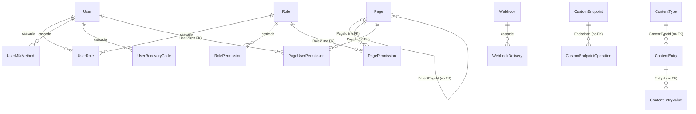

# Database

Tables, relationships, constraints, migrations and seeding. All persistence goes through
`src/DotNetForge.Data/DotNetForgeDbContext.cs`; entity classes are in `src/DotNetForge.Shared/Entities/`. Uploaded
file bytes are **not** in the database - they live in `IFileStorage`, and `MediaFiles` holds the metadata and the
storage key ([media storage](../features/media-storage.md#storage-architecture)).

## Provider

The CMS database is **PostgreSQL** (`DATABASE_CONNECTION_STRING`, required in every environment). SQLite, SQL Server, MySQL and MongoDB can only be additional databases
(`DATABASES_<NAME>_*`) for `IDatabaseService`, custom endpoints and exports - they never hold these tables. How the
database layer works, how it is configured and how to add a provider: [database layer](../database/architecture.md),
[providers](../database/providers.md), [configuration](../database/configuration.md).

At startup `DatabaseInitializer` calls `IDatabaseProvider.InitializeSchemaAsync` - `MigrateAsync` with the migrations
in `Database/Providers/PostgreSql/Migrations/` - then `DataSeeder` ([Seeding](#seeding)).

> **Existing SQLite, SQL Server, MySQL or MongoDB CMS databases** no longer start: the provider is refused at startup
> ([configuration](../database/configuration.md#validation-startup)). The export file is model-driven, so an export
> made on such a database imports into PostgreSQL on [Data Management](../pages/data-management.md) (Development
> only) when its data version and schema match ([rules](../features/transfer-and-updates.md#rules)).
>
> **A PostgreSQL database created by a much earlier build** (via `EnsureCreated`) has no `__EFMigrationsHistory`
> table, so `MigrateAsync` tries to create every table again and startup fails. Recreate the database, or baseline
> it: create the `DataProtectionKeys` table by hand (as in
> `Database/Providers/PostgreSql/Migrations/20261005180055_InitialCreate.cs`), then insert the row
> `('20261005180055_InitialCreate', '<EF Core product version>')` into `__EFMigrationsHistory`.

### Model and context

- **`DotNetForgeDbContext`** holds the whole model (all `DbSet`s and fluent configuration). Not sealed: a protected
  constructor for the subclass, and a public one for tools and tests that only need the model.
- **`PostgreSqlDbContext`** (`Database/Providers/PostgreSql/`) derives from it and owns the migrations (namespace
  `DotNetForge.Data.Database.Providers.PostgreSql.Migrations`). EF Core binds a migration set to a context type.
- **`PostgreSqlDatabaseProvider.AddDbContext` registers it as `DotNetForgeDbContext`**, so application code always
  injects `DotNetForgeDbContext` and never names the subclass.

## Entity relationship diagram



Only the six "cascade" relationships are real foreign keys. `ParentPageId` is a plain column with no FK constraint - integrity is maintained by application code (e.g. `PageService.DeleteAsync` re-parents children).
`PagePermission.PageId` / `RoleId` are plain columns too (`PagesController.Delete` removes a page's grants;
`PagePermissionService` ignores grants of roles that no longer exist). `ContentEntry.ContentTypeId` and
`ContentEntryValue.EntryId` are plain columns as well: `ContentEntryService` and `ContentTypeService` remove an entry's
index rows and a type's entries in the same save, and `CustomEndpointOperation.EndpointId` is one too
(`CustomEndpointService` saves and deletes an endpoint's operations with it). References *inside* entry JSON (media ids, linked entry ids) are not
constrained at all: they are checked on save and a missing one is skipped when rendering
([structured content](../features/structured-content.md)). `AuditLogEntry`, `InstalledExtension`, `SystemState`,
`AuthProvider`, `MediaFile`, `ApiToken`, `Setting` and `DataProtectionKey` are standalone tables. There is one site per
installation: no table is scoped by a tenant or site id (the former `Tenants` table and `TenantId` columns were
removed by the `RemoveTenants` migrations).

## Tables

| Table (`DbSet`) | Key | Important columns | Unique indexes / constraints | Written by |
| --- | --- | --- | --- | --- |
| `Users` | `Guid Id` | `Email`(256), `FirstName`(100), `LastName`(100), `PasswordHash` (empty for an account created through a sign-in provider until it sets a password), `Status`, `EmailConfirmed`, `FailedLoginCount`, `LockoutEndUtc`, `LastLoginDate` | `Email` unique; `DisplayName` is computed, not stored | `InstallationStore`, `AuthService` (counters, last login), `UserManagementService`, `ProfileService` |
| `Roles` | `Guid Id` | `Name`(100), `Description`(500), `IsBuiltIn` | `Name` unique | `DataSeeder`, `RoleManagementService` |
| `RolePermissions` | `Guid Id` | `RoleId`, `Area`(100), `Action`(100) | (`RoleId`, `Area`, `Action`) unique | `DataSeeder`, `RoleManagementService`; read by `RoleGrantStore` |
| `UserRoles` | (`UserId`, `RoleId`) | - | composite PK | `InstallationStore`, `UserManagementService` |
| `UserSessions` | `Guid Id` | `UserId` (no FK: an import replaces the users), `CreatedDate`, `ExpiresDate` | indexes `UserId`, `ExpiresDate` | `UserSessionService`; not transferred ([sessions](../features/authentication.md#sessions)) |
| `Pages` | `Guid Id` | `Slug`(200), `Title`(300), `MetaTitle`, `MetaDescription`, `SeoKeywords`, `CanonicalUrl`, `Published`, `Disabled`, `DisplayInMenu`, `ParentPageId`, `SortOrder`, `PageType`, `TargetUrl`, `FileReference`, `ScheduledPublishDate`, `ScheduledUnpublishDate`, `NoIndex`, `SocialImageUrl`(2000), `ThemeId`(100), `ThemeForChildren`, `LayoutJson` / `DraftLayoutJson` (unbounded text: `text` / `nvarchar(max)` / `longtext`), `DraftVersion`, `DraftUpdatedDate`, `DraftUpdatedById`, `LayoutPublishedDate`, `CreatedById`, dates | (`ParentPageId`, `Slug`) unique | `PagesController` and `ContentApiController` through `IPageService`, `PageBuilderService` (layout columns), `ScheduledPublishingService`, `DataSeeder` |
| `PagePermissions` | `Guid Id` | `PageId`, `RoleId`, `Permission`(20: `view` / `edit`) | (`PageId`, `RoleId`, `Permission`) unique | `PagePermissionService` ([page permissions](../features/content-pages-and-routing.md#page-permissions)) |
| `PageUserPermissions` | `Guid Id` | `PageId`, `UserId`, `Permission`(20), `Allow` (false = blocked) | (`PageId`, `UserId`, `Permission`) unique | `PagePermissionService`; removed by `UserManagementService.DeleteAsync` with the user |
| `MediaFiles` | `Guid Id` | `FileName`(400, sanitized display name ≤ 200), `OriginalName`(400), `ContentType`(200, from the extension), `SizeBytes` (the stored object), `OriginalSizeBytes`? (the size as uploaded when optimization stored a smaller version), `Optimization` (`MediaOptimization`: `None`, `Optimized`, `Pending`, `Processing`, `Failed`), `OptimizationStartedDate`? (when the video compression claimed it), `RelativePath`(1000, the `IFileStorage` key `{yyyy}/{MM}/{guid:N}{ext}`; older uploads keep their earlier keys), `FolderId`? (the `MediaFolders` row; null = top level), `IsPublic`, `UploadedById`, `UploadedDate` | `FolderId`, `Optimization` | `MediaService` (upload adds, delete removes), `MediaFolderService` (moves), `VideoOptimizationService` (compression state, key and sizes - [optimization](../features/media-storage.md#optimization)) |
| `MediaFolders` | `Guid Id` | `Name`(100), `ParentId`?, `Path`(1000, "/Photos/2026"), `CreatedById`?, `CreatedDate` | `Path` unique, `ParentId` | `MediaFolderService` - virtual library folders ([media → folders](../pages/media.md#folders)) |
| `ApiTokens` | `Guid Id` | `Name`(200), `Description`(1000), `Duration`, `ExpirationDate`, `PermissionsCsv`, `CreatedById`, `CreatedDate`, `LastUsedDate`, `Revoked`, `TokenHash`, `TokenPrefix`(64) | `Name` unique; index on `TokenPrefix`; `Permissions` computed from CSV | `ApiTokensController`, `ApiTokenAuthenticationHandler` (`LastUsedDate`, at most every 5 min) |
| `Webhooks` | `Guid Id` | `Name`(200), `Url`(2000), `HeadersJson`(4000, `[{"key","value"}]`), `EventsCsv`(1000), `Enabled`, `Secret` (unbounded, protected with Data Protection), `CreatedDate`, `LastDelivery` | - (names unique case-insensitively, checked by `WebhookService`); `Events` computed from CSV | `WebhookService` (Webhooks screen); `LastDelivery` also by `WebhookDispatcher` ([webhooks](../features/webhooks.md)) |
| `WebhookDeliveries` | `Guid Id` | `WebhookId` (FK, cascade), `EventId` (same for every attempt of one event), `Event`(100), `TargetUrl`(2000), `RequestTimestamp`, `NextAttemptDate`? (when a `Pending` attempt is due; also its lease while sending), `RequestBody`(65536), `ResponseStatusCode`?, `ResponseTimeMs`?, `ResponseBody`(4000)?, `AttemptNumber`, `Outcome` (`WebhookOutcome`), `Detail`(4000)? | indexes `WebhookId`, (`Outcome`, `NextAttemptDate`) | `WebhookDispatcher` (one row per attempt; finished rows older than 30 days pruned hourly), `WebhookService` (test deliveries, cancelling pending attempts on disable) |
| `AuditLogs` | `long Id` (auto-increment) | `UserId` (null for API-token actions), `UserDisplaySnapshot`(256), `Action`(100), `EntityType`, `EntityId`(100), `EntityDisplaySnapshot`(400), `IpAddress`, `UserAgent`(512), `Timestamp`, `Details`, `Success` | indexes on `Timestamp` and `Action` | `AuditService` (`IAuditService`) only (append-only; snapshots truncated to the column lengths) |
| `InstalledExtensions` | `string Id` (manifest id, 200) | `Name`, `Description`, `Version`, `Type`, `Author`, `Status`, `InstalledDate`, `UpdateAvailable`, `PermissionsCsv`, `Website`, `License` | - | `ExtensionLifecycleService` (upsert on enable from the manifest, `InstalledDate` on first enable; `Status` on disable; `UpdateAvailable` never); read by `ExtensionState` (enabled ids, cached 30 s), `PluginsController`, `DashboardController`, `GET /api/extensions` |
| `SystemState` | `int Id` (always 1) | `Installed`, `InstalledAtUtc`, `CmsVersion` (default `"1.0.0"`), `SeedVersion` (one-time data updates applied, [Seeding](#seeding)) | single row | `DataSeeder`, `InstallationStore` |
| `ContentTypes` | `Guid Id` | `Name`(100), `Slug`(64, the API id), `Description`(500), `Icon`(40), `Kind` (`ContentTypeKind`), `FieldsJson` (unbounded, the field definitions), `TitleField`(64), `Drafts`, `SortOrder`, `CreatedById`, dates | `Slug` unique | `ContentTypeService` |
| `ContentEntries` | `Guid Id` | `ContentTypeId`, `Title`(300), `SearchText`(1000, lower-cased), `DataJson` (working copy) / `PublishedDataJson` (published values, null = not published) - unbounded, `Published`, `HasDraft`, `PublishedDate`, `PublishedById`, `SortOrder`, `Version`, `CreatedById`, `UpdatedById`, dates | index (`ContentTypeId`, `SortOrder`) | `ContentEntryService` |
| `ContentEntryValues` | `Guid Id` | `ContentTypeId`, `EntryId`, `Published` (which version), `Field`(100), `Text`(200, lower-cased), `Number` (double), `Date` | indexes (`ContentTypeId`, `Published`, `Field`, `Text`), (`ContentTypeId`, `Published`, `Field`, `Number`), (`EntryId`) | `ContentEntryService` (rewritten on every save, publish and type change); read by `ContentQueryService` ([querying](../features/structured-content.md#querying)) |
| `CustomEndpoints` | `Guid Id` | `Name`(100), `Path`(200, the base path), `Description`(500), `Access` (`EndpointAccess`), `TokenProtected` (unbounded, nullable: the endpoint's own token encrypted with Data Protection), `Enabled`, `Database`(64, nullable: the additional database its SQL runs on, lower case; null = the CMS database), `CreatedById`, dates | index on `Path` (not unique: `CustomEndpointService` refuses a second endpoint with the same base path) | `CustomEndpointService` ([custom endpoints](../features/custom-endpoints.md)) |
| `EmailLog` | `Guid Id` | `SentAt`, `Recipient`(320), `Subject`(500), `Template`(100)?, `Success`, `Error`(300)? | `SentAt` | `LoggingEmailSender` - one row per send attempt, kept 30 days ([Email Configuration](../pages/email-configuration.md#email-log)) |
| `EmailTemplates` | `Guid Id` | `Key`(100), `Subject`(500), `Body` (unbounded; the service caps it at 20 000), `UpdatedDate`, `UpdatedById` | `Key` unique | `EmailTemplateService` - a row only while a template is customized ([email templates](../pages/email-templates.md)) |
| `CustomEndpointOperations` | `Guid Id` | `EndpointId`, `Name`(100, nullable), `Method`(10), `Path`(200, the sub-path; empty = the endpoint's path), `Sql` and `ParametersJson` (unbounded), `Result` (`EndpointResultShape`), `TimeoutSeconds`, `MaxRows`, `SortOrder` | (`EndpointId`, `Method`, `Path`) unique; one method + path shape across all endpoints is checked by `CustomEndpointService` | `CustomEndpointService` (saved and deleted with the endpoint); run by `SqlEndpointRunner` |
| `Settings` | `Guid Id` | `Key`(200), `Value`(4000) | `Key` unique (one value per key) | `SettingsController`; screens with their own rows: `UserAccountSettingsService` (`users.*`), `DatabaseTransferService` (`transfer.backup.*`), `MediaSettingsService` (`media.*`, [Media Library settings](../pages/media-settings.md)), `MfaSettingsService` (`mfa.*`, [Two-factor authentication](../pages/mfa.md)) |
| `TransferRecords` | `Guid Id` | `Operation`, `Status` (enums), `Provider`(50), `SourceProvider`(50)?, `FileName`(260), `StorageKey`(500)?, `SizeBytes`, `RecordCount`, `Checksum`(64)?, `Automatic`, `Note`(200)?, `Error`(2000)?, `StartedAt`, `CompletedAt`?, `InitiatedById`? | `StartedAt` | `DatabaseTransferService` - one row per export, backup, import or restore; `MediaExportService` - one per media export (`TransferOperation.MediaExport` = 4); never exported or replaced by an import ([Data Management](../pages/data-management.md)) |
| `AuthProviders` | `Guid Id` | `Key`(50, `AuthProviderKeys`: `email`, `google`, ...), `Name`(100), `Enabled`, `IsBuiltIn` (Email), `SettingsJson`(8000: `ProviderSettings` JSON, client secret and Apple key protected with Data Protection), `UpdatedDate` (moves on every save; other instances reload the sign-in schemes when it does) | `Key` unique, `Name` unique | `DataSeeder` (one row per provider), `AuthProviderService` (Providers screen); read by `OAuthProviderRegistry` ([authentication → providers](../features/authentication.md#providers)) |
| `UserMfaMethods` | `Guid Id` | `UserId` (FK, cascade), `Type` (`MfaMethodType`: 1 authenticator app, 2 email, 3 SMS, 4 passkey), `Name`(100), `Secret`(1000, TOTP secret protected with Data Protection), `PhoneNumber`(20, E.164), `CredentialId`(bytea, 1024) and `PublicKey`(bytea, 2048) of a passkey, `Counter` (last TOTP step / passkey signature counter), `CreatedDate`, `LastUsedDate` | indexes `UserId`, `CredentialId` (uniqueness of a credential checked by `MfaService`) | `MfaService` ([MFA](../features/mfa.md)) |
| `UserRecoveryCodes` | `Guid Id` | `UserId` (FK, cascade), `CodeHash`(64, SHA-256 hex), `CreatedDate`, `UsedDate` | index `UserId` | `MfaService` ([recovery codes](../features/mfa.md#recovery-codes)) |
| `DataProtectionKeys` | `int Id` (auto-increment) | `FriendlyName`, `Xml` | - | ASP.NET Core Data Protection (`PersistKeysToDbContext<DotNetForgeDbContext>`) |

Enums are stored as integers (`UserStatus`, `PageType`, `TokenDuration`, `ExtensionType`, `ExtensionStatus`,
 `WebhookOutcome`, `ContentTypeKind`, `TransferOperation`, `MediaOptimization`, `MfaMethodType` - values in `src/DotNetForge.Shared/Enums/Enums.cs`). CSV columns (`PermissionsCsv`,
`EventsCsv`) are split by computed properties ignored by EF (`ApiToken.Permissions`, `Webhook.Events`).

`DataProtectionKeys` holds the key ring for the auth cookie, antiforgery tokens, TempData, the custom endpoint
tokens (`CustomEndpoints.TokenProtected`), the sign-in providers' secrets (`AuthProviders.SettingsJson`), the
authenticator-app secrets (`UserMfaMethods.Secret`) and the webhook signing secrets (`Webhooks.Secret`), so every instance shares it and sessions survive restarts on a read-only
filesystem. The key XML is stored **unencrypted**: anyone who can read this table can forge cookies and decrypt the
endpoint tokens. Deleting the rows signs everyone out and makes every endpoint token unreadable (callers get `401`
until each endpoint gets a new token with **Generate token**), and likewise makes provider secrets (re-enter them on
[Providers](../pages/providers.md)), authenticator apps (set up again) and webhook secrets (deliveries fail with "Not
sent" until the secret is rotated on [Webhooks](../pages/webhooks.md)) unusable.

### Column lengths

PostgreSQL enforces `HasMaxLength` (`character varying(n)`). Input is therefore checked before
saving so an oversized value is a validation message, not a 500: `PageService` (Title 300, Slug 200, Meta title 300,
Meta description 1000, Keywords 500, Canonical/Target URL/File reference 2000), `SettingsController` (key 200, value
4000), `ApiTokensController` (name 200, description 1000), `InstallationService` (email 256, names 100),
`ContentTypeService` (name 100, API id 64, description 500), `CustomEndpointService` (endpoint name 100, path 200,
description 500; operation name 100, full path 200); `EntryData` cuts entry titles (300), search text (1000)
and index text (200); and `AuditService` truncates its snapshots.

### Unique indexes and NULL

The unique index (`ParentPageId`, `Slug`) on `Pages` includes a nullable column. PostgreSQL treats NULLs as distinct,
so the index allows two root pages (`ParentPageId` NULL) with the same slug. So `PageService` checks slug
uniqueness in code, including the root level, in:
- `ApplyAsync` (Pages screen edits and `POST /api/content/pages`);
- `ReorderAsync`;
- `DeleteAsync` (children moving up a level).

## Migrations

One set, for `PostgreSqlDbContext`, in `src/DotNetForge.Data/Database/Providers/PostgreSql/Migrations/`, applied
automatically at startup:

| Migration | Adds |
| --- | --- |
| `20261005180055_InitialCreate` | the model of that time in one step: all 16 tables and indexes (incl. `DataProtectionKeys`) |
| `20261023140202_AddPageBuilderAndPermissions` | `Pages.ThemeId`, `NoIndex`, `SocialImageUrl`, `LayoutJson`, `DraftLayoutJson`, `DraftVersion`, `DraftUpdatedDate`, `DraftUpdatedById`, `LayoutPublishedDate`; table `PagePermissions` |
| `20261023144957_AddPageUserPermissions` | table `PageUserPermissions` |
| `20261026110549_AddStructuredContent` | tables `ContentTypes`, `ContentEntries`, `ContentEntryValues`; `SystemState.SeedVersion` |
| `20261026130447_AddCustomEndpoints` | table `CustomEndpoints` |
| `20261026145804_RemoveTenants` | removes table `Tenants` and every `TenantId` column; unique indexes without `TenantId` (`Users.Email`, `Roles.Name`, `Pages` (`ParentPageId`, `Slug`), `ApiTokens.Name`, `ContentTypes.Slug`, `CustomEndpoints` (`Method`, `Path`), `Settings.Key`), `AuditLogs` index on `Action`. Before `Settings.Key` becomes unique it deletes a global setting (no tenant) whose key a tenant setting also has - the tenant's value wins |
| `20261026152316_AddEndpointTokens` | `CustomEndpoints.TokenProtected` (existing endpoints get a token on their next save or with **Generate token**) |
| `20261026155553_AddEndpointOperations` | table `CustomEndpointOperations`; copies every endpoint into one operation (`INSERT … SELECT`: the endpoint's id as both `Id` and `EndpointId`, `Path` `''`, `Name` NULL, its `Method`, `Sql`, `ParametersJson`, `Result`, `TimeoutSeconds`, `MaxRows`, `SortOrder` 0), then drops those columns and the unique index (`Method`, `Path`) from `CustomEndpoints`; new indexes `CustomEndpoints.Path` and (`EndpointId`, `Method`, `Path`) unique. `Down` restores the columns empty - the operations are not copied back |
| `20261026164300_AddPageThemeForChildren` | `Pages.ThemeForChildren` (bool, not null, default `false`: existing pages hand no theme down) |
| `20261027092545_AddEmailTemplates` | table `EmailTemplates` with a unique index on `Key` |
| `20261027124505_AddTransferRecords` | table `TransferRecords` with an index on `StartedAt` |
| `20261027135904_AddEndpointDatabase` | `CustomEndpoints.Database` (`character varying(64)`, nullable) |
| `20261027145210_AddEmailLog` | table `EmailLog` with an index on `SentAt` |
| `20261027153504_AddMediaFolders` | table `MediaFolders` (unique `Path`, index `ParentId`); `MediaFiles.FolderPath` dropped, `MediaFiles.FolderId` added (index) |
| `20261028111036_AddMediaOptimization` | `MediaFiles.Optimization` (integer, not null, default 0 = `None`: existing files count as stored as uploaded), `MediaFiles.OptimizationStartedDate` (nullable), `MediaFiles.OriginalSizeBytes` (bigint, nullable); index `IX_MediaFiles_Optimization` |
| `20261028135245_AddSignInProvidersAndMfa` | `AuthProviders.Key` (`character varying(50)`, unique index) and `UpdatedDate`; `AuthProviders.SettingsJson` 4000 → 8000; tables `UserMfaMethods` and `UserRecoveryCodes` (FKs to `Users`, cascade). Existing rows get their key from the name before the unique index (`Twitter/X` → `x`, otherwise the name lower-cased without non-alphanumerics: `GitHub` → `github`); `DataSeeder` then adds the missing providers and removes the never-configured old ones |
| `20261029092426_AddWebhookDelivery` | `WebhookDeliveries.EventId` (uuid, not null, default empty GUID for existing rows), `NextAttemptDate` (nullable), `RequestBody` (`character varying(65536)`), `ResponseBody` (`character varying(4000)`); index `IX_WebhookDeliveries_Outcome_NextAttemptDate` |
| `20261030133232_AddUserSessions` | table `UserSessions` with indexes on `UserId` and `ExpiresDate`. Cookies from before it have no session, so everyone signs in once |

**Every schema change needs one migration** for `PostgreSqlDbContext`. Use the
[database-change skill](../../.claude/skills/database-change/SKILL.md) or, from the repository root:

```bash
dotnet tool restore
dotnet ef migrations add <Name> --project src/DotNetForge.Data --startup-project src/DotNetForge.Data --context PostgreSqlDbContext --output-dir Database/Providers/PostgreSql/Migrations
```

After generating:

- **Strip the UTF-8 BOM** EF writes into the new files; `.editorconfig` sets `charset = utf-8` (no BOM).
- **Check the snapshot.** There must be one `PostgreSqlDbContextModelSnapshot.cs` in the folder.
  - Don't pass `--namespace`: EF derives the snapshot's folder from it and writes it elsewhere.
  - `dotnet ef migrations has-pending-model-changes --project src/DotNetForge.Data --startup-project src/DotNetForge.Data --context PostgreSqlDbContext`
    must report no changes afterwards.
- **Read the generated SQL:** indexed text columns need a `HasMaxLength`; check column types and the values existing
  rows get.
- **The design-time factory never connects** (`PostgreSqlDesignTimeDbContextFactory` in
  `src/DotNetForge.Data/DesignTimeDbContextFactory.cs`). It reads `DATABASE_CONNECTION_STRING` from the process
  environment, otherwise it uses a placeholder.

## Seeding

`DataSeeder.SeedAsync` runs after migration on every start. Each step is skipped when its data already exists:

| Step | Condition to run | Creates |
| --- | --- | --- |
| Built-in roles | per role name missing | the seven roles (`IsBuiltIn = true`; a database seeded before `Developer` existed gets it on the next start) with `RolePermission` rows from `PermissionMatrix.GrantsFor(role)` |
| Starter pages | no pages | `Home` (`/`, published), `About` (`about`, published), `News` (`news`, published), `Contact` (`contact`, not published), and under About: `Team` (`team`, published), `History` (`history`, not published) |
| Auth providers (`SeedAuthProvidersAsync`) | **every start** | one row per `AuthProviderKeys` key that is missing: `email` (Email, enabled, built-in) and the ten OAuth providers `google`, `microsoft`, `apple`, `facebook`, `github`, `linkedin`, `x`, `discord`, `gitlab`, `twitch` (disabled); renames a row whose name differs from the catalog; removes rows whose key is not in the catalog while they are disabled and their `SettingsJson` is empty or `{}` (the Auth0, CAS, Cognito, Instagram, Keycloak, Patreon, Reddit and VK rows of earlier versions) - a configured one is kept ([authentication → providers](../features/authentication.md#providers)) |
| System state | no row | `SystemState { Id = 1, Installed = false }` |
| One-time updates (`UpgradeAsync`) | `SystemState.SeedVersion < DataSeeder.CurrentSeedVersion` | each missing step once, then `SeedVersion = CurrentSeedVersion`. Step 1: built-in roles with no grant in `Content types` / `Entries` get the matrix defaults of those areas ([authorization](../features/authorization.md#permission-matrix-default-grants)). Step 2: every existing user gets `EmailConfirmed = true`, so turning on email confirmation never locks out accounts that predate it ([authentication](../features/authentication.md#self-service-accounts)) |

Deleting all pages therefore re-creates the starter tree on the next restart. Seeded pages have no `CreatedById`, so
Authors (who may only edit their own pages) cannot edit them. Nothing seeds `Settings`, `MediaFiles`, `Webhooks`,
`ApiTokens`, `InstalledExtensions`, `DataProtectionKeys`, `UserMfaMethods`, `UserRecoveryCodes` or the content tables (content types come from templates on
the [Content types](../pages/content-types.md) screen).

## Delete behaviour

| Action | Effect |
| --- | --- |
| Delete a content page (`PageService.DeleteAsync`) | children are re-parented to the deleted page's parent, then the page is removed; refused when that would create a duplicate slug or a second dynamic segment under the parent |
| Delete a media file (`MediaService.DeleteAsync`) | the `MediaFiles` row is removed first, then the stored object; a failed object delete leaves an orphaned object (logged as a warning) |
| Delete a role / user | `RoleManagementService` / `UserManagementService` remove `RolePermissions` / `UserRoles` first; a role still held by users can't be deleted; a user's `UserMfaMethods` and `UserRecoveryCodes` go with the user (cascade) |
| Delete a content page | `PagesController.Delete` removes its `PagePermissions` and `PageUserPermissions` before `PageService.DeleteAsync` |
| Delete an entry / several | `ContentEntryService.DeleteAsync` / `DeleteManyAsync` remove the entries' `ContentEntryValues` with them; entries that linked to it keep the id (skipped when rendering) |
| Delete a custom endpoint | `CustomEndpointService.DeleteAsync` removes its `CustomEndpointOperations` in the same save |
| Delete a content type | `ContentTypeService.DeleteAsync`: refused while another type links to it; its entries and index rows go in the same save (a collection with entries only with explicit confirmation) |
| Revoke an API token | soft: `Revoked = true`, row kept |
| Delete a webhook | `WebhookService.DeleteAsync`: its `WebhookDeliveries` go with it (cascade), pending attempts included |
| Audit entries | never updated or deleted by the application |

## Rules

- Query through `DotNetForgeDbContext`; no raw SQL (custom API endpoints are the one deliberate exception). Never
  inject or name `PostgreSqlDbContext`.
- The CMS database is always PostgreSQL, so queries no longer need to avoid joins and navigations; the existing code
  combines small single-table queries in memory, which keeps working.
- Use `AsNoTracking()` + `Select` projection for reads that render a screen or API response.
- Validate lengths before saving (PostgreSQL enforces them).
- Schema changes: change the entity + `OnModelCreating`, add **one** migration for `PostgreSqlDbContext`, and keep
  `DataSeeder` idempotent.
