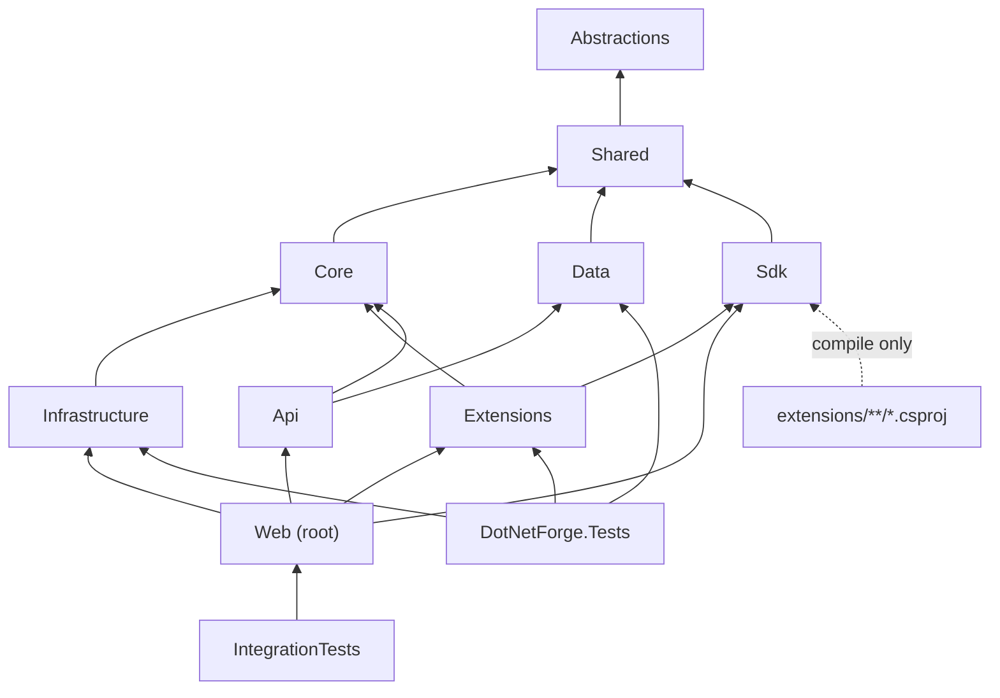

# Dependencies

Project references, NuGet packages and DI registrations - what depends on what, and which dependencies must not be
introduced. Layer responsibilities are in [codebase.md](codebase.md).

## Project references

| Project | References | Must never reference |
| --- | --- | --- |
| `DotNetForge.Abstractions` | - | anything |
| `DotNetForge.Shared` | Abstractions | Core, Data, Infrastructure, Api, EF Core |
| `DotNetForge.Core` | Abstractions, Shared | Data, Infrastructure, EF Core, ASP.NET Core |
| `DotNetForge.Data` | Abstractions, Shared (+ EF Core packages, `Microsoft.AspNetCore.DataProtection.EntityFrameworkCore`) | Core, Infrastructure, Api |
| `DotNetForge.Infrastructure` | Abstractions, Shared, Core (+ `AWSSDK.S3`) | Data, Api |
| `DotNetForge.Sdk` | Abstractions, Shared; `FrameworkReference Microsoft.AspNetCore.App` | Core, Data, Infrastructure, Extensions, Api, the web host (extensions compile against it - keep it small) |
| `DotNetForge.Extensions` | Abstractions, Shared, Core, Sdk | Data, Api |
| `DotNetForge.Api` | Abstractions, Shared, Core, Data; `FrameworkReference Microsoft.AspNetCore.App` | the web host |
| `DotNetForge.PageBuilder` | nothing in the solution (+ `Newtonsoft.Json`); embeds `src/DotNetForge.Web/wwwroot/builder/schema/*.json` and `base.css` | everything else - pure document logic ([page builder](../features/page-builder.md)) |
| `DotNetForge.Web` (root) | all nine `src/` projects | test projects, extension projects |
| `DotNetForge.Tests` | Abstractions, Shared, Core, Data, Infrastructure, Extensions, PageBuilder | Web, Api |
| `DotNetForge.IntegrationTests` | `src/DotNetForge.Web/DotNetForge.Web.csproj`; build-only (`ReferenceOutputAssembly="false"`): `tests/fixtures/extensions/test-kit`, the `markdown-kit`, `contact-form` and `seo-toolkit` samples | - |
| Extension projects (`extensions/**/*.csproj`) | Sdk, Abstractions, Shared via `extensions/Directory.Build.props` (`Private="false"`: never copied into `bin/`); other extensions with `Private="false"` (Contact Form → Markdown Kit); their own NuGet packages with explicit versions (central package management is off for them) | `src/` projects other than those three; the host loads them, nothing references them |

(Transitive edges omitted.) Why the unusual edges exist:

- **`Core` ⟂ `Data`** - kept as siblings so domain logic stays testable without EF Core. Bridge them with an
  interface in `Shared/Stores` implemented in `Data` (`IInstallationStore`).
- **`Api` → `Data`** - pragmatic shortcut (comment in `DotNetForge.Api.csproj`): API controllers query the
  DbContext directly. Don't add a repository layer just to remove it.
- **`Api` ⟂ Web host** - the API uses host services through contracts in `Shared` (`IPageService`,
  `IAuditService`) that the host registers; it never references the host project.
- **`PermissionMatrix` in `Shared`** - so `Data` (seeder) and `Core` (`PermissionService`) share it without `Data`
  depending on `Core`.
- **Extensions → `Sdk` only, never copied** - at runtime `ExtensionLoadContext` resolves every assembly the host ships
  from the host first, so `IExtension`, `IFileStorage`, `IAuditService` etc. are the same types on both sides. A
  package an extension shares with the host (the S3 sample's `AWSSDK.S3`, `ExcludeAssets="runtime"`) uses the host's
  copy too.

## NuGet packages

All versions are pinned centrally in `Directory.Packages.props` (`ManagePackageVersionsCentrally`,
`CentralPackageTransitivePinningEnabled`). `.csproj` files reference packages **without** a version.

| Package | Version | Referenced by | Purpose |
| --- | --- | --- | --- |
| `Microsoft.EntityFrameworkCore` | 10.0.12 | Data | ORM |
| `Microsoft.EntityFrameworkCore.Relational` | 10.0.12 | Data | relational APIs (transactions, migrations) |
| `Microsoft.EntityFrameworkCore.Sqlite` | 10.0.12 | Data | default provider |
| `Npgsql.EntityFrameworkCore.PostgreSQL` | 10.0.3 | Data | PostgreSQL provider |
| `Microsoft.EntityFrameworkCore.SqlServer` | 10.0.12 | Data | SQL Server provider (needs ICU: `InvariantGlobalization=false`) |
| `MySql.EntityFrameworkCore` | 10.0.9 | Data | MySQL provider (Oracle; Pomelo has no EF Core 10 release) |
| `MongoDB.EntityFrameworkCore` | `[10.0.4]` (pinned) | Data | MongoDB provider; brings `MongoDB.Driver`, used natively by `MongoExecutor` |
| `Microsoft.EntityFrameworkCore.Design` | 10.0.12 | Data only, `PrivateAssets="all"` | `dotnet ef` design-time support; does not flow into the web host or the publish output |
| `Microsoft.AspNetCore.DataProtection.EntityFrameworkCore` | 10.0.12 | Data | `IDataProtectionKeyContext`, `PersistKeysToDbContext` - Data Protection key ring in the database |
| `AWSSDK.S3` | 4.0.104.1 | Infrastructure (also the S3 connector sample, compile-only) | `S3FileStorage` (any S3-compatible service, presigned URLs) |
| `Newtonsoft.Json` | 13.0.4 | PageBuilder (also transitively by `Microsoft.EntityFrameworkCore.Design`) | the page builder document model (`JToken`) - kept from the ported code, whose number formatting and key order must match the JavaScript renderer byte for byte |
| `Microsoft.AspNetCore.Mvc.Razor.RuntimeCompilation` | 10.0.12 | Web | compiles extension views from `extensions/` at runtime, in memory |
| `System.Security.Cryptography.Pkcs` / `.Xml` | 10.0.13 | none directly - transitive pins (`CentralPackageTransitivePinningEnabled`) | security fix: Pkcs comes from `Microsoft.Data.SqlClient` (SQL Server provider), Xml from `Microsoft.AspNetCore.DataProtection`; their 10.0.12 / 9.0.11 versions are affected by NU1902/NU1903 advisories (GHSA-846f-f764-76mx, GHSA-2fmv-rv2c-59x7, GHSA-r955-8q5j-3h83, GHSA-7hqp-7c5m-4vq6, GHSA-c399-9853-6jmj) |
| `Microsoft.NET.Test.Sdk` | 17.12.0 | tests | test host |
| `xunit` / `xunit.runner.visualstudio` | 2.9.2 / 2.8.2 | tests | test framework |
| `Microsoft.AspNetCore.Mvc.Testing` | 10.0.12 | IntegrationTests | `WebApplicationFactory<Program>` |

Local tool: `dotnet-ef` 10.0.12 (`.config/dotnet-tools.json`; `dotnet tool restore`).

The former **NU1903** advisory (transitive `SQLitePCLRaw.lib.e_sqlite3` 2.1.11) is resolved: the 10.0.12 EF Core
packages pull SQLitePCLRaw 2.1.12.

Rate limiting (`AddRateLimiter`), Data Protection, `IMemoryCache` and forwarded headers come from the shared
framework (`Microsoft.AspNetCore.App`) - no packages.

There are no frontend packages: no `package.json`, no ESLint config. The page builder's JavaScript
(`wwwroot/js/builder/`) is plain ES modules, served as files - no bundler; its conformance test
(`tests/js/page-builder-fixtures.mjs`) needs only Node. Extension projects do not use
`Directory.Packages.props` (`extensions/Directory.Build.props` turns central package management off for them).

**Rule:** don't add a package for something the BCL or ASP.NET Core already does. Cryptography, `.env` parsing,
hashing and signing are deliberately in-house; `AWSSDK.S3` is the exception, for S3 request signing.

## DI registrations

All in `src/DotNetForge.Web/Startup/DependencyRegistration.AddDotNetForge(env, hostEnv)`; the extension host part is
`AddExtensionHost`, which also runs each loaded extension's `IExtension.ConfigureServices` on the same
`IServiceCollection`.

| Service | Implementation | Lifetime | Injected by |
| --- | --- | --- | --- |
| `AppEnvironment` | instance from `EnvConfigurationLoader` | singleton | `AccountController`, `SetupController`, `HomeController`, `DashboardController`, `SettingsController` |
| `IMemoryCache` | `AddMemoryCache()` | singleton | cookie session check (`ValidateSessionAsync`, key `dnf:session:{userId}`), `ApiTokenAuthenticationHandler` (key `dnf:apitoken:{sha256}`) |
| `DotNetForgeDbContext` | `AddDbContext<DotNetForgeDbContext, TContext>` by the main database's provider (`IDatabaseProvider.AddDbContext`; `TContext` = the provider's context type) | scoped | almost every controller, all API controllers, `MediaFilesController`, `AuthService`, `AuditService`, `PageService`, `MediaService`, `InstallationStore`, `ApiTokenAuthenticationHandler`, the Data Protection key repository, admin extension views (`@inject`) |
| `DatabaseProviderRegistry`, `DatabaseCatalog` | `AddDotNetForgeDatabases` (built during registration from `AddDatabaseProvider<T>(name)` calls) | singleton | `QueryRouter`, `Program.cs` (schema initialization) |
| `QueryRouter` | `AddDotNetForgeDatabases` | singleton | `DatabaseService` |
| `IDatabaseService` → `DatabaseService` | `AddDotNetForgeDatabases` | singleton | not used by CMS code yet; for extensions and tooling ([database layer](../database/architecture.md)) |
| Data Protection | `AddDataProtection().SetApplicationName("DotNetForge").PersistKeysToDbContext<DotNetForgeDbContext>()` | framework | auth cookie, antiforgery, TempData |
| keyed `IFileStorage` `"core"` (`ExtensionMediaStorage.CoreStorageKey`) | `S3FileStorage(env.Storage)`; `LocalFileStorage(env.Storage.LocalPath)` only in Development without `STORAGE_S3_*` | keyed singleton (factory) | `ExtensionMediaStorage`; replaced by `DotNetForgeWebFactory` in tests |
| `IFileStorage` | `ExtensionMediaStorage` (core storage + every `MediaStorageContribution`) | singleton (factory) | `MediaService`, `MediaFilesController`, extensions (Contact Form) |
| `IPasswordHasher` | `Pbkdf2PasswordHasher` | singleton | `AuthService`, `InstallationService`, `UserManagementService` |
| `IDateTimeProvider` | `SystemClock` | singleton | `AuthService`, `ApiTokensController`, `ApiTokenAuthenticationHandler` |
| `IApiTokenFactory` | `ApiTokenFactory` | singleton | `ApiTokensController`, `ApiTokenAuthenticationHandler` |
| `PageBuilderService` | self (`src/DotNetForge.Web/Services/`) | scoped | `PageBuilderController` (static render/CSS helpers also used by `PageLayoutViewComponent`, `PageCssController`, `ContentController`) |
| `PagePermissionService` | self | scoped | `ContentController`, `HomeController`, `AdminControllerBase.CanEditPageAsync` |
| `ProfileService` | self | scoped | `ProfileController` |
| `IPermissionService` | `PermissionService(IRoleGrantStore)` (factory) | singleton | `AdminControllerBase.Can` / `CanModify` (resolved from `RequestServices`), `PermissionAuthorizationHandler` |
| `IRoleGrantStore` | `RoleGrantStore` (`src/DotNetForge.Data`; per-tenant cache, 30 s) | singleton | `PermissionService`, `RoleManagementService` (invalidate), `UsersController` (effective permissions) |
| `IAuthorizationPolicyProvider` | `PermissionPolicyProvider` (`permission:{area}:{action}` policies, else the default provider) | singleton | ASP.NET Core authorization, `AdminNavigationService` |
| `IAuthorizationHandler` | `PermissionAuthorizationHandler` | singleton | ASP.NET Core authorization (`[RequirePermission]`) |
| `IManifestValidator` | `ManifestValidator` (instance created in `AddExtensionHost`) | singleton | `ExtensionLoader` |
| `IExtensionLoader` | `ExtensionLoader(validator, env.ExtensionsPath)`, created before the container (code loading needs the scan) | singleton (factory, so the container disposes the watcher) | `ExtensionCatalog`, `PluginsController` |
| `ExtensionRuntime` | `ExtensionRuntime.Load(loader.Discover(), env.Lookup)` at registration time | singleton (instance) | `ExtensionCatalog`, `ExtensionControllerConvention`, `MapDotNetForgeExtensionsAsync` |
| `ExtensionState`, `IExtensionState` (Sdk) | `ExtensionState` (same instance for both) | singleton | `ExtensionCatalog`, `ExtensionLifecycleService`; extensions' own background code |
| `ExtensionCatalog` | `new ExtensionCatalog(loader, runtime, state, env.Lookup)` | singleton | every slot: `ExtensionsController`, `ExtensionViewController`, `ExtensionResourcesController`, `PluginsController`, `AdminNavigationService` (sidebar extension tabs), `ExtensionWidgetsViewComponent`, `ExtensionModulesViewComponent`, `ThemeResolver`, `LoginProviders`, `ExtensionMediaStorage`, `AuditEventDispatcher`, `ExtensionEndpointGateMiddleware` |
| `ExtensionLifecycleService` | self | scoped | `PluginsController` |
| `AdminNavigationService` | self (`src/DotNetForge.Web/Areas/Admin/Navigation/AdminNavigation.cs`) | scoped (builds the sidebar once per request) | `_AdminLayout`, `Dashboard/Index.cshtml` (`@inject`; quick actions via `Allows`) |
| `ExtensionViewRenderer` | self | singleton | `HomeController`, `ExtensionViewController`, widget and module view components |
| `ThemeResolver` | self | scoped | `HomeController` |
| `LoginProviders` | self (every `LoginProviderContribution`) | singleton | `AccountController`, `ExternalLoginController` |
| `AuditEventDispatcher` | self (every `AuditHandlerContribution`), also `AddHostedService` | singleton (hosted) | `AuditService` |
| `IPublishedPages` | `PublishedPageService` | scoped | `HomeController` (theme menu), extensions (SEO Toolkit sitemap) |
| contribution records (`MediaStorageContribution`, `LoginProviderContribution`, `AuditHandlerContribution`) | registered by the SDK helpers in an extension's `ConfigureServices` | singleton | `ExtensionMediaStorage`, `LoginProviders`, `AuditEventDispatcher` |
| an extension's own services | its `ConfigureServices` | as it chooses | the extension, other extensions, extension views (`@inject`) |
| `IInstallationStore` | `InstallationStore` | scoped | `InstallationService`, `InstallationMiddleware`, integration tests |
| `IInstallationService` | `InstallationService` | scoped | `SetupController` |
| `InstallationStatusCache` | self | singleton | `InstallationMiddleware`, `SetupController` |
| `IHttpContextAccessor` | framework | singleton | `AuditService` |
| `AuthService` | self | scoped | `AccountController`, `ExternalLoginController`, `SetupController`, `ValidateSessionAsync` |
| `IAuditService` | `AuditService` | scoped | `AccountController`, `ExternalLoginController`, `SetupController`, `ContentController`, `SettingsController`, `ApiTokensController`, `MediaService`, `UserManagementService`, `RoleManagementService`, `ProfileService`, `PageBuilderService`, `PagePermissionService`, `ContentApiController`, `ExtensionLifecycleService`, extensions (Contact Form) |
| `IPageService` | `PageService` | scoped | `ContentController`, `ContentApiController` |
| `MediaService` | self | scoped | `MediaController` |
| `UserManagementService` | self (`src/DotNetForge.Web/Services/`) | scoped | `UsersController` |
| `RoleManagementService` | self (`src/DotNetForge.Web/Services/`) | scoped | `RolesController` |
| `ScheduledPublishingService` | `AddHostedService` | singleton (hosted) | host |

Not registered (removed): `IEmailSender` (no implementation exists; `FileSystemEmailSender` was deleted) and
`IWebhookSigner` (`HmacWebhookSigner` and its tests are kept for planned webhooks).

Framework services also configured there:

- cookie authentication (`dnf.auth`, 8 h sliding, `HttpOnly`, `SameSite=Lax`, `SecurePolicy` `Always` outside
  Development / `SameAsRequest` in Development, `OnValidatePrincipal = ValidateSessionAsync`), the external cookie
  scheme `ExternalLogin.SignInScheme` (`dnf.external`, 10 min) and the `ApiToken` scheme; extensions add their own
  remote schemes;
- the `AuthorizationPolicies.AdminArea` authorization policy (`RequireRole(Roles.AdminCapable)`);
- `AddRateLimiter` with fixed-window policies `RateLimitPolicies.Credentials` (10/min), `RateLimitPolicies.Api`
  (300/min) and `RateLimitPolicies.Forms` (5/min), partitioned by client IP, `RejectionStatusCode = 429`;
- antiforgery (`HeaderName = "X-CSRF-TOKEN"`);
- MVC controllers + views with the API application part, every loaded extension assembly as an application part
  (`ExtensionAssemblyPart`, controllers tagged by `ExtensionControllerConvention`), and runtime Razor compilation over
  a `PhysicalFileProvider` on the folder that contains `extensions/`, with the extensions' private assemblies as
  `AdditionalReferencePaths`.

`InstallationMiddleware` and `ExtensionEndpointGateMiddleware` receive their dependencies through `InvokeAsync`
parameters (the middleware itself is constructed once). `SecurityHeadersMiddleware` takes `IWebHostEnvironment` in its constructor.

## Dependencies that must not be bypassed

| Instead of ... | Always use ... | Reason |
| --- | --- | --- |
| Hashing or comparing passwords yourself | `IPasswordHasher` | format `pbkdf2-sha256$iterations$salt$hash`, constant-time compare |
| Generating/validating tokens yourself | `IApiTokenFactory` | prefix lookup + salted hash contract used by the auth handler |
| `DateTime.UtcNow` in auth/token logic | `IDateTimeProvider` | testable time (the content code and scheduler still use `DateTime.UtcNow` directly) |
| Writing `AuditLogEntry` rows directly, or injecting `AuditService` | `IAuditService.LogAsync` | captures user or API token, tenant, IP, user agent consistently; truncates snapshots |
| Validating or mutating content pages in a controller, or injecting `PageService` | `IPageService` (`ApplyAsync`, `ReorderAsync`, `DeleteAsync`) | single rule set for the admin and the API |
| `System.IO` on the content root / `wwwroot` for runtime files | `IFileStorage` (via `MediaService` for media) | the deployment directory is read-only; works with S3 and multiple instances |
| Building storage keys from user input | generated keys validated by `StorageKey` | no traversal, no odd object names |
| Role-name checks for content/media actions in a controller | `AdminControllerBase.Can` / `CanModify` | evaluates the permission matrix incl. `.own` actions |
| Reading `.env` / `Environment` in feature code | inject `AppEnvironment` | validated once at startup |
| Scanning `extensions/` | `IExtensionLoader.Discover()` | manifest validation, cached results |
| Deciding whether an extension may contribute (combining discovery, loaded code and enabled state) | `ExtensionCatalog` (`GetActiveAsync`, `FindActiveAsync`, `IsActiveAsync`) | one rule for every slot: valid, first with its id, enabled, code loaded |
| Re-implementing the public "live" rule | `PageVisibility.Live` | one definition of what the public sees |
| Hard-coding sidebar links or per-role link checks in a view | `AdminNavigation.Tree` + `AdminNavigationService` (`AdminNavModel.Allows`) | one tree for sidebar, active state and breadcrumbs; visibility follows the controllers' `[Authorize]` rules |
| `asp-validation-summary`, inline styles, CSS/JS libraries in views | the [design system](design-system.md) (`<form-errors />`, `wwwroot/css/forge`, `ui.js`) | CSP (`style-src 'self'`), one look across screens, no front-end dependencies |
| Replacing `IFileStorage` or adding auth buttons/audit hooks from an extension with plain DI | `AddMediaStorage`, `AddLoginProvider`, `AddAuditEventHandler` (`DotNetForge.Sdk`) | the host can switch the contribution off while the extension is disabled |
| Building your own sign-in principal | `AuthService.ValidateAsync` | lockout, claims shape (`dnf:tenant`, roles) |
| Hard-coding role names / permission keys / audit actions / rate-limit / authorization policy names | `Roles`, `PermissionKeys`, `PermissionAreas`, `PermissionActions`, `AuditActions`, `RateLimitPolicies`, `AuthorizationPolicies` | one source of truth |
