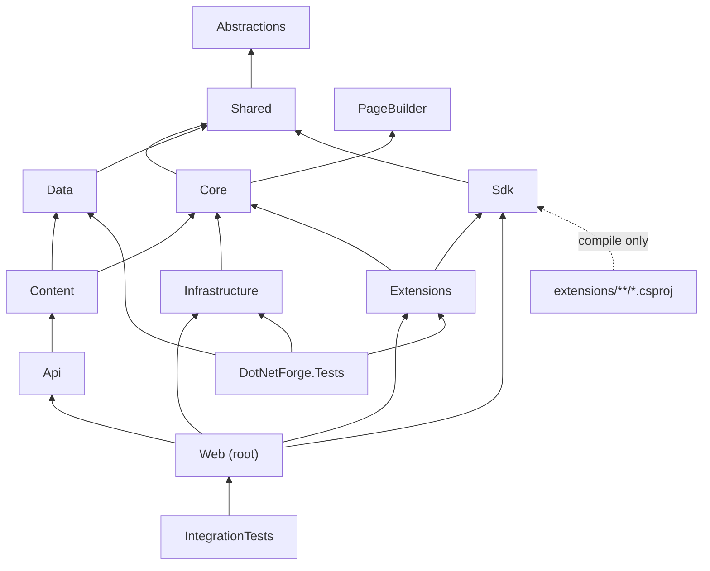

# Dependencies

Project references, NuGet packages and DI registrations - what depends on what, and which dependencies must not be
introduced. Layer responsibilities are in [codebase.md](codebase.md).

## Project references

| Project | References | Must never reference |
| --- | --- | --- |
| `DotNetForge.Abstractions` | - | anything |
| `DotNetForge.Shared` | Abstractions | Core, Data, Infrastructure, Api, EF Core |
| `DotNetForge.Core` | Abstractions, Shared, PageBuilder (rich text of entries, `Core/Content`) | Data, Infrastructure, EF Core, ASP.NET Core |
| `DotNetForge.Content` | Abstractions, Shared, Core, Data | Infrastructure, Api, the web host, ASP.NET Core |
| `DotNetForge.Data` | Abstractions, Shared (+ EF Core packages, `Microsoft.AspNetCore.DataProtection.EntityFrameworkCore`) | Core, Infrastructure, Api |
| `DotNetForge.Infrastructure` | Abstractions, Shared, Core (+ `AWSSDK.S3`) | Data, Api |
| `DotNetForge.Sdk` | Abstractions, Shared; `FrameworkReference Microsoft.AspNetCore.App` | Core, Data, Infrastructure, Extensions, Api, the web host (extensions compile against it - keep it small) |
| `DotNetForge.Extensions` | Abstractions, Shared, Core, Sdk | Data, Api |
| `DotNetForge.Api` | Abstractions, Shared, Core, Data, Content; `FrameworkReference Microsoft.AspNetCore.App` | the web host |
| `DotNetForge.PageBuilder` | nothing in the solution (+ `Newtonsoft.Json`); embeds `src/DotNetForge.Web/wwwroot/builder/schema/*.json` and `base.css` | everything else - pure document logic ([page builder](../features/page-builder.md)) |
| `DotNetForge.Web` (root) | all ten `src/` projects | test projects, extension projects |
| `DotNetForge.Tests` | Abstractions, Shared, Core, Data, Infrastructure, Extensions, PageBuilder, Content | Web, Api |
| `DotNetForge.IntegrationTests` | `src/DotNetForge.Web/DotNetForge.Web.csproj`; build-only (`ReferenceOutputAssembly="false"`): `tests/fixtures/extensions/test-kit`, the `markdown-kit`, `contact-form` and `seo-toolkit` samples | - |
| Extension projects (`extensions/**/*.csproj`) | Sdk, Abstractions, Shared via `extensions/Directory.Build.props` (`Private="false"`: never copied into `bin/`); other extensions with `Private="false"` (Contact Form → Markdown Kit); their own NuGet packages with explicit versions (central package management is off for them) | `src/` projects other than those three; the host loads them, nothing references them |

(Transitive edges omitted.) Why the unusual edges exist:

- **`Core` ⟂ `Data`** - kept as siblings so domain logic stays testable without EF Core. Bridge them with an
  interface in `Shared/Stores` implemented in `Data` (`IInstallationStore`).
- **`Api` → `Data`** - pragmatic shortcut (comment in `DotNetForge.Api.csproj`): API controllers query the
  DbContext directly. Don't add a repository layer just to remove it.
- **`Api` ⟂ Web host** - the API uses host services through contracts in `Shared` (`IPageService`,
  `IAuditService`) that the host registers; it never references the host project.
- **`Content` above `Core` and `Data`** - the structured-content rules need the database and are used by both the
  admin and the API; a library both reference keeps one implementation without the API referencing the host
  ([structured content](../features/structured-content.md)). Pure rules stay in `Core/Content`, testable without a
  database.
- **`Core` → `PageBuilder`** - entries store rich text in the page builder's format and validate it with its
  `RichText` normalizer, so a rich text field renders in a layout unchanged.
- **`PermissionMatrix` in `Shared`** - so `Data` (seeder) and `Core` (`PermissionService`) share it without `Data`
  depending on `Core`.
- **Extensions → `Sdk` only, never copied** - at runtime `ExtensionLoadContext` resolves every assembly the host ships
  from the host first, so `IExtension`, `IFileStorage`, `IAuditService` etc. are the same types on both sides. A
  package an extension shares with the host (the S3 sample's `AWSSDK.S3`, `ExcludeAssets="runtime"`) uses the host's
  copy too.

## NuGet packages

All versions are pinned centrally in `Directory.Packages.props` (`ManagePackageVersionsCentrally`,
`CentralPackageTransitivePinningEnabled`). `.csproj` files reference packages **without** a version.

| Package | Version | Referenced by | Purpose |
| --- | --- | --- | --- |
| `Microsoft.EntityFrameworkCore` | 10.0.12 | Data | ORM |
| `Microsoft.EntityFrameworkCore.Relational` | 10.0.12 | Data | relational APIs (transactions, migrations) |
| `Npgsql.EntityFrameworkCore.PostgreSQL` | 10.0.3 | Data | PostgreSQL provider - the CMS database (and PostgreSQL additional databases) |
| `Microsoft.EntityFrameworkCore.Sqlite` | 10.0.12 | Data | SQLite additional databases (brings `Microsoft.Data.Sqlite`) |
| `Microsoft.EntityFrameworkCore.SqlServer` | 10.0.12 | Data | SQL Server additional databases (brings `Microsoft.Data.SqlClient`; needs ICU: `InvariantGlobalization=false`) |
| `MySql.EntityFrameworkCore` | 10.0.9 | Data | MySQL additional databases (Oracle, brings `MySql.Data`; Pomelo has no EF Core 10 release) |
| `MongoDB.EntityFrameworkCore` | `[10.0.4]` (pinned) | Data | MongoDB additional databases; brings `MongoDB.Driver`, used natively by `MongoExecutor` |
| `Microsoft.EntityFrameworkCore.Design` | 10.0.12 | Data only, `PrivateAssets="all"` | `dotnet ef` design-time support; does not flow into the web host or the publish output |
| `Microsoft.AspNetCore.DataProtection.EntityFrameworkCore` | 10.0.12 | Data | `IDataProtectionKeyContext`, `PersistKeysToDbContext` - Data Protection key ring in the database |
| `AWSSDK.S3` | 4.0.104.1 | Infrastructure (also the S3 connector sample, compile-only) | `S3FileStorage` (any S3-compatible service, presigned URLs) |
| `Newtonsoft.Json` | 13.0.4 | PageBuilder (also transitively by `Microsoft.EntityFrameworkCore.Design`) | the page builder document model (`JToken`) - kept from the ported code, whose number formatting and key order must match the JavaScript renderer byte for byte |
| `Microsoft.AspNetCore.Mvc.Razor.RuntimeCompilation` | 10.0.12 | Web | compiles extension views from `extensions/` at runtime, in memory |
| `Microsoft.AspNetCore.OpenApi` | 10.0.12 | Web | builds the OpenAPI document of the headless API (`AddOpenApi`, `MapOpenApi`) that the [API docs](../features/api-docs.md) render; extended by `ApiDocsTransformers.cs` with the token schemes, permission keys and custom endpoints |
| `Scalar.AspNetCore` | 2.18.3 | Web | the interactive API reference (Scalar) at `/admin/api-docs/reference/` (`MapScalarApiReference`); its scripts are served by the package from this origin - font CDN, telemetry, "Ask AI" agent, MCP and developer tools switched off ([API docs](../features/api-docs.md)) |
| `System.Security.Cryptography.Pkcs` / `.Xml` | 10.0.13 | none directly - transitive pins (`CentralPackageTransitivePinningEnabled`) | security fix: Pkcs comes from `Microsoft.Data.SqlClient` (SQL Server provider, additional databases), Xml from `Microsoft.AspNetCore.DataProtection`; their 10.0.12 / 9.0.11 versions are affected by NU1902/NU1903 advisories (GHSA-846f-f764-76mx, GHSA-2fmv-rv2c-59x7, GHSA-r955-8q5j-3h83, GHSA-7hqp-7c5m-4vq6, GHSA-c399-9853-6jmj) |
| `SkiaSharp` | 4.153.1 | Web | image optimization on upload (`ImageOptimizer`: decode, EXIF orientation, resize, re-encode as JPEG/PNG/WebP - [media storage → images](../features/media-storage.md#images)) |
| `SkiaSharp.NativeAssets.Linux.NoDependencies` | 4.153.1 | Web | SkiaSharp's native library for Linux without system font/graphics libraries, so the slim Docker image needs nothing extra (Windows and macOS assets come with `SkiaSharp`) |
| `Fido2` | 4.2.0 | Web | passkeys and security keys (WebAuthn): registration and assertion checks in `MfaService` ([MFA → passkeys](../features/mfa.md#passkeys)); MIT |
| `QRCoder` | 1.8.0 | Web | the QR code (PNG) of the authenticator-app setup on Sign-in security; MIT |
| `Microsoft.NET.Test.Sdk` | 17.12.0 | tests | test host |
| `xunit` / `xunit.runner.visualstudio` | 2.9.2 / 2.8.2 | tests | test framework |
| `Microsoft.AspNetCore.Mvc.Testing` | 10.0.12 | IntegrationTests | `WebApplicationFactory<Program>` |

Local tool: `dotnet-ef` 10.0.12 (`.config/dotnet-tools.json`; `dotnet tool restore`).

The former **NU1903** advisory (transitive `SQLitePCLRaw.lib.e_sqlite3` 2.1.11) is resolved: the 10.0.12 EF Core
packages pull SQLitePCLRaw 2.1.12.

Rate limiting (`AddRateLimiter`), Data Protection, `IMemoryCache` and forwarded headers come from the shared
framework (`Microsoft.AspNetCore.App`) - no packages.

There are no frontend packages: no `package.json`, no ESLint config. One vendored library: the **Monaco** code
editor (`monaco-editor` 0.52.2, MIT, Microsoft), the files of its AMD build that the HTML editor needs - loader,
editor core, the HTML and CSS language services and their worker, and the HTML/CSS/JavaScript colorizers, about
5.6 MB - copied into `src/DotNetForge.Web/wwwroot/lib/monaco/` with its `LICENSE` and `ThirdPartyNotices.txt`. It is
loaded only by the email template editor ([Email Templates](../pages/email-templates.md)); to update it, replace those
files from the same paths of a newer `monaco-editor` package (`min/vs/...`). The page builder's JavaScript
(`wwwroot/js/builder/`) is plain ES modules, served as files - no bundler; its conformance test
(`tests/js/page-builder-fixtures.mjs`) needs only Node. Extension projects do not use
`Directory.Packages.props` (`extensions/Directory.Build.props` turns central package management off for them).

**Rule:** don't add a package for something the BCL or ASP.NET Core already does. Cryptography, `.env` parsing,
hashing and signing are deliberately in-house; `AWSSDK.S3` is the exception, for S3 request signing.
`Microsoft.AspNetCore.OpenApi` is ASP.NET Core's own OpenAPI generator (not part of the shared framework), and
`Scalar.AspNetCore` is there because ASP.NET Core ships no UI to read and try an OpenAPI document, Monaco because
the browser has no code editor (IntelliSense, validation markers, colorization), SkiaSharp because .NET has no
cross-platform image codec (`System.Drawing` is Windows-only), `Fido2` because WebAuthn attestation and assertion
verification (CBOR, COSE keys, many signature formats) is too large and security-critical to write in-house, and
`QRCoder` because .NET has no QR encoder. Video compression uses no package: it runs an external ffmpeg
(`FFMPEG_PATH`, optional) as a process; SMS codes call Twilio's REST API with `HttpClient` (no SDK); webhooks are sent with `HttpClient` and
signed with the BCL's HMAC-SHA256; TOTP and the built-in OAuth providers use the BCL and ASP.NET Core's `OAuthHandler`.

## DI registrations

All in `src/DotNetForge.Web/Startup/DependencyRegistration.AddDotNetForge(env, hostEnv)`; the extension host part is
`AddExtensionHost`, which also runs each loaded extension's `IExtension.ConfigureServices` on the same
`IServiceCollection`.

| Service | Implementation | Lifetime | Injected by |
| --- | --- | --- | --- |
| `AppEnvironment` | instance from `EnvConfigurationLoader` | singleton | `AccountController`, `SetupController`, `HomeController`, `DashboardController`, `SettingsController`, `Ffmpeg` (`FfmpegPath`) |
| `IMemoryCache` | `AddMemoryCache()` | singleton | cookie session check (`ValidateSessionAsync`, key `dnf:session:{userId}`), `ApiTokenAuthenticationHandler` (key `dnf:apitoken:{sha256}`), `MfaSettingsService` (`dnf:mfa:required`), `MfaService` (`dnf:mfa:enrolled:{userId}`) - 30 s each |
| `DotNetForgeDbContext` | `AddDbContext<DotNetForgeDbContext, PostgreSqlDbContext>` by `PostgreSqlDatabaseProvider.AddDbContext` (the CMS database is PostgreSQL) | scoped | almost every controller, all API controllers, `MediaFilesController`, `AuthService`, `AuditService`, `PageService`, `MediaService`, `InstallationStore`, `ApiTokenAuthenticationHandler`, the Data Protection key repository, admin extension views (`@inject`) |
| `DatabaseProviderRegistry`, `DatabaseCatalog` | `AddDotNetForgeDatabases` (built during registration from `AddDatabaseProvider<T>(name)` calls) | singleton | `QueryRouter`, `Program.cs` (schema initialization), `SqlEndpointRunner`, `DatabaseTransferService` (export choices) |
| `QueryRouter` | `AddDotNetForgeDatabases` | singleton | `DatabaseService` |
| `IDatabaseService` → `DatabaseService` | `AddDotNetForgeDatabases` | singleton | `DatabaseTransferService` (export of an additional database); extensions and tooling ([database layer](../database/architecture.md)) |
| Data Protection | `AddDataProtection().SetApplicationName("DotNetForge").PersistKeysToDbContext<DotNetForgeDbContext>()` | framework | auth cookie, antiforgery, TempData |
| keyed `IFileStorage` `"core"` (`ExtensionMediaStorage.CoreStorageKey`) | `S3FileStorage(env.Storage)`; `LocalFileStorage(env.Storage.LocalPath)` only in Development without `STORAGE_S3_*` | keyed singleton (factory) | `ExtensionMediaStorage`; replaced by `DotNetForgeWebFactory` in tests |
| `IFileStorage` | `ExtensionMediaStorage` (core storage + every `MediaStorageContribution`) | singleton (factory) | `MediaService`, `MediaFilesController`, `MediaExportService`, `VideoOptimizationService` (per run, from its scope), extensions (Contact Form) |
| `IPasswordHasher` | `Pbkdf2PasswordHasher` | singleton | `AuthService`, `InstallationService`, `UserManagementService` |
| `IDateTimeProvider` | `SystemClock` | singleton | `AuthService`, `ApiTokensController`, `ApiTokenAuthenticationHandler` |
| `IApiTokenFactory` | `ApiTokenFactory` | singleton | `ApiTokensController`, `ApiTokenAuthenticationHandler` |
| `PageBuilderService` | self (`src/DotNetForge.Web/Services/`) | scoped | `PageBuilderController` (static render/CSS helpers also used by `PageLayoutViewComponent`, `PageCssController`, `PagesController`) |
| `PagePermissionService` | self | scoped | `PagesController`, `HomeController`, `AdminControllerBase.CanEditPageAsync` |
| `ContentTypeService` | self (`src/DotNetForge.Content/`) | scoped | `ContentTypesController`, `ContentController`, `PageBuilderController`, `EntriesApiController` |
| `ContentEntryService` | self (`src/DotNetForge.Content/`) | scoped | `ContentController`, `ContentTypeService`, `EntriesApiController` |
| `ContentQueryService` | self (`src/DotNetForge.Content/`) | scoped | `ContentController`, `ContentRenderService`, `PageBuilderController`, `EntriesApiController` |
| `ContentApiService` | self (`src/DotNetForge.Content/`) | scoped | `EntriesApiController` |
| `ContentRenderService` | self (`src/DotNetForge.Web/Services/`) | scoped | `HomeController`, `PageLayoutViewComponent`, `PageBuilderController`, `ContentController` |
| `CustomEndpointService` | self (`src/DotNetForge.Content/Endpoints/`; Data Protection protector `DotNetForge.CustomEndpoints.Token.v1` for the endpoint tokens) | scoped | `ApiEndpointsController`, `CustomEndpointsApiController`, `ApiDocsDocumentTransformer`, `MapApiDocs` (Scalar's pre-filled tokens) |
| `SqlEndpointRunner` | self (`src/DotNetForge.Content/Endpoints/`; uses `DatabaseCatalog` and `IDatabaseProvider.CreateConnection` for additional databases) | scoped | `CustomEndpointService` (database check), `ApiEndpointsController` (database choices, test run), `CustomEndpointsApiController` |
| OpenAPI document `v1` | `AddOpenApi("v1")` with `ApiDocsDocument.Includes` (`/api/*` except `/api/custom/{**path}`), `ApiDocsDocumentTransformer`, `ApiDocsOperationTransformer` (`src/DotNetForge.Web/ApiDocs/`) | framework | `MapApiDocs` → `GET /admin/api-docs/openapi/v1.json` |
| `ProfileService` | self | scoped | `ProfileController` |
| `IPermissionService` | `PermissionService(IRoleGrantStore)` (factory) | singleton | `AdminControllerBase.Can` / `CanModify` (resolved from `RequestServices`), `PermissionAuthorizationHandler` |
| `IRoleGrantStore` | `RoleGrantStore` (`src/DotNetForge.Data`; one cached grant set, 30 s) | singleton | `PermissionService`, `RoleManagementService` (invalidate), `UsersController` (effective permissions) |
| `IAuthorizationPolicyProvider` | `PermissionPolicyProvider` (`permission:{area}:{action}` policies, else the default provider) | singleton | ASP.NET Core authorization, `AdminNavigationService` |
| `IAuthorizationHandler` | `PermissionAuthorizationHandler` | singleton | ASP.NET Core authorization (`[RequirePermission]`) |
| `IManifestValidator` | `ManifestValidator` (instance created in `AddExtensionHost`) | singleton | `ExtensionLoader` |
| `IExtensionLoader` | `ExtensionLoader(validator, env.ExtensionsPath)`, created before the container (code loading needs the scan) | singleton (factory, so the container disposes the watcher) | `ExtensionCatalog`, `PluginsController` |
| `ExtensionRuntime` | `ExtensionRuntime.Load(loader.Discover(), env.Lookup)` at registration time | singleton (instance) | `ExtensionCatalog`, `ExtensionControllerConvention`, `MapDotNetForgeExtensionsAsync` |
| `ExtensionState`, `IExtensionState` (Sdk) | `ExtensionState` (same instance for both) | singleton | `ExtensionCatalog`, `ExtensionLifecycleService`; extensions' own background code |
| `ExtensionCatalog` | `new ExtensionCatalog(loader, runtime, state, env.Lookup)` | singleton | every slot: `ExtensionsController`, `ExtensionViewController`, `ExtensionResourcesController`, `PluginsController`, `AdminNavigationService` (sidebar extension tabs), `ExtensionWidgetsViewComponent`, `ExtensionModulesViewComponent`, `ThemeResolver`, `LoginProviders`, `ExtensionMediaStorage`, `AuditEventDispatcher`, `ExtensionEndpointGateMiddleware` |
| `ExtensionLifecycleService` | self | scoped | `PluginsController` |
| `AdminNavigationService` | self (`src/DotNetForge.Web/Areas/Admin/Navigation/AdminNavigation.cs`) | scoped (builds the sidebar once per request) | `_AdminLayout`, `Dashboard/Index.cshtml` (`@inject`; quick actions via `Allows`) |
| `ExtensionViewRenderer` | self | singleton | `HomeController`, `ExtensionViewController`, widget and module view components |
| `ThemeResolver` | self (reads `ExtensionCatalog` and, for theme inheritance, `DotNetForgeDbContext`) | scoped | `HomeController`, `PageBuilderController` (canvas, preview); the static `InheritedFrom`: `PagesController` (Theme tab) |
| `LoginProviders` | self (every `LoginProviderContribution` + `OAuthProviderRegistry`) | singleton | `AccountController`, `ExternalLoginController`, `AuthProvidersController` |
| `AuditEventDispatcher` | self (every `AuditHandlerContribution`), also `AddHostedService` | singleton (hosted) | `AuditService` |
| `IPublishedPages` | `PublishedPageService` | scoped | `HomeController` and `PageBuilderController` (header menu, `ViewData["Menu"]`), extensions (SEO Toolkit sitemap) |
| contribution records (`MediaStorageContribution`, `LoginProviderContribution`, `AuditHandlerContribution`) | registered by the SDK helpers in an extension's `ConfigureServices` | singleton | `ExtensionMediaStorage`, `LoginProviders`, `AuditEventDispatcher` |
| an extension's own services | its `ConfigureServices` | as it chooses | the extension, other extensions, extension views (`@inject`) |
| `IInstallationStore` | `InstallationStore` | scoped | `InstallationService`, `InstallationMiddleware`, integration tests |
| `IInstallationService` | `InstallationService` | scoped | `SetupController` |
| `InstallationStatusCache` | self | singleton | `InstallationMiddleware`, `SetupController` |
| `IHttpContextAccessor` | framework | singleton | `AuditService` |
| `AuthService` | self | scoped | `AccountController`, `ExternalLoginController`, `MfaLoginController`, `SetupController`, `ProfileController`, `ValidateSessionAsync` |
| `MfaSettingsService` | self (`src/DotNetForge.Web/Services/Mfa/MfaSettings.cs`) | scoped | `MfaService`, `MfaSettingsController`, `SecurityController`, `AdminControllerBase` (the requirement, from `RequestServices`) |
| `MfaService` | self (`src/DotNetForge.Web/Services/Mfa/MfaService.cs`) | scoped | `AuthService`, `MfaLoginController`, `SecurityController`, `ProfileController`, `UsersController` (reset), `AdminControllerBase` (from `RequestServices`) |
| `ISmsSender` | `TwilioSmsSender` (typed `HttpClient`, 15 s timeout; `TWILIO_*`) | transient (`AddHttpClient`) | `MfaService` |
| `AuthProviderService` | self (`src/DotNetForge.Web/Authentication/AuthProviderService.cs`) | scoped | `AuthProvidersController` |
| `OAuthProviderRegistry` | self (`src/DotNetForge.Web/Authentication/OAuthProviderRegistry.cs`) | singleton | `OAuthProviderRefreshMiddleware`, `LoginProviders`, `AuthProviderService`, `ConfigureOAuthProviderOptions` |
| `IConfigureOptions<OAuthProviderOptions>` / `IPostConfigureOptions<OAuthProviderOptions>` | `ConfigureOAuthProviderOptions` / `OAuthPostConfigureOptions<OAuthProviderOptions, OAuthProviderHandler>` | singleton | the `oauth-<key>` schemes' options (named per scheme) |
| `IEmailSender` | `SmtpEmailSender` (`DotNetForge.Infrastructure.Messaging`) | scoped | `AccountService`, `EmailConfigurationController` (test send) |
| `EmailConfigurationService`, `IEmailSettingsSource` (the same instance) | self (`src/DotNetForge.Web/Services/EmailConfigurationService.cs`) | scoped | `SmtpEmailSender`, `AccountService`, `UserAccountSettingsService`, `AdvancedSettingsController`, `EmailConfigurationController` |
| `UserAccountSettingsService` | self (`src/DotNetForge.Web/Services/UserAccountSettings.cs`) | scoped | `AuthService` (email confirmation), `AccountService`, `AccountController`, `AdvancedSettingsController` |
| `AccountService` | self | scoped | `AccountController` (registration, password reset, email confirmation), `AuthService` (account-locked email), `ExternalLoginController` (sign-up through a provider), `MfaService` (sign-in code email) |
| `EmailTemplateService` | self | scoped | `AccountService` (rendering), `EmailTemplatesController` |
| `IAuditService` | `AuditService` | scoped | `AccountController`, `AccountService`, `UserAccountSettingsService`, `EmailConfigurationService`, `EmailConfigurationController`, `ExternalLoginController`, `MfaLoginController`, `MfaService`, `MfaSettingsService`, `AuthProviderService`, `SetupController`, `PagesController`, `ContentTypeService`, `ContentEntryService`, `SettingsController`, `ApiTokensController`, `MediaService`, `MediaSettingsService`, `MediaExportService`, `UserManagementService`, `RoleManagementService`, `ProfileService`, `PageBuilderService`, `PagePermissionService`, `ContentApiController`, `ExtensionLifecycleService`, `CustomEndpointService`, `ApiEndpointsController` (test run), `CustomEndpointsApiController`, `WebhookService`, extensions (Contact Form) |
| `IPageService` | `PageService` | scoped | `PagesController`, `ContentApiController` |
| `MediaService` | self | scoped | `MediaController`, `ContentController` (uploads from entry forms), `PageBuilderController`, `[MediaUploadLimit]` (from `RequestServices`, for the request size) |
| `MediaSettingsService` | self (`src/DotNetForge.Web/Services/MediaSettings.cs`) | scoped | `MediaService`, `MediaSettingsController`, `VideoOptimizationService` (per run) |
| `MediaExportService` | self | scoped | `DataManagementController` (media export) |
| `Ffmpeg` | self (`src/DotNetForge.Web/Services/VideoCompression.cs`; `FFMPEG_PATH`, probed once) | singleton | `MediaService`, `MediaSettingsController`, `VideoOptimizationService` |
| `VideoOptimizationQueue` | self (a signal) | singleton | `MediaService` (notify), `VideoOptimizationService` (wait) |
| `VideoOptimizationService` | `AddHostedService` | singleton (hosted) | host - compresses queued videos ([media storage → videos](../features/media-storage.md#videos)) |
| `UserManagementService` | self (`src/DotNetForge.Web/Services/`) | scoped | `UsersController` |
| `RoleManagementService` | self (`src/DotNetForge.Web/Services/`) | scoped | `RolesController` |
| `ScheduledPublishingService` | `AddHostedService` | singleton (hosted) | host |
| `IWebhookSigner` | `HmacWebhookSigner` (`DotNetForge.Infrastructure.Security`) | singleton | `WebhookService` (secrets), `WebhookSender` (signatures) |
| `WebhookService` | self (`src/DotNetForge.Web/Services/Webhooks/WebhookService.cs`) | scoped | `WebhooksController` |
| `WebhookSender` | self | singleton | `WebhookService` (test deliveries), `WebhookDispatcher` |
| `WebhookDispatcher` | self, also `AddHostedService` (the same instance) | singleton (hosted) | `AuditService` (`Raise`), integration tests (`RunDueAsync`) - sends webhook deliveries ([webhooks → delivery](../features/webhooks.md#delivery)) |
| named `HttpClient` `"webhooks"` (`WebhookSender.ClientName`) | `AddHttpClient` with a `SocketsHttpHandler` (`AllowAutoRedirect = false`, 10 s connect timeout) | factory | `WebhookSender` |

Framework services also configured there:

- cookie authentication (`dnf.auth`, 8 h sliding, `HttpOnly`, `SameSite=Lax`, `SecurePolicy` `Always` outside
  Development / `SameAsRequest` in Development, `OnValidatePrincipal = ValidateSessionAsync`), the external cookie
  scheme `ExternalLogin.SignInScheme` (`dnf.external`, 10 min), the pending second-step cookie scheme
  `PendingSignIn.Scheme` (`dnf.mfa`, 10 min, not sliding) and the `ApiToken` scheme; the built-in OAuth providers'
  `oauth-<key>` schemes are added and removed at runtime by `OAuthProviderRegistry` (through
  `IAuthenticationSchemeProvider`); extensions add their own remote schemes;
- the `AuthorizationPolicies.AdminArea` authorization policy (`Roles.CanEnterAdmin`: any role except `Authenticated` /
  `Public`) and `AuthorizationPolicies.ApiDocs` (signed in as `Super Admin` or `Developer`; the API Docs screen, the
  OpenAPI document and Scalar);
- `AddRateLimiter` with fixed-window policies `RateLimitPolicies.Credentials` (10/min), `RateLimitPolicies.Api`
  (300/min) and `RateLimitPolicies.Forms` (5/min), partitioned by client IP, `RejectionStatusCode = 429`;
- antiforgery (`HeaderName = "X-CSRF-TOKEN"`);
- MVC controllers + views with the API application part, every loaded extension assembly as an application part
  (`ExtensionAssemblyPart`, controllers tagged by `ExtensionControllerConvention`), and runtime Razor compilation over
  a `PhysicalFileProvider` on the folder that contains `extensions/`, with the extensions' private assemblies as
  `AdditionalReferencePaths`.

`InstallationMiddleware` and `ExtensionEndpointGateMiddleware` receive their dependencies through `InvokeAsync`
parameters (the middleware itself is constructed once). `SecurityHeadersMiddleware` takes `IWebHostEnvironment` in its
constructor; it gives only the Scalar page (a response whose `HttpContext.Items` carries Scalar's nonce) a policy with
`script-src 'self' 'nonce-…'` and `style-src 'self' 'unsafe-inline'` (`ApiReferencePolicy`), screens with the Monaco
editor `style-src 'self' 'unsafe-inline'` (`CodeEditorPolicy`, via `PagePolicyItemKey`; scripts stay `'self'`), and
the email template preview its own enforced sandbox policy (`EmailPreviewPolicy`, via `PolicyOverrideItemKey`).

## Dependencies that must not be bypassed

| Instead of ... | Always use ... | Reason |
| --- | --- | --- |
| Hashing or comparing passwords yourself | `IPasswordHasher` | format `pbkdf2-sha256$iterations$salt$hash`, constant-time compare |
| Generating/validating tokens yourself | `IApiTokenFactory` | prefix lookup + salted hash contract used by the auth handler |
| `DateTime.UtcNow` in auth/token logic | `IDateTimeProvider` | testable time (the content code and scheduler still use `DateTime.UtcNow` directly) |
| Writing `AuditLogEntry` rows directly, or injecting `AuditService` | `IAuditService.LogAsync` | captures user or API token, IP, user agent consistently; truncates snapshots; the entry and media actions also fire [webhooks](../features/webhooks.md#events) - a change that skips it fires none |
| Sending webhooks or signing payloads yourself, or writing `WebhookDeliveries` rows | `WebhookService` (screen rules, test deliveries), `WebhookDispatcher` (events, retries), `IWebhookSigner` | one signature format receivers rely on, the loop guard, the delivery log |
| Validating or mutating content pages in a controller, or injecting `PageService` | `IPageService` (`ApplyAsync`, `ReorderAsync`, `DeleteAsync`) | single rule set for the admin and the API |
| Validating entry values, writing `ContentEntries` / `ContentEntryValues` or querying entry JSON in a controller | `ContentEntryService`, `ContentQueryService`, `ContentTypeService` (`DotNetForge.Content`) | one rule set for the admin, the renderer and the API; the value index stays in step with the JSON |
| Building `/media/...` URLs by hand | `MediaUrls.For` (or `MediaService.UrlFor`) | one URL format |
| `System.IO` on the content root / `wwwroot` for runtime files | `IFileStorage` (via `MediaService` for media) | the deployment directory is read-only; works with S3 and multiple instances |
| Building storage keys from user input | generated keys validated by `StorageKey` | no traversal, no odd object names |
| Role-name checks for content/media actions in a controller | `AdminControllerBase.Can` / `CanModify` | evaluates the permission matrix incl. `.own` actions |
| Reading `.env` / `Environment` in feature code | inject `AppEnvironment` | validated once at startup |
| Scanning `extensions/` | `IExtensionLoader.Discover()` | manifest validation, cached results |
| Deciding whether an extension may contribute (combining discovery, loaded code and enabled state) | `ExtensionCatalog` (`GetActiveAsync`, `FindActiveAsync`, `IsActiveAsync`) | one rule for every slot: valid, first with its id, enabled, code loaded |
| Re-implementing the public "live" rule | `PageVisibility.Live` | one definition of what the public sees |
| Hard-coding sidebar links or per-role link checks in a view | `AdminNavigation.Tree` + `AdminNavigationService` (`AdminNavModel.Allows`) | one tree for sidebar, active state and breadcrumbs; visibility follows the controllers' `[Authorize]` rules |
| `asp-validation-summary`, inline styles, CSS/JS libraries in views | the [design system](design-system.md) (`<form-errors />`, `wwwroot/css/forge`, `ui.js`); for code, the vendored Monaco editor (email templates only) | CSP (`style-src 'self'`), one look across screens, no front-end dependencies beyond Monaco |
| Replacing `IFileStorage` or adding auth buttons/audit hooks from an extension with plain DI | `AddMediaStorage`, `AddLoginProvider`, `AddAuditEventHandler` (`DotNetForge.Sdk`) | the host can switch the contribution off while the extension is disabled |
| Building your own sign-in principal | `AuthService.ValidateAsync` | lockout, claims shape (user id, name, email, roles) |
| Hard-coding role names / permission keys / audit actions / rate-limit / authorization policy names | `Roles`, `PermissionKeys`, `PermissionAreas`, `PermissionActions`, `AuditActions`, `RateLimitPolicies`, `AuthorizationPolicies` | one source of truth |
