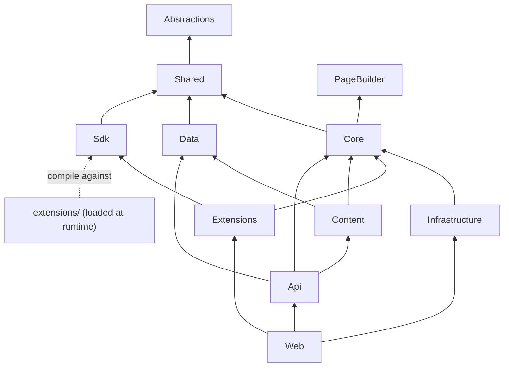

# Architecture overview

DotNetForge CMS is a server-rendered **ASP.NET Core MVC** CMS (C#, EF Core, Razor) on **.NET 10**, with **PostgreSQL** as
its database (more databases can be added for your own data), configured through `.env`. It serves a role-gated admin area, a public site resolved from
a page tree, structured content (content types and their entries, shown on pages through the page builder's content
lists), and a token-secured headless API over the same data, and keeps the core (`src/`) separate from
user extensions (`extensions/`): a CMS user customizes the site only there - code, views and assets that plug into
the host once enabled.

This is the one-page overview. The detailed, code-verified architecture:

| Topic | Document |
| --- | --- |
| Projects, folders, layers, DI, rules for changes | [codebase.md](codebase.md) |
| Startup, request pipeline, routing, auth/API/background flows | [data-flow.md](data-flow.md) |
| Screens, route map, layouts, navigation | [pages.md](pages.md) |
| UI: tokens, components, tag helpers, themes, accessibility | [design-system.md](design-system.md) |
| Tables, migrations, seeding | [database.md](database.md) |
| Project references, packages, DI registrations | [dependencies.md](dependencies.md) |
| Built vs. specified | [implementation-status.md](../implementation-status.md) |

## Layout

```text
DotNetForge.slnx               solution (every project)
src/
  DotNetForge.Web/             MVC web app: Program.cs, Startup/, Middleware/, Services/, Controllers/, Areas/Admin/,
                               Views/, wwwroot/ - composition root, admin area, public site, setup
  DotNetForge.Abstractions/    contracts only, no dependencies
  DotNetForge.Shared/          entities, enums, constants, DTOs, results, manifest model, store interfaces
  DotNetForge.Core/            installation, permission matrix evaluation, validators, structured content rules (no EF Core)
  DotNetForge.Content/         structured content over the database: content types, entries, queries (admin + API)
  DotNetForge.PageBuilder/     page builder document model, validation and HTML/CSS renderer
  DotNetForge.Data/            EF Core model, PostgreSQL context + migrations, seeding, database providers
  DotNetForge.Infrastructure/  BCL implementations: hashing, tokens, signing, .env, paths, file storage
  DotNetForge.Extensions/      manifest validation, discovery, code loading, ExtensionCatalog
  DotNetForge.Sdk/             the extension SDK (what extensions compile against)
  DotNetForge.Api/             headless API controllers, token auth, permission filter
tests/        DotNetForge.Tests (unit), DotNetForge.IntegrationTests (real host), fixtures/extensions
extensions/   extensions by type (one manifest per folder, optional .csproj → bin/); copied next to the app on publish
docker/       Dockerfile (read-only friendly production image), compose.dev.yml (PostgreSQL + RustFS + Mailpit), compose.app.yml (the app in Docker), databases/ s3/ mail/ (one compose file per service)
.docs/        technical documentation, incl. planned work per topic
```

This matches the spec's canonical tree (`src/DotNetForge.Web/` and the libraries under `src/`). Run the app with
`dotnet run --project src/DotNetForge.Web`; `dotnet build` and `dotnet test` at the root use the solution. AI-agent
quick references live in `.github/agents/` instead of a root `agents/` folder.

## Layering



- `Core` and `Data` are siblings; `Core` needs persistence only through interfaces in `Shared/Stores`
  (`IInstallationStore`).
- `Api` queries `Data` directly - a documented shortcut.
- `Content` holds the structured-content rules that need the database, so the admin and the API share one
  implementation ([structured content](../features/structured-content.md)).
- `PermissionMatrix` lives in `Shared` so the seeder and `PermissionService` share it.
- All host DI is in `src/DotNetForge.Web/Startup/DependencyRegistration.cs`; extensions add theirs through
  `IExtension.ConfigureServices`, called from there.

## Key decisions

- **Server-rendered admin**, no SPA or Node build; progressive enhancement only. One dependency-free design system
  (CSS tokens + components, Razor tag helpers, vanilla `ui.js`, light/dark) for every built-in screen, shaped by the
  CSP ([design system](design-system.md)).
- **Two auth schemes:** cookie (`dnf.auth`) for the admin, `ApiToken` bearer for `/api`.
- **Role-based admin gating** (`AdminArea` policy + `[Authorize(Roles = ...)]`), plus `(area, action)` checks from the
  permission matrix for content and media actions; granular permission keys for API tokens.
- **Install gate** middleware until the first Super Admin exists.
- **Structured content is separate from pages:** content types define fields, entries hold values as JSON with a
  single-table value index for filtering and sorting, and pages show entries through content
  lists resolved per request - the layout stores bindings, never content
  ([structured content](../features/structured-content.md)).
- **Liveness of content pages is computed per request** from `Published`, `Disabled` and the schedule; a background
  job only tidies passed schedules.
- **Extensions are discovered from disk, validated and loaded** (one load context each, at startup), and contribute
  only while a Super Admin has enabled them: admin tabs, dashboard widgets, the public theme, page modules, endpoints,
  media storage, sign-in providers, audit handlers. One gate (`ExtensionCatalog`) decides; views compile in memory.
  Extension code is trusted and runs in-process ([extensions](../features/extensions.md)).
- **BCL-only security primitives** (PBKDF2, HMAC, RNG) and an in-house `.env` parser - no extra dependencies.
- **Read-only deployment directory.** Runtime data goes to the database (incl. the Data Protection key ring) and to
  object storage behind `IFileStorage` (local directory in development, S3-compatible - Cloudflare R2 recommended - in
  production). Production configuration may not default into the app's folder ([deployment](../guides/deployment.md)).
- **PostgreSQL for the CMS, five databases for your own data:** the CMS runs on PostgreSQL and applies its one
  migration set at startup. SQLite, PostgreSQL, SQL Server, MySQL and MongoDB are `IDatabaseProvider`s registered by
  name for additional databases (`DATABASES_<NAME>_*`): `IDatabaseService` runs structured commands on any of them,
  and custom API endpoints run SQL on the SQL ones ([database layer](../database/architecture.md)).
- **Defence in depth on the web layer:** CSP and security headers, rate limiting, session re-validation, content and
  media permission checks from the role permission matrix.
