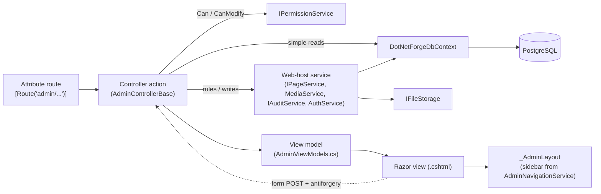
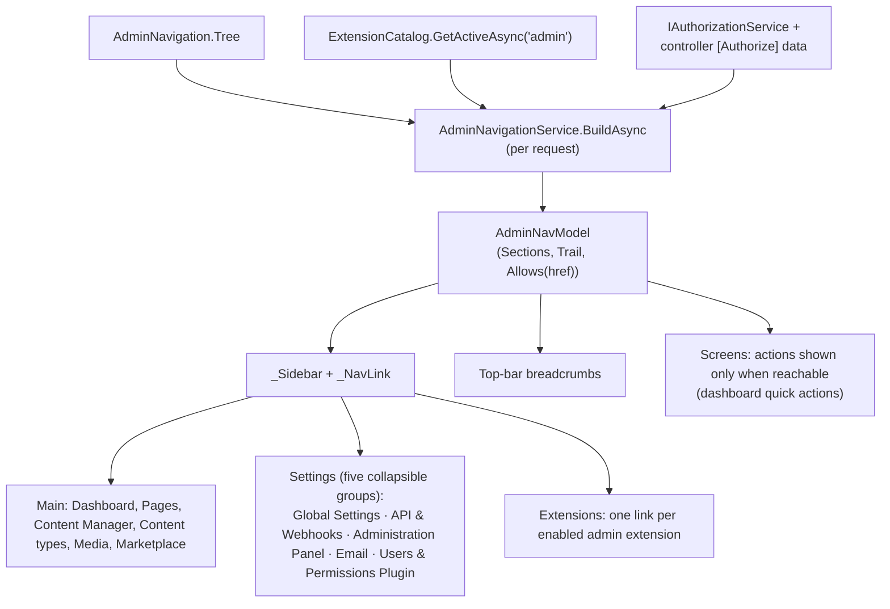
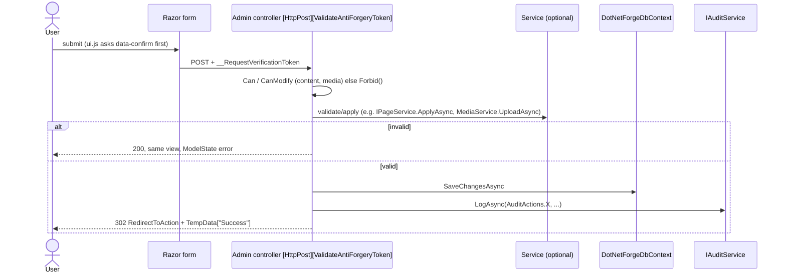

# Page (screen) architecture

How screens are built, routed, laid out, secured and wired to the backend. In this document "screen" means a UI
view; the content entity is always "content page" (see the [glossary](../glossary.md)). Each screen has its own
document in [`pages/`](../pages/).

## The pattern in one picture

There are no view models with behaviour, no client-side router and no SPA. A screen is a controller action that
queries the database (directly or through a web-host service) and renders a Razor view with a plain model.

## Route map

Every screen in the application. Auth column: **Anon** = anonymous; **AdminArea** = any role except `Authenticated`
and `Public` (the built-in `Super Admin`, `Admin`, `Developer`, `Editor`, `Author` and every custom role);
**SA/Admin** = `Super Admin` or `Admin`; **SA** = `Super Admin` only; **SA/Dev** = `Super Admin` or `Developer`;
**+ perm** = individual actions also check `(area, action)` permissions through `Can`/`CanModify`. All routes except
`/setup`, `/health` and paths with a file extension additionally require the CMS to be installed.

| Screen | Route(s) | Controller → action | View | Auth | Doc |
| --- | --- | --- | --- | --- | --- |
| Setup wizard | `GET/POST /setup` (POST rate-limited) | `SetupController.Index` | `src/DotNetForge.Web/Views/Setup/Index.cshtml` | Anon, only before install | [setup](../pages/setup.md) |
| Sign in | `GET/POST /login` (POST rate-limited), `GET /account/login` (301 → `/login`), `POST /account/logout` | `AccountController.Login`, `.LegacyLogin`, `.Logout` | `src/DotNetForge.Web/Views/Account/Login.cshtml` | Anon | [login](../pages/login.md) |
| Self-service accounts | `GET/POST /register` (404 unless sign-ups are on), `GET/POST /forgot-password` (404 without SMTP), `GET/POST /reset-password`, `GET /confirm-email`, `POST /confirm-email/resend` (POSTs rate-limited) | `AccountController.Register`, `.ForgotPassword`, `.ResetPassword`, `.ConfirmEmail`, `.ResendConfirmation` | `src/DotNetForge.Web/Views/Account/{Register,ForgotPassword,ResetPassword,Notice}.cshtml` | Anon | [account-self-service](../pages/account-self-service.md) |
| External sign-in | `POST /account/external/{scheme}` (antiforgery, rate-limited), `GET /account/external/callback` (rate-limited), `GET /account/external/failed?provider=` ; the built-in providers' own callbacks `GET`/`POST /signin/{key}` (handled by their `oauth-{key}` scheme, only while enabled and configured) | `ExternalLoginController.Challenge`, `.Callback`, `.Failed` | `src/DotNetForge.Web/Views/ExternalLogin/Continue.cshtml` ("Continuing to …", meta refresh to the provider); otherwise redirects (`returnUrl`/home, `/login/mfa` or back to `/login`) | Anon; `{scheme}` must belong to an enabled built-in provider or an active authentication extension | [authentication](../features/authentication.md#external-sign-in) |
| Two-factor step | `GET /login/mfa` (`method`, `recovery`), `POST /login/mfa`, `POST /login/mfa/send`, `POST /login/mfa/passkey/options`, `POST /login/mfa/passkey` (JSON), `POST /login/mfa/cancel` (POSTs antiforgery + rate-limited) | `MfaLoginController` | `src/DotNetForge.Web/Views/MfaLogin/Index.cshtml` | Anon with a pending sign-in (`dnf.mfa` cookie), else back to `/login` | [login → two-factor step](../pages/login.md#two-factor-step) |
| Access denied | `GET /account/denied` | `AccountController.Denied` | `src/DotNetForge.Web/Views/Account/Denied.cshtml` | Anon | [access-denied](../pages/access-denied.md) |
| Public home | `GET /` | `HomeController.Index` | the active theme's `Views/Page.cshtml` / `Views/Index.cshtml`, else `src/DotNetForge.Web/Views/Home/Page.cshtml` or `Index.cshtml` | Anon | [public-home](../pages/public-home.md) |
| Public content page | any other extension-less path (fallback) | `HomeController.RenderPage` | the page's or the active theme's `Views/Page.cshtml`, else `src/DotNetForge.Web/Views/Home/Page.cshtml` | Anon, unless the page has [view grants](../features/content-pages-and-routing.md#page-permissions) | [public-page](../pages/public-page.md) |
| Page layout stylesheet | `GET /page-css/{id:guid}.css?v={hash}` | `PageCssController.Get` | none - `text/css` of a live page's published layout (cached a year when `v` matches) | Anon | [page builder → Rendering](../features/page-builder.md#rendering) |
| Public extension resource | `GET /ext/{id}/resources/{**path}` | `ExtensionResourcesController.Resource` | none - a file from the extension's `Views/Resources/` | Anon; only active `theme` / `module` extensions, else 404 | [extensions → Slots](../features/extensions.md#slots) |
| Extension endpoints | whatever an extension maps (`IExtension.MapEndpoints`) or its MVC controllers route, e.g. `/sitemap.xml`, `/robots.txt` (SEO Toolkit), `POST /ext/contact-form/submit` (Contact Form) | the extension | the extension's | as the extension sets (public unless it adds authorization); `404` while the extension is not active | [extensions](../features/extensions.md#slots) |
| Media file | `GET /media/{id:guid}/{fileName?}` | `MediaFilesController.Download` | none - 302 to a presigned URL or a file stream | public file: Anon; private file: AdminArea user, else 404 | [media storage](../features/media-storage.md#download-flow) |
| Error | `/error` (any HTTP method) | `HomeController.Error` | `src/DotNetForge.Web/Views/Home/Error.cshtml` | Anon | [error](../pages/error.md) |
| Dashboard | `GET /admin` | `DashboardController.Index` | `src/DotNetForge.Web/Areas/Admin/Views/Dashboard/Index.cshtml` | AdminArea | [dashboard](../pages/dashboard.md) |
| Content Manager | `GET /admin/content`, `GET /admin/content/{type}` (`q`, `status`, `sort`, `desc`, `page`), `GET /admin/content/{type}/new`, `GET /admin/content/{type}/{id}`; `POST /admin/content/{type}/new`, `POST /admin/content/{type}/{id}` (`intent` save / publish), `POST /admin/content/{type}/{id}/{publish,unpublish,duplicate,delete}`, `POST /admin/content/{type}/{delete-selected,reorder}`; JSON `GET /admin/content/api/{entries,media}`, `POST /admin/content/api/media/upload`; `GET /admin/content?selected={pageId}` and `GET /admin/content/{pageId}/builder` → 301 to Pages | `ContentController` | `src/DotNetForge.Web/Areas/Admin/Views/Content/{Index,List,Edit,_Field}.cshtml` | AdminArea + `[RequirePermission(Entries, read)]` on every route + perm (`Entries`: `create` (also duplicate); `update`/`update.own`; `publish`; `delete`/`delete.own`; reorder `update`; uploads `Media`/`create`) | [content-manager](../pages/content-manager.md) |
| Content types | `GET /admin/content-types`, `GET /admin/content-types/new`, `POST /admin/content-types/create`, `GET`/`POST /admin/content-types/{id}`, `POST /admin/content-types/{id}/delete` | `ContentTypesController` | `src/DotNetForge.Web/Areas/Admin/Views/ContentTypes/{Index,New,Edit}.cshtml` | AdminArea + `[RequirePermission(Content types, read)]`; `create` / `update` / `delete` per action | [content-types](../pages/content-types.md) |
| Pages | `GET /admin/pages`, `POST /admin/pages/{create,update/{id},duplicate/{id},delete/{id},reorder}` | `PagesController` | `src/DotNetForge.Web/Areas/Admin/Views/Pages/Index.cshtml` (+ `_TreeNodes`, `_PageForm` with the Page settings / SEO / Theme / Permissions / Layout tabs) | AdminArea + `[RequirePermission(Collection types, read)]` + perm (`Collection types`: `create` (also duplicate); `update`/`update.own` or a page edit grant; `publish` to change Published or schedule; `delete`/`delete.own`; reorder and page permissions need `update`) | [pages](../pages/pages.md) |
| Page builder | `GET /admin/pages/{id}/builder` (+ `canvas`, `preview`, `draft.css`, `state`, `media`, `content/types`, `content/link-targets`, `content/entries`; `POST save`, `publish`, `unpublish`, `discard`, `heartbeat`, `upload`, `content/preview`) | `PageBuilderController` | `src/DotNetForge.Web/Areas/Admin/Views/PageBuilder/{Index,Canvas}.cshtml` (no admin shell) | AdminArea + may edit the page; publish/unpublish need `publish`, upload `Media`/`create` | [page-builder](../pages/page-builder.md) |
| Profile | `GET /admin/profile`, `POST /admin/profile`, `POST /admin/profile/password` | `ProfileController` | `src/DotNetForge.Web/Areas/Admin/Views/Profile/Index.cshtml` | AdminArea (own account only) | [profile](../pages/profile.md) |
| Sign-in security | `GET /admin/profile/security`, `GET/POST /admin/profile/security/authenticator`, `GET /admin/profile/security/sms`, `POST /admin/profile/security/code/send`, `POST /admin/profile/security/code`, `POST /admin/profile/security/passkey/options`, `POST /admin/profile/security/passkey` (JSON), `GET/POST /admin/profile/security/recovery-codes`, `POST /admin/profile/security/{id}/remove` | `SecurityController` | `src/DotNetForge.Web/Areas/Admin/Views/Security/{Index,Authenticator,Sms,Code,RecoveryCodes}.cshtml` | AdminArea (own account only); the only admin screen open while a required second factor is missing | [sign-in-security](../pages/sign-in-security.md) |
| Media | `GET /admin/media` (`?folder={id}`), `GET /admin/media/{id}/inline` (`?download=true`) and `GET /admin/media/{id}/zip` (JSON) for the preview dialog, `POST /admin/media/upload`, `POST /admin/media/visibility/{id}`, `POST /admin/media/{id}/rename`, `POST /admin/media/delete/{id}`, `POST /admin/media/delete-selected` and `POST /admin/media/move-selected` (bulk: `ids` files + `folderIds` folders, at most `MediaController.MaxBulkDelete` = 100 together), `POST /admin/media/folders`, `POST /admin/media/folders/{id}/{rename,move,delete}` | `MediaController` (`.Index`, `.Inline`, `.ZipEntries`, `.Upload`, `.Visibility`, `.Rename`, `.Delete`, `.DeleteSelected`, `.MoveSelected`, folder actions) | `src/DotNetForge.Web/Areas/Admin/Views/Media/Index.cshtml` | AdminArea + `[RequirePermission(Media, read)]` + perm (`Media`: upload needs `create`; public/private and rename need `update` or `update.own`; delete needs `delete`, or `delete.own` for files the user uploaded - checked per file in a bulk delete; folders: create `create`, rename/move `update`, delete `delete`; preview and download only `read`) | [media](../pages/media.md) |
| Settings | `GET /admin/settings`, `POST /admin/settings/save` | `SettingsController` | `src/DotNetForge.Web/Areas/Admin/Views/Settings/Index.cshtml` | AdminArea + perm (`Settings`: `read`; save needs `update`) | [settings](../pages/settings.md) |
| API Tokens | `GET /admin/api-tokens`, `GET/POST /admin/api-tokens/create`, `POST /admin/api-tokens/revoke/{id}` | `ApiTokensController` | `src/DotNetForge.Web/Areas/Admin/Views/ApiTokens/{Index,Create,Created}.cshtml` | AdminArea + perm (`API`: `read`; create needs `create`, revoke `delete`) | [api-tokens](../pages/api-tokens.md) |
| API Endpoints | `GET /admin/api-endpoints`, `GET/POST /admin/api-endpoints/new`, `GET/POST /admin/api-endpoints/{id}`, `POST /admin/api-endpoints/{id}/token`, `POST /admin/api-endpoints/{id}/delete`, `POST /admin/api-endpoints/test` | `ApiEndpointsController` | `src/DotNetForge.Web/Areas/Admin/Views/ApiEndpoints/{Index,Edit}.cshtml` | AdminArea + SA/Dev (`[Authorize(Roles = "Super Admin,Developer")]`) | [api-endpoints](../pages/api-endpoints.md) |
| API Docs | `GET /admin/api-docs` | `ApiDocsController.Index` | `src/DotNetForge.Web/Areas/Admin/Views/ApiDocs/Index.cshtml` (frames the reference below) | AdminArea + SA/Dev (`ApiDocs` policy) | [api-docs](../pages/api-docs.md) |
| API reference (Scalar) | `GET /admin/api-docs/reference/` (+ its scripts under that prefix), `GET /admin/api-docs/openapi/v1.json` | `MapApiDocs` (`src/DotNetForge.Web/ApiDocs/ApiDocsEndpoints.cs`): `MapScalarApiReference`, `MapOpenApi` | none - Scalar's own HTML page (no admin shell) and the OpenAPI JSON | SA/Dev (`ApiDocs` policy; anonymous → sign-in, other roles → denied) | [API docs](../features/api-docs.md) |
| Webhooks | `GET /admin/webhooks`, `GET/POST /admin/webhooks/create`, `GET/POST /admin/webhooks/{id}`, `POST /admin/webhooks/{id}/{enable,disable,delete,rotate,test}` (enable/disable/test take `returnTo` = `edit` / `deliveries`), `GET /admin/webhooks/{id}/secret` (once, after create/rotate), `GET /admin/webhooks/{id}/deliveries?page=` | `WebhooksController` | `src/DotNetForge.Web/Areas/Admin/Views/Webhooks/{Index,Edit,Secret,Deliveries}.cshtml` | AdminArea + `[RequirePermission(Webhooks, read)]` + perm (`Webhooks`: create `create`; save, enable/disable, rotate, test `update`; delete `delete`) | [webhooks](../pages/webhooks.md) |
| Roles | `GET /admin/roles`, `GET/POST /admin/roles/create`, `GET/POST /admin/roles/{id}`, `POST /admin/roles/{id}/duplicate`, `POST /admin/roles/{id}/delete` | `RolesController` | `src/DotNetForge.Web/Areas/Admin/Views/Roles/{Index,Edit}.cshtml` | AdminArea + perm (`Roles`: `read`; create/duplicate `create`, save `update`, delete `delete`) | [roles](../pages/roles.md) |
| Users | `GET /admin/users`, `GET/POST /admin/users/create`, `GET/POST /admin/users/{id}`, `POST /admin/users/{id}/{enable,disable,delete}`, `POST /admin/users/{id}/mfa/reset` | `UsersController` | `src/DotNetForge.Web/Areas/Admin/Views/Users/{Index,Edit}.cshtml` | AdminArea + perm (`Users`: `read`; create `create`, save/enable/disable/reset two-step verification `update`, delete `delete`) | [users](../pages/users.md) |
| Email Configuration | `GET /admin/email/configuration`, `POST /admin/email/configuration/connection`, `POST /admin/email/configuration/test` | `EmailConfigurationController.Index`, `.TestConnection`, `.Test` | `src/DotNetForge.Web/Areas/Admin/Views/EmailConfiguration/Index.cshtml` | AdminArea + perm (`Settings`: `read`; tests `update`) | [email-configuration](../pages/email-configuration.md) |
| Email Templates | `GET /admin/email/templates`, `GET/POST /admin/email/templates/{key}`, `POST /admin/email/templates/{key}/restore`, `GET/POST /admin/email/templates/{key}/preview` | `EmailTemplatesController.Index`, `.Edit`, `.Save`, `.Restore`, `.Preview`, `.PreviewChanges` | `src/DotNetForge.Web/Areas/Admin/Views/EmailTemplates/{Index,Edit}.cshtml` (the preview is a standalone document) | AdminArea + perm (`Settings`: `read`; save/restore `update`) | [email-templates](../pages/email-templates.md) |
| Data Management | `GET /admin/data`; `POST /admin/data/export`, `/export-media`, `/export-all`, `/backups`, `/backups/schedule`, `/backups/{id}/download`, `/backups/{id}/delete`, `/backups/{id}/restore`, `/import` | `DataManagementController` | `src/DotNetForge.Web/Areas/Admin/Views/DataManagement/Index.cshtml` | AdminArea + role Super Admin; import/restore Development only | [Data Management](../pages/data-management.md) |
| Media Library settings | `GET/POST /admin/media-settings` | `MediaSettingsController.Index`, `.Save` | `src/DotNetForge.Web/Areas/Admin/Views/MediaSettings/Index.cshtml` | AdminArea + perm (`Settings`: `read`; save `update`) | [media-settings](../pages/media-settings.md) |
| Providers | `GET /admin/providers`, `GET/POST /admin/providers/{key}` | `AuthProvidersController.Index`, `.Edit` | `src/DotNetForge.Web/Areas/Admin/Views/AuthProviders/{Index,Edit}.cshtml` | AdminArea + perm (`Settings`: `read`; save `update`) | [providers](../pages/providers.md) |
| Two-factor authentication | `GET/POST /admin/mfa` | `MfaSettingsController.Index`, `.Save` | `src/DotNetForge.Web/Areas/Admin/Views/MfaSettings/Index.cshtml` | AdminArea + perm (`Settings`: `read`; save `update`) | [mfa](../pages/mfa.md) |
| Advanced Settings | `GET/POST /admin/advanced-settings` | `AdvancedSettingsController.Index`, `.Save` | `src/DotNetForge.Web/Areas/Admin/Views/AdvancedSettings/Index.cshtml` | AdminArea + perm (`Settings`: `read`; save `update`; admin-opening default role SA only) | [advanced-settings](../pages/advanced-settings.md) |
| Audit Logs | `GET /admin/audit-logs` | `AuditLogsController.Index` | `src/DotNetForge.Web/Areas/Admin/Views/AuditLogs/Index.cshtml` | AdminArea + perm (`Audit logs`: `read`) | [audit-logs](../pages/audit-logs.md) |
| Plugins | `GET /admin/plugins`, `POST /admin/plugins/{id}/enable`, `POST /admin/plugins/{id}/disable` | `PluginsController.Index`, `.Enable`, `.Disable` | `src/DotNetForge.Web/Areas/Admin/Views/Plugins/Index.cshtml` | SA | [plugins](../pages/plugins.md) |
| Admin extension tab | `GET /admin/ext/{id}` (shell), `GET /admin/ext/{id}/raw` (active `admin` extensions), `GET /admin/ext/{id}/resources/{**path}` (any active extension) | `ExtensionsController.Host`, `ExtensionViewController.Render` / `.Resource` | `src/DotNetForge.Web/Areas/Admin/Views/Extensions/Host.cshtml` + the extension's own views | AdminArea | [extension-host](../pages/extension-host.md) |
| Module placeholders | `/admin/marketplace`, `/admin/content-history`, `/admin/internationalization` | `ModulesController` | `src/DotNetForge.Web/Areas/Admin/Views/Modules/Placeholder.cshtml` | AdminArea | [module-placeholders](../pages/module-placeholders.md) |

Non-screen endpoints: `GET /health` (JSON, bypasses install gate), `/api/*` ([headless API](../features/headless-api.md))
and `/api/custom/*` ([custom endpoints](../features/custom-endpoints.md)).

The Settings screen was AdminArea before; Editors and Authors now get the denied screen there.

## How screens are registered

There is no registry. A screen exists when:

1. a controller action has an **attribute route** (every admin controller has `[Route("admin/...")]`;
   `ModulesController` uses absolute `[HttpGet("/admin/...")]` per action); and
2. a view is found by MVC's normal lookup: `src/DotNetForge.Web/Areas/Admin/Views/<Controller>/<Action>.cshtml`, then
   `src/DotNetForge.Web/Areas/Admin/Views/Shared/`, then `Views/Shared/` - or the action names the view explicitly (`View("Created", ...)`,
   `View(nameof(Index), ...)`, `View("Placeholder", ...)`, `View("Page", ...)`).

Extensions are the exception: admin tabs come from enabled extensions (see
[Admin extension tabs](#admin-extension-tabs-dynamic-navigation)), and extension endpoints are mapped at startup by
`await app.MapDotNetForgeExtensionsAsync()` (before the fallback, so they win over content-page URLs).

## Layouts

| Layout | Set by | Used by | What it renders |
| --- | --- | --- | --- |
Look, components and behaviours of the built-in layouts: [design system](design-system.md#layouts).

| Layout | Set by | Used by | What it renders |
| --- | --- | --- | --- |
| `src/DotNetForge.Web/Areas/Admin/Views/Shared/_AdminLayout.cshtml` | `src/DotNetForge.Web/Areas/Admin/Views/_ViewStart.cshtml` | every admin screen | `<title>{Title} · DotNetForge Admin</title>`; `theme.js` (in `<head>`), `forge/{tokens,base,components,admin}.css`, `ui.js` (`defer`), `nav-state.js` (synchronous, after the sidebar); sidebar (logo, the `_Sidebar` partial built by `AdminNavigationService`, account menu with **View site** and **Sign out**); top bar (breadcrumbs except on the dashboard, **View site**, theme menu); page header (`ViewData["Title"]` as the only `<h1>`, optional `ViewData["Description"]`, `@section Actions`); `_Feedback`; `@section Scripts` |
| `src/DotNetForge.Web/Views/Shared/_AuthLayout.cshtml` | `Layout = "_AuthLayout"` in the view | setup, login, denied | `theme.js`, `forge/{tokens,base,components,auth}.css`, `ui.js`; brand panel (follows the theme) + form column with theme menu; `_Feedback` |
| `src/DotNetForge.Web/Views/Shared/_Layout.cshtml` | `src/DotNetForge.Web/Views/_ViewStart.cshtml` | public home (list or root page), public content pages and the error screen while no theme is enabled | `theme.js`, `forge/{tokens,base,components,public}.css` (no `ui.js`, no `_Feedback`, no theme menu); `<title>`, `meta description` and `canonical` from `ViewData["Title"]`/`["MetaDescription"]`/`["CanonicalUrl"]`; header with app name, the page menu (`ViewData["Menu"]`, `nav.site-nav`) and an **Admin** link for users who may enter the admin (`Roles.CanEnterAdmin`), `<main>`, footer |
| extension's own `Views/Shared/_Layout.cshtml` | the extension's `_ViewStart.cshtml` | admin extension `raw` documents; theme views (public home and content pages while a theme is active) | whatever the extension ships (same CSP applies; it may link the host's `/css/forge/*.css` and `<script src="/js/forge/theme.js">` to look like the admin - [design system](design-system.md#tag-helpers)) |

Layouts read `ViewData["Title"]`; the public and auth layouts also read `ViewData["AppName"]` (falling back to
`"DotNetForge CMS"`). Admin views set `ViewData["Title"]` (and optionally `ViewData["Description"]`) at the top of the
view; the admin layout does not use `AppName`.

**Rule:** the admin and auth layouts must never be affected by a public theme. Only `HomeController.ThemedViewAsync`
renders theme views ([themes](../features/themes.md)); admin styling lives in `wwwroot/css/forge/` and is never
replaced by a theme.

## Content Security Policy and screens

`SecurityHeadersMiddleware` sends `script-src 'self'; style-src 'self'` (plus `img-src 'self' data: https:`,
`media-src 'self' https:`, `frame-src 'self'`, `frame-ancestors 'self'`, `form-action 'self'`, `object-src 'none'`)
on every response. For screens this means:

- **No inline script or style**: no `<script>` blocks, `<style>` blocks, `style="..."` attributes or `on*="..."`
  handlers. Scripts go in `src/DotNetForge.Web/wwwroot/js/forge/` and are referenced with
  `<script src="~/js/forge/..." defer>` (page scripts via `@section Scripts`); styles go in
  `src/DotNetForge.Web/wwwroot/css/forge/`. This applies to admin extension documents too.
- Tag helpers that emit inline styles are not used: validation errors render with `<form-errors />`, never
  `asp-validation-summary` (its empty state is `<li style="display:none">`).
- Behaviour hooks are data attributes handled by `ui.js` (`data-confirm`, `data-collection`, `data-copy-target`, ...;
  list: [design system → behaviours](design-system.md#behaviours)).
- `AdminUiTests.Every_screen_renders_without_inline_script_or_style` renders every admin screen, sign-in, `/` and a
  content page and fails on any inline style, `<style>`, inline `<script>` or `on…=` handler.
- Forms may only post to this origin; images may also come from `data:` and HTTPS origins (media redirects to
  presigned object-storage URLs).
- The admin extension host embeds `/admin/ext/{id}/raw` and the [API Docs](../pages/api-docs.md) screen embeds
  `/admin/api-docs/reference/` in a same-origin `<iframe>`, allowed by `frame-src 'self'` and
  `X-Frame-Options: SAMEORIGIN`.
- The one exception to the strict policy is Scalar's page (`/admin/api-docs/reference/`, not an MVC view): it gets
  `script-src 'self' 'nonce-…'` (a fresh nonce per response, on Scalar's one inline script) and
  `style-src 'self' 'unsafe-inline'` (`SecurityHeadersMiddleware.ApiReferencePolicy`). Every other response, the API
  Docs screen included, keeps the strict policy (`ApiDocsTests`).
- In Development the policy is **report-only**: violations appear only as browser console warnings, so check the
  console when adding UI.

## Navigation

Navigation is defined once, in `AdminNavigation.Tree`
(`src/DotNetForge.Web/Areas/Admin/Navigation/AdminNavigation.cs`): sections, collapsible groups and links, each link
with label, href, icon, the screen's controller type and a `Planned` flag. The scoped `AdminNavigationService` builds
an `AdminNavModel` from it once per request; `_AdminLayout` renders the sidebar (`Shared/_Sidebar.cshtml`, one
`Shared/_NavLink.cshtml` per link) and the top-bar breadcrumbs from that model.

| Behaviour | How |
| --- | --- |
| Role-aware | A link is shown only when the user passes its controller's `[Authorize]` data - `AdminArea`, `[RequirePermission]`, role lists and named policies (collected from the class and its base classes, combined with `AuthorizationPolicy.CombineAsync`, evaluated with `IAuthorizationService`), so custom roles see what their grants open. With the default grants an Editor or Author sees Dashboard, Pages, Content Manager, Media and Marketplace in Main (not Content types) but in Settings only the placeholder links (`ModulesController` is AdminArea): no Settings, Media Library, API Tokens, API Endpoints, API Docs, Webhooks, Plugins, Data Management, Roles, Users, Audit Logs, Providers, Two-factor (MFA) or Advanced Settings, and no API & Webhooks, Administration Panel or Users & Permissions Plugin group. A `Developer` sees Dashboard and Marketplace in Main, API Tokens, API Endpoints and API Docs in API & Webhooks (not Webhooks: no `Webhooks` grant by default), and the placeholders in Global Settings - no Pages, Content Manager, Content types, Media, Settings, Media Library, Plugins or Data Management. Empty groups and sections are dropped. Hiding is never the gate - the controller still refuses a direct URL. |
| Active link | The longest href that equals the request path or is a parent of it (`/admin` only matches itself), so `/admin/api-tokens/create` marks **API Tokens**; it gets `aria-current="page"`. If a link were listed twice, only its first occurrence would be marked. |
| Groups | Settings sub-groups are `
`; the group holding the active link renders open, the others closed; `nav-state.js` remembers what the user opened or closed (`localStorage` `dnf-nav`) and counts the active group as opened, so a group stays open across screens (also after leaving it) until the user closes it. |
| Stable between screens | Every screen is a full page load. `nav-state.js` loads synchronously right after `</aside>` (not deferred), so the remembered groups and the sidebar's scroll position (`sessionStorage` `dnf-nav-scroll`, per tab; otherwise the active link is scrolled into view) are in place before the first paint - no groups opening or closing and no jump after load. `admin.css` opts into cross-document view transitions (`@view-transition`): browsers that support them keep the old screen up until the new one can paint and swap the sidebar and the top bar without a fade (`view-transition-name: sidebar` / `topbar`), so only the content changes; no animation with `prefers-reduced-motion`. The top bar's theme menu is in the markup from the first paint (shown once `theme.js` has set `<html class="js">`), not revealed later by `ui.js`. |
| Planned modules | `Planned: true` links (the [module placeholders](../pages/module-placeholders.md)) show a **Soon** badge. |
| Breadcrumbs | Section → group → link label (the link is clickable), then the screen's `ViewData["Title"]` when it differs (e.g. **Create API token**). Not shown on the dashboard or when the trail has one entry. |
| `Allows(href)` | `AdminNavModel.Allows("/admin/users")` is true when the user's sidebar contains that href; the dashboard uses it to show quick actions and cards only for reachable screens. |

- Items with no built screen route to `ModulesController` placeholders, so the navigation has no dead links.
- Navigation is full page loads; there is no client router. Deep links are ordinary URLs, e.g.
  `/admin/pages?selected={pageId}`. Below 64rem the sidebar is a drawer (menu button in the top bar).
- Tested by `AdminUiTests.The_sidebar_shows_only_screens_the_role_may_open` (Editor),
  `ApiDocsTests.Only_super_admins_and_developers_open_the_docs` (Developer) and
  `UserAndRoleManagementTests.A_custom_role_grants_exactly_its_permissions_and_edits_apply_at_once` (custom role).

### Admin extension tabs (dynamic navigation)

`AdminNavigationService` calls `ExtensionCatalog.GetActiveAsync("admin")` on every admin request (discovery from the
loader's cache, enabled state from `ExtensionState`'s 30-second cache; ordered by name) and appends an **Extensions**
section with one link per active admin extension (label = extension name, href `/admin/ext/{manifest id}`, icon
`panel`, controller `ExtensionsController`). Enabling an admin extension on [Plugins](../pages/plugins.md) adds its
tab on the next request. See [extension host](../pages/extension-host.md).

## How screens load data

- **Synchronously on the server, before the response is sent.** There is no client-side data fetching on any
  screen; every screen arrives fully rendered. The only loading indicator is the skeleton of the extension host and
  the API Docs screen, shown until their `<iframe>` has loaded.
- Reads use `AsNoTracking()` and project into a view model (`Select(...)`). There is one site per installation, so
  no query is scoped: Audit Logs and the Dashboard (audit count and **Recent activity**) include every entry, including
  failed sign-ins - documented per screen.
- Lists are unpaged on the server except Audit Logs (`Take(100)`) and the dashboard's activity
  (`DashboardController.RecentActivityCount` = 8). Search, filters, sorting and pagination of a list are client-side
  enhancements over the rendered rows (`data-collection` in `ui.js`); without JavaScript the whole list shows.
- A screen that also handles validation errors builds its model in a private helper (`ContentController.BuildIndexAsync`,
  `MediaController.BuildIndexAsync`, `SettingsController.BuildAsync`) so GET and the failed POST render the same
  model.
- Permission-aware screens compute their flags in the same helper (`MediaIndexViewModel.CanUpload`,
  `MediaRowViewModel.CanDelete`).

## How actions reach the backend

Conventions every mutating screen follows:

- `<form method="post">` with `@Html.AntiForgeryToken()`; the action has `[HttpPost]` and
  `[ValidateAntiForgeryToken]`. Antiforgery is configured with `HeaderName = "X-CSRF-TOKEN"` so the `fetch`
  calls (Pages and entry-list reorder, the page builder, the Content Manager's media upload) can send the token in a header. File uploads use `enctype="multipart/form-data"`
  and declare their request size on the action - media uploads with `[MediaUploadLimit]`, which follows the
  [upload limits](../features/media-storage.md#upload-limits) (largest per-file limit × files per request + 1 MB),
  the Data Management import with `[RequestSizeLimit]`/`[RequestFormLimits]`.
- Success → Post/Redirect/Get with an optional `TempData["Success"]` (or `TempData["Error"]`/`["Info"]`) message,
  shown as a toast by the layout (`Views/Shared/_Feedback.cshtml`); screens never render their own flash markup
  ([design system → feedback](design-system.md#feedback)).
- Failure → `ModelState.AddModelError(string.Empty, message)` and re-render with the posted values; views show the
  errors with `<form-errors />` at the top of the form. Input lengths are checked before saving.
- Permission denied → `Forbid()` → `/account/denied` (status 403).
- Exceptions (e.g. a unique-index violation) are not caught and surface through the global error handling.
- Successful writes are audited via `IAuditService` (Content create/update/delete/reorder, Media upload/delete,
  Settings save, API token create/revoke, login/logout, setup). The service does the audit for media
  (`MediaService`); controllers do it for the rest.

## State management

| State | Mechanism | Lifetime | Example |
| --- | --- | --- | --- |
| Selected item | query string | URL | `/admin/pages?selected={id}` |
| View data | view model / `ViewData` / `ViewBag` | one request | `ViewData["ParentOptions"]`, `ViewBag.Permissions` |
| Flash message | `TempData["Success"]` / `["Error"]` / `["Info"]` (cookie TempData provider, Data Protection) | until read on the next request; the toast auto-hides after 6 s (Success only) | "Saved 'About'." |
| Form input after a failed POST | the bound model is passed back to the view | one request | `PageInput` keeps unsaved edits |
| Signed-in user | auth cookie `dnf.auth` (keys in `DataProtectionKeys`) | 8 h sliding; account re-checked every request (30 s cache) | name in the sidebar account menu |
| Client UI state | DOM (`ui.js`, `pages.js`, `entries.js`, `content-types.js`) | until reload | list search/filter/page, selection, conditional fields, drag state |
| UI preferences | browser `localStorage` (`ui.js`, `theme.js`, `nav-state.js`) | until cleared | `dnf-theme` (light/dark/system), `dnf-nav` (open sidebar groups), `dnf-view:<screen>` (grid/list); `sessionStorage` `dnf-nav-scroll` (sidebar scroll position, per tab) and `dnf-scroll` (page scroll across a POST back to the same screen, read once) |
| Persistent | database (+ `IFileStorage` for media bytes) | permanent | everything else |

`localStorage` holds only display preferences (every access is wrapped in `try`; blocked storage falls back to the
defaults); there is no client-side data cache and no global client state.

## Loading states

Screens are server-rendered in one response; the browser's own page-load indicator is the main feedback. The
extension host and the API Docs screen show a skeleton until their `<iframe>` loads (`iframe[data-frame]` in `ui.js`). The one asynchronous action (tree reorder) gives no
in-progress indicator and reloads the page when it finishes (after a toast on failure).

## Error handling on screens

- Validation and business-rule errors: `<form-errors />` on the same screen, or a `TempData["Error"]` toast after a
  redirect (see above).
- Not found: `NotFound()` produces an empty 404 (no custom 404 page, no status-code pages middleware).
- Authorization: redirects to login or the denied screen (role checks and `Forbid()` alike).
- Unhandled: [error screen](../pages/error.md) outside Development, for GET and POST requests.

## Permissions on screens

Two layers, both enforced on the server:

1. **Screen access** - the `AdminArea` policy plus `[RequirePermission(area, action)]` on the controller and its
   mutating actions (Plugins: `[Authorize(Roles = "Super Admin")]`; API Endpoints:
   `[Authorize(Roles = "Super Admin,Developer")]`; API Docs: the `ApiDocs` policy); see the route map and
   [authorization → screen access](../features/authorization.md#screen-access).
2. **Record permissions** - `AdminControllerBase.Can(area, action)` and
   `CanModify(area, anyAction, ownAction, createdById)` evaluate the user's roles' stored grants
   ([authorization](../features/authorization.md#how-permissions-are-evaluated)). Used by Pages (area
   `Collection types`), the Content Manager (area `Entries`) and Media (area `Media`); a denied action returns `Forbid()`.

What the view hides (never the gate - the server checks again):

| Where | Hidden by |
| --- | --- |
| Sidebar links and groups | `AdminNavigationService` ([navigation](#navigation)) |
| Dashboard quick actions and cards | `DashboardViewModel.CanCreatePages` / `CanUpload` and `AdminNavModel.Allows(href)` |
| Media upload card, a file's **Delete**, its selection checkbox; folder checkboxes and menu items | `MediaIndexViewModel.CanUpload`, `MediaRowViewModel.CanDelete` / `CanEdit`, `MediaIndexViewModel.CanEditFolders` / `CanDeleteFolders` |
| Pages drag-to-reorder | `ViewData["CanReorder"]` (`Collection types`/`update`) |
| Content Manager: **New entry**, row actions, bulk delete, reorder, publish buttons, read-only form | `ContentManagerViewModel` / `EntryListViewModel` / `EntryEditViewModel` flags (`Entries` grants) |
| Content types: create, save, delete | `ContentTypesIndexViewModel` / `ContentTypeEditViewModel` flags (`Content types` grants) |

Pages otherwise shows every button to every user who can open it: an Author who saves or deletes another
user's page gets the denied screen, and changing Published or the schedule without `publish` re-renders the form with
"You don't have permission to publish, unpublish or schedule pages.". Other screens have no per-button logic - if a
user can open them, every action on them is available.

## Dialogs and modals

One shared modal: the confirmation `<dialog id="confirm-dialog">` in `Views/Shared/_Feedback.cshtml`, opened by
`ui.js` for any form (or submit button) with `data-confirm="<question>"` (optional `data-confirm-title`,
`data-confirm-action`, `data-confirm-tone`). Without the dialog API it falls back to `window.confirm`; without
JavaScript the form submits directly. Mechanics: [design system → feedback](design-system.md#feedback).

| Screen | Confirmation |
| --- | --- |
| Pages | **Delete page** (`_PageForm`): "Delete this page? Its child pages move up a level." |
| Content Manager | **Delete** an entry, **Delete selected**, **Unpublish** |
| Content types | **Delete content type**, removing a field in the builder |
| Media | a file's or folder's **Delete**, **Make private** / **Make public**, and **Delete selected** (files and folders) |
| API Tokens | **Revoke** |
| API Endpoints | **Delete endpoint**, **Regenerate token** / **Generate token** |
| Plugins | **Disable** (enable needs no confirmation) |

A failed reorder shows a danger toast (`window.Forge.toast`) with the server's `{ error }` or "Could not save the new
order." and reloads. There are no inline `onsubmit`/`onclick` handlers (the CSP blocks them). The denied screen's
**Sign out** is a plain POST button.

## Component organization

| Kind | Location | Examples |
| --- | --- | --- |
| Layouts | `Views/Shared/`, `src/DotNetForge.Web/Areas/Admin/Views/Shared/` | `_Layout`, `_AuthLayout`, `_AdminLayout` |
| Shared partials | `Views/Shared/` (all layouts), `Areas/Admin/Views/Shared/` (admin shell) | `_Feedback` (toasts + confirm dialog), `_ThemeMenu`, `_Sidebar`, `_NavLink` |
| Screen partials | next to the screen that owns them, prefixed `_` | `Pages/_TreeNodes.cshtml` (recursive), `Pages/_PageForm.cshtml` |
| Navigation | `src/DotNetForge.Web/Areas/Admin/Navigation/AdminNavigation.cs` | `AdminNavigation.Tree`, `AdminNavigationService` |
| View components | admin: class in `src/DotNetForge.Web/Areas/Admin/Components/`, view in `src/DotNetForge.Web/Areas/Admin/Views/Shared/Components/<Name>/Default.cshtml`; public: `src/DotNetForge.Web/Components/` | `ExtensionWidgetsViewComponent` (dashboard widgets), `ExtensionModulesViewComponent` (page modules, returns HTML directly) |
| Tag helpers | ASP.NET Core's (`@addTagHelper *, Microsoft.AspNetCore.Mvc.TagHelpers`) and the UI ones in `src/DotNetForge.Web/Ui/UiTagHelpers.cs` (`@addTagHelper *, DotNetForge.Web`), both in each `_ViewImports` | `asp-for`, `asp-action`; `<icon>`, `<badge>`, `<alert>`, `<empty-state>`, `<stat-card>`, `<timestamp>`, `<form-errors />` |
| Presentation helpers | `src/DotNetForge.Web/Ui/` | `AuditPresentation` (action labels/icons), `MediaPresentation` (file kind, size) |
| Styles | `src/DotNetForge.Web/wwwroot/css/forge/` | `tokens.css`, `base.css`, `components.css`, `admin.css`, `auth.css`, `public.css` |
| Scripts | `src/DotNetForge.Web/wwwroot/js/forge/` | `theme.js` (every layout, in `<head>`), `ui.js` (admin and auth layouts), `nav-state.js` (admin layout, right after the sidebar), `pages.js` (Pages), `entries.js` (Content Manager), `content-types.js` (Content types builder) |
| Icons | `src/DotNetForge.Web/wwwroot/img/icons.svg` | sprite used by `<icon name="…">` |

Reusable UI is the **Forge design system** - class-based components, tag helpers, partials and data-attribute
behaviours. Build every screen from it: [design system → building a screen](design-system.md#building-a-screen) and
the [component table](design-system.md#components).

## Planned (not implemented)

Target behaviour from the original product specification. Nothing in this section exists in the code unless marked ✔.

### Requirements

| Area | Target |
| --- | --- |
| Admin shell | One built-in admin layout for every admin screen ✔ (`_AdminLayout`). Public [themes](../features/themes.md) never affect the admin area, the setup wizard or (unless login theming is explicitly configured) the sign-in screen; applying a public theme to an admin route is rejected. |
| Role-aware sidebar | Items the current role cannot open are hidden ✔ ([navigation](#navigation)). Still planned: hiding items whose module is disabled for the role, and hiding by granted permissions rather than by the controller's role attributes (an Editor sees the placeholder links because `ModulesController` is AdminArea). |
| Active state | ✔ The current section is highlighted including its child routes and the group containing it is expanded ([navigation](#navigation)). |
| Owning module | Every sidebar leaf routes to exactly one owning module; built screens are in the [route map](#route-map), unbuilt ones in [module placeholders](../pages/module-placeholders.md). |

### Canonical sidebar tree vs the sidebar

The spec fixes the tree: **Main** (Dashboard, Content Manager, File Manager, Marketplace) and one **Settings** group
with four nested sub-groups - Global Settings (Overview, API Tokens, Content History, Internationalization, File
Manager, Plugins, Transfer, Webhooks), Administration Panel (Roles, Users, Audit Logs), Email (Configuration,
Templates), Users & Permissions Plugin (Roles, Providers, Advanced Settings) - in that order. Entries must not be
added, removed or reordered without a spec change. `AdminNavigation.Tree` follows it except:

| Spec | `AdminNavigation.Tree` today |
| --- | --- |
| Main → **File Manager** | labelled **Media** (`/admin/media`) |
| Main → **Content Manager** (the page tree) | three links: **Pages** (`/admin/pages`, the page tree), **Content Manager** (`/admin/content`, structured content) and **Content types** (`/admin/content-types`) - content, pages and content models are separate screens ([structured content](../features/structured-content.md)) |
| Global Settings → **Overview** | labelled **Settings** (`/admin/settings`, the key/value editor); the Overview screen is [planned](../pages/settings.md#planned-not-implemented) |
| Global Settings → **Transfer** | labelled **Data Management** (`/admin/data`, icon `database`): export, backups and import ([Data Management](../pages/data-management.md)) |
| Global Settings → **File Manager** (between Internationalization and Plugins) | labelled **Media Library** (`/admin/media-settings`, icon `image`): upload limits, image optimization and video compression ([Media Library settings](../pages/media-settings.md)) |
| one Settings group with four collapsible sub-groups | one **Settings** section with **five** collapsible `
` sub-groups: **API & Webhooks** (after Global Settings) is an addition - see the next row |
| Global Settings → API Tokens, Webhooks | moved into their own group **API & Webhooks** (after Global Settings) with **API Tokens**, **API Endpoints**, **API Docs** and **Webhooks** - the developer and integration screens apart from the site's own settings |
| Users & Permissions Plugin → **Roles** | not repeated: **Roles** is listed once, under Administration Panel - two links to the same screen confused users |
| Users & Permissions Plugin: Providers, then Advanced Settings | **Two-factor (MFA)** (`/admin/mfa`, icon `shield`) added between them - the [Two-factor authentication](../pages/mfa.md) settings, an addition the spec tree does not list; **Providers** (`/admin/providers`, icon `lock`) is the built [Providers](../pages/providers.md) screen |
| no API Endpoints, API Docs | **API Endpoints** (`/admin/api-endpoints`, icon `code`) and **API Docs** (`/admin/api-docs`, icon `book`), both for Super Admins and Developers, in API & Webhooks after API Tokens - [custom API endpoints](../features/custom-endpoints.md) and the [API docs](../features/api-docs.md), additions the spec tree does not list |
| no Extensions group | `AdminNavigationService` appends an **Extensions** section (admin extension tabs) when at least one admin extension is enabled - an addition the spec tree does not list |

All other entries and their order already match.

### Role rules for navigation

Default visibility; actual visibility follows the role's granted permissions ([authorization](../features/authorization.md)).

| Role | Enters admin area | Sidebar shows |
| --- | --- | --- |
| `Super Admin` | yes | full tree |
| `Admin` | yes | full tree except Plugins and Data Management (Super Admin only), API Endpoints and API Docs (Super Admin and Developer only) |
| `Developer` | yes | ✔ Dashboard, API Tokens, API Endpoints, API Docs (+ the placeholder links); no Webhooks, content, media, settings or administration screens |
| `Editor` | yes | items permitted by role (typically Content Manager, File Manager, Content History); Settings sub-groups hidden unless granted |
| `Author` | yes | limited (typically Content Manager and File Manager, own content); no Administration Panel, Email or Users & Permissions Plugin unless granted |
| `Authenticated` | no | none |
| `Public` | no | none |

- The entry column is enforced ✔: non-admin-capable roles are denied before any module loads (`AdminArea` policy).
- Hiding an item is never the gate: each module enforces its own check on every request ✔ (controller
  `[Authorize]` attributes; `Can`/`CanModify` for content and media actions).
- Authors are limited to their own content ✔ in Pages, the Content Manager and Media (`update.own`/`delete.own` via
  `CanModify`).
- Hiding by role ✔: the sidebar drops links whose controller the role cannot open - also by granted read
  permissions where the controller requires one (Pages, Content Manager, Content types, Media, Settings, Media Library,
  API Tokens, Webhooks, Users, Roles, Audit Logs, Providers, Two-factor (MFA)). Not yet for placeholders: every admin
  user still sees the placeholder links (Content History, Internationalization, Marketplace), because
  `ModulesController` is AdminArea.

### User flows

**Open the admin area**

1. ✔ Not installed → `/setup`; not signed in → `/login`; not admin-capable → `/account/denied`.
2. Render the built-in admin layout ✔ and a sidebar filtered by role ✔, permissions and module availability.

**Navigate to a module:** select a Main item or a leaf inside a Settings sub-group → the owning module opens → the leaf is marked active and its parent group stays expanded ✔.

### Rules and validation

- The sidebar matches the canonical tree exactly (groups, items, order).
- Every leaf resolves to exactly one owning module route; no dead links ✔ (placeholders via `ModulesController`).
- Admin routes always render with the built-in admin layout ✔; a public theme can never be applied to them.
- Unauthenticated → 401 (API-style requests) or redirect to sign-in ✔; authenticated without an admin-capable role →
  403 ✔ (via `302 /account/denied`, which responds 403).

### Edge cases

| Case | Target behaviour |
| --- | --- |
| Role or permissions change mid-session | Re-evaluated on the next request; hidden items stay unreachable by URL. Today roles are cookie claims fixed at sign-in (8 h sliding), so a change takes effect only after signing in again; a disabled or deleted account is signed out within 30 s ✔ (`ValidateSessionAsync`). |
| Authenticated/Public user hits an admin route | 403, no sidebar ✔ (denied screen uses `_AuthLayout`). |
| Public theme tries to style the admin | No effect on admin, setup or sign-in (unless login theming is configured). |
| Module disabled for the role | Item hidden, not shown as a broken link. |

### Acceptance criteria

- [ ] The sidebar renders the exact canonical tree (see differences above).
- [ ] Every sidebar leaf routes to its owning module and no leaf is a dead link - no dead links today, but three
  leaves are placeholders (Marketplace, Content History, Internationalization).
- [x] The admin area is never restyled by a public theme and always uses the built-in admin layout -
  `src/DotNetForge.Web/Areas/Admin/Views/_ViewStart.cshtml` sets `_AdminLayout`; theme views are only used by
  `HomeController.ThemedViewAsync`.
- [x] The setup and sign-in screens are unaffected by public themes - both set `Layout = "_AuthLayout"`.
- [x] `Authenticated` and `Public` never enter the admin area (403); the admin-capable built-in roles (`Super Admin`,
  `Admin`, `Developer`, `Editor`, `Author`) and custom roles do - `AdminArea` policy (`Roles.CanEnterAdmin`) on
  `AdminControllerBase`, forbid → `AccountController.Denied` (status 403).
- [x] Unauthenticated requests to admin routes are redirected to sign-in - cookie `LoginPath` in
  `DependencyRegistration`.
- [x] Sidebar items the role cannot open are hidden, and direct-URL access stays blocked - hiding by
  `AdminNavigationService` (controller `[Authorize]` data), blocking by controller attributes and `Can`/`CanModify`;
  `AdminUiTests.The_sidebar_shows_only_screens_the_role_may_open`. (Hiding by permissions and module availability:
  not built.)
- [x] Roles resolves to one module without divergent role data - a single `/admin/roles` link (`RolesController`;
  the spec's second entry is not repeated, `UserAndRoleManagementTests.The_sidebar_lists_roles_once`).
- [x] The selected sidebar item is highlighted and its parent group expanded - longest-href match (child routes
  count) and `ContainsActive` opens the group (`AdminNavigationService`).

## Adding a new admin screen

Use the [admin-page skill](../../.claude/skills/admin-page/SKILL.md). In short:

1. Controller in `src/DotNetForge.Web/Areas/Admin/Controllers/` deriving `AdminControllerBase`, with `[Route("admin/<slug>")]` and a
   role restriction if needed.
2. View model in `src/DotNetForge.Web/Areas/Admin/Models/AdminViewModels.cs`; view in `src/DotNetForge.Web/Areas/Admin/Views/<Controller>/Index.cshtml`
   setting `ViewData["Title"]`.
3. Business rules in a `src/DotNetForge.Web/Services/` class registered in `DependencyRegistration`, not in the controller. Runtime
   files go through `IFileStorage`, never the content root.
4. Mutations: POST + antiforgery + `IAuditService.LogAsync` with a constant from `AuditActions`; validate input
   lengths before saving.
5. Per-action permissions: check `Can(area, action)` / `CanModify(area, any, own, createdById)` and return
   `Forbid()`; expose the result on the view model (`CanX`) and hide what the user cannot do.
6. Build the view from the [design system](design-system.md#building-a-screen): cards, `.field`s,
   `<form-errors />`, `TempData` toasts, `data-confirm` for destructive forms, `table.table.table-stack`,
   `<empty-state>`. No inline script or style; page scripts go in `src/DotNetForge.Web/wwwroot/js/forge/` via
   `@section Scripts`.
7. Add the link to `AdminNavigation.Tree` with the screen's controller type (replace the matching placeholder link
   and `ModulesController` action if one exists) - visibility, active state and breadcrumbs follow.
8. Add `.docs/pages/<screen>.md` and update the route map above.
