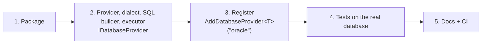

# Adding a database provider

Adding a database means three things: **create a provider, implement the interface, register it**. The router,
the service, the configuration loader and the CMS code don't change. A new provider serves **additional databases**
(`DATABASES_<NAME>_*`): the CMS database is always PostgreSQL ([configuration](configuration.md#cms-database)), so a
provider has no CMS context and no migrations. This page walks through Oracle as an example; the same steps apply to
MariaDB, CockroachDB, CosmosDB or anything else with a .NET driver.



## 1. Package

Add the driver to `Directory.Packages.props`, and a `PackageReference` in
`src/DotNetForge.Data/DotNetForge.Data.csproj`:

```xml
<PackageVersion Include="Oracle.ManagedDataAccess.Core" Version="23.x" />
```

Everything for the new database goes in its own folder, `src/DotNetForge.Data/Database/Providers/Oracle/` (namespace
`DotNetForge.Data.Database.Providers.Oracle`). Nothing in that folder is shared with another database
([providers → Isolation](providers.md#isolation-and-updates)).

## 2. The provider

A SQL database is four files. **Start by copying a SQL folder whose syntax is closest** (for Oracle, `SqlServer/`:
`OFFSET … FETCH`), rename the `SqlServer` prefix to `Oracle`, then change what differs:

| File | Copied from | Change |
| --- | --- | --- |
| `OracleDialect.cs` | `SqlServerDialect.cs` | identifier quoting, parameter prefix (`:p0`), paging, LIKE escaping, aggregate casts |
| `OracleSqlBuilder.cs` | `SqlServerSqlBuilder.cs` | usually only the names; it calls `OracleDialect` for everything database-specific |
| `OracleExecutor.cs` | `SqlServerExecutor.cs` | the driver's factory (`OracleClientFactory.Instance`); the `ListCollectionsAsync` query (e.g. `user_tables`) |
| `OracleDatabaseProvider.cs` | `SqlServerDatabaseProvider.cs` | detection, settings validation, `CreateConnection`, error codes |

The provider implements `IDatabaseProvider` directly; there is no base class:

```csharp
// src/DotNetForge.Data/Database/Providers/Oracle/OracleDatabaseProvider.cs (excerpt)
public sealed class OracleDatabaseProvider : IDatabaseProvider
{
    public string DisplayName => "Oracle";

    // Return true only when the connection string can't belong to another database.
    public bool CanHandle(string? connectionString) => false;

    // The CMS runs on PostgreSQL only; this provider serves additional databases.
    public void AddDbContext(IServiceCollection services, DatabaseSettings settings) =>
        throw new DatabaseConfigurationException(
            "The CMS database must be PostgreSQL; Oracle can only be an additional database (DATABASES_<NAME>_PROVIDER=oracle).");

    public Task InitializeSchemaAsync(DotNetForgeDbContext db, CancellationToken cancellationToken) =>
        throw new NotSupportedException("Oracle does not host the CMS model.");

    public IDatabaseExecutor CreateExecutor(DatabaseSettings settings, IModel? model, ILoggerFactory loggerFactory) =>
        new OracleExecutor(settings, model is null ? DatabaseSchema.Unmapped : Schema(model));

    // Raw SQL for custom API endpoints on this database; leave it out (null) for a database without SQL.
    public DbConnection? CreateConnection(DatabaseSettings settings)
    {
        var connection = OracleClientFactory.Instance.CreateConnection()
            ?? throw new DatabaseProviderException("The database driver could not create a connection.");
        connection.ConnectionString = settings.ConnectionString;
        return connection;
    }

    public DatabaseException? TranslateException(Exception exception) => exception switch
    {
        DatabaseException translated => translated,
        OracleException { Number: 1017 } => new DatabaseAuthenticationException("Oracle rejected the credentials.", exception),
        OracleException { Number: 1 } => new DatabaseConflictException("A record with the same unique value already exists.", exception),
        OracleException { Number: 942 } => new DatabaseNotFoundException("The table or column does not exist.", exception),
        OracleException { Number: 12170 or 12541 } => new DatabaseConnectionException("Oracle could not be reached.", exception),
        TimeoutException => new DatabaseTimeoutException("The database command timed out.", exception),
        DbException => new DatabaseQueryException("The database rejected the command.", exception),
        _ => null,
    };

    // Normalize, Describe, Schema and the connection-string helpers: as in the copied provider.
}
```

A database that is **not SQL** implements `IDatabaseProvider` the same way (see `MongoDbDatabaseProvider`):
- **`Normalize`**: validate the settings.
- **`AddDbContext`** / **`InitializeSchemaAsync`**: throw, as above.
- **`CreateExecutor`**: return an `IDatabaseExecutor` that translates `DatabaseCommand`s with the native driver.
  - Use typed values, never strings.
  - Validate names with `DatabaseSchema.EnsureIdentifier`.
  - Convert values with `ValueCoercion`.
  - `ListCollectionsAsync`: its collections, system ones left out.
- **`CreateConnection`**: don't implement it (the default returns `null`: no custom endpoints on it).
- **`TranslateException`**.

The provider can implement just the commands it supports; unsupported operations raise `DatabaseProviderException`.

## 3. Register

```csharp
// src/DotNetForge.Data/Database/DatabaseServiceCollectionExtensions.cs → AddDefaultDatabaseProviders
.AddDatabaseProvider<OracleDatabaseProvider>("oracle")
```

Or, to keep it out of the defaults, add the line in `DependencyRegistration` (or an application's own startup)
after `AddDefaultDatabaseProviders()`. `DATABASES_<NAME>_PROVIDER=oracle` now selects it. Nothing else changes: no
switch statement, no enum, no edits to the router, the service or the loader.

## 4. Tests

1. Add the provider to `DatabaseProviderTests`:
   - name resolution (as an additional database);
   - that it can't host the CMS (`Only_postgresql_hosts_the_cms`);
   - validation messages;
   - a `Describe` case proving credentials are not shown;
   - detection, if `CanHandle` can ever return true.
2. Add the builder to `DatabaseTranslationTests` (a `SqlBuilder` entry, plus its exact SQL in `Selects`, `Pagings`
   and `Aggregates`); the shared expectations then run against it too.
3. Add an unreachable-server case to `DatabaseConnectionTests`.
4. Add the server to `TestDatabaseServer.AdditionalDatabase` (`DNF_TEST_ORACLE`) and an
   `[AdditionalDatabaseFact("oracle", "DNF_TEST_ORACLE")]` case to `AdditionalDatabaseProviderTests` (insert, list,
   find, a custom endpoint on it, the Data Management export), plus creating and dropping its test database there:

   ```bash
   DNF_TEST_ORACLE="User Id=system;Password=…;Data Source=localhost:1521/FREEPDB1" \
     dotnet test tests/DotNetForge.IntegrationTests --filter "FullyQualifiedName~AdditionalDatabase"
   ```

   The CMS database of these tests is PostgreSQL (`DNF_TEST_POSTGRES`, [testing](../guides/testing.md#databases)).
5. Add a wrong-credentials case to `DatabaseCredentialTests`.

## 5. Docs and CI

- [providers.md](providers.md): a row in the provider table, plus provider notes.
- [configuration.md](configuration.md): an example connection string, and detection if any.
- `.env.example` and a compose file `docker/databases/<name>.yml`.
- `.github/workflows/ci.yml`: an `additional-databases` matrix entry that starts the server and sets the test
  variable.
