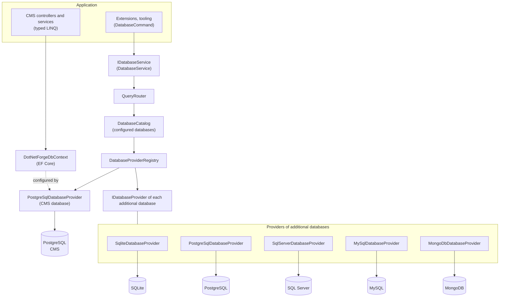
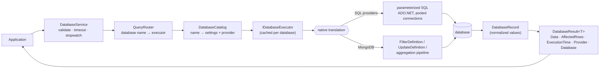

# Database architecture

The CMS runs on **PostgreSQL**. Through `IDatabaseService` it can also reach **additional databases** - SQLite,
PostgreSQL, SQL Server, MySQL or MongoDB - and new database technologies can be added without changing application
code. This page explains how the database layer is put together. The other pages cover:
[providers](providers.md), [query routing](query-routing.md), [configuration](configuration.md),
[MongoDB](mongodb.md), [security](security.md) and [adding a provider](adding-a-provider.md).

## Two ways to reach a database

| | EF Core (`DotNetForgeDbContext`) | `IDatabaseService` |
| --- | --- | --- |
| Used by | the CMS itself: every controller and service in `src/` | extensions, tooling, additional databases, the Data Management export |
| Queries | typed LINQ, change tracking, migrations | structured [`DatabaseCommand`](query-routing.md)s |
| Databases | the **CMS** (main) database only - PostgreSQL | the CMS database and any [additional database](configuration.md#more-databases) |
| Provider-specific code | none in application code: the provider configures EF Core | none: the provider's executor translates commands |

Both paths go through the same provider, so the CMS and `IDatabaseService` always agree on the CMS database, its
schema and the value formats. The CMS uses EF Core because typed queries, change tracking and migrations would
otherwise have to be rebuilt by hand. `IDatabaseService` adds what EF Core does not cover: one structured API for any
configured database, MongoDB-native execution, consistent results and errors.

A third, narrow path exists for raw SQL: [custom API endpoints](../features/custom-endpoints.md) run their SQL on the
CMS database through EF Core's connection, or on an additional SQL database through
`IDatabaseProvider.CreateConnection`.



## Components

| Component | File | Responsibility |
| --- | --- | --- |
| `IDatabaseService`, `DatabaseCommand`, `DatabaseFilter`, `DatabaseResult<T>`, `DatabaseRecord`, exceptions | `src/DotNetForge.Abstractions/Database/` | Provider-neutral contracts; no dependencies, so extensions can use them. `IDatabaseService.ListCollectionsAsync(database)` lists a database's tables or collections (throws `DatabaseException`, 30 s timeout) |
| `DatabaseSettings` | `src/DotNetForge.Shared/Configuration/DatabaseSettings.cs` | One configured database as read from the environment |
| `IDatabaseProvider`, `IDatabaseExecutor` | `src/DotNetForge.Data/Database/IDatabaseProvider.cs` | What a database technology must implement |
| `DatabaseProviderRegistry` | `src/DotNetForge.Data/Database/DatabaseProviderRegistry.cs` | Name → provider; detection from the connection string |
| `DatabaseCatalog` | same file | The resolved databases (CMS + additional) |
| `QueryRouter` | `src/DotNetForge.Data/Database/QueryRouter.cs` | Database name → executor; one executor per database, created once |
| `DatabaseService` | `src/DotNetForge.Data/Database/DatabaseService.cs` | Validation, timeouts, timing, error translation, logging |
| `DatabaseCommandValidator` | `src/DotNetForge.Data/Database/DatabaseCommandValidator.cs` | Shape checks before any provider is involved |
| `DatabaseSchema`, `CollectionMap`, `FieldMap` | `src/DotNetForge.Data/Database/DatabaseSchema.cs` | Model names → table/column or collection/element names; name validation |
| `ValueCoercion` | `src/DotNetForge.Data/Database/ValueCoercion.cs` | Values to the model's types and back (Guid, enum, UTC dates) |
| One folder per database | `src/DotNetForge.Data/Database/Providers/<Database>/` | Everything specific to that database, with no code shared between databases: the provider; SQL databases also their dialect, parameterized SQL builder and ADO.NET executor; PostgreSQL also the CMS context `PostgreSqlDbContext` and the migrations; MongoDB its executor and key generators. See [providers → Isolation](providers.md#isolation-and-updates) |
| Registration | `src/DotNetForge.Data/Database/DatabaseServiceCollectionExtensions.cs` | `AddDatabaseProvider<T>(name)`, `AddDefaultDatabaseProviders()`, `AddDotNetForgeDatabases(...)` |

## Startup

```mermaid
sequenceDiagram
    participant P as Program.cs
    participant L as EnvConfigurationLoader
    participant D as DependencyRegistration
    participant R as DatabaseProviderRegistry
    participant Pr as PostgreSqlDatabaseProvider
    participant I as DatabaseInitializer
    P->>L: Load(contentRoot, isDevelopment)
    L-->>P: AppEnvironment (DatabaseSettings as written)
    P->>D: AddDotNetForge(env)
    D->>D: AddDefaultDatabaseProviders()
    D->>R: AddDotNetForgeDatabases(main, additional, host)
    R->>R: main: must be postgresql; additional: by name, or detected
    R->>Pr: Normalize(settings) (validates)
    Note over R,Pr: invalid configuration → DatabaseConfigurationException → exit 1
    R->>Pr: AddDbContext(services, settings)
    P->>I: InitializeAsync(db, catalog.Main.Provider)
    I->>Pr: InitializeSchemaAsync (PostgreSQL migrations)
    I->>I: DataSeeder.SeedAsync
```

Configuration problems stop the process before it serves anything: `Program.cs` prints
`[DotNetForge] Configuration error: <message>` and exits with code 1.

## Command flow



Details: [query routing](query-routing.md).

## Errors

Providers translate their driver's exceptions into a small, common set. Every one keeps the driver exception as
`InnerException`, and the service adds `Provider`, `Database`, `Operation` and `Collection`:

| Exception | Raised when |
| --- | --- |
| `DatabaseConnectionException` | the server can't be reached, or the connection broke |
| `DatabaseAuthenticationException` | wrong credentials or missing permission |
| `DatabaseTimeoutException` | the command exceeded its timeout (caller cancellation stays an `OperationCanceledException`) |
| `DatabaseQueryException` | the command is invalid, or the database rejected it |
| `DatabaseNotFoundException` | unknown database name, table/collection or field |
| `DatabaseConflictException` | a unique index or key was violated |
| `DatabaseProviderException` | the provider can't do it (e.g. `DeleteOne` without a key, MongoDB transactions without a replica set) |
| `DatabaseConfigurationException` | invalid configuration (startup) |

Exceptions that are not database errors (bugs such as `InvalidOperationException`) are **not** translated; they
surface unchanged.

Messages are written by DotNetForge, not copied from the driver, because driver messages can echo data (for
example a duplicate value). The `Try*` methods (`TryQueryAsync`, `TryExecuteAsync`) return
`DatabaseResult { Success = false, Error = ... }` instead of throwing. `TestConnectionAsync` never throws for
database errors.

## Results

`DatabaseResult<T>` has the same shape for every provider:

- `Data`
- `Success` / `Error`
- `AffectedRows`: records read, written or counted
- `ExecutionTime`
- `Provider`: display name
- `Database`: configured name

Records are `DatabaseRecord`s, case-insensitive dictionaries holding the model's property names and normalized
.NET values:
- `Guid`;
- UTC `DateTime`;
- enums as numbers;
- `long` / `double` / `decimal`;
- `string`.

`record.Get<T>("Field")` converts. No driver type (`BsonDocument`, `DbDataReader`) leaves the provider.

## Logging

`DatabaseService` logs with these fields:
- database
- provider
- operation
- collection
- elapsed milliseconds
- record count

```text
dbug: Database main (PostgreSQL) Find Users: 12 records in 23.4 ms
info: Slow database command: events (MongoDB) Aggregate orders: 40 records in 812.0 ms
warn: Database reports (MySQL) InsertOne events failed after 3.1 ms: DatabaseConflictException: A record with the same unique value already exists.
```

Successful commands log at Debug, commands slower than 500 ms at Information, and failures at Warning. Values,
connection strings and driver messages are never logged ([security](security.md#logging)).

## Performance

- **Clients and pools are reused.**
  - SQL executors open short-lived connections from the driver's pool.
  - MongoDB uses one `MongoClient` per connection string for the whole process.
  - Executors are created once per configured database (`QueryRouter`).
- **Everything is async and cancellable.**
  - Every operation takes a `CancellationToken`.
  - A per-command timeout (default 30 s, `DatabaseCommand.Timeout`) cancels the operation server-side as well:
    `CommandTimeout` for SQL, `MaxTime` for MongoDB.
- **Streaming.**
  - `StreamAsync` yields records straight from the data reader or server cursor without buffering.
  - `QueryAsync` buffers, so use paging (`Skip`/`Take`) or streaming for large results.
- **Efficient paging.** Paging happens in the database (`LIMIT/OFFSET`, `OFFSET … FETCH`, `$skip/$limit`), never in
  memory.
- **Minimal mapping.** Records are built once from the reader/cursor with the model's types; there is no
  intermediate serialization.

## Rules for code in this repository

- CMS code uses LINQ against `DotNetForgeDbContext`. The CMS database is always PostgreSQL, so queries no longer
  need to avoid joins or navigations for MongoDB's sake; the existing code is single-table (small queries combined in
  memory) and still works as it is.
- No database-specific code outside `src/DotNetForge.Data/Database/`.
- Schema changes need **one** migration, for `PostgreSqlDbContext`
  ([database.md → Migrations](../architecture/database.md#migrations)).
