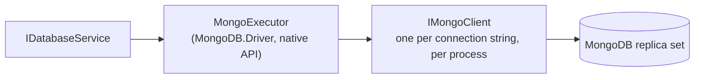

# MongoDB

MongoDB is an **additional database** (`DATABASES_<NAME>_PROVIDER=mongodb`): `IDatabaseService` reads and writes it
with the native driver, and Data Management can export it. It never hosts the CMS - the CMS database is PostgreSQL
([configuration](configuration.md#cms-database)); `MongoDbDatabaseProvider.AddDbContext` throws
`DatabaseConfigurationException` and `InitializeSchemaAsync` throws `NotSupportedException`.

## Requirements

- **A database name in the URL path** (`mongodb://host:27017/events`). MongoDB also authenticates against that
  database, so add `authSource=admin` for a user created in `admin` (such as the root user of the Docker image).
- **Transactions** (`IDatabaseService.BeginTransactionAsync`) need MongoDB 5.0 or later as a replica set or sharded
  cluster (Atlas always is one); a standalone server rejects them. For development, a single-node replica set:
  `docker compose -f docker/databases/mongodb.yml up -d`.

```env
DATABASES_EVENTS_PROVIDER=mongodb
DATABASES_EVENTS_CONNECTION_STRING=mongodb+srv://reader:<secret>@cluster0.example.mongodb.net/events
# local single-node replica set:
# DATABASES_EVENTS_CONNECTION_STRING=mongodb://localhost:27017/events?replicaSet=rs0&directConnection=true
```

## How it is built



- **One client.** `MongoDbDatabaseProvider` creates one `MongoClient` per connection string for the whole process.
  The client is the connection pool and is thread-safe.
- **The native driver for `DatabaseCommand`s** (`MongoExecutor`, `src/DotNetForge.Data/Database/Providers/MongoDb/`):
  - `Find` with sort, skip, limit and projection;
  - `CountDocuments`;
  - `InsertOne`/`InsertMany`;
  - `UpdateOne`/`UpdateMany` with `$set`;
  - `DeleteOne`/`DeleteMany`;
  - aggregation pipelines (`$match` → `$group` → `$project` → `$sort/$skip/$limit`);
  - `ListCollectionsAsync`: `listCollections` without `system.*`.
  - Filters use the driver's typed `FilterDefinitionBuilder`, never JSON strings.
- **No SQL.** `CreateConnection` returns `null`, so [custom API endpoints](../features/custom-endpoints.md) can't run
  on a MongoDB database ("The database '<name>' is MongoDB, which has no SQL.") and the endpoint editor doesn't offer
  it.
- Names are used as written and must be plain identifiers ([query routing](query-routing.md#names-and-schema)); a
  collection whose name isn't one is skipped by the Data Management export.
- `MongoKeys` (time-ordered `long` and random `int` keys) and the model mapping (`Schema`, `_id` paths) are used only
  when an executor is created with an EF model; additional databases have none, and `MongoDB.EntityFrameworkCore`
  stays referenced for that mapping.

Values come back as `DatabaseRecord`s: BSON dates as UTC `DateTime`, `Decimal128` as `decimal`, binary UUIDs as `Guid`.

## Query rules

MongoDB no longer hosts the CMS, so CMS code has no MongoDB query restrictions. The single-table CMS queries that
combine results in memory (e.g. `RolesController`, `UsersController`, `AuthService`, `ContentQueryService`) date from
when it did; they keep working on PostgreSQL. Commands on a MongoDB additional database go through
`IDatabaseService` only, one collection per command; for a `$lookup` across collections use the driver directly
([provider-specific operations](query-routing.md#provider-specific-operations)).

## Operations

- **Version pinning.** `MongoDB.EntityFrameworkCore` (which brings `MongoDB.Driver`) is pinned exactly (`[10.0.4]` in
  `Directory.Packages.props`); its versions follow EF Core, not semantic versioning. Upgrade deliberately and run the
  MongoDB additional-database tests (`DNF_TEST_MONGODB`, [testing](../guides/testing.md#databases)).
- **Timeouts.** Server selection fails after 30 s by default (`serverSelectionTimeoutMS` in the URL). Each command
  also gets `MaxTime` from its timeout.
- **Backups.** Use `mongodump` or Atlas backups; the Data Management export of a MongoDB database is a JSON copy for
  your own use, not importable.
- **Errors.**
  - duplicate key → `DatabaseConflictException`;
  - authentication → `DatabaseAuthenticationException`;
  - no server reachable → `DatabaseConnectionException`;
  - `MaxTime` exceeded → `DatabaseTimeoutException`;
  - transactions on a standalone server → `DatabaseProviderException` ("MongoDB transactions need a replica set or
    sharded cluster").
