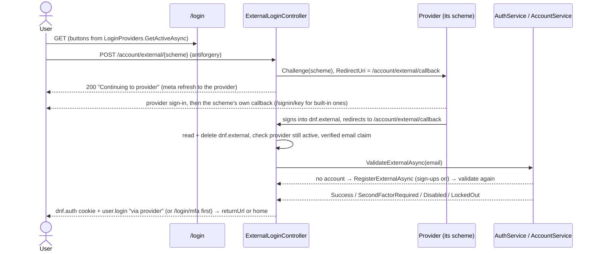

# Authentication

Two independent schemes, both registered in `src/DotNetForge.Web/Startup/DependencyRegistration.cs`, plus
short-lived helper cookies for sign-in with a provider and for the second sign-in step:

| Scheme | Name | Used for | Credential | Selected by |
| --- | --- | --- | --- | --- |
| Cookie (default) | `CookieAuthenticationDefaults.AuthenticationScheme` ("Cookies") | admin area, extension views | email + password (or a sign-in provider), plus the second step when the account has one → cookie `dnf.auth` | default scheme |
| API token | `ApiTokenDefaults.Scheme` = `"ApiToken"` | `/api/*` | `Authorization: Bearer dnf_<prefix>_<secret>` | `[Authorize(AuthenticationSchemes = "ApiToken")]` on `ApiControllerBase` |
| External (helper) | `ExternalLogin.SignInScheme` = `"dnf.external"` | carrying a provider's result to `ExternalLoginController` | cookie `dnf.external`, 10 min, `HttpOnly`, `SameSite=Lax`, `Secure` as `dnf.auth` | the provider's remote scheme signs into it - [External sign-in](#external-sign-in) |
| Pending second step (helper) | `PendingSignIn.Scheme` = `"dnf.mfa"` | a sign-in waiting for its second factor | cookie `dnf.mfa`, 10 min (not sliding), `HttpOnly`, `SameSite=Lax`, `Secure` as `dnf.auth` | `AccountController.Login` / `ExternalLoginController` write it, `MfaLoginController` reads it - [MFA → Sign-in](mfa.md#sign-in) |
| Built-in OAuth providers | `oauth-<key>` (`oauth-google`, ...) | one remote scheme per enabled, configured provider, added and removed at runtime | the provider's sign-in → `dnf.external` | `OAuthProviderRegistry` - [Built-in OAuth providers](#built-in-oauth-providers) |

Extensions may register further schemes (e.g. the Discord sample's `discord` OAuth scheme) from
`IExtension.ConfigureServices`.

A cookie never authenticates an API call and a token never authenticates an admin screen. Authorization (who may do
what once authenticated) is in [authorization.md](authorization.md).

## Cookie sign-in

Screens: [Sign in](../pages/login.md), [Access denied](../pages/access-denied.md). Flow diagram:
[data-flow.md → Authentication flow](../architecture/data-flow.md#authentication-flow-admin-sign-in).

### Cookie options

| Option | Value |
| --- | --- |
| `LoginPath` | `/login` |
| `LogoutPath` | `/account/logout` |
| `AccessDeniedPath` | `/account/denied` |
| `ExpireTimeSpan` | 8 hours, `SlidingExpiration = true`; **Remember me**: persistent cookie, 30 days (`AccountController.RememberMeLifetime`), also sliding |
| `Cookie.Name` | `dnf.auth` |
| `HttpOnly` | `true` |
| `SameSite` | `Lax` |
| `SecurePolicy` | `Always` outside Development; `SameAsRequest` in Development (Secure only over HTTPS) |
| `Events.OnSigningIn`, `Events.OnValidatePrincipal` | `StartSessionAsync`, `ValidateSessionAsync` - see [Sessions](#sessions) |

`Always` means the browser never sends the cookie over plain HTTP, so production must be served over HTTPS (directly
or through a TLS-terminating proxy with forwarded headers - [deployment](../guides/deployment.md#behind-a-reverse-proxy)).

### Sign-in request (`POST /login`)

1. Rate limit `credentials` (10 per minute per client IP, `429` beyond) - see [Rate limiting](#rate-limiting).
2. Antiforgery check.
3. `AuthService.ValidateAsync(email, password)` (below).
4. `SecondFactorRequired` (the account has a [second factor](mfa.md)) → no session yet: the `dnf.mfa` cookie
   remembers the user, **Remember me** and the local `returnUrl`, and the browser goes to `/login/mfa`, which finishes
   the steps below ([MFA → Sign-in](mfa.md#sign-in)).
5. Success → `SignInAsync` (cookie; `IsPersistent` + `ExpiresUtc` when **Remember me** is ticked), then `HttpContext.User` is set to the new principal so the `user.login` audit
   entry carries the user, then `LocalRedirect(returnUrl)` when it is local, else `/admin` - or `/` for a
   site-only account (`Roles.CanEnterAdmin` false, e.g. one that signed up) - so a missing or external `returnUrl`
   never leaves the site.
6. Failure → message per status as an error toast (`TempData["Error"]`), `user.login.failed` with the typed email
   ([audit logging](audit-logging.md)).

### `AuthService.ValidateAsync(email, password)`

1. Trim the email and find the user by **exact** `Email` (unique) - the comparison is whatever the database
   collation does (case-sensitive on PostgreSQL), so `Admin@x.com` ≠ `admin@x.com`.
2. Not found → `InvalidCredentials` (no counter change - neutral response against enumeration).
3. `Status == Disabled` → `Disabled`.
4. `LockoutEndUtc > now` → `LockedOut`.
5. Wrong password → `FailedLoginCount++`; at `MaxFailedAttempts` (5) set `LockoutEndUtc = now + LockoutWindow`
   (15 min) and reset the count to 0 → `InvalidCredentials`.
6. Correct password → reset counters. When **Enable email confirmation** is on and `EmailConfirmed` is false →
   `EmailNotConfirmed` (no session; [self-service accounts](#self-service-accounts)).
7. The user has a usable second factor (`MfaService.RequiresSecondFactorAsync`) → `SecondFactorRequired` (counters
   saved, nothing else); `AuthService.CompleteSecondFactorAsync` does step 8 once the second step passed, after
   checking again that the account is enabled and not locked.
8. Success → set `LastLoginDate`, load role names, build the principal.

An account created through a sign-in provider has an empty `PasswordHash`: no password matches it until the user sets
one ([Profile](../pages/profile.md) - without a current password - or **Forgot password**).

The status order means a disabled or locked account reports so even when the password is wrong; the UI shows a
different message for each ([login screen](../pages/login.md#error-handling)).

### Principal claims

| Claim type | Value |
| --- | --- |
| `ClaimTypes.NameIdentifier` | `User.Id` |
| `ClaimTypes.Name` | `User.DisplayName` (first + last name, or email) |
| `ClaimTypes.Email` | `User.Email` |
| `ClaimTypes.Role` | one per assigned role name |

The roles in the cookie are not what counts: every request takes them from the [session](#sessions). Name and email are
fixed at sign-in, until the user saves their [profile](../pages/profile.md).

### Sessions

The cookie says who and which session (`dnf:sid`); the server decides the rest, so a changed role, an ended session or a
disabled account counts whatever the cookie holds. Nothing the browser can edit takes part in a permission check: the
cookie is encrypted and signed, and `localStorage` holds only display preferences.

| Part | What it does |
| --- | --- |
| `UserSessions` | one row per sign-in; a session counts only while its row exists and `ExpiresDate` (30 days after sign-in, `UserSessionService.MaxLifetime`) hasn't passed, however often the sliding cookie is renewed. Not exported by Data Management |
| `OnSigningIn` | every way in (password, second factor, provider, setup) ends in the same cookie sign-in, so `StartSessionAsync` starts the session there and clears out expired rows. Re-issuing the cookie of a signed-in user, after they save their profile, keeps the session |
| `OnValidatePrincipal` | `ValidateSessionAsync`, on every request with a `dnf.auth` cookie: asks `UserSessionService.RolesAsync`, rejects the cookie and signs out when the session no longer counts, otherwise puts the current roles on the principal |
| `dnf:session:{userId}` | what `RolesAsync` caches for 30 s: the user's roles and their open sessions, from one query. A disabled or deleted user has neither |
| `RoleGrantStore` | what each role may do, for all roles: two queries at most every 30 s for the whole site, not per user. So a screen and its sidebar make no permission query per link, or per request once these two are cached |

| Change | Effect | How |
| --- | --- | --- |
| Roles of a user | next request | `UserManagementService` drops the cached entry |
| What a role may do, its name | next request | `RoleManagementService` drops the grants, and on a rename the cached entries of the role's users |
| Disable or delete a user | next request | all their sessions end |
| An administrator sets a password, or a password reset | next request | all their sessions end |
| The user changes their own password | next request | their other sessions end; this one stays |
| Sign out | next request | this session ends, so a copy of the cookie is worth nothing; their other devices stay signed in |
| Data Management import or restore | next request | caches cleared; `UserSessions` stays, so someone whose user id is in the import stays signed in, with the imported roles |

With [several instances](../guides/deployment.md#scaling-to-several-instances) another instance's cached entry lasts up to
30 s after a change. A lockout does not end an open session. API tokens are separate: they carry their own permissions
([API token authentication](#api-token-authentication)).

### Sign-out

`POST /account/logout` (antiforgery-protected) writes `user.logout`, ends the [session](#sessions) on the server, clears
the cookie and redirects to `/login`.
Triggered by the **Sign out** button in `_AdminLayout`, the **Sign out** button (a POST form) on the denied screen and
the public header's **Sign out** for a signed-in site-only account. The old sign-in address `GET /account/login`
answers `301` to `/login` (query string kept).

## Providers

How people sign in, listed on [Providers](../pages/providers.md) (`/admin/providers`, sidebar **Settings → Users &
Permissions Plugin → Providers**; Settings read to open, Settings update to save):

| Provider | Configured | Sign-in |
| --- | --- | --- |
| **Email** (built in) | always enabled; its rules are the [Advanced user settings](#advanced-user-settings) | email + password, [Cookie sign-in](#cookie-sign-in) |
| 10 [built-in OAuth providers](#built-in-oauth-providers) | on the Providers screen: credentials + on/off, no restart | "Sign in with ..." → [External sign-in](#external-sign-in) |
| Providers of `authentication` extensions | in `.env` and the extension's code; on/off by enabling the extension on [Plugins](../pages/plugins.md) | "Sign in with ..." → [External sign-in](#external-sign-in), see [Extension providers](#extension-providers) |

Each built-in provider has one `AuthProvider` row (`AuthProviders` table): `Key` (`email`, `google`, ..., unique),
`Name`, `Enabled`, `IsBuiltIn` (Email only), `SettingsJson` (max 8000) and `UpdatedDate`. The keys are
`AuthProviderKeys` (`src/DotNetForge.Shared/Constants/AuthProviderKeys.cs`). `DataSeeder.SeedAuthProvidersAsync`
runs on every start: it adds missing rows (Email enabled, the OAuth providers disabled), keeps the names current, and
removes rows of providers that are no longer built in - only while they are disabled and were never configured
(`SettingsJson` empty or `{}`), so no settings are lost. That removed the rows earlier versions seeded for Auth0, CAS,
Cognito, Instagram, Keycloak, Patreon, Reddit and VK ([database → seed data](../architecture/database.md#seeding)).

### Built-in OAuth providers

Defined in `OAuthProviderCatalog` (`src/DotNetForge.Web/Authentication/OAuthProviderCatalog.cs`): endpoints, scopes,
the fields the screen asks for and a profile reader. Every provider passes on an email **only when the provider
reports it verified** - the host trusts that email to find or create the account.

| Provider | Key | Fields | Scopes | Email counts when | Specials |
| --- | --- | --- | --- | --- | --- |
| Google | `google` | Client ID, Client secret | `openid email profile` | user info `email_verified` | PKCE |
| Microsoft | `microsoft` | Client ID, Client secret, Tenant (optional, default `common`; `consumers`, `organizations`, a tenant id or domain) | `openid email profile` | from the id token: a personal account (tenant `9188040d-6c67-4c5b-b112-36a304b66dad`), or a work/school account with the optional claim `xms_edov` | PKCE; endpoints `login.microsoftonline.com/<tenant>` |
| Apple | `apple` | Services ID, Team ID, Key ID, Private key (`.p8`) | `email name` | id token `email_verified` (private relay addresses too) | `response_mode=form_post`; client secret = ES256 JWT signed with the key for each sign-in (valid 5 min); `https` return URLs only |
| Facebook | `facebook` | Client ID (app ID), Client secret | `email public_profile` | Graph API returns an email (only confirmed ones) | Graph `v21.0` |
| GitHub | `github` | Client ID, Client secret | `read:user user:email` | the primary email of `/user/emails` with `verified` | - |
| LinkedIn | `linkedin` | Client ID, Client secret | `openid profile email` | user info `email_verified` | - |
| X (Twitter) | `x` | Client ID, Client secret | `users.read tweet.read users.email` | `confirmed_email` (needs "Request email from users" on the X app) | PKCE; client credentials as HTTP Basic |
| Discord | `discord` | Client ID, Client secret | `identify email` | `verified` | - |
| GitLab | `gitlab` | Client ID, Client secret, Server (optional, default `https://gitlab.com`) | `openid profile email` | user info `email_verified` | PKCE; self-managed servers |
| Twitch | `twitch` | Client ID, Client secret | `openid user:read:email` | user info `email_verified` | `claims` parameter asks for the email |

How they run:

- **Handler**: `OAuthProviderHandler` (ASP.NET Core's `OAuthHandler`) adds the extra authorization parameters, reads
  Apple's posted callback, signs Apple's client secret, sends X's credentials as HTTP Basic, and runs the profile
  reader, which adds `NameIdentifier`, `Email` (verified only), `GivenName`, `Surname` and `Name` claims. An id token
  (Microsoft, Apple) is read without checking its signature: it comes straight from the provider's token endpoint over
  TLS in exchange for the site's own code and secret (OpenID Connect Core 3.1.3.7).
- **Schemes at runtime**: `OAuthProviderRegistry` (singleton) gives each provider whose row is **enabled and
  complete** (every field filled except the optional Tenant/Server, secrets readable) a scheme `oauth-<key>` with the
  callback path `/signin/<key>` (register `APP_URL` + that path at the provider); any other provider has no scheme, so
  its callback answers `404`. `OAuthProviderRefreshMiddleware` (before `UseAuthentication` in `Program.cs`) re-reads
  the rows at most every **30 s** and at once after a save on this instance, so changes need no restart and reach
  other instances within 30 s. A failed read keeps the current schemes and logs an error.
- **Options** (`ConfigureOAuthProviderOptions`): client id/secret, the endpoints with `{tenant}`/`{server}` filled in,
  `SignInScheme = dnf.external`, PKCE per provider, the correlation cookie `SameSite=Lax` (`None` + `Secure` for
  Apple's cross-site POST) and `Secure` outside Development. ASP.NET Core builds the `redirect_uri` from the address
  the request arrived on, so people must open the site at `APP_URL`
  ([deployment](../guides/deployment.md#public-address-app_url)). **OnRemoteFailure** (cancelled at the provider, bad
  state, failed code exchange) logs a warning and redirects to `GET /account/external/failed?provider=<key>`, which
  audits `user.login.failed` (details `via <name>`) and returns to `/login` with "Signing in with <name> was cancelled
  or did not complete. Try again or sign in with your password."
- **Settings**: `AuthProvider.SettingsJson` holds `ProviderSettings` (`clientId`, `clientSecret`, `teamId`, `keyId`,
  `privateKey`, `serverUrl`, `tenant`; empty ones omitted). The client secret and Apple's private key are stored
  protected with Data Protection (purpose `DotNetForge.AuthProviders.Secrets.v1`, the database key ring) and are
  write-only: never shown again, kept when the field is left empty. A secret that can't be unprotected (an import from
  another site) reads as missing - the provider counts as not set up and the screen says **Secret unreadable**.
- **Saving** (`AuthProviderService.SaveAsync`): validation and messages in
  [Providers → Validation](../pages/providers.md#validation); a provider can't be turned on until every field is
  filled; nothing changed → nothing saved; otherwise `UpdatedDate` moves, the registry reloads and `provider.updated`
  is audited with `Enabled`/`Disabled` and the **names** of the changed fields only.

## External sign-in

The "Sign in with ..." buttons of the [Sign in](../pages/login.md) screen, for built-in and extension providers alike.

| Step | Rule (`ExternalLoginController`, `AuthService.ValidateExternalAsync`, `AccountService.RegisterExternalAsync`) |
| --- | --- |
| Buttons | `LoginProviders` (`src/DotNetForge.Web/Services/LoginProviders.cs`): the active built-in providers in catalog order (`OAuthProviderRegistry.Active`), then the `LoginProviderContribution`s whose extension is active (`ExtensionCatalog`). A provider turned off or an extension disabled loses its button at once (built-in ones within 30 s on other instances) |
| Challenge | `POST /account/external/{scheme}`: antiforgery, rate limit `credentials`; unknown or inactive scheme (case-insensitive match) → `404`; a non-local `returnUrl` is dropped. The provider's address is **not** sent as a redirect: the CSP's `form-action 'self'` also applies to redirects that follow a form post, so the browser would block it. The response is a `200` page "Continuing to <provider>…" (`Views/ExternalLogin/Continue.cshtml`, `_AuthLayout`) whose `<meta http-equiv="refresh" content="0;url=…">` starts a new navigation, with a **Continue to <provider>** link as fallback and `referrer` `no-referrer` |
| Callback | `GET /account/external/callback` (rate limit `credentials`): authenticates and immediately signs out `dnf.external`; the provider recorded in the challenge must still be active; the principal must carry a `ClaimTypes.Email` claim - else "Your <provider> account has no verified email address, so it can't be matched to an account here." |
| Matching | the user with exactly that email (trimmed); otherwise the **only** user with it in another letter case (providers don't keep the case typed here). Two accounts differing only in case → no match |
| No account | [Sign-up through a provider](#sign-up-through-a-provider) |
| Account state | `Disabled` and locked-out (`LockoutEndUtc > now`) accounts are refused, as for a password sign-in. Failed-attempt counters are not changed. Email confirmation is not checked (the provider verified the email) |
| Second factor | the account has a usable [second factor](mfa.md) → `dnf.mfa` with the provider's name, redirect to `/login/mfa` ([MFA → Sign-in](mfa.md#sign-in)) |
| Success | `LastLoginDate`, same principal as a password sign-in (`AuthService`), cookie `dnf.auth` (never persistent: the provider buttons don't post **Remember me**), audit `user.login` with details `via <DisplayName>`, `LocalRedirect` to a local `returnUrl`, else `/admin` - or `/` for a site-only account |
| Failure | audit `user.login.failed` (`success: false`, the email if known, details `via <DisplayName>` or `external sign-in`), message in `TempData["Error"]` (an error toast), redirect to `/login` ([messages](../pages/login.md#error-handling)) |

Trust: the host believes the email claim, so a provider must only pass on emails it has verified - the built-in ones
do ([table](#built-in-oauth-providers)); an extension must do the same (the Discord sample adds the claim only when
Discord reports `verified: true`). Like all extension code it runs with full host privileges
([extensions → Security model](extensions.md#security-model)).

### Sign-up through a provider

When no account has the provider's email, `AccountService.RegisterExternalAsync` creates one - for any provider,
built-in or extension - under the same rules as `/register`:

| Rule | Result |
| --- | --- |
| **Enable sign-ups** off ([Advanced user settings](#advanced-user-settings)) | no account; "No account here uses the email of your <provider> account, and new accounts can't be created." |
| Email not valid or longer than allowed | "The provider's email address can't be used here." |
| Several accounts use the email in different letter case, so none matched (one account per email) | "An account with this email already exists." |
| The default role no longer exists | "Registration is not available right now. Please try again later." (warning logged) |
| Otherwise | user with the default role, `Enabled`, `EmailConfirmed = true` (the provider verified it), empty `PasswordHash`, first/last name from the provider's `GivenName`/`Surname` claims when it sends them (cut to 100); audit `user.registered` with details `via <provider>; Role: <role>`; the *Welcome* email when SMTP is configured; then the sign-in continues as above |

The new account has no password: it signs in with its provider, or sets a first password on
[Profile](../pages/profile.md) (no current password asked) or through **Forgot password**.

### Extension providers

An `authentication` extension adds its own "Sign in with ..." button. It registers its own remote scheme (OAuth/OIDC)
with `SignInScheme = ExternalLogin.SignInScheme` and calls `services.AddLoginProvider(context, scheme, displayName)`
(`DotNetForge.Sdk`); the host does the rest (the flow above, including sign-up and the second step). The Providers
screen lists these providers read-only under **From extensions**. Writing one:
[extension development guide](../guides/extension-development.md); sample: `extensions/authentication/discord-login`
(needs `DISCORD_CLIENT_ID` / `DISCORD_CLIENT_SECRET`, see [configuration](configuration.md#extension-settings)). For
Discord the built-in provider needs no extension.

## Rate limiting

ASP.NET Core's built-in rate limiter (`AddRateLimiter` in `DependencyRegistration.AddRateLimits`, `UseRateLimiter()`
after `UseAuthentication()` in `Program.cs`). Policy names are constants in
`src/DotNetForge.Shared/Constants/RateLimitPolicies.cs`.

| Policy | Applied to | Limit | Partition |
| --- | --- | --- | --- |
| `credentials` | `POST /login`, `POST /register`, `POST /forgot-password`, `POST /reset-password`, `POST /confirm-email/resend`, `POST /setup`, `POST /account/external/{scheme}`, `GET /account/external/callback`, the POSTs of the [second step](mfa.md#sign-in) (`/login/mfa`, `/login/mfa/send`, `/login/mfa/passkey/options`, `/login/mfa/passkey`, `/login/mfa/cancel`) | 10 requests per 1-minute fixed window, no queue | `Connection.RemoteIpAddress` |
| `api` | every API controller (`ApiControllerBase`) | 300 requests per 1-minute fixed window, no queue | `Connection.RemoteIpAddress` |
| `forms` | anonymous public form posts of extensions that opt in (`.RequireRateLimiting(RateLimitPolicies.Forms)`, e.g. the Contact Form sample's `POST /ext/contact-form/submit`) | 5 requests per 1-minute fixed window, no queue | `Connection.RemoteIpAddress` |

A rejected request gets `429 Too Many Requests`. Counters are in memory per instance. Behind a reverse proxy enable
forwarded headers (`ASPNETCORE_FORWARDEDHEADERS_ENABLED=true`), otherwise every client shares the proxy's address
([deployment](../guides/deployment.md#behind-a-reverse-proxy)). The rate limit is independent of the per-account
lockout.

## Data Protection keys

The cookie and the antiforgery tokens are encrypted with the ASP.NET Core Data Protection key ring, which is persisted
to the database (`AddDataProtection().SetApplicationName("DotNetForge").PersistKeysToDbContext<DotNetForgeDbContext>()`,
table `DataProtectionKeys`, migration `20261005180052_AddDataProtectionKeys`). Sessions therefore survive restarts on a
read-only filesystem and are valid on every instance that shares the database. The keys are stored **unencrypted**
(ASP.NET Core logs "No XML encryptor configured"): whoever can read the database can forge cookies.

The same key ring protects stored secrets: the built-in providers' client secrets and Apple key (purpose
`DotNetForge.AuthProviders.Secrets.v1`), authenticator-app secrets (`DotNetForge.Mfa.Secrets.v1`) and custom endpoint
tokens, plus the short-lived tokens of account links (`DotNetForge.Account.Links.v1`) and two-factor codes
(`DotNetForge.Mfa.Tokens.v1`). `DataProtectionKeys` is never exported by Data Management, so on another site those
stored secrets can't be read ([transfer](transfer-and-updates.md#export-file)).

## API token authentication

`src/DotNetForge.Api/Authentication/ApiTokenAuthenticationHandler.cs`, full lifecycle in
[headless API](headless-api.md#tokens).

The API controllers authenticate with the policy scheme `Api` (`ApiTokenDefaults.RequestScheme`, `ApiControllerBase`):
a request whose `Authorization` header carries a credential uses the token (below) and **only** the token; a request
without one - or with a bare `Bearer`, which an API client sends when its token field is empty - uses the **admin
session** (`ApiSession`, `AdminSessionAuthenticationHandler`):

| Admin session | Result |
| --- | --- |
| `Sec-Fetch-Site` is not `same-origin` (another site, the address bar, a non-browser client) | `NoResult` → 401. Browsers set this header themselves, so no other site can use the cookie (on top of `SameSite=Lax`) |
| No valid admin cookie (re-validated as on every screen), or the user is not a **Super Admin** | `NoResult` → 401 - other roles use a token |
| Super Admin, same origin | the user's claims plus one `dnf:permission` per `PermissionKeys.All` (like a Super Admin token); audit entries name the user, not a token |

This is what lets a signed-in Super Admin press **Send** in the [API docs](api-docs.md#tokens-in-scalar) without a token.

API token outcomes:

| Outcome | Result |
| --- | --- |
| No `Authorization` header, or not `Bearer ` | `NoResult` → 401 challenge |
| Empty token | `Fail("Empty token.")` → 401 |
| No candidate with the prefix verifies | `Fail("Unknown token.")` → 401 |
| `Revoked` | `Fail("Token has been revoked.")` → 401 |
| `ExpirationDate <= now` | `Fail("Token has expired.")` → 401 |
| Valid | `LastUsedDate` updated when older than 5 min; principal with `NameIdentifier` = token id, `dnf:token`, one `dnf:permission` per key |

Performance and resilience:

- **Verification cache:** PBKDF2 verification is deliberately slow, so a successful match is remembered in
  `IMemoryCache` for 10 min under `dnf:apitoken:` + SHA-256 (hex) of the presented token - never the token itself. A
  cache hit skips the prefix lookup and hash check but still re-reads the `ApiToken` row by id, so revocation and
  expiry take effect on the next request.
- **`LastUsedDate` throttle:** written at most every 5 min per token (`LastUsedResolution`). A failed write
  (`DbUpdateException`, cancellation) is logged as a warning and never fails the request.
- Rate limited by the `api` policy ([Rate limiting](#rate-limiting)).

## Password and token hashing

| Secret | Implementation | Stored format |
| --- | --- | --- |
| Password | `Pbkdf2PasswordHasher` (PBKDF2-HMAC-SHA256, 16-byte salt, 32-byte key, 120 000 iterations) | `pbkdf2-sha256$120000$<salt b64>$<hash b64>` |
| API token | `ApiTokenFactory` (PBKDF2-HMAC-SHA256, 16-byte salt, 32-byte key, 60 000 iterations) | `60000$<salt b64>$<hash b64>` |

Both verify with `CryptographicOperations.FixedTimeEquals` and read the iteration count from the stored value, so
iterations can be raised without invalidating existing hashes.

## Self-service accounts

Screens: [register, forgot / reset password, confirm email](../pages/account-self-service.md). Code:
`AccountController` (routes) → `AccountService` (rules, tokens, emails) and `UserAccountSettingsService` (the
[Advanced User Settings](#advanced-user-settings)); email goes through `IEmailSender` = `SmtpEmailSender`
([email](email.md)).

| Flow | Route | Available when | What happens |
| --- | --- | --- | --- |
| Registration | `GET/POST /register` | **Enable sign-ups** on (else `404`) | validate (email format and length, `PasswordPolicy`, confirmation match, name length, **one account per email** case-insensitive, default role exists) → create the user with the default role (`user.registered`) → confirmation off: confirmed and signed in (`/admin` for an admin-capable role, else `/`); confirmation on: unconfirmed, confirmation email, "check your email" |
| Password reset request | `GET/POST /forgot-password` | SMTP configured (else `404`) | always the same neutral answer; for an enabled account with that email a reset email (`user.password.reset.requested`, `success` = whether an account matched) |
| Reset | `GET/POST /reset-password?token=` | valid token | new password (`PasswordPolicy` + confirmation) → hash updated, lockout cleared, email marked confirmed, `user.password.reset` → `/login`. No antiforgery check: the token is the proof, so a front end's own reset page can post `token`, `password`, `confirmPassword` here |
| Email confirmation | `GET /confirm-email?token=` | valid token | marks the account confirmed (`user.email.confirmed`) → **Redirection after email confirmation** URL or `/login` |
| Resend confirmation | `POST /confirm-email/resend` | email confirmation on | new link for an enabled, unconfirmed account; neutral answer |

Tokens and links:

- ASP.NET Data Protection time-limited tokens (`ITimeLimitedDataProtector`, purpose `DotNetForge.Account.Links.v1`,
  the same database key ring as the cookie - [Data Protection keys](#data-protection-keys)); no token table.
- Reset: `reset|<userId>|<fingerprint>`, valid **1 hour** (`AccountService.ResetLinkLifetime`); the fingerprint is a
  SHA-256 prefix of the current password hash, so the link is **single use** - it stops working once the password
  changes. Only `Enabled` accounts.
- Confirmation: `confirm|<userId>|<email>`, valid **2 days** (`ConfirmationLinkLifetime`); stops working if the email
  changes.
- Links are built from `APP_URL` (or the configured **Reset password page** URL), never from the request's `Host`
  header (no host-header poisoning).
- A failed send never changes the answer; only the exception type is logged (SMTP errors can echo addresses).

Sign-in with email confirmation on: a correct password for an unconfirmed account returns
`SignInStatus.EmailNotConfirmed` (counters reset, no session) - see
[`AuthService.ValidateAsync`](#authservicevalidateasyncemail-password). External sign-in does not check it (the
provider vouches for the email), and accounts created through a provider are confirmed. Accounts are confirmed when created by setup or on the Users screen, by a password
reset, and - for accounts that existed before this feature - by the data upgrade `DataSeeder` seed version 2.

## Advanced user settings

Screen: [Advanced Settings](../pages/advanced-settings.md) (`/admin/advanced-settings`, Settings read to open,
Settings update to save). Stored as `Settings` rows (`users.*`), read by `UserAccountSettingsService.GetAsync`.

| Setting | Key | Default | Rule |
| --- | --- | --- | --- |
| Enable sign-ups | `users.signUps` | off | off → `/register` answers `404`, the sign-in screen has no **Create an account** link and a provider sign-in without an account is refused; on → also [sign-up through a provider](#sign-up-through-a-provider) |
| Default role for new accounts | `users.defaultRole` | `Authenticated` | must exist; never `Super Admin` or `Public`; a role that opens the admin (anything but `Authenticated`) only by a Super Admin. Deleted later → registration stops ("not available right now") until a valid role is set |
| Enable email confirmation | `users.emailConfirmation` | off | needs SMTP (`SMTP_*` in `.env`, [Email Configuration](../pages/email-configuration.md)) to be saved and counts as off while SMTP is not configured |
| Reset password page URL | `users.resetPasswordUrl` | built-in `/reset-password` | optional absolute `http(s)` URL; reset links point there with `?token=` |
| Email confirmation redirection URL | `users.confirmationRedirectUrl` | `/login` | optional absolute `http(s)` URL (the specification made it required while confirmation is on; the built-in sign-in page is the default instead) |
| One account per email address | - | always on | not a setting: registration - on `/register` and [through a provider](#sign-up-through-a-provider) - refuses an email any account already uses (case-insensitive) |

Saving audits `settings.changed` ("Advanced User Settings").

## Not implemented

No login API for headless front ends (`/api` takes API tokens only); no OpenID Connect providers that need an
authority/issuer URL (Auth0, Amazon Cognito, Keycloak), no CAS, and no Instagram, Patreon, Reddit or VK
([Planned](#planned-not-implemented)). The **Email** provider can't be turned off. Providers of extensions are listed
read-only on the Providers screen; they are turned on and off on Plugins.

## Planned (not implemented)

Target behaviour from the original product specification. Nothing in this section exists in the code unless marked ✔.

### Requirements

- ✔ Built-in **Email** provider (local email + password, [Cookie sign-in](#cookie-sign-in)) plus social/OAuth
  providers, each with Name, Status (`Enabled`/`Disabled`) and an Edit action ([Providers](#providers)).
- Further providers from the specification, not built in:

  | Type | Providers | State |
  | --- | --- | --- |
  | Local | Email | ✔ |
  | OAuth/OIDC | Google, LinkedIn, Microsoft (Entra ID) | ✔ [built in](#built-in-oauth-providers) |
  | OAuth/OIDC (needs an authority/issuer URL) | Auth0, Cognito (Amazon Cognito user pools), Keycloak | ✘ |
  | OAuth | Discord, Facebook, GitHub, Twitch, Twitter/X | ✔ built in (also Apple and GitLab, not in the specification) |
  | OAuth | Instagram, Patreon, Reddit, VK | ✘ |
  | CAS (single sign-on) | CAS | ✘ |

  Until then they can be added as `authentication` extensions ([Extension providers](#extension-providers)).
- More providers can be installed as `authentication` extensions; they appear in the providers list with the same
  controls ([extensions](extensions.md#planned-not-implemented)). ✔ such extensions add a sign-in button when enabled
  and are listed on the Providers screen; ✘ they are listed read-only (no Edit, enabled on Plugins).
- Sign-in in all three CMS modes ([product](../product.md)): the login screen (Traditional/Hybrid) ✔ and a login API
  (Headless; today `/api` accepts only API tokens - [headless API](headless-api.md)). A login API must also ask for
  the [second factor](mfa.md).
- ✔ Self sign-up, password reset, email confirmation and social login with sign-up through a provider, governed by the
  **Advanced User Settings** ([Self-service accounts](#self-service-accounts),
  [Sign-up through a provider](#sign-up-through-a-provider)).
- ✔ New users get the configured default role ([Advanced user settings](#advanced-user-settings)).
- ✔ Security integration: lockout (`AuthService`), endpoint rate limiting ([Rate limiting](#rate-limiting)),
  `Account locked` email ([email](email.md#templates)), session cookie `Secure` in production
  ([Cookie options](#cookie-options)).

### Providers screen

✔ Built: [Providers](../pages/providers.md). Still planned:

- Disabling the **Email** provider: hides the password form and blocks password sign-in; warn the admin that it
  also removes password-based recovery, and refuse it while no other provider is enabled.
- Extension providers with the same controls as the built-in ones (today read-only, enabled on Plugins).
- OIDC providers with an authority/issuer URL (see the table above).

### User flows

| Flow | Steps |
| --- | --- |
| Email login | ✔ As [Cookie sign-in](#cookie-sign-in) (with email confirmation on, an unconfirmed account is rejected with "confirm your email" and an offer to resend); ✘ Headless mode uses a login API instead of the form. |
| Social / OAuth login | ✔ [External sign-in](#external-sign-in): pick an enabled provider → its authorization endpoint → callback with code → exchange code, read profile incl. verified email → existing account: sign in; none: registration sub-flow (subject to **Enable sign-ups** and one account per email) → session → redirect to destination. |
| Registration | ✔ Email form ([Self-service accounts](#self-service-accounts)) and ✔ through a provider ([Sign-up through a provider](#sign-up-through-a-provider)). |
| Password reset | ✔ Submit email → always a neutral response → if the account exists: single-use, time-limited token, *Password reset* email linking to the **Reset password page URL** → user submits new password + confirmation → validate token (unexpired, unused) and password → update hash, invalidate token → redirect to login. |
| Email confirmation | ✔ Single-use, time-limited link in the confirmation email → validate token → mark confirmed, invalidate token → redirect to the **Email confirmation redirection URL**. |

The first Super Admin is created by the setup wizard, not by registration ✔ ([installation](installation.md)).

### Rules and validation

| Action | Super Admin | Admin | Editor | Author | Authenticated | Public |
| --- | :-: | :-: | :-: | :-: | :-: | :-: |
| View providers list, enable/disable a provider, edit provider settings | ✔ | ✔ | ✘ | ✘ | ✘ | ✘ |
| Edit Advanced User Settings | ✔ | ✔ | ✘ | ✘ | ✘ | ✘ |
| Install provider extensions | ✔ | ✘ | ✘ | ✘ | ✘ | ✘ |
| Sign in (any enabled provider) | ✔ | ✔ | ✔ | ✔ | ✔ | n/a |
| Register (when sign-ups are enabled) | n/a | n/a | n/a | n/a | n/a | ✔ |
| Reset own password / confirm own email | ✔ | ✔ | ✔ | ✔ | ✔ | n/a |

✔ Enforced through the **Settings** permission area (Providers and Advanced Settings: Settings read / update - the
defaults match the table; custom roles get what they are granted) and Plugins (Super Admin only). Rules:

- ✔ A provider cannot be **Enabled** while its required credentials are missing ("Fill in every field before turning
  <provider> on."); ✘ credentials are not checked against the provider when saved.
- ✔ Callback/redirect URLs come from `APP_URL` (an absolute URL, checked at startup).
- ✔ Reset password page URL and Email confirmation redirection URL: well-formed absolute URLs.
- ✔ Default role must reference an existing role; saving a missing or deleted role is rejected.
- Email format is validated on registration and reset requests ✔; the login form relies on the browser ✘.
- ✔ One account per email: unique across the email form and every provider (case-insensitive).
- ✔ Reset and confirmation tokens are single-use and time-limited.
- ✔ Boolean settings accept only `true`/`false`.
- Every authentication form and endpoint: input validation, CSRF ✔, rate limiting ✔ (`credentials` policy).

### Edge cases

- ✔ **Sign-ups disabled, OAuth user without an account:** no account is created; the sign-in screen says new accounts
  can't be created. Existing accounts can still sign in through OAuth.
- ✔ **Same email from a second provider:** the existing account is signed in - accounts are matched by verified
  email, never duplicated.
- ✔ **Unconfirmed email:** password sign-in blocked with instructions; re-sending the confirmation email is possible.
- ✔ **Provider disabled while in use:** hidden from login, new logins through it blocked, accounts kept; users recover
  through another enabled provider or email/password reset. ✘ Disabling the **Email** provider (see above).
- ✔ **Repeated failures:** lockout (5 → 15 min, `AuthService`), also for wrong second-step codes; the *Account
  locked* email is sent when SMTP is configured.
- ✔ **Login flooding:** endpoint rate limiting throttles attempts independently of account lockout (`credentials`:
  10/min per IP, per instance).
- ✔ **Default role deleted later:** new registrations fail until a valid role is configured.
- ✔ **Reset for an unknown email:** neutral response, no enumeration.
- ✔ **Expired or reused token:** rejected; the user restarts the flow.

### Acceptance criteria

- [ ] The Providers screen lists all default providers of the specification: Email, Auth0, CAS, Cognito, Discord, Facebook, GitHub, Google, Instagram, Keycloak, LinkedIn, Microsoft, Patreon, Reddit, Twitch, Twitter/X, VK (✔ Email + 10 built-in OAuth providers incl. Discord, Facebook, GitHub, Google, LinkedIn, Microsoft, Twitch, X; ✘ Auth0, CAS, Cognito, Instagram, Keycloak, Patreon, Reddit, VK).
- [x] Each provider row shows Name, Status (Enabled/Disabled) and a working Edit action (`AuthProvidersController`, `SignInSecurityTests`).
- [x] Provider statuses render as in the example (Email **Enabled**; a configured provider that is off **Disabled**, an unconfigured one **Not set up**, an imported secret that can't be read **Secret unreadable**).
- [ ] A provider installed as an `authentication` extension appears in the list with the same controls (✔ listed with its status; ✘ read-only).
- [x] Only Super Admin and Admin can view the providers list, enable/disable providers, edit provider settings and edit Advanced User Settings (Settings read/update, default grants); only Super Admin can install provider extensions (Plugins).
- [x] A user can sign in with email and a correct password; a wrong password is rejected and increments the lockout counter (`AuthService.ValidateAsync`).
- [x] A user can sign in through each enabled social/OAuth provider via the full redirect/callback exchange (`SignInSecurityTests.Google_sign_in_matches_verified_emails_signs_up_new_people_and_refuses_unverified_ones`, `ExtensionTests`).
- [x] A new user can register via email when sign-ups are enabled and gets the configured default role (`AccountTests`).
- [x] With **Enable sign-ups** `false`, registration is rejected for every provider, including OAuth-driven account creation (email form: `404`; providers: `RegisterExternalAsync`).
- [x] With **One account per email address** `true`, an email already in use never yields a second account (always on).
- [x] With **Enable email confirmation** `true`, registration sends a confirmation email and unconfirmed users cannot sign in.
- [x] A valid confirmation link marks the account confirmed and redirects to the Email confirmation redirection URL (or `/login`).
- [x] Password reset emails a single-use, time-limited link to the Reset password page URL and updates the password on valid submission.
- [x] Password reset requests respond neutrally for unknown emails.
- [x] Enabling a provider with missing required credentials is rejected (`AuthProviderService.SaveAsync`, `SignInSecurityTests.Apple_needs_its_key_and_ids_and_the_page_never_shows_secrets`).
- [ ] An invalid Reset password page URL or Email confirmation redirection URL is rejected ✔; the redirection URL is required when email confirmation is on (✘ by decision: it defaults to `/login`).
- [x] Saving a default role that does not reference an existing role is rejected.
- [x] After the configured number of failed attempts the account is locked and sign-in is refused until the window elapses (`AuthService`: fixed `MaxFailedAttempts` 5, `LockoutWindow` 15 min).
- [x] Login attempts are rate limited at the endpoint level (`[EnableRateLimiting(RateLimitPolicies.Credentials)]` on `AccountController.Login`, the self-service POSTs, external sign-in and the second step: 10/min per client IP → 429).
- [ ] Disabling a provider removes it from the login screen and blocks new logins through it without deleting accounts (✔ built-in OAuth providers and extension providers; ✘ the Email provider can't be disabled).
- [ ] All authentication forms and APIs enforce input validation and CSRF protection, and passwords are stored only as secure hashes (CSRF on login ✔ and PBKDF2 hashing ✔; no server-side email format check on login).

## Where to change things

- Credential rules, lockout constants, claims, the active-user check: `src/DotNetForge.Web/Services/AuthService.cs`.
- Registration, reset and confirmation rules, token lifetimes, email texts: `src/DotNetForge.Web/Services/AccountService.cs`;
  the Advanced User Settings: `src/DotNetForge.Web/Services/UserAccountSettings.cs`; routes: `AccountController`.
- Cookie options, schemes, session re-validation (`ValidateSessionAsync`), rate-limit policies (`AddRateLimits`),
  Data Protection: `src/DotNetForge.Web/Startup/DependencyRegistration.cs`. Policy names: `RateLimitPolicies`.
- Token validation, verification cache, `LastUsedDate` throttle: `ApiTokenAuthenticationHandler`. Token format:
  `ApiTokenFactory`.
- External sign-in: `ExternalLoginController` (flow, messages, audit, the "Continuing to" page),
  `AuthService.ValidateExternalAsync` (matching and account checks), `AccountService.RegisterExternalAsync`
  (sign-up through a provider), `LoginProviders` (which buttons), the `dnf.external` cookie in
  `DependencyRegistration`; the extension contract (`AddLoginProvider`, `ExternalLogin.SignInScheme`) in
  `src/DotNetForge.Sdk`.
- Built-in OAuth providers (`src/DotNetForge.Web/Authentication/`): a new provider or changed endpoints/scopes/profile
  reading in `OAuthProviderCatalog` (plus its key in `AuthProviderKeys.OAuth`, so `DataSeeder` adds its row); handler
  behaviour in `OAuthProviderHandler`; scheme lifecycle, stored settings and options in `OAuthProviderRegistry.cs`;
  validation and audit in `AuthProviderService`; the screen in `AuthProvidersController` + `Views/AuthProviders/`.
- The second sign-in step: [MFA → Where to change things](mfa.md#where-to-change-things).
- Never build a `ClaimsPrincipal` for a user anywhere else - reuse `AuthService` so claims stay consistent.
