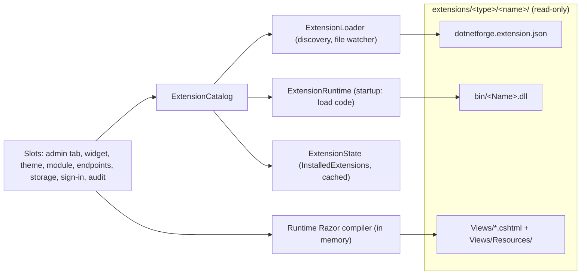

# Extensions

Extensions are folders under `extensions/` with a `dotnetforge.extension.json` manifest, optional C# code built into
the extension's own `bin/`, and optional Razor views and static files. They change the CMS without touching `src/`:
the host discovers and validates every manifest, loads extension code into an isolated load context per extension,
and plugs it into fixed **slots** (admin tab, dashboard widget, theme, page module, endpoints, media storage, sign-in
provider, audit events). Nothing an extension offers is used until it is **enabled** on the
[Plugins screen](../pages/plugins.md). How to write one: [extension development guide](../guides/extension-development.md).

`ExtensionCatalog` (`src/DotNetForge.Extensions/ExtensionCatalog.cs`) is the one place that answers "may this
extension contribute now?": its manifest is valid (and the first with its id), it is enabled, and - when it has code -
the code loaded and configured without error. Every slot asks it; none combines discovery, code and state itself.

## Manifest

Model: `src/DotNetForge.Shared/Manifests/ExtensionManifest.cs` (camelCase JSON). File name constant:
`ExtensionManifest.FileName = "dotnetforge.extension.json"`.

| Field | Required | Validation (`ManifestValidator`) | Used at runtime |
| --- | :-: | --- | --- |
| `id` | ✔ | non-blank | identity everywhere: Plugins row, enabled state, URLs (`/admin/ext/{id}`, `/ext/{id}/resources`) |
| `name` | ✔ | non-blank | sidebar label, tab title, widget title, Plugins row |
| `description` | ✔ | non-blank | Plugins row |
| `version` | ✔ | `^\d+\.\d+\.\d+([-+].+)?$` | Plugins row, startup log |
| `type` | ✔ | one of `theme, authentication, connector, library, admin, widget, provider, plugin, module` (case-insensitive) | which view slot is used ([Slots](#slots)) |
| `author` | ✔ | non-blank | Plugins row |
| `entryPoint` | ✔ | non-blank | with `assembly`: full type name (or simple name) of the class implementing `DotNetForge.Sdk.IExtension`; otherwise informational |
| `permissions` | ✔ | non-empty; each matches `^[a-z0-9]+(?:[._-][a-z0-9]+)*\.[a-z0-9]+(?:[._-][a-z0-9]+)*$` (dotted, lower-case) | recorded in `InstalledExtensions.PermissionsCsv`; not checked against `PermissionKeys`, not enforced |
| `assembly` | | a `.dll` path relative to the manifest folder, `/`-separated, no segment starting with `.` (so no `..`, no rooted path) | the code to load ([Loading code](#loading-code)); absent = views/resources only |
| `dependencies` | | - | extension ids that must be enabled first; libraries' load contexts are shared with dependents |
| `settings` | | - | `ExtensionContext` (code and views), `ViewData["Settings"]` |
| `website`, `license` | | - | recorded in `InstalledExtensions` |
| `routes` | | - | informational only; endpoints are whatever the code maps |

Validation errors carry the PascalCase field name (`Version`, `Permissions`, `Assembly`, ...). Parse failures become a
single `Manifest` error (`Manifest could not be parsed.` / `Invalid JSON: ...`). The loader accepts comments and
trailing commas and is case-insensitive on property names.

## Discovery

`IExtensionLoader` (`src/DotNetForge.Core/Extensions/IExtensionContracts.cs`) is implemented by `ExtensionLoader`
(`src/DotNetForge.Extensions/`). `Discover()` returns one `DiscoveredExtension { Path, Manifest, Validation, IsValid }`
per `dotnetforge.extension.json` found **recursively** under the root, valid or not. The root is
`AppEnvironment.ExtensionsPath`: `EXTENSIONS_PATH` when set (relative to the content root), otherwise the
`extensions/` folder next to the app, otherwise the one at the repository root - so a checkout run with
`dotnet run --project src/DotNetForge.Web` and a published `/app` both find it
([where the app finds its files](../guides/development.md#where-the-app-finds-its-files)).

**Caching.** The scan result is cached in memory. A `FileSystemWatcher` on the root (no name filter, subdirectories
included) clears the cache on `Created`, `Changed`, `Deleted`, `Renamed` and `Error` (buffer overflow) for any file or
folder and increments a version counter. Folder events matter: on Linux a manifest written right after its new folder
is created can arrive before that folder is watched, and a folder moved in raises no manifest event. A scan is only
cached when no change arrived while it ran. If the root does not exist at startup or the watcher cannot be created,
every call rescans.
A new or changed manifest is therefore picked up without a restart; new or changed **code** is not (see below).
Tests: `tests/DotNetForge.Tests/ExtensionLoaderTests.cs`.

Folder layout below `extensions/` is a convention only; the type comes from the manifest. When two valid manifests
share an id, the first in file-system order is used everywhere and the Plugins screen flags the other.

## Loading code

At startup - in `DependencyRegistration`, before the DI container is built, because extensions register services -
`ExtensionRuntime.Load` (`src/DotNetForge.Extensions/ExtensionRuntime.cs`) loads every valid manifest that names an
`assembly`, **enabled or not**:

1. Dependency order: an extension's `dependencies` load first. A missing, failed or circular dependency marks the
   dependent failed.
2. One `ExtensionLoadContext` (an `AssemblyLoadContext`, `src/DotNetForge.Extensions/ExtensionLoadContext.cs`) per
   extension. It resolves an assembly from, in order: **the host** (any assembly the app ships - the framework,
   `DotNetForge.*`, the host's NuGet packages - so contract types are identical on both sides), the load contexts of
   the extension's dependencies (one shared copy of a library), then the extension's own `bin/` (its `.deps.json`,
   else the file next to the main assembly). Native libraries resolve through the `.deps.json`.
3. Assemblies are read into memory before loading, so files are never locked: an extension can be rebuilt while the
   app runs. Code is never unloaded.
4. The entry type (`entryPoint`) must implement `IExtension` and have a public parameterless constructor; one
   instance is created.
5. `IExtension.ConfigureServices(services, context)` runs; later, `IExtension.MapEndpoints(group, context)` runs in
   `Program.cs` (`ExtensionPipeline.MapDotNetForgeExtensionsAsync`). The extension's assembly is an MVC application part
   (its controllers) and its private assemblies are compile references for runtime-compiled views.

Any exception - missing file (`'bin/X.dll' was not found. Build the extension (dotnet build "...") and restart the
app.`), bad image, missing entry type, a throwing `ConfigureServices`/`MapEndpoints` - is recorded on the
`LoadedExtension` (`Error`), logged at startup (`Extension {id} is enabled but not running: ...` (warning; information while disabled)) and shown on the Plugins screen.
The extension then contributes nothing and cannot be enabled; the host always starts. Views compiled at runtime bind
to extension assemblies through an `AppDomain.AssemblyResolve` fallback in `ExtensionLoadContext`.

Because code loads only at startup, a new or rebuilt DLL needs a **restart**; the Plugins screen says so for an
extension whose manifest gained or changed its `assembly` after startup. Enabling and disabling never need one.

## Enable and disable

Every extension starts **disabled**. `ExtensionLifecycleService` (`src/DotNetForge.Web/Services/`) owns the rules;
the Plugins screen calls it (`POST /admin/plugins/{id}/enable|disable`, Super Admin, antiforgery):

| Action | Refused when | On success |
| --- | --- | --- |
| Enable | no valid manifest with this id; code failed or needs a restart; a `dependencies` entry is not enabled (`X needs Y - enable it first.`) | upserts the `InstalledExtensions` row from the manifest (`InstalledDate` on first enable), `Status = Enabled`, audit `plugin.enabled` |
| Disable | not enabled; an enabled extension lists it in `dependencies` (`Y depends on X - disable it first.`) | `Status = Disabled`, audit `plugin.disabled` |

Changes on one instance are serialized by a semaphore.

### Enabled state

`ExtensionState` (`src/DotNetForge.Web/Services/ExtensionState.cs`, also registered as `DotNetForge.Sdk.IExtensionState`)
caches the set of enabled ids from `InstalledExtensions` (one single-table query). A change
on this instance refreshes it immediately; another instance sees it within `ExtensionState.Lifetime` (30 s). A read
that overlapped a change is never cached.

## Slots

What an enabled, running extension can contribute. View slots depend on the manifest `type`; code slots are open to
every type.

| Slot | Contributed by | Host side |
| --- | --- | --- |
| Admin tab | `type: admin` + `Views/Index.cshtml` | sidebar group **Extensions**, `/admin/ext/{id}` (shell + iframe of `/admin/ext/{id}/raw`) - [extension host](../pages/extension-host.md) |
| Dashboard widget | `type: widget` + `Views/Widget.cshtml` | one panel per widget on `/admin` - [dashboard](../pages/dashboard.md#widgets) |
| Public theme | `type: theme` + `Views/Page.cshtml` and/or `Views/Index.cshtml` | `HomeController` renders the active theme's view - [themes](themes.md) |
| Page module | `type: module` + `Views/Module.cshtml` + setting `pages` | `ExtensionModules` view component in the page view (built-in and themes) |
| Endpoints | `IExtension.MapEndpoints` (minimal APIs) or MVC controllers in the assembly | mapped at startup; `ExtensionEndpointGateMiddleware` answers 404 while inactive |
| Media storage | `services.AddMediaStorage(context, factory)` | `ExtensionMediaStorage` routes `IFileStorage` to it - [media storage](media-storage.md#storage-connectors) |
| Sign-in provider | own auth scheme + `services.AddLoginProvider(context, scheme, name)` | "Sign in with ..." button, `ExternalLoginController` - [authentication](authentication.md#extension-providers); listed read-only on [Providers](../pages/providers.md) |
| Audit events | `services.AddAuditEventHandler<T>(context)` | `AuditEventDispatcher` (background) - [audit logging](audit-logging.md#extension-handlers) |
| Any service | `IExtension.ConfigureServices` | the host container; other extensions and views can inject it |

View rendering (`ExtensionViewRenderer`): a widget or module view is rendered as a partial into the host screen with a
fresh ViewData; if it throws, the error is logged and a short "could not be displayed" notice replaces it. Every
extension view receives:

| `ViewData` key | Value |
| --- | --- |
| `Extension` | the `DotNetForge.Sdk.ExtensionContext` (id, name, settings with typed getters, `GetEnvironmentValue`) |
| `Settings` | manifest `settings` as `Dictionary<string, object?>`: numbers → `long`/`double`, booleans → `bool`, strings → `string`, arrays/objects → JSON text |
| `ResourceBase` | `/admin/ext/{id}/resources` in the admin area, `/ext/{id}/resources` on the public site |

Theme views also get `AppName` and `Menu` (top-level live pages marked "display in menu", as `PublishedPage`).

**Modules.** `ExtensionModulesViewComponent` (`src/DotNetForge.Web/Components/`) renders every active module whose
`pages` setting contains the current URL path (case-insensitive, slashes trimmed: `"contact"`, `"about/team"`, `"/"`
for the root page, `"*"` for every page), ordered by name, with the `Page` as model.

**Static files.** `Views/Resources/` of an active extension is served at `/admin/ext/{id}/resources/{**path}`
(admin-capable users, any type) and - for `theme` and `module` only - publicly at `/ext/{id}/resources/{**path}`.
Both resolve the path with `Path.GetFullPath` and refuse anything outside `Views/Resources/`; content types: css, js,
json, svg, png, jpg/jpeg, gif, webp, ico, woff2, else `application/octet-stream`.

## Extension SDK

`src/DotNetForge.Sdk` is the one assembly an extension compiles against (with `DotNetForge.Abstractions` and
`DotNetForge.Shared`, which it references). It has a framework reference to ASP.NET Core.

| Type | Purpose |
| --- | --- |
| `IExtension` | entry point: `ConfigureServices(IServiceCollection, ExtensionContext)`, `MapEndpoints(IEndpointRouteBuilder, ExtensionContext)` (both optional) |
| `ExtensionContext` | `Id`, `Name`, `Version`, `Type`, `Directory`, `Settings`, `GetString/GetBool/GetInt64/GetDouble/GetStringList`, `GetEnvironmentValue(name)` (process environment, then `.env` - for secrets), `PublicResourceBase`, `AdminResourceBase` |
| `ExtensionServiceCollectionExtensions` | `AddMediaStorage`, `AddLoginProvider`, `AddAuditEventHandler<T>` |
| `IExtensionState` | `IsEnabledAsync(id)`, `GetEnabledAsync()` - for code that runs on its own (hosted services) |
| `IAuditEventHandler`, `AuditEvent` | audit event subscription |
| `ExternalLogin.SignInScheme` | `dnf.external`, the cookie scheme a sign-in extension's remote handler signs into |

Host contracts commonly used from extensions: `IFileStorage`/`StorageKey` (Abstractions), `IAuditService`,
`IPublishedPages`, `PageVisibility`, `AuthorizationPolicies`, `RateLimitPolicies`, `PermissionKeys`, `AppEnvironment`
(Shared). Extensions may also inject host internals such as `DotNetForgeDbContext` (the `audit-dashboard` sample does),
at the price of coupling to them.

## Deployment

`extensions/` sits at the repository root, outside every project. `src/DotNetForge.Web/DotNetForge.Web.csproj` copies
it to the publish output as plain files (`<None Include="../../extensions/**" Exclude="../../extensions/**/obj/**" ...>`),
so the built `bin/` folders ship and `obj/` does not. `docker/Dockerfile` builds every `extensions/**/*.csproj` in
Release before `dotnet publish`. Views compile in memory (runtime Razor compilation with a `PhysicalFileProvider` on
the folder that contains `extensions/`); nothing is written to disk, so all of this works on a read-only filesystem
([deployment](../guides/deployment.md#read-only-deployment-requirements)). Enabled state lives in the database, so
enabling needs no write access to the deployment either. Adding or changing an extension in a read-only deployment
means a new publish or image.

`extensions/Directory.Build.props` makes every extension project build into its own `bin/` (whatever the
configuration) as a plugin (`EnableDynamicLoading`), referencing the SDK projects without copying them. In a published
app without `src/` it references the `DotNetForge.Sdk.dll`, `DotNetForge.Abstractions.dll` and `DotNetForge.Shared.dll`
next to the app instead, so an extension can be built against a published CMS. The sample projects are in
`DotNetForge.slnx` (folder `/extensions/`), so `dotnet build` builds them.

## Security model

- Extension code and views run **in the host process** with full access to DI and the database. The load context
  isolates dependency versions, not privileges. Install only extensions you trust as much as the CMS itself.
- Manifest `permissions` are recorded, not enforced.
- Admin tabs and widgets are behind the `AdminArea` policy only (Editors and Authors see enabled ones too). An
  extension's own endpoints are **public** unless it protects them (`.RequireAuthorization(AuthorizationPolicies.AdminArea)`).
- The admin-tab iframe isolates **styles** and the DOM from the admin shell, not privileges; it is same-origin.
- The CSP (`script-src 'self'; style-src 'self'`) applies to every extension view: no inline script or style.
- Only Super Admin can enable or disable; every change is audited.

## Samples in the repository

Each sample is runnable; [extensions/README.md](../../extensions/README.md) says how to try each one.

| Folder | id | type | Code | What it does |
| --- | --- | --- | :-: | --- |
| `extensions/admin/audit-dashboard` | `dotnetforge.admin.audit-dashboard` | admin | | admin tab with the recent audit activity |
| `extensions/widgets/weather-widget` | `dotnetforge.widget.weather` | widget | ✔ | dashboard tile with the current weather (Open-Meteo, cached 15 min, fails soft) |
| `extensions/themes/default-theme` | `dotnetforge.theme.default` | theme | | public-site layout, menu, page and home views, light/dark |
| `extensions/modules/contact-form` | `dotnetforge.module.contact-form` | module | ✔ | contact form on the `pages` it lists; messages to media storage (`ext/contact-form/...`) + audit `contactform.submitted` |
| `extensions/libraries/markdown-kit` | `dotnetforge.library.markdown-kit` | library | ✔ | safe Markdown → HTML (`IMarkdownRenderer`), used by Contact Form |
| `extensions/plugins/seo-toolkit` | `dotnetforge.plugin.seo-toolkit` | plugin | ✔ | `/sitemap.xml` of live pages and `/robots.txt` |
| `extensions/connectors/s3-storage` | `dotnetforge.connector.s3` | connector | ✔ | media storage in its own S3-compatible bucket (defaults: the `docker/s3/seaweedfs.yml` server) |
| `extensions/authentication/discord-login` | `dotnetforge.auth.discord` | authentication | ✔ | "Sign in with Discord" with a verified Discord email: the matching account, or a new one while sign-ups are on (needs `DISCORD_CLIENT_ID`/`_SECRET`); Discord is also one of the [built-in providers](authentication.md#built-in-oauth-providers), which need no extension |
| `extensions/providers/sms-notifications` | `dotnetforge.provider.sms` | provider | ✔ | SMS for selected audit events (`log` gateway offline, `twilio`) |

Fixture extensions for the integration tests live in `tests/fixtures/extensions/` ([testing](../guides/testing.md)).

## Planned (not implemented)

Target behaviour from the original product specification. Nothing in this section exists in the code unless marked ✔.

### Requirements

- **Lifecycle:** install (local package or [marketplace](#marketplace)), update, configure and remove extensions from
  the CMS. Enable/disable ✔ (see [Enable and disable](#enable-and-disable)); today extensions are installed by putting
  their folder under `extensions/` and redeploying.
- **Unloading:** disabling stops every contribution ✔, but loaded code stays in memory until the next restart.
- **Core separation:** extensions live only under `extensions/` ✔; core updates must not break or overwrite them. Core
  updates, backups and rollback: [transfer and updates](transfer-and-updates.md).
- **Runtime permissions:** the manifest `permissions` are enforced at runtime through the role/permission model.
  Granting an extension's runtime permissions to roles is separate from the right to manage its lifecycle.
- **Audit:** every install, configure, update and remove writes an audit entry (enable ✔ `plugin.enabled`, disable ✔
  `plugin.disabled`; `AuditActions.PluginInstalled` exists but is never written). See [audit logging](audit-logging.md).

Manifest changes the spec implies:

| Field | Target meaning | Today |
| --- | --- | --- |
| `dependencies` | other extension ids, each with an optional version constraint | ✔ ids, enforced on enable/disable and used for load order; no version constraints |
| `routes` | routes the extension registers, including dynamic route handlers | informational; code maps its own endpoints |
| `settings` | definition and defaults edited through **Configure**; saved values validated against it | read from the manifest only |
| core compatibility | the extension declares which CMS core versions it supports | no field exists - must be added to `ExtensionManifest` |

### User flows

| Flow | Steps |
| --- | --- |
| Create | ✔ Developer creates a folder of the chosen type under `extensions/` → writes the manifest → adds code and/or views → builds → restarts → enables on Plugins. Guide: [extension development](../guides/extension-development.md). Packaging for the marketplace is planned. |
| Install (local) | Super Admin/Admin uploads or selects a package → CMS reads `dotnetforge.extension.json` → full validation (see below) → on failure reject with a clear reason, install nothing → on success store it where the read-only deployment allows, write `InstalledExtension` with `InstalledDate`, leave **Disabled** → audit. |
| Install (marketplace) | See [Marketplace](#marketplace). |
| Enable | ✔ dependencies enabled, code loaded → `Status = Enabled` → audit. Planned: core compatibility check. |
| Disable | ✔ refused while enabled extensions depend on it → `Status = Disabled` → audit. Planned: warn/block when in use (active theme, active storage connector). |
| Configure | Edit the extension's `settings` → save only valid values; field-level error messages otherwise → audit. |
| Update | Update availability shown per extension → **Update** → fetch package → full validation incl. compatibility with the running core → back up first, never overwrite unrelated extensions → refresh `Version` / `UpdateAvailable` → on failure keep or restore the previous version → audit. |
| Remove | Check dependents and in-use status → block with an explanation while either applies → on confirmation disable, delete → audit. |

### Rules and validation

| Rule | Today |
| --- | --- |
| Package contains a file named exactly `dotnetforge.extension.json` | ✔ discovery only reads that name (no packages/install exist) |
| Well-formed JSON that conforms to the manifest schema | ✔ JSON parse errors; no schema beyond typed deserialization |
| `id`, `name`, `description`, `version`, `type`, `author`, `entryPoint`, `permissions` present and non-empty | ✔ `ManifestValidator` |
| Exactly one `version` key, valid semver; duplicate `version` keys or a misspelled `vrsion` key rejected | ✘ semver ✔, but duplicate keys are accepted (System.Text.Json, last value wins) and unknown keys such as `vrsion` are ignored |
| `type` is one of the nine extension types | ✔ `ManifestValidator.ValidTypes` |
| `id` does not collide with an installed extension | partly ✔: duplicates are flagged on Plugins and only the first is used |
| Every `permissions` entry is a known/declarable permission key | ✘ only the dotted format is checked |
| Every `dependencies` entry resolves to an enabled extension | ✔ on enable; ✘ version constraints |
| Compatible with the running core version | ✘ |
| Extensions failing validation or loading are never used | ✔ invalid manifests and failed code contribute nothing and cannot be enabled |
| Marketplace installs come from a trusted source | ✘ |
| **Configure** values validate against the extension's `settings` definition | ✘ |
| Concurrent lifecycle actions on the same extension are serialized | partly ✔: per instance (semaphore), not across instances |

Roles: the spec lets **Super Admin** and **Admin** manage extensions; today the Plugins screen and enable/disable are
Super Admin only, and `PermissionMatrix` (reference data) grants Admin only `Extensions: read`. See
[authorization](authorization.md).

### Edge cases

| Case | Required behaviour |
| --- | --- |
| Manifest missing, invalid JSON, schema failure, missing required field, duplicate/misspelled `version` | install/update rejected with a specific error; nothing loaded (✔ for discovery: shown as invalid, never loaded) |
| Missing dependency | ✔ enable blocked, the missing dependency named |
| Incompatible core version | install/update/enable rejected; required vs current version reported |
| Disabling an extension others depend on | ✔ refused until dependents are disabled |
| Disabling the active theme | ✔ the site falls back to the next enabled theme or the built-in views; the admin area never uses themes |
| Disabling an active authentication provider or in-use storage connector | blocked until no longer in use (today: allowed; media stored through a connector is unreachable while it is disabled) |
| Untrusted marketplace source | rejected before download |
| Update fails mid-apply | previous working version preserved or restored where possible |
| Disabled but installed | ✔ stays listed, contributes nothing |

### Marketplace

Today `/admin/marketplace` is a [placeholder](../pages/module-placeholders.md) (`ModulesController.Marketplace`,
sidebar **Main**, `AdminArea` policy). Planned:

- Admin entry point stays `/admin/marketplace`; restricted to Super Admin and Admin.
- Uses an external marketplace API whose endpoint is configured in Settings (no setting key exists yet).
- Flow: open → query the marketplace API → select → verify the source is **trusted** → download → read manifest →
  same validation as a local install → install **Disabled** → audit.
- The same source supplies update availability (`InstalledExtension.UpdateAvailable` exists, never written).

### Acceptance criteria

- [ ] An extension cannot be installed without a valid `dotnetforge.extension.json` manifest (no install exists).
- [x] Manifest validation enforces all required fields: `id`, `name`, `description`, `version`, `type`, `author`,
  `entryPoint`, `permissions` (`ManifestValidator`).
- [ ] A manifest with duplicate `version` keys or a `vrsion` field is rejected; exactly one `version` field is required.
- [x] `type` is validated against the nine extension types (`ManifestValidator.ValidTypes`).
- [x] Invalid or failing extensions are never loaded or used (`ExtensionCatalog`); unsafe/incompatible checks are not
  implemented.
- [x] Dependency resolution blocks enabling an extension whose dependencies are not enabled, naming them
  (`ExtensionLifecycleService`).
- [ ] A version/compatibility check against the current core version blocks incompatible extensions.
- [ ] Marketplace installs verify source trust before download; untrusted sources are rejected.
- [ ] Marketplace install is reachable from the admin Marketplace entry point.
- [ ] The full lifecycle works: create ✔, install, update, enable ✔, disable ✔, remove.
- [x] Disabling an extension that others depend on is prevented.
- [ ] Removing an in-use theme is blocked until another theme is selected; the admin area remains unaffected by
  frontend themes (✔ the admin area never uses themes).
- [ ] Removing an in-use authentication provider or connector is blocked until it is no longer in use.
- [ ] Updating an extension does not overwrite unrelated custom extensions and creates a backup beforehand.
- [ ] A failed update preserves or restores the previous working version where possible.
- [ ] The Plugins screen lists every installed extension with Name, Description, Version, Type, Status, Author,
  Installed date and Update availability (all but installed date and update availability ✔).
- [ ] The Plugins screen exposes Enable ✔, Disable ✔, Configure, Update and Remove actions per extension.
- [ ] Only Super Admin and Admin can view the Plugins screen and manage extensions (Super Admin only today).
- [ ] Every install, enable ✔, disable ✔, configure, update and remove action is recorded in the audit log.
- [ ] Each installed extension declares its required permissions, which are enforced at runtime.

## Where to change things

- Validation rules: `src/DotNetForge.Extensions/ManifestValidator.cs` + `tests/DotNetForge.Tests/ManifestValidationTests.cs`.
- Discovery and its cache: `ExtensionLoader` + `tests/DotNetForge.Tests/ExtensionLoaderTests.cs`.
- Code loading and isolation: `ExtensionRuntime`, `ExtensionLoadContext` + `tests/DotNetForge.Tests/ExtensionRuntimeTests.cs`.
- "Is it active?": `ExtensionCatalog` (`GetActiveAsync`, `FindActiveAsync`, `IsActiveAsync`, `Problem`) - never
  combine discovery, runtime and state in a caller.
- Enable/disable rules: `ExtensionLifecycleService`; the screen: `PluginsController`.
- Slots: `ExtensionViewController` (admin tab, admin resources), `ExtensionResourcesController` (public resources),
  `ExtensionWidgetsViewComponent`, `ExtensionModulesViewComponent`, `HomeController.ThemedViewAsync` + `ThemeResolver`,
  `ExtensionMediaStorage`, `ExternalLoginController` + `LoginProviders`, `AuditEventDispatcher`,
  `ExtensionEndpointGateMiddleware` + `ExtensionControllerConvention` (`src/DotNetForge.Web/Startup/ExtensionHosting.cs`).
- The SDK surface: `src/DotNetForge.Sdk` - extensions compile against it, so treat changes as breaking.
- End-to-end tests: `tests/DotNetForge.IntegrationTests/ExtensionTests.cs` (fixtures) and `SampleExtensionTests`.
- What ships with a deployment: the `extensions/**` `None` item in `src/DotNetForge.Web/DotNetForge.Web.csproj` and
  the extension build step in `docker/Dockerfile`.
- Never resolve a file under `extensions/` from request input without the `GetFullPath` + prefix check in
  `ExtensionResources.Serve`.
