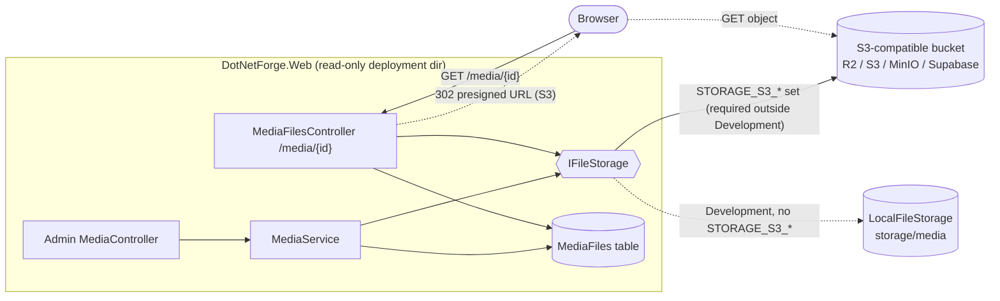
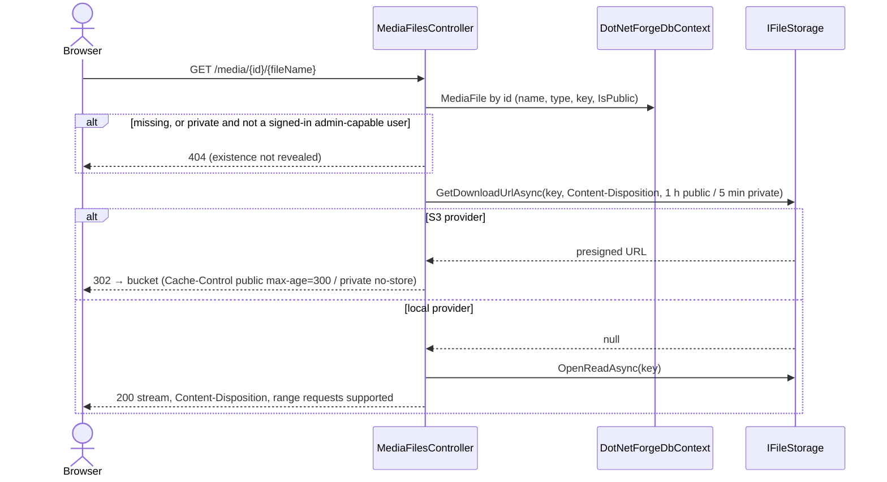

# Media storage

Uploaded media - the only files the application creates at runtime - live in **object storage** behind the
`IFileStorage` abstraction, never in the deployment directory (which is read-only in production, see
[deployment](../guides/deployment.md#read-only-deployment-requirements)). Metadata lives in the `MediaFiles` table.
Screen: [Media](../pages/media.md). Still-unbuilt File Manager features: [Planned](#planned-not-implemented).

## What exists

| Piece | Location | Responsibility |
| --- | --- | --- |
| `IFileStorage`, `StoredFile`, `StorageKey` | `src/DotNetForge.Abstractions/Storage/IFileStorage.cs` | Provider-neutral contract and key validation |
| `LocalFileStorage` | `src/DotNetForge.Infrastructure/Storage/LocalFileStorage.cs` | Development fallback (`storage/media`) when no S3 storage is configured; the integration tests' stand-in |
| `S3FileStorage` | `src/DotNetForge.Infrastructure/Storage/S3FileStorage.cs` | Any S3-compatible service (Cloudflare R2, AWS S3, MinIO, Supabase Storage) |
| `ExtensionMediaStorage` | `src/DotNetForge.Web/Services/ExtensionMediaStorage.cs` | The `IFileStorage` everyone injects: routes each call to an enabled storage-connector extension, else to the host's own storage ([Storage connectors](#storage-connectors)) |
| `MediaService` | `src/DotNetForge.Web/Services/MediaService.cs` | Upload/delete rules: allowed types, [upload limits](#upload-limits), duplicates, image optimization, generated keys, audit, failure handling |
| `MediaSettings`, `MediaSettingsService` | `src/DotNetForge.Web/Services/MediaSettings.cs` | The Media Library settings (upload limits, optimization) as `Settings` rows `media.*`, with validation; screen: [Media Library settings](../pages/media-settings.md) |
| `MediaUploadLimitAttribute` | `src/DotNetForge.Web/Services/MediaUploadLimitAttribute.cs` | `[MediaUploadLimit]`: the request size of the upload actions, from the settings ([upload limits](#upload-limits)) |
| `ImageOptimizer` | `src/DotNetForge.Web/Services/ImageOptimizer.cs` | Re-encodes uploaded images with SkiaSharp ([images](#images)) |
| `Ffmpeg`, `VideoOptimizationQueue`, `VideoOptimizationService` | `src/DotNetForge.Web/Services/VideoCompression.cs` | ffmpeg from `FFMPEG_PATH`, and the background job that compresses queued MP4 uploads ([videos](#videos)) |
| `MediaExportService` | `src/DotNetForge.Web/Services/MediaExportService.cs` | Every media file as one .zip in its library folders ([Data Management → media export](../pages/data-management.md#media-export)) |
| Admin screen | `src/DotNetForge.Web/Areas/Admin/Controllers/MediaController.cs` | `GET /admin/media`, `POST /admin/media/upload`, `POST /admin/media/delete/{id}`, `POST /admin/media/delete-selected` ([delete flow](#delete-flow)) |
| Download endpoint | `src/DotNetForge.Web/Controllers/MediaFilesController.cs` | `GET /media/{id}/{fileName?}`: authorization, then presigned redirect or stream |
| `MediaFile` entity | `src/DotNetForge.Shared/Entities/Content.cs` | Metadata row (`RelativePath` holds the storage key) |
| API list | `GET /api/media` (`media.read`) | Lists the media files ([headless API](headless-api.md)) |
| Configuration | `StorageSettings` on `AppEnvironment`; `STORAGE_S3_*` keys | Endpoint and credentials ([configuration](configuration.md)) |

## Storage architecture



Design decisions:

- **One small contract.** `SaveAsync`, `OpenReadAsync` (returns the stream and its length, or `null` when missing),
  `DeleteAsync` (idempotent) and `GetDownloadUrlAsync` (a short-lived signed URL, or `null` when the provider can't
  sign). These are the operations the application actually uses. There are no separate exists/metadata calls:
  `OpenReadAsync` covers both, and content type, size and name are stored in `MediaFiles`.
- **Keys never contain user input.** `MediaService` generates `{yyyy}/{MM}/{random:N}{ext}` (files uploaded before
  the `RemoveTenants` migration keep their stored `{tenantId:N}/{yyyy}/{MM}/...` keys and still work - the key is read
  from `RelativePath`, never rebuilt); `StorageKey.IsValid` (1-512 characters, `/`-separated segments of `[A-Za-z0-9._-]`, no `.`, `..` or empty
  segments) is enforced by every provider, so traversal or odd object names are impossible.
- **Objects stay private in the bucket.** Access control is decided by the application, then the browser gets a
  presigned URL that expires (public files: 1 hour, private files: 5 minutes). No public bucket and no CDN rules to
  keep in sync.
- **Provider code stays behind the interface.** Only `src/DotNetForge.Web/Startup/DependencyRegistration.cs` decides which implementation
  is used; controllers and services depend on `IFileStorage`. The host's own storage (`S3FileStorage` or
  `LocalFileStorage`) is registered as a **keyed** singleton (`ExtensionMediaStorage.CoreStorageKey = "core"`); the
  unkeyed `IFileStorage` is `ExtensionMediaStorage`, which wraps it.

## Storage connectors

A `connector` extension (any type may, by convention it is `connector`) can replace where media is stored by calling
`services.AddMediaStorage(context, sp => new MyStorage(...))` (`DotNetForge.Sdk`) from `ConfigureServices`. The
factory returns any `IFileStorage`.

| Rule (`ExtensionMediaStorage`) | Behaviour |
| --- | --- |
| Which storage | per call: the storage of the **first** contribution (registration order) whose extension is active (`ExtensionCatalog.IsActiveAsync`), else the core storage |
| Switching | enabling or disabling the connector on [Plugins](../pages/plugins.md) takes effect without a restart (other instances within 30 s) |
| Existing objects | **not moved**: media stored before a switch stays in the previous storage and its downloads fail (404/stream error) while the other storage is in use - switch on a fresh site or copy the objects yourself |
| Creation | the connector's storage is created on first use (`Lazy`, `PublicationOnly`): a factory that throws (missing secret, bad setting) fails that media operation and is retried on the next call, it never fails startup |
| Disposal | created connector storages that are `IDisposable` are disposed with the app |
| Keys and rules | unchanged: `MediaService` still generates keys and enforces upload rules; connectors should enforce `StorageKey.IsValid` like the built-in providers |

Sample: `extensions/connectors/s3-storage` (`dotnetforge.connector.s3`) - its own S3-compatible bucket from manifest
`settings` (`serviceUrl`, `bucket`, `region`, `forcePathStyle`; defaults point at the `docker/s3/seaweedfs.yml`
server) and secrets `S3_CONNECTOR_ACCESS_KEY_ID` / `S3_CONNECTOR_SECRET_ACCESS_KEY`
([configuration → extension settings](configuration.md#extension-settings)). Extensions can also **use** media storage
directly by injecting `IFileStorage` (the Contact Form sample stores messages under `ext/contact-form/...`); such
objects have no `MediaFiles` row and do not appear on the Media screen.

## Provider choice

S3 is the only storage for deployments, and no provider name is configured: every service below speaks the S3 API,
so choosing one means setting its endpoint (`STORAGE_S3_SERVICE_URL`), region and path style.

**Recommendation: Cloudflare R2** for production. In development, either leave `STORAGE_S3_*` empty (uploads go to
`storage/media`) or run an S3 server from `docker/s3/` (RustFS, Ceph or SeaweedFS) to use the S3 path locally.

Prices researched October 2026 (check the providers' pages before committing; they change):

| | Cloudflare R2 | Supabase Storage | AWS S3 | Azure Blob Storage |
| --- | --- | --- | --- | --- |
| Storage | $0.015 / GB-month | Pro: 100 GB included, then $0.0213 / GB | $0.023 / GB-month (Standard, us-east-1) | ~$0.018-0.021 / GB-month (Hot LRS, region-dependent) |
| Egress | **free** | Free: 5 GB; Pro: 250 GB, then $0.09 / GB | first 100 GB/month free, then $0.09 / GB | billed beyond a free allowance (~$0.087 / GB) |
| Requests | $4.50 / M writes, $0.36 / M reads | included | $0.005 / 1k PUT, $0.0004 / 1k GET | per 10k operations |
| Free tier | 10 GB + 1 M writes + 10 M reads / month, permanently | 1 GB, 50 MB max file; free projects pause after 1 week inactive | credits for new accounts (time-limited) | credits for new accounts |
| Paid entry | pay as you go | $25 / month (Pro plan) | pay as you go | pay as you go |
| API | S3-compatible | own API + S3-compatible endpoint | S3 (reference) | own API/SDK (not S3) |
| Presigned URLs | ✔ | ✔ (signed URLs; S3 presign via the S3 endpoint) | ✔ | ✔ (SAS tokens) |
| Fit with this code | `S3FileStorage` as-is | `S3FileStorage` via S3 endpoint | `S3FileStorage` as-is | needs a second provider implementation |

Why R2:

- **Cost profile of a CMS.** Media is read far more often than written; R2's free egress removes the cost line that
  grows with traffic on S3, Azure and Supabase.
- **No lock-in.** It speaks the S3 API, so the same `S3FileStorage` works with AWS S3, MinIO, Backblaze B2 or
  Supabase. Moving providers is a configuration change plus an object copy (`rclone`, `aws s3 sync`).
- **Permanent free tier** that covers small sites, unlike time-limited cloud credits or Supabase's pausing free
  projects.
- **Mature SDK.** The official AWS SDK (`AWSSDK.S3`) is well-maintained and handles signing, retries and multipart.
- **Reliability and security.** Durable object storage, private buckets by default, scoped API tokens per bucket.

When to choose differently: already on AWS (S3, IAM roles, same-region compute → no egress inside AWS); already using
Supabase for the database (its S3 endpoint works with this code); Azure-only organisations (Blob Storage would need an
`AzureBlobFileStorage` behind the same interface - not implemented).

### Provider setup

| Provider | `STORAGE_S3_SERVICE_URL` | `STORAGE_S3_REGION` | `STORAGE_S3_FORCE_PATH_STYLE` |
| --- | --- | --- | --- |
| Cloudflare R2 | `https://<account-id>.r2.cloudflarestorage.com` | `auto` (default) | `false` |
| AWS S3 | *(empty)* | the bucket's region, e.g. `eu-central-1` (required) | `false` |
| Supabase Storage | `https://<project-ref>.supabase.co/storage/v1/s3` | the project's region | `true` |
| MinIO / SeaweedFS (dev) | `http://localhost:8333` (or the server's URL) | `auto` | `true` |

All need `STORAGE_S3_BUCKET`, `STORAGE_S3_ACCESS_KEY_ID`, `STORAGE_S3_SECRET_ACCESS_KEY` (a key scoped to the one bucket,
read/write objects). Full key reference: [configuration](configuration.md).
`S3FileStorage` disables the SDK's optional checksums and `aws-chunked` uploads (several S3-compatible services reject
them) and signs URLs with the endpoint's scheme.

## Upload flow

```mermaid
sequenceDiagram
    actor U as Admin user
    participant C as Admin MediaController.Upload
    participant M as MediaService
    participant S as IFileStorage
    participant DB as DotNetForgeDbContext
    participant A as IAuditService
    U->>C: POST /admin/media/upload (multipart, antiforgery, ≤ 10 files)
    C->>C: Media/create permission; file count; request size limit ([MediaUploadLimit])
    loop each file
        C->>M: UploadAsync(file, isPublic, user)
        M->>M: extension in AllowedTypes → content type; size ≤ the limit of its kind; not a duplicate; sanitize display name
        opt image optimization on (JPEG, PNG, WebP up to 64 MB)
            M->>M: ImageOptimizer - upright, scaled, re-encoded; kept only when smaller
        end
        M->>S: SaveAsync("{yyyy}/{MM}/{random}{ext}", stream, contentType)
        alt storage fails
            M-->>C: "'x' could not be stored right now. Try again later." (error logged)
        else stored
            M->>DB: add MediaFile (Optimization Pending for an MP4 to compress), SaveChanges (on failure: delete the object, rethrow)
            M->>A: media.uploaded
        end
    end
    C-->>U: redirect + "Uploaded N files." or the same screen with per-file errors
```

Upload rules (`MediaService`):

| Rule | Value |
| --- | --- |
| Max size per file | per kind, from the Media Library settings - [upload limits](#upload-limits) (defaults: images 25 MB, videos and audio 100 MB, other files 25 MB) |
| Files per request | `MaxFilesPerUpload` = 10; request limit = the largest per-file limit × 10 + 1 MB |
| Allowed types (extension → stored content type) | `.jpg .jpeg .png .gif .webp .avif .pdf .txt .csv .mp3 .mp4 .zip .docx .xlsx .pptx` |
| Never allowed | HTML, SVG, scripts, anything unlisted - they could run script from the site's origin |
| Content type | from the extension map, never the client's `Content-Type` |
| Stored names | display name sanitized (no path, quotes or control characters; ≤ 200), `OriginalName` ≤ 400; an image stored as WebP gets `.webp` in its display name and key |
| Duplicates | a file with the same `OriginalName` and the same size **as uploaded** (`OriginalSizeBytes ?? SizeBytes`, so an optimized file is still recognised) in the same folder: refused ("'x' is already in this folder (same name and size)."), or - for the pickers (`reuseDuplicate`), with the same visibility - the existing file is returned |
| Optimization | images re-encoded on upload, MP4 videos compressed in the background, as the settings say - [optimization](#optimization) |
| Temporary buffering | ASP.NET Core buffers multipart bodies over 64 KB in the OS temp directory (`ASPNETCORE_TEMP` or `/tmp`) - must be writable (tmpfs in containers); never used as storage |

## Upload limits

The largest file per upload is set per kind on [Settings → Media Library](../pages/media-settings.md)
(`MediaSettings`; `Settings` rows `media.maxImageMb`, `media.maxVideoMb`, `media.maxOtherMb`):

| Kind (`MediaSettings.KindOf`, by the content type from the extension) | Default | Range |
| --- | --- | --- |
| Images (`image/*`) | 25 MB | 1-2048 MB (`MediaSettings.MaxLimitMb`) |
| Videos and audio (`video/*`, `audio/*`) | 100 MB | 1-2048 MB |
| Other files (PDF, text, Office documents, archives) | 25 MB | 1-2048 MB |

Where they are enforced:

| Layer | Check |
| --- | --- |
| Browser (`media.js`) | the Media screen's Upload dialog marks a chosen file "Too large (max …)" with the limit of its kind (`data-max-image` / `data-max-video` / `data-max-other`; extensions per kind in `data-image-types` / `data-video-types`) - a hint only, the server checks again |
| Request (`[MediaUploadLimit]`) | the request body and the multipart form are limited to the **largest** of the three limits × the files one request may carry (`Files`: 10 on `MediaController.Upload`, 1 on the Content Manager's and the page builder's upload) + 1 MB. It runs before antiforgery (filter order 900), like the `[RequestSizeLimit]`/`[RequestFormLimits]` it replaced; a larger request is refused before model binding |
| Per file (`MediaService.UploadAsync`) | the limit of the file's kind: "'x' is larger than N MB, the limit for images." (`videos and audio`, `this kind of file`) |

The settings are read once per request (`MediaService.SettingsAsync`) and apply from the next upload; stored files are
not checked again. A reverse proxy in front of the app needs a body limit at least as large
([deployment](../guides/deployment.md#behind-a-reverse-proxy)).

## Optimization

Uploads can be made smaller to save storage and bandwidth, as set on
[Settings → Media Library](../pages/media-settings.md). An upload is never lost to optimization: whatever fails, the
file is stored (or kept) as uploaded. Only new uploads are optimized. State per file in `MediaFile`:

| Column | Meaning |
| --- | --- |
| `Optimization` (`MediaOptimization`) | `None` - stored as uploaded (not optimizable, optimization off, or the result was not smaller); `Optimized` - replaced by a smaller version; `Pending` - a video waiting for compression; `Processing` - being compressed; `Failed` - compression failed, the upload is kept (see the log) |
| `SizeBytes` | the stored object's size |
| `OriginalSizeBytes` | the size as uploaded when optimization replaced it, else null; duplicate checks compare uploads with it |
| `OptimizationStartedDate` | when the background compression claimed the file (UTC) |

The Media screen shows an optimized file's saving in the file's **Info** ([media → file info](../pages/media.md#file-info))
and a queued or running video as an **Optimizing…** badge; the settings screen sums up what optimization saved.

### Images

On upload, within the request (`MediaService.UploadAsync` → `ImageOptimizer.Optimize`, SkiaSharp), while **Optimize
images on upload** is on (the default):

| Rule | Behaviour |
| --- | --- |
| Which files | `.jpg`, `.jpeg`, `.png`, `.webp` up to 64 MB (`MediaService.MaxOptimizedImageBytes`; they are read into memory). GIF, AVIF, animated images (more than one frame), images over 100 megapixels (`ImageOptimizer.MaxPixels`) and files that can't be decoded are stored as uploaded |
| Orientation | turned upright by the EXIF orientation |
| Size | scaled down (never up, aspect ratio kept) to fit **Maximum width** × **Maximum height** (default 2560 × 2560 px; 320-10000) |
| Format | re-encoded in its own format (JPEG stays JPEG, PNG stays PNG, WebP stays WebP) at **Quality** (default 82; 40-100; PNG is lossless) - or, with **Store as WebP**, as WebP: the display name and storage key get `.webp`, the content type becomes `image/webp` |
| Metadata | not carried over (EXIF, GPS) |
| Kept only when smaller | a result that is not smaller than the upload is dropped and the upload stored unchanged (`None`) |
| Failure | an exception while optimizing is logged ("Optimizing image '…' failed; it is stored as uploaded.") and the upload is stored as it came |
| Audit | `media.uploaded` with details "Optimized from N to M bytes" |

### Videos

MP4 uploads (`video/mp4`, the only allowed video type) are compressed **in the background** with ffmpeg while
**Compress videos** is on (off by default) and ffmpeg is available:

1. **ffmpeg** - the executable in `FFMPEG_PATH` ([configuration](configuration.md#video-compression)), probed once per
   process with `-version` (`Ffmpeg.GetInfoAsync`; the settings screen shows the version or the problem). Not set, or
   not answering → videos are stored as uploaded. The Docker image includes ffmpeg when built with `WITH_FFMPEG=true`
   ([deployment](../guides/deployment.md#docker)).
2. **Upload** - the file is stored as uploaded and usable at once, with `Optimization = Pending`;
   `VideoOptimizationQueue.Notify` wakes the worker.
3. **Worker** (`VideoOptimizationService`, a hosted service that also looks every minute) - one video at a time, oldest
   upload first. It claims a file by switching it from `Pending` to `Processing` with a conditional update (two
   instances never take the same one), copies the object to a temporary file in the OS temp directory and runs ffmpeg:
   the first video and audio stream, H.264 (`libx264`, preset `medium`) at the **Quality** CRF (High quality 20,
   Balanced 23 - the default, Smallest files 28), scaled down so the **short** side is at most **Maximum resolution**
   (480, 720, 1080 - the default, 1440 or 2160; never up), `yuv420p`, AAC 128 kbit/s, `+faststart` (playback starts
   before the whole file has loaded). The arguments are a list - no shell, nothing user-typed. A run is stopped after
   2 hours (`Ffmpeg.Timeout`).
4. **Result** - smaller → stored under a new key; the row gets the new key, size and `OriginalSizeBytes`
   (`Optimized`), then the old object is deleted. The media link (`/media/{id}/{name}`) stays the same. Not smaller →
   `None`, the upload stays. ffmpeg error, missing object or exception → `Failed`, the upload stays, a warning is
   logged.
5. **Recovery** - a `Processing` row older than `Ffmpeg.Timeout` + 30 minutes (the app stopped mid-run) goes back to
   `Pending`. While compression is off or ffmpeg is unavailable, every `Pending` file is reset to `None`.

The temporary files (`dotnetforge-video-<id>-in.mp4` / `-out.mp4`) are deleted after each run and are never written
under the content root; a compression needs temporary disk space of about twice the video's size, and CPU.

## Download flow



Images, video, audio and PDF are served `inline`; everything else as `attachment`. Every response carries
`X-Content-Type-Options: nosniff` (security headers middleware).

## Delete flow

`POST /admin/media/delete/{id}` needs `Media/delete`, or `Media/delete.own` for files the user uploaded
(`UploadedById`) - Authors can delete only their own uploads. `MediaService.DeleteAsync` removes the row first (so
nothing ever points at a missing object), then the object; if the object delete fails it is logged as orphaned. Audit:
`media.deleted`.

`POST /admin/media/delete-selected` (`MediaController.DeleteSelected`, the library's bulk action) applies the same
rules to a list of files:

| Rule | Behaviour |
| --- | --- |
| Input | form field `ids` (repeated), de-duplicated; 1 to `MediaController.MaxBulkDelete` = 100, else nothing is deleted and `TempData["Error"]` is "Select at least one file." / "Delete at most 100 files at a time." |
| Unknown ids | skipped silently |
| Permission | per file, the same `CanModify(Media, delete, delete.own, UploadedById)` as the single delete; refused files are skipped and counted |
| Deletion and audit | `MediaService.DeleteAsync` per permitted file - one `media.deleted` entry each, exactly like the single delete |
| Result | redirect to `/admin/media`; `TempData["Success"]` "Deleted N files." when any were deleted; `TempData["Error"]` "N files were not deleted: your role may not delete them." for refused files, or "None of the selected files exist any more." when nothing was deleted or refused |

Covered by `AdminUiTests.Bulk_delete_removes_the_selected_files_the_user_may_delete`. Screen details:
[Media → Delete selected files](../pages/media.md#delete-selected-files).

## Local development

- Default: no `STORAGE_S3_*` key set → uploads go to `storage/media` at the repository root (Development only;
  `storage/` is git-ignored).
- S3 path locally: `docker compose -f docker/compose.dev.yml up -d` with `.env.developer` (RustFS with access keys),
  or one server from `docker/s3/` - each creates bucket `dotnetforge`; the `.env` settings are in its file header
  ([development](../guides/development.md#docker-services-for-development)).
- Live S3 contract tests: set `DNF_TEST_S3_*` ([testing](../guides/testing.md)).

## Backups

The bucket and the database must be backed up together: rows reference keys, keys hold the bytes. Enable bucket
versioning or replicate with `rclone sync` / `aws s3 sync` on a schedule. See
[deployment → Backups](../guides/deployment.md#backups).

## Planned (not implemented)

Target behaviour from the original product specification. Nothing in this section exists in the code unless marked ✔.

### Requirements

- File Manager: folders with arbitrary nesting ✔, rename ✔ and move ✔ folders, move files ✔, rename files ✔ ([media → rename](../pages/media.md#rename-a-file)), breadcrumbs ✔, drag-and-drop ✔ (moving)
  upload, delete with in-use protection (pages of type `File`, `Page.FileReference`).
- Private files with explicit role/user **access grants** (today private = any signed-in admin-capable user).
- Search, filter and sort by name, type/MIME, tag, folder, date and size; tags on files (today: in-browser search by
  name/content type and type/access filters on the loaded list ✔).
- Configurable allowed types (today fixed in `MediaService.AllowedTypes`; maximum sizes ✔ per kind -
  [upload limits](#upload-limits)); content sniffing or malware scanning of uploads.
- Duplicate strategy (reject, auto-rename or replace) based on checksum or name.
- Image processing toggles: responsive variants (small/medium/large), size optimization ✔, EXIF auto-orientation ✔
  ([optimization](#images)); stable variant URLs.
- Optimizing files uploaded before optimization was turned on (today only new uploads are optimized), and retrying a
  `Failed` video compression.
- Compressing more video formats than MP4 (WebM, MOV - not allowed upload types today) and audio.
- Toggle public/private after upload; update metadata (`media.update`).
- API upload/update/delete with `media.upload`, `media.update`, `media.delete` permission keys.
- Webhook events `media.create`, `media.update`, `media.delete` ([webhooks](webhooks.md)).
- The screen is **File Manager** under *Main* with settings under *Settings → Global Settings → File Manager* (the
  settings screen ✔, labelled **Media Library** - [Media Library settings](../pages/media-settings.md);
  [Media screen → Planned](../pages/media.md#planned-not-implemented)).

### Data model additions

| Target field | Today | Notes |
| --- | --- | --- |
| `extension` | derived from `RelativePath` | |
| `folderId` | ✔ `FolderId` | ✔ `MediaFolder` entity: `Id`, `Name`, `ParentId`, materialized `Path` (unique), `CreatedById`, `CreatedDate` - no `isPublic` per folder yet |
| `storageProvider` | - | needed so files stay reachable after switching storage; today one storage is used at a time (core or the first enabled [connector](#storage-connectors)) and older objects are not tracked per row |
| `tags`, `width`, `height`, `variants`, `checksum`, `updatedDate` | - | |
| size optimization | ✔ `OriginalSizeBytes`, `Optimization`, `OptimizationStartedDate` | [optimization](#optimization) |

Access grant entity: `targetId`, `targetType` (`file` / `folder`), `roleId?`, `userId?` (at least one).

### Roles

| Capability | Super Admin | Admin | Editor | Author | Authenticated | Public |
| --- | :-: | :-: | :-: | :-: | :-: | :-: |
| Upload ✔ | ✔ | ✔ | ✔ | ✔ | ✘ | ✘ |
| Delete ✔ | ✔ | ✔ | ✔ | own only | ✘ | ✘ |
| Folders; rename / move files | ✔ | ✔ | ✔ | own only | ✘ | ✘ |
| Mark public / private after upload | ✔ | ✔ | ✔ | ✘ | ✘ | ✘ |
| Manage access grants, media settings (settings ✔ via `Settings` read / update) | ✔ | ✔ | ✘ | ✘ | ✘ | ✘ |
| Download public files ✔ | ✔ | ✔ | ✔ | ✔ | ✔ | ✔ |
| Download private files | ✔ | ✔ | if granted (today ✔) | if granted (today ✔) | if granted | ✘ |

### Edge cases

- Duplicate name/content: resolved by the configured strategy and reported to the user.
- Deleting a file in use or a non-empty folder: references listed; blocked or explicit confirmation.
- Unsafe upload: blocked or quarantined, never served, audited.
- Corrupt image or invalid EXIF: keep the original, skip variants, record a warning.
- Concurrent rename/move/delete: optimistic concurrency with a conflict message.

### Acceptance criteria

- [x] Upload via drag/drop and file picker, including multiple files at once (`Media/Index.cshtml`: the `.dropzone` covers a real `<input type="file" multiple>`, so dropped files are selected natively and upload with **Upload**).
- [x] Uploads over the maximum size are rejected (per kind, from the Media Library settings - `MediaService.UploadAsync` and `[MediaUploadLimit]`; `MediaOptimizationTests.Upload_limits_are_per_kind_and_validated`).
- [ ] Uploads whose MIME type/extension is not allowlisted are rejected; detection does not rely only on the client extension (allowlist ✔ `MediaService.AllowedTypes`; type comes from the extension, no content sniffing).
- [ ] Unsafe uploads are scanned or blocked and never served (active formats are not allowlisted; no scanning).
- [x] Filenames are sanitized and directory-traversal attempts are neutralized (keys are generated, `StorageKey` validation in every provider; display names sanitized in `MediaService`).
- [ ] Duplicate names/content follow the configured strategy and the result is shown to the user.
- [x] Folders can be created, renamed, moved and deleted (empty only), with arbitrary nesting ([media → folders](../pages/media.md#folders)).
- [x] Breadcrumbs reflect the folder hierarchy and every segment is clickable.
- [x] A folder cannot be moved into itself or a descendant.
- [ ] Files and folders can be marked public or private (files ✔ at upload and later per file - `MediaController.Visibility`; no folders).
- [ ] Private files enforce role/user access grants; unauthorized download → `403`, missing → `404`, no metadata leakage (private files return `404` to anyone but signed-in admin-capable users - `MediaFilesController`; no grants).
- [x] Public files are directly downloadable, including anonymously (`MediaFilesController`).
- [ ] Stable URLs exist for every file and every responsive variant (files ✔ `/media/{id}/{name}`; no variants).
- [ ] Search by name, type, tag, folder and date, with ascending/descending sort (client-side search by name/content type and type and access filters ✔ on the Media screen; no tag, folder or date, no sort).
- [ ] Responsive friendly upload generates small/medium/large variants when on.
- [x] Size optimization reduces image size when on (`ImageOptimizer`; `MediaOptimizationTests.Images_are_scaled_down_re_encoded_and_optionally_stored_as_webp`).
- [x] Auto orientation rotates images using EXIF when on (part of image optimization, no separate toggle).
- [ ] Local storage is the default and an external provider can be selected - deliberately not: deployments always use S3-compatible storage (any provider, chosen by endpoint); local storage remains only as the Development fallback.
- [x] A broken storage provider fails gracefully and the failure is logged (`MediaService.UploadAsync` returns a message and logs; existing files are unaffected).
- [ ] Deleting a file referenced by a page/content is blocked or needs explicit confirmation, with dependents listed.
- [ ] `media.create`, `media.update` and `media.delete` webhook events fire.
- [ ] Media settings (allowed types, max size, image toggles, default provider) are configurable by Super Admin and Admin only (max size per kind and image/video optimization ✔ on [Media Library settings](../pages/media-settings.md) with `Settings` read/update - by default Super Admin and Admin; no allowed types, no provider choice).
- [x] Storage secrets come from `.env` / the environment and are never committed (`STORAGE_S3_SECRET_ACCESS_KEY`, `.gitignore`).

## Where to change things

- **New provider without touching the core** (e.g. Azure Blob): a connector extension
  ([Storage connectors](#storage-connectors), [extension development](../guides/extension-development.md)).
- **New built-in provider**: implement `IFileStorage` in `src/DotNetForge.Infrastructure/Storage/`, add a
  `StorageProvider` value, its keys in `EnvConfigurationLoader`, the keyed (`"core"`) registration branch in
  `src/DotNetForge.Web/Startup/DependencyRegistration.cs`, and run the shared contract tests in `tests/DotNetForge.Tests/FileStorageTests.cs`
  against it. Never call a provider SDK outside its `IFileStorage` implementation.
- **Which storage is used**: `ExtensionMediaStorage` only. Tests replace the keyed core storage, not `IFileStorage`
  (`DotNetForgeWebFactory`).
- **Upload rules** (types, size, naming, duplicates, image processing): `MediaService` only - the admin controller and
  a future API upload must share it. A new upload action declares `[MediaUploadLimit]` (with `Files` for multi-file
  requests), never a fixed `[RequestSizeLimit]`.
- **A new media setting**: `MediaSettings` (record and `Default`), `MediaSettingsService` (read, validate, save), the
  view model and view of `MediaSettingsController`, and [media-settings.md](../pages/media-settings.md).
- **Optimization**: images in `ImageOptimizer` (pure, no I/O), the ffmpeg command in `Ffmpeg.Arguments`, the queue and
  its states in `VideoOptimizationService`. Tests: `tests/DotNetForge.IntegrationTests/MediaOptimizationTests.cs`.
- **Who may do what**: `MediaController` via `Can`/`CanModify` on the `Media` permission area; download access in
  `MediaFilesController.CanReadPrivate`.
- **Entities** (folders, grants, variants): `src/DotNetForge.Shared/Entities`, the fluent configuration, and a migration
  for **each** SQL context (`database-change` skill).
- **Webhooks**: raise `WebhookEvents.MediaCreate/MediaUpdate/MediaDelete` from `MediaService` once a dispatcher exists.
- **Rule**: no code may write runtime files under the content root; use `IFileStorage` (or the OS temp directory for
  transient processing). `ReadOnlyDeploymentTests` fails if anything does.
- Update this document, [pages/media.md](../pages/media.md) and [implementation-status.md](../implementation-status.md)
  in the same change.
