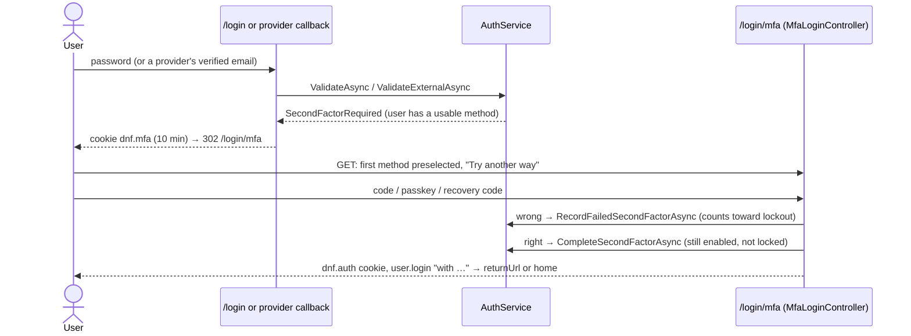

# Two-factor authentication (MFA)

A second sign-in step after the password (or after a sign-in provider): an **authenticator app**, a **passkey or
security key**, an **email code** or an **SMS code**, with one-time **recovery codes** as the fallback. Users set up
their own methods on [Profile → Sign-in security](../pages/sign-in-security.md); administrators choose which methods
exist and whether admin users must have one on [Two-factor authentication](../pages/mfa.md) (`/admin/mfa`). The UI
calls it "two-step verification" towards users.

| Piece | Location |
| --- | --- |
| Settings (`mfa.*` rows), requirement, "required?" cache | `src/DotNetForge.Web/Services/Mfa/MfaSettings.cs` (`MfaSettings`, `MfaSettingsService`) |
| Methods, codes, passkeys, recovery codes, reset, audit | `src/DotNetForge.Web/Services/Mfa/MfaService.cs` |
| TOTP (RFC 6238) | `src/DotNetForge.Web/Services/Mfa/Totp.cs` |
| Sign-in waiting for its second step (cookie `dnf.mfa`) | `src/DotNetForge.Web/Services/Mfa/PendingSignIn.cs` |
| SMS through Twilio | `src/DotNetForge.Web/Services/Mfa/SmsSender.cs` (`ISmsSender`, `TwilioSmsSender`) |
| Sign-in step | `src/DotNetForge.Web/Controllers/MfaLoginController.cs`, `Views/MfaLogin/Index.cshtml` ([Sign in → Two-factor step](../pages/login.md#two-factor-step)) |
| Status hand-over | `AuthService` (`SignInStatus.SecondFactorRequired`, `CompleteSecondFactorAsync`, `RecordFailedSecondFactorAsync`, `FindPendingUserAsync`) |
| User screen | `Areas/Admin/Controllers/SecurityController.cs` + `Areas/Admin/Views/Security/` |
| Admin screen | `Areas/Admin/Controllers/MfaSettingsController.cs` + `Areas/Admin/Views/MfaSettings/Index.cshtml` |
| Reset for a user | `UsersController.ResetMfa` ([Users](../pages/users.md)) |
| Requirement gate | `AdminControllerBase.OnActionExecutionAsync` |
| Passkeys in the browser | `src/DotNetForge.Web/wwwroot/js/forge/passkeys.js` |
| Tables | `UserMfaMethods`, `UserRecoveryCodes` (`src/DotNetForge.Shared/Entities/UserMfa.cs`, [database](../architecture/database.md#tables)) |
| Packages | `Fido2` 4.2.0 (WebAuthn), `QRCoder` 1.8.0 (the setup QR code) - [dependencies](../architecture/dependencies.md#nuget-packages) |

## Settings

Stored as `Settings` rows, read by `MfaSettingsService.GetAsync`, saved only on [Two-factor authentication](../pages/mfa.md)
(the generic [Settings](../pages/settings.md) screen refuses keys starting with `mfa.`, so the checks below can't be
skipped).

| Setting | Key | Default | Rule |
| --- | --- | --- | --- |
| Authenticator app | `mfa.authenticatorApp` | on | - |
| Passkeys and security keys | `mfa.passkeys` | on | - |
| Email codes | `mfa.email` | off | can be turned on only while SMTP is configured (`SMTP_*`, [email](email.md)); counts as off while it isn't |
| SMS codes | `mfa.sms` | off | can be turned on only while Twilio is configured (`TWILIO_*`, [SMS](#sms)); counts as off while it isn't |
| Who must use it | `mfa.requirement` | `Optional` | `Optional` or `AdminUsers` ([Requirement](#requirement)); `AdminUsers` needs at least one method on |

Values are `true`/`false` and the `MfaRequirement` name; anything else reads as the default. `GetAsync` returns the
settings **in effect** (email and SMS off while their service is missing); `GetStoredAsync` returns what was saved,
which the screen shows so a choice survives while SMTP or Twilio is unset. Saving writes `settings.changed`
("Two-factor authentication").

**Turning a method off** stops it at sign-in: `MfaService.UsableMethodsAsync` only returns methods whose type is on.
What users set up is kept and works again when the method is turned back on. A user whose only methods are turned off
signs in with the password alone (and, while the requirement is on, is sent to set up another method).

## Methods

A user may have several methods; each is one `UserMfaMethod` row. At sign-in they are offered in the order
authenticator app, passkey, SMS, email (`MfaService.Preference`), the first one the user has preselected.

### Authenticator app

TOTP as authenticator apps make it (`Totp`): HMAC-SHA1, 6 digits, 30-second steps, a random 160-bit secret in Base32.

- **Setup** (`GET/POST /admin/profile/security/authenticator`): `BeginAuthenticator` makes the secret and an
  `otpauth://totp/<APP_NAME>:<email>?secret=…&issuer=<APP_NAME>` link, shown as a QR code (QRCoder, PNG data URI)
  and as text. The secret travels in a signed setup token (15 minutes), not in the database; the method is stored
  only when a correct code is entered. A wrong code shows the same secret again, so the app already scanned keeps
  working. The setup screen offers one authenticator app per account.
- **Check**: the current step ±1 (clock drift), and only a step **after** the last one used (`Counter`), so each code
  works once. Codes are compared in constant time; spaces are ignored ("123 456").
- **Storage**: the secret is protected with Data Protection (purpose `DotNetForge.Mfa.Secrets.v1`). A secret that
  can't be unprotected (imported from another site) is skipped - that app can't be used here.

### Passkeys

WebAuthn through `Fido2` (passkeys, Face ID / Touch ID / Windows Hello, a phone, a USB key such as a YubiKey).

- **Relying party**: id = the host of `APP_URL`, name = `APP_NAME`; the only accepted origin is `APP_URL`'s origin.
  The site must be opened at `APP_URL` (and over `https`, or on `localhost` - a browser rule), otherwise registration
  fails with "The passkey couldn't be verified. Try again; the site must be opened at <origin>."
  ([deployment](../guides/deployment.md#public-address-app_url)).
- **Registration** (`POST /admin/profile/security/passkey/options`, then `POST /admin/profile/security/passkey`,
  driven by `passkeys.js`): resident key and user verification *preferred*, attestation *none*, the user's existing
  credentials excluded; the options travel back in a signed token (5 minutes). The credential id must be unused by any
  account. Stored: credential id, COSE public key, signature counter and the name the user typed (max 100, default
  "Passkey").
- **Sign-in** (`POST /login/mfa/passkey/options`, `POST /login/mfa/passkey`): the allowed credentials are the user's
  passkeys; the assertion is verified with the stored public key and counter; a user handle, when sent, must be the
  user's id. The counter is updated.
- Passkeys need JavaScript; without WebAuthn `passkeys.js` shows "This browser can't use passkeys. Use another
  browser or another way." Failures are logged as warnings with the error type, never as server errors.

### Email codes

A 6-digit code (cryptographically random) emailed with the **Sign-in code** template (`sign-in-code`,
[email → templates](email.md#templates)) through `AccountService.SendSignInCodeAsync`; it works for 10 minutes
(`MfaService.CodeLifetime`). Setting it up (**Turn on** on Sign-in security) sends a code to the account's email
first; the method ("Email codes") is added once that code is entered. At sign-in the user presses **Send code**
(nothing is sent automatically) and may **Send a new code**. The code itself is never stored: only its SHA-256 hash,
inside a time-limited Data Protection token (purpose `DotNetForge.Mfa.Tokens.v1`) bound to the user and the method.
"Only as safe as the mailbox", as the screens say.

### SMS

The same 6-digit, 10-minute code by text message: "`<code>` is your `<APP_NAME>` sign-in code. It works for 10
minutes." `TwilioSmsSender` posts it to Twilio's Messages API with `TWILIO_ACCOUNT_SID` / `TWILIO_AUTH_TOKEN`
(HTTP Basic) from `TWILIO_FROM` - a number, or a Messaging Service SID (`MG…`) sent as `MessagingServiceSid`
([configuration](configuration.md#sms-twilio)); 15-second timeout. A refused send is logged with the status code only
(Twilio's error body repeats the phone number) and the user sees "The text message couldn't be sent…".

- Phone numbers must be international: `+41 79 123 45 67` or `0041 79 …` → E.164 `+41791234567` (7-15 digits, first
  digit not 0); otherwise "Enter the phone number with its country code, e.g. +41 79 123 45 67."
- Setting up sends a code to the number; the method is added when it is entered, named with the masked number
  (`+41 *** *** 67`). One method per number; a user may add several numbers.
- SMS is the weakest method (SIM swapping) and each message costs money - both screens say so.

## Recovery codes

Ten one-time codes (`MfaService.RecoveryCodeCount`) of the form `XXXXX-XXXXX` from an alphabet without `0/O` and
`1/I`. Only the SHA-256 hash of the normalized code (letters and digits, upper case) is stored (`UserRecoveryCodes`).

- Made automatically with the user's first method and shown **once** (`/admin/profile/security/recovery-codes`,
  carried in `TempData`); **Make new codes** replaces them (the old ones stop working). Both write
  `user.mfa.recovery.generated`.
- At sign-in, **Use a recovery code** accepts any unused code (case and dashes don't matter); it is marked used
  (`UsedDate`). With 3 or fewer left the user is told to make new ones.
- Removing the last method deletes the recovery codes too.

## Sign-in

1. `AuthService.ValidateAsync` (password) or `ValidateExternalAsync` (provider) checks the first step as before. When
   it passes and `MfaService.RequiresSecondFactorAsync` is true (the user has at least one **usable** method), the
   result is `SignInStatus.SecondFactorRequired` - no session, no `user.login`, `LastLoginDate` unchanged.
2. `PendingSignIn.StartAsync` writes the `dnf.mfa` cookie (`HttpOnly`, `SameSite=Lax`, `Secure` as `dnf.auth`,
   encrypted like it): user id, **Remember me**, the local `returnUrl`, the provider's name, and later the token of a
   sent code or a passkey ceremony. It lasts **10 minutes from the first step**; rewriting it keeps the expiry.
3. `/login/mfa` ([screen](../pages/login.md#two-factor-step)) shows one method at a time. Every route reloads the
   pending sign-in and the user (`FindPendingUserAsync`: enabled, not locked out) and the usable methods; if any is
   missing - cookie expired, account disabled or locked, all methods removed - the user goes back to `/login` with
   "Your sign-in expired. Sign in again."
4. A **wrong** code or passkey writes `user.login.failed` (details `wrong code from <method>` / `wrong passkey`) and
   counts like a wrong password (`FailedLoginCount`, which a correct password resets): the 5th failure locks the
   account for 15 minutes (with the *Account locked* email), ends the pending sign-in and returns to `/login` with
   "Account is temporarily locked. Try again later." So a 6-digit code can't be guessed.
5. A **right** one ends the pending sign-in, re-checks the account (`CompleteSecondFactorAsync`), resets the failure
   counter, sets `LastLoginDate`, issues the normal session cookie (Remember me as chosen in step 1) and writes
   `user.login` with details `with an authenticator app` / `a passkey` / `an email code` / `an SMS code` /
   `a recovery code` (prefixed `via <provider>, ` after a provider sign-in).
6. **Cancel and sign in again** deletes `dnf.mfa`.

The POST routes of `/login/mfa` use the `credentials` rate limit ([authentication](authentication.md#rate-limiting));
the GET does not. Sign-in through a provider gets the same second step - the provider replaces only the password.

## Requirement

`mfa.requirement = AdminUsers` (**Required for everyone who uses the admin**): while it is on and at least one method
is on (`MfaSettingsService.IsRequiredAsync`, cached 30 s per instance, cleared by a save), every admin screen whose
controller derives from `AdminControllerBase` redirects a signed-in user **without a usable method**
(`MfaService.IsEnrolledAsync`, cached 30 s per user, cleared when the user's methods change) to
`/admin/profile/security`, which stays open (`SecurityController` is exempt) and shows "Two-step verification is
required". Signing out (`POST /account/logout`) still works. Users without an admin role are not affected (they never
reach admin screens). The screen counts the accounts it covers: users with a role that opens the admin
(`Roles.CanEnterAdmin`).

The gate is on `AdminControllerBase` only: a raw admin extension view (`/admin/ext/{id}/raw`) and the API through a
Super Admin's admin session ([authentication](authentication.md#api-token-authentication)) are not redirected.
API tokens are never affected.

## Lost access

1. The user signs in with a **recovery code** and sets up a new method.
2. Without one, a user with **Users update** opens their account on [Users](../pages/users.md) → **Reset two-step
   verification** (`POST /admin/users/{id}/mfa/reset`, not for one's own account): every method and recovery code of
   that user is deleted (`MfaService.ResetAsync`, audit `user.mfa.reset`). The user then signs in with the password
   alone and sets up a new method (at once, while it is required). An account created through a sign-in provider has
   no password: it signs in with its provider.
3. If nobody who could reset it can sign in (e.g. the only Super Admin), delete the user's rows from
   `"UserMfaMethods"` and `"UserRecoveryCodes"` in the database; the 30-second caches expire by themselves.

## Storage, secrets and transfer

| What | Stored as |
| --- | --- |
| Authenticator secret | `UserMfaMethods.Secret`, protected (Data Protection purpose `DotNetForge.Mfa.Secrets.v1`) |
| Phone number | `UserMfaMethods.PhoneNumber`, E.164 in clear (needed to send); lists show it masked |
| Passkey | credential id and public key (not secret), signature counter |
| Recovery codes | SHA-256 hashes only |
| Codes sent, setup and passkey ceremonies | nothing in the database: time-limited Data Protection tokens (purpose `DotNetForge.Mfa.Tokens.v1`) in hidden fields or the `dnf.mfa` cookie |

Both tables cascade-delete with the user. [Data Management](transfer-and-updates.md) exports and imports them like
every table. On **another** site the key ring differs (`DataProtectionKeys` is never transferred), so imported
authenticator secrets can't be read there - those apps stop working until set up again; passkeys keep working only
when `APP_URL`'s host is the same; email and SMS methods and recovery codes keep working.

## Audit

`user.mfa.added` and `user.mfa.removed` (details `<type>: <name>`), `user.mfa.recovery.generated`, `user.mfa.reset`
(details `<n> method(s) removed`), `settings.changed` for the settings, and the sign-in entries above -
[audit logging](audit-logging.md#what-is-logged-today). Codes, secrets and phone numbers are never written to the
audit log or the application log.

## Known limitations

- No "remember this device": every sign-in asks for the second step.
- The requirement covers admin users only (one switch, not per role) and only screens on `AdminControllerBase`
  ([Requirement](#requirement)).
- Email and SMS codes are sent only on request at sign-in; there is no resend throttle beyond the `credentials` rate
  limit (10 POSTs per minute per IP).
- Methods of a type the administrator turned off stay listed on Sign-in security ("turned off by your administrator")
  but are not asked for; when all of a user's methods are such, the badge says **Off** and the password alone signs in.

## Planned (not implemented)

Nothing beyond what is built is specified. The [login API](authentication.md#planned-not-implemented) for headless
front ends, when built, needs a second-step equivalent.

## Where to change things

- Which methods exist, their defaults and the requirement: `MfaSettings` / `MfaSettingsService`.
- Codes, lifetimes, recovery codes, passkey options, phone rules: `MfaService` (constants at the top).
- The sign-in step and its messages: `MfaLoginController`, `Views/MfaLogin/Index.cshtml`, `passkeys.js`.
- What happens after the first step: `AuthService.SecondFactorOrSignInAsync`; the hand-over in `AccountController.Login`
  and `ExternalLoginController.Callback`.
- A new SMS service: implement `ISmsSender` and register it in `DependencyRegistration` instead of `TwilioSmsSender`.
- A new method type: append to `MfaMethodType` (stored as int - never renumber), then `MfaSettings`, `MfaService`,
  the three screens and this document.
