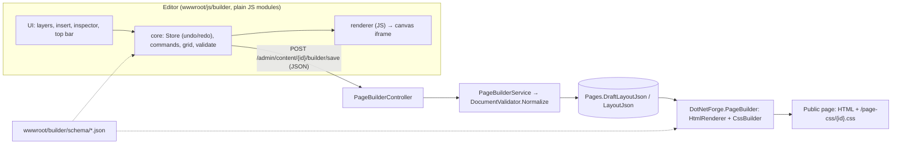

# Page builder

Design a content page visually: sections, containers, grids and stacks, with headings, text, images, buttons, link
lists, icons, posts, videos, spacers and dividers, each with its own tablet and mobile variant. Opened from the
**Layout** tab of the [Content Manager](../pages/content-manager.md#page-editor); the editor screen is described in
[page builder (screen)](../pages/page-builder.md).

The builder is a port of the **Dnn.Libraries.PageEditor** project (a DNN page editor written in TypeScript + Preact
with a C# renderer). Its document model, validation, renderer, schema, editor core and 76 golden test fixtures were
copied; the UI is the reference's components converted to plain JavaScript, rendered by a small built-in virtual DOM
instead of Preact (no framework, no build step), and everything DNN-specific
(panes, modules, Persona Bar, SQL Server data layer) was left out or replaced.



## Where the code is

| Part | Location |
| --- | --- |
| Schema (components, style properties, icons) - **one copy**, fetched by the editor and embedded in the C# library | `src/DotNetForge.Web/wwwroot/builder/schema/{components,style,icons}.json` |
| Shared layout stylesheet (buttons, links, posts, video ratios) | `src/DotNetForge.Web/wwwroot/builder/base.css` (embedded too) |
| Theme colour bridge | `src/DotNetForge.Web/wwwroot/builder/site-colors.css` ([theme colours](#theme-colours)) |
| C# domain: document model, validator, values, rich text, responsive rules, HTML and CSS renderer | `src/DotNetForge.PageBuilder/` (project `DotNetForge.PageBuilder`, Newtonsoft.Json) |
| Storage, publish, rendering for the site | `src/DotNetForge.Web/Services/PageBuilderService.cs` |
| Editor screen, canvas document and JSON API | `src/DotNetForge.Web/Areas/Admin/Controllers/PageBuilderController.cs`, `Areas/Admin/Views/PageBuilder/Index.cshtml` |
| Rendering on the site | `src/DotNetForge.Web/Components/PageLayoutViewComponent.cs`, `Controllers/PageCssController.cs` |
| Editor JavaScript | `src/DotNetForge.Web/wwwroot/js/builder/` - `main.js` (entry), `core/`, `renderer/`, `components/`, `editor/` (ported), `ui/` (the reference's components, rendered by `ui/vdom.js`) |
| Editor styles | `wwwroot/builder/editor.css` (ported as is), `editor-host.css` (additions), `canvas.css` (canvas placeholders) |

## Document model

A layout is a JSON document: a flat map of nodes with a root `page` node.

```json
{ "schema": 1, "root": "r", "settings": { "breakpoints": { "tablet": 1024, "mobile": 640 } },
  "nodes": {
    "r": { "id": "r", "type": "page",    "parent": null, "children": ["s"], "props": {} },
    "s": { "id": "s", "type": "section", "parent": "r",  "children": ["h"], "props": { "tag": "section" },
           "layout": { "base": { "mode": "grid", "columns": 12 } } },
    "h": { "id": "h", "type": "heading", "parent": "s",  "props": { "text": [{ "text": "Hello" }], "level": "1" },
           "place": { "base": { "col": 1, "row": 1, "colSpan": 12 } }, "style": { "mobile": { "fontSize": 28 } } } } }
```

- **Containers** (`page`, `section`, `container`) lay out their children as a **stack** (flex row/column with gap,
  align, distribute, wrap), a **grid** (1-24 columns, row height, gaps, explicit cells or auto-flow) or **free**
  (absolute x/y/w/h).
- **Components**: heading, text (rich text as data, not HTML), image, button, links, icon, post (with comments in a
  CSS-only dialog), video (YouTube/Vimeo, privacy-enhanced embed), spacer, divider. The schema's `module` type (a DNN
  module) is kept so the shared fixtures stay valid, but it is never offered and never renders here.
- **Responsive**: `layout`, `place` and `style` are `{ base, tablet, mobile }`, desktop-first; tablet applies below
  `settings.breakpoints.tablet`, mobile below `mobile`.
- Per node also: `name`, `hidden`, `locked`, `visibility` (`devices`, `audience`: `all` / `anonymous` /
  `authenticated`), `className`, CSS `vars`.

The full property list, ranges and defaults are in `wwwroot/builder/schema/style.json` and `components.json`.

## Validation and security

`DocumentValidator.Normalize` (C#, `src/DotNetForge.PageBuilder/DocumentValidator.cs`) runs on every save, again on
publish and when a layout is rendered:

- structure errors are refused (HTTP 400 with a message): wrong `schema`, unknown types, a child in two places, a
  node in a parent that may not contain it, more than 5000 nodes, deeper than 32, more than 4 MB;
- values are cleaned, not refused: unknown keys dropped, out-of-range numbers and invalid values reset to defaults;
- links allow only `http(s)://`, site paths, `#`, `?`, `mailto:`, `tel:`; images only `http(s)` or site paths;
  videos become YouTube-no-cookie / Vimeo embed URLs; colours and CSS variables are checked against allow-lists;
- rich text is data (runs and blocks), rendered by escaping - no HTML from the editor reaches a page.

The editor's JavaScript validator (`js/builder/core/validate.js`) applies the same rules, and both are proven
identical by the golden fixtures ([testing](#testing)).

**CSP.** Published pages keep `script-src 'self'; style-src 'self'`: the layout's CSS is an external stylesheet
(`/page-css/{id}.css?v={hash}`), the renderer emits classes only (no `style=`), and the editor writes canvas CSS
into constructable stylesheets (`document.adoptedStyleSheets`) and drag previews through the CSSOM. `frame-src` also
allows `https://www.youtube-nocookie.com` and `https://player.vimeo.com` for the video component
([security](security.md)).

## Drafts and publishing

| Column (`Page`) | Meaning |
| --- | --- |
| `DraftLayoutJson` | what the editor saves (autosave about 1.5 s after a change) |
| `DraftVersion`, `DraftUpdatedDate`, `DraftUpdatedById` | conflict detection: a save names the version it was based on |
| `LayoutJson`, `LayoutPublishedDate` | what visitors see; `null` = the page's default view |

- **Save**: normalized, stored, new `DraftVersion`. A save based on an older version answers **409** with who saved
  when; the editor offers *Load their version* or *Keep mine and overwrite* (`force`).
- **Publish** (needs `Collection types` / `publish`): the draft becomes `LayoutJson`. Audited as `content.updated`
  (details `Layout published`).
- **Unpublish** (needs `publish`): `LayoutJson = null`, the draft is kept. Audited (`Layout unpublished`).
- **Discard** unpublished changes: the draft goes back to the published layout.
- **Preview** (`/admin/content/{id}/builder/preview`): the draft rendered in the site's page view with
  `noindex`, for editors only.

There is no version history yet ([Planned](#planned-not-implemented)).

## API

JSON under `/admin/content/{pageId}/builder/`; every POST needs the antiforgery token in `X-CSRF-TOKEN`. Access: the
user may edit the page (`Collection types` update, update.own on own pages, or a page **edit** grant -
[page permissions](content-pages-and-routing.md#page-permissions)); otherwise 403/404.

| Method, path | Body → response |
| --- | --- |
| `GET ` (the editor screen), `GET canvas` (iframe document), `GET preview`, `GET draft.css` | HTML / CSS |
| `GET state` | `{ page: { tabId, name, url, published, publishedOn, … }, draft: { document, version, savedOn, savedBy, pendingChanges }, capabilities: { editLayout, publish, … }, canUpload }` |
| `POST save` | `{ document, baseVersion, force }` → `{ version, savedOn }`; 409 `{ message, conflict: { savedBy, savedOn, version } }`; 400 `{ message }` |
| `POST publish` / `unpublish` | → `{ publishedOn }` / `{ ok }`; 403 without `publish` |
| `POST discard` | → `{ version, document }` |
| `POST heartbeat` | → `{ others: [] }` (no presence tracking) |
| `GET media` | public images of the media library `[{ url, name, contentType }]` (image picker) |
| `POST upload` (multipart `file`) | stores a **public** image through `MediaService` (needs `Media` / `create`) → `{ url, name }` |

## Rendering

`PageLayoutViewComponent` renders the published layout where a page view calls
`@await Component.InvokeAsync("PageLayout", new { page = Model })` - the built-in `Views/Home/Page.cshtml` and the
sample theme do. It writes three `<link rel="stylesheet">` (`site-colors.css`, `base.css`, the page's CSS) and the
HTML. Elements limited to signed-in or anonymous visitors are left out on the server; device visibility is CSS.
Parsed documents and their CSS are cached in memory per layout hash.

A page with a layout renders full width: the page view sets `ViewData["FullWidth"] = true` and the layout drops its
centred content column (themes should do the same - [themes](themes.md#theme-views)). Without a layout, or with one
that can't be read, the page shows its default view.

**Fill wins over alignment.** A layer whose size on its stack parent's cross axis is "Fill container" (width in a
column, height in a row) gets `align-self: stretch`; an `alignSelf` it also has is not written (`CssBuilder` /
`renderer/css.js`, fixture `fill-ignores-alignment`). The reference let the alignment override it, which shrank a
"Fill" layer to its content while the editor still showed "Fill". The editor disables the cross-axis alignment
buttons for such a layer and clears `alignSelf` when Fill is chosen.

`GET /page-css/{id}.css?v={hash}` serves a **live** page's layout CSS, `Cache-Control: public, max-age=31536000,
immutable` when `v` matches (the URL changes with every publish).

## Theme colours

Layouts, `base.css` and the ready-made blocks use the colour variables `--dnn-color-primary`, `-secondary`,
`-surface`, `-neutral`, … (names kept from the reference editor, so its schema and fixtures stay identical).
`site-colors.css` maps them to the [design system](../architecture/design-system.md) tokens - brand orange, surfaces,
borders - so layouts follow the site's brand and dark mode. A theme can redefine any of them on `body` (which wins
over the defaults on `:root`); the sample default theme maps them to its accent, background, text and line colours.

## Editor

Plain ES modules loaded by `Index.cshtml` (`<script type="module" src="/js/builder/main.js">`); no build step.

- **Ported** from the reference TypeScript (converted once to readable JavaScript with esbuild): `core/` - the
  `Store` (transactions, undo/redo with merging), `commands` (insert, move, duplicate, wrap/unwrap, grid placement,
  styles per breakpoint), `grid`, `responsive`, `validate`, `richtext`, `values`; `renderer/` and `components/` (the
  same output as the C# renderer); `editor/` - `session` (autosave, conflicts), `actions`, `shortcuts`, `presets`,
  `layout-ops`, and `canvas/` (frame patching, pointer drag/resize with snapping and guides, inline text editing).
  Changes for this CMS: the schema is fetched (`core/schema-data.js`) instead of bundled, the API client
  (`editor/api.js`) talks to the endpoints above, and the canvas uses constructable stylesheets instead of `<style>`
  elements.
- **UI** (`ui/`): the reference's Preact components one to one, converted once from TSX with the TypeScript
  compiler (comments kept): `app.js` (layout, panel resizers), `top-bar.js`, `layers.js`, `insert-panel.js`,
  `canvas.js` (stage, overlay, handles, guides), `inspector.js` (Content / Advanced tabs, page panel),
  `design-panel.js` (Design tab: position, auto layout, appearance, typography, fill, stroke, effects),
  `grid-panel.js`, `fields.js`, `color-picker.js` + `color.js`, `context-menu.js`, `dialogs.js`, `hooks.js`,
  `icons.js` (+ `icon-data.js`). They render with `ui/vdom.js`, a small virtual DOM written for this CMS that
  implements the part of Preact's API they use (`h` - called as `jsx()`, because the components have locals named
  `h` -, `Fragment`, `render`, `createContext` and the hooks), so there is no framework dependency and no build step.
  Changes to the reference: no DNN modules (Insert, onboarding "start from the current page", module dialogs), no
  version history (History dialog, named versions, publish note), visibility by audience instead of DNN roles, the
  image picker lists the media library (`editor/api.js` `files()`), the ⋯ menu also chooses the canvas page's light or
  dark look, Esc closes the top-bar menus and the colour picker without also selecting the parent, and the canvas has
  no scrollbar (`canvas.css`; the editor scrolls it), so it is exactly the device width and a Fill layer reaches its
  right edge - the reference reserved a 15px scrollbar gutter there.
- The canvas is a same-origin iframe (`GET canvas`): the page as the site shows it - the page's theme
  (`ThemeResolver`, as `HomeController` resolves it) with its header, menu and footer, or the built-in page view -
  where `PageLayoutViewComponent` emits an empty `#pe-canvas-mount` and `canvas.css` instead of the layout
  (`ViewData["BuilderCanvas"]`). The editor renders the layout into the mount with the JS renderer and patches only
  the changed nodes. `GET preview` renders the draft through the same theme.
- The canvas shows the page light or dark (⋯ menu, remembered per browser, light by default): the editor sets
  `data-theme` and `color-scheme` on the iframe's `<html>`. The Forge tokens and the sample theme honour it; a
  theme that only uses `prefers-color-scheme` follows the system instead.

## Testing

- `tests/DotNetForge.Tests/PageBuilder/` - the reference project's C# tests (validator, values, components,
  security regressions) and **golden fixtures**: `tests/fixtures/page-builder/render/*.json` (76 cases) give an input
  document and the exact normalized document, HTML and CSS; the C# renderer must match byte for byte.
- `node tests/js/page-builder-fixtures.mjs` runs the same 77 fixtures through the browser modules (Node 20+, no
  packages) - proof the JavaScript and C# sides agree.
- `tests/DotNetForge.IntegrationTests/PageBuilderTests.cs` - draft, conflict, invalid document, publish (rendered
  HTML, external CSS with cache headers, no `<style>`), unpublish, audit, access (edit grants, publish permission).

## Planned (not implemented)

From the reference editor, not ported yet:

- **Version history**: published versions, named snapshots, restore (the reference keeps a versions table).
- **Presence**: showing who else edits the page (the heartbeat endpoint answers with nobody).
- **Element permissions**: per-element edit roles and content-only editing (the reference's `ChangeGuard`); the
  document's `permissions.editRoles` and `visibility.roles` (integer DNN role ids) are kept by the validator but not
  offered or enforced.
- **Module slots**: placing [module extensions](extensions.md#slots) inside a layout (the reference's `module`
  component placed DNN modules).
- **Colour picker and grid track editor** of the reference design panel (the port uses the browser's colour input
  and the column count / gaps / row height fields).

### Acceptance criteria

- [x] A page can be designed with sections, grids, stacks and components, per device, and published.
- [x] Drafts autosave; visitors see only what is published; a stale save is detected.
- [x] The published page keeps the strict CSP (no inline style or script).
- [x] C# and JavaScript render identically (76 shared golden fixtures).
- [ ] Version history with restore.
- [ ] Per-element edit permissions.
