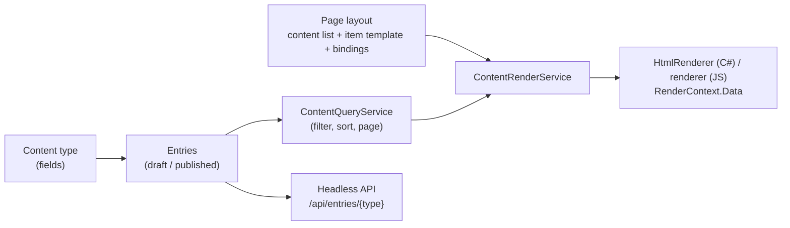
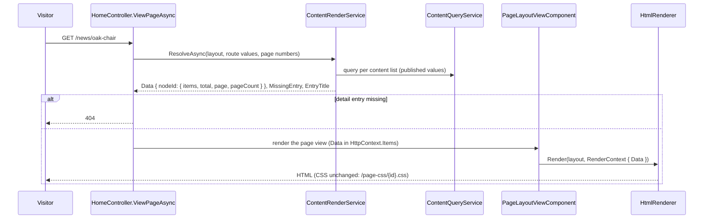

# Structured content

Content that is independent of its presentation: an admin defines **content types** (Blog posts, Products, Events...)
with their **fields**, adds **entries** through forms generated from those fields, and shows the entries on any page
with a **content list** in the [page builder](page-builder.md). Editing an entry changes every page that shows it; each
page decides on its own how the entry looks.

Three systems, each with one job:

| System | Screen | Owns |
| --- | --- | --- |
| **Content Manager** | [Content Manager](../pages/content-manager.md) (`/admin/content`), [Content types](../pages/content-types.md) (`/admin/content-types`) | content types, their fields, entries (drafts, publishing) |
| **Pages** | [Pages](../pages/pages.md) (`/admin/pages`) | the page tree, URLs, navigation, SEO, page permissions ([content pages and routing](content-pages-and-routing.md)) |
| **Page builder** | [Page builder](../pages/page-builder.md) (`/admin/pages/{id}/builder`) | how a page looks, including which entries its content lists show and how |



## Where the code is

| Part | Location |
| --- | --- |
| Entities `ContentType`, `ContentEntry`, `ContentEntryValue` | `src/DotNetForge.Shared/Entities/StructuredContent.cs` (enum `ContentTypeKind` in `src/DotNetForge.Shared/Enums/Enums.cs`) |
| Pure rules (no database): field definitions, entry validation, value index, item data, templates | `src/DotNetForge.Core/Content/` - `ContentSchema.cs`, `EntryData.cs`, `ItemData.cs`, `ContentTypeTemplates.cs` |
| Rules over the database, shared by the admin and the API | `src/DotNetForge.Content/` - `ContentTypeService`, `ContentEntryService`, `ContentQueryService`, `ContentApiService` |
| Rendering content lists on pages | `src/DotNetForge.Web/Services/ContentRenderService.cs`, `Components/PageLayoutViewComponent.cs`, `Controllers/HomeController.cs` |
| Admin screens | `Areas/Admin/Controllers/ContentController.cs` (+ `Services/EntryForm.cs`), `ContentTypesController.cs`, views `Areas/Admin/Views/Content/`, `Views/ContentTypes/`, scripts `wwwroot/js/forge/entries.js`, `content-types.js` |
| Content list component (both renderers) | `src/DotNetForge.PageBuilder/Rendering/Binding.cs`, `Collections.cs`; `wwwroot/js/builder/renderer/binding.js`, `collection.js` |
| Editor: data panel, preview data, presets | `wwwroot/js/builder/ui/data-panel.js`, `editor/content.js`, `editor/presets.js` (`CONTENT_PRESETS`) |
| Headless API | `src/DotNetForge.Api/Controllers/EntriesApiController.cs` ([headless API](headless-api.md#structured-content)) |

## Content types

A `ContentType` row: `Name`, `Slug` (the **API id**, `^[a-z][a-z0-9-]{0,63}$`, unique; `api`, `types`,
`new` and `media` are reserved because the Content Manager's routes use them), `Description`, `Icon` (one of
`ContentTypeService.Icons`), `Kind`, `FieldsJson`, `TitleField`, `Drafts`, `SortOrder`.

| Kind | Meaning |
| --- | --- |
| `Collection` | many entries (an entry list, a "New entry" button) |
| `Single` | exactly one entry, created with the type (`ContentEntryService.AddSingleEntry`); `/admin/content/{type}` opens it. A collection with more than one entry can't become single. |

**Drafts** (default on): saving keeps changes as the working copy until someone publishes. Off: every save publishes
(validated as a publish, so it needs the `publish` grant).

**Title field**: the top-level text, slug or email field that names an entry in lists, pickers and the browser tab of
a detail page (`ContentSchema.TitleKey`: the configured one, else the first such field). Copied into
`ContentEntry.Title` on every save.

### Field types

Field definitions are a JSON array in `FieldsJson`, checked by `ContentSchema.Validate` on every save of the type
(errors are listed on the builder screen). Every field has `id` (12 hex characters, stable), `key` (the API name,
`^[a-z][A-Za-z0-9_]{0,49}$`, unique per level, case-insensitive), `label`, `type`, and optionally `required`, `help`,
`placeholder`, `default`, `width` (`full`/`half`), `showInList` (top level only).

| Type | Stored value | Options |
| --- | --- | --- |
| `text` | string (one line, default max 500) | `minLength`, `maxLength`, `pattern` (regex, 100 ms timeout), `unique` |
| `textarea` | string (newlines kept, max 10 000) | `minLength`, `maxLength`, `pattern` |
| `richText` | blocks of runs - the page builder's rich text format (`RichText.NormalizeBlocks`), max 100 000 characters | `minLength`, `maxLength` |
| `number` | number (whole numbers stored as integers) | `min`, `max`, `integer`, `decimals` (display), `unique` |
| `boolean` | `true` / `false` (always stored) | `default` |
| `date` | `yyyy-MM-dd`, or `yyyy-MM-ddTHH:mm:ssZ` with `withTime` (UTC) | `withTime` |
| `select` | option value, or a list with `multiple` | `choices` (≤ 200, `value` + `label`), `multiple`, `minRows`/`maxRows` |
| `email` | string | `unique` |
| `url` | `http(s)://`, site path, `#`, `mailto:`, `tel:` (`Values.LinkUrl`) | `unique` |
| `slug` | lower-case `a-z0-9-` | `slugFrom` (a text field on the same level), `unique` |
| `image` | media file id (images only), or a list with `multiple` | `multiple`, `minRows`/`maxRows` |
| `file` | media file id, or a list | `multiple`, `minRows`/`maxRows` |
| `relationship` | entry id of `relationTo`, or a list with `multiple` | `relationTo` (an existing content type; itself allowed), `multiple` |
| `array` | list of strings, or numbers with `itemType: number` (the form posts one per line) | `itemType`, `minRows`/`maxRows`, `min`/`max` |
| `group` | object of nested fields | `fields` |
| `repeater` | list of objects of nested fields | `fields`, `minRows`/`maxRows` |

Limits: at most 150 fields in total, groups and repeaters nested at most 2 levels (`MaxDepth` 3). `unique` is
allowed only on top-level `text`, `email`, `url`, `slug` and `number` fields.

### Starter templates

`ContentTypeTemplates.All`: Blog posts, Categories, Authors, Products, Events, Projects, Testimonials, FAQ and Site
settings (a single type). A template's relationship fields name another template by API id (`Requires`): creating
Blog posts also creates Categories and Authors when no type with those ids exists yet
(`ContentTypeService.CreateAsync`). A created type is an ordinary type; every field can change.

### Changing fields of a type that has entries

`ContentTypeService.UpdateAsync` saves the type and rewrites every entry in **one `SaveChanges`**
(`ContentEntryService.MigrateAsync` → `EntryData.Migrate`):

- a field keeps its values when its **id** is unchanged - so renaming a key moves the values;
- values of removed fields are dropped (the builder warns before removing);
- titles, search text and the value index are rebuilt for the working copy and the published values.

A type can't be deleted while another type has a relationship field that links to it. Deleting a collection with
entries needs the explicit `withEntries` choice; its entries and index rows go with it.

## Entries

A `ContentEntry` holds two JSON documents: `DataJson` (the **working copy**, always the latest save) and
`PublishedDataJson` (the **published values**, `null` = not published). Visitors, content lists and the API's default
reads use the published values only.

| Column | Use |
| --- | --- |
| `Published`, `HasDraft` | status: **Draft** (never published), **Published**, **Changed** (published with newer working copy) |
| `Title`, `SearchText` | copies for lists and search (lower-cased title and short text values, max 1000) |
| `Version` | changes on every save; a save posting an older version is refused (409 in the API, a message in the form) |
| `SortOrder` | manual order: the default sort of lists and content lists (drag rows in the entry list) |
| `CreatedById`, `UpdatedById`, `PublishedById` and dates | ownership (`update.own` / `delete.own`) and the status card |

### Validation

`EntryData.Validate` normalizes untrusted input (the form, the API): unknown keys dropped, empty values removed, form strings converted
(`"12.5"` → number, `"on"` → `true`, textarea lines → array), every problem reported with its dotted path
(`variants.2.name`). Referenced media and entries must exist (looked up once,
`ContentEntryService.ValidateAsync`).

| Check | Draft save | Publish |
| --- | :-: | :-: |
| Types, formats, `maxLength`, `max`, `maxRows`, patterns, choices, references | ✔ | ✔ |
| `required`, `minLength`, `minRows` | | ✔ |
| `unique` (against the working copies and published values of the other entries, via the index) | ✔ | ✔ |

An empty slug with `slugFrom` is made from its source field on the server (`EntryData`), so forms without JavaScript
and the API get slugs too; the form script does the same while typing.

### Actions

| Action | Service method | Notes |
| --- | --- | --- |
| Save (create on first save) | `ContentEntryService.SaveAsync` | `publish` also publishes; a type without drafts always does |
| Publish the saved values | `PublishAsync` | validates the working copy as a publish |
| Unpublish | `UnpublishAsync` | the values stay as the working copy |
| Duplicate | `DuplicateAsync` | unpublished copy placed after the original; slugs get `-copy`, other unique values are cleared, the title gets " (copy)" |
| Delete, bulk delete | `DeleteAsync`, `DeleteManyAsync` | removes the index rows too; a single type's entry can't be deleted |
| Reorder | `ReorderAsync` | the moved entries share their old positions in the new order |

Every action except reorder writes an `entry.*` audit entry, which also fires the subscribed
[webhooks](webhooks.md#events) (`entry.create`, `entry.update`, `entry.publish`, `entry.unpublish`, `entry.delete`) -
from the Content Manager and from `/api/entries` alike.

## Querying

Entry values live in JSON, which databases can't filter or sort the same way. Every save therefore writes
**`ContentEntryValues`** rows: one per top-level scalar value (text, email, URL, slug, select, relationship, image and
file ids, array items as text; numbers in `Number`; booleans as `0/1` and `"true"/"false"`; dates in `Date`), separately
for the working copy (`Published = false`) and the published values (`Published = true`). Text is lower-cased and cut
to 200 characters. Rich text, groups and repeaters are not indexed.

`ContentQueryService.QueryAsync` answers an `EntryQuery` with single-table queries only, combined in memory (written
when the CMS still ran on MongoDB too; the CMS database is now always PostgreSQL, [database rules](../architecture/database.md#rules)):

1. the narrow entry rows of the type (`Id`, `SortOrder`, `Title`, dates), filtered by status and search
   (`SearchText.Contains`);
2. per filter, the index rows of that field → the matching entry ids (intersected);
3. for a field sort, the index rows of that field (entries without a value last);
4. the page of ids → the full entries by id.

| Filter op | Meaning |
| --- | --- |
| `eq`, `neq` | equal / not equal (numbers and dates compare as such, text lower-cased) |
| `contains` | text contains |
| `gt`, `gte`, `lt`, `lte` | numbers, dates, else ordinal text |
| `empty`, `notEmpty` | the field has no value / has one |

Filter fields are top-level keys or `$title`, `$id`; an unknown field matches nothing. Sorts: `sortOrder` (default),
`title`, `createdAt`, `updatedAt`, `publishedAt` or a field key; ties by manual order. Page size at most
`ContentQueryService.MaxPageSize` (100). Cost: proportional to the number of entries of the type (narrow rows), plus
one query per filter and sorted field.

## Content lists

The page builder component `collection` ("Content list") with exactly one kind of child, `item` (the item template,
not insertable on its own). Editors insert a ready-made list from **Insert → Content lists** (Card grid, List,
Carousel, Table, Detail - `CONTENT_PRESETS`), which selects the list and opens its **Data** tab.

| Prop | Type | Meaning |
| --- | --- | --- |
| `source` | `ref` | content type id |
| `mode` | `list` / `single` | many entries, or one |
| `entry` | `ref` | single: a fixed entry |
| `routeParam`, `routeField` | `slug`, `field` | single: the entry whose `routeField` (default `slug`, or `$id`) equals the URL's `[routeParam]` value |
| `filters` | `filters` | ≤ 10 `{ field, op, value }` |
| `sortField`, `sortDir` | `field`, `asc`/`desc` | order (empty = manual order) |
| `limit` | 1-100 | entries (per page with pagination) |
| `paginate` | bool | Previous / Next links |
| `view` | `items` / `table` | repeat the item template, or a table |
| `columns` | `columns` | table: ≤ 12 `{ field, label }`; the first column links to the entry |
| `carousel` | bool | items in one row that scrolls sideways (`.pe-carousel`, CSS scroll-snap, no script) |
| `itemUrl` | text | the entry's link pattern, e.g. `/news/{slug}` |
| `emptyText`, `prevLabel`, `nextLabel` | text | texts |

How the items are arranged is the list's ordinary **layout** (grid with columns per device, or a stack): the list's
`.pe-in` holds one copy of the item template per entry, each placed in that layout (an `item` is never pinned to a
cell; `col`, `row`, `x`, `y` are dropped by the validator).

**Detail pages.** A page with a dynamic slug (`/news/[slug]`, [routing](content-pages-and-routing.md#public-resolution))
holding a single-mode list with `routeParam` `slug` shows the entry the URL names. No published entry with that value →
the page answers **404** (`HomeController.ViewPageAsync`), and the browser title is the entry's title
(`ViewData["ContentTitle"]`, built-in `Page.cshtml`). The editor previews such a list with the first matching entry.

**Pagination** reads `?pg-{nodeId}=n` (`PageLayoutViewComponent.ResolveContentAsync`), so several paginated lists on one
page are independent.

**Item links.** `ContentRenderService.ItemUrl` fills `{field}` placeholders of `itemUrl` with the entry's (URL-encoded)
values; the result must pass `Values.LinkUrl`. An entry missing a value gets no link. The editor's **Detail page**
picker lists pages with a `[param]` segment as patterns (`GET content/link-targets`).

## Data binding

An element inside the item template takes props from the entry it shows through its node-level **`bind`** map: prop
key → template. `{path}` placeholders are filled from the entry; anything else is literal text.

```json
"h": { "id": "h", "type": "heading", "parent": "i", "props": { "level": "3" }, "bind": { "text": "{name}" } },
"p": { "id": "p", "type": "text", "parent": "i", "props": {}, "bind": { "content": "From {price} USD" } },
"b": { "id": "b", "type": "button", "parent": "i", "props": { "label": "View" }, "bind": { "href": "{$url}" } }
```

**Item data.** The server turns each entry into `{ id, fields }` (`ItemData.Build`), where `fields` maps a **field path**
to `{ text, url?, rich?, value? }`. Every formatting decision is made there, once: numbers with the field's decimals
(`1,249.50`), dates `MMM d, yyyy` (`HH:mm` with a time), select labels, media URLs (public files only), titles of linked
entries. Paths: top-level keys (`price`), group members (`specs.width`), the first linked entry's own fields one level
deep (`category.name`, `category.$title`) and the built-ins `$id`, `$title`, `$url`. `ItemData.Paths` lists them for the
editor.

**Filling a prop** (`Binding.Value`, `renderer/binding.js`) by prop type:

| Prop type | Value |
| --- | --- |
| `text`, `video` | the template with each placeholder's `text` (cut to the prop's max length) |
| `inline` | one run of that text |
| `rich` | exactly `{path}` with `rich` → those blocks; else a paragraph of the text |
| `url`, `image` | exactly `{path}` → the field's `url`, else its `text`; a mixed template URL-encodes each value |

The result then goes through the prop's own validator (`DocumentValidator.NormalizeProp` / `normalizeProp`), so a bound
value obeys the same rules as a typed one (a `javascript:` URL is dropped). Bindable prop types: `text`, `inline`,
`rich`, `url`, `image`, `video` (`PropDef.BindableTypes` / `BINDABLE_TYPES`).

**Both renderers render identically.** The C# and JavaScript renderers only look values up in the item data and share
the binding and list code paths; golden fixtures prove it byte for byte (seven `content-list-*` cases written by
`node tests/js/content-list-fixtures.mjs`, checked by `GoldenFixtureTests` and `tests/js/page-builder-fixtures.mjs`).

In the editor, choosing a content type maps the template automatically (`autoBind`: image ← first image field, first
heading ← title, text ← first rich text or text field, buttons ← item link); each element's Content tab shows "from
content" rows to change a binding or write a template.

## Rendering flow



Nothing is cached: entries are read per request, so an edit shows everywhere at once. The layout's CSS does not
depend on the data and keeps its cache-forever URL. The editor gets the same data from
`POST /admin/pages/{id}/builder/content/preview` (published entries; `editor/content.js` refetches when a list's query
props change) and renders it into the canvas: the first item copy is editable, the other copies are rendered without
editing hooks ("ghosts") and select the list when clicked.

## Permissions

| Action | Needs |
| --- | --- |
| Open the Content Manager overview | `AdminArea` |
| Entry list, entry form, pickers | `Entries` / `read` |
| Create, duplicate | `Entries` / `create` |
| Save | `update`, or `update.own` on own entries |
| Publish, unpublish (and saving a type without drafts) | `publish` |
| Delete, bulk delete | `delete`, or `delete.own` on own entries (bulk: every selected entry) |
| Reorder | `update` |
| Content types screens, create, save, delete | `Content types` / `read`, `create`, `update`, `delete` |
| Upload from an entry form | `Media` / `create` |

Defaults and the grant back-fill for existing databases: [authorization](authorization.md). API keys:
[headless API](headless-api.md#structured-content). Audit actions: `contenttype.created|updated|deleted`
(entity type `ContentType`) and `entry.created|updated|published|unpublished|deleted` (entity type `Entry`, display
"<type name>: <entry title>", so renaming a type keeps one history) -
[audit logging](audit-logging.md).

## Where to change things

| Change | Place |
| --- | --- |
| A rule for field definitions | `ContentSchema.ReadField` |
| A rule for values | `EntryData.NormalizeValue` (draft vs publish via `publish`) |
| Saving, publishing, uniqueness, index rows | `ContentEntryService` |
| Type names, API ids, deletion, migration of entries | `ContentTypeService` |
| Filtering, sorting, paging | `ContentQueryService` |
| What a content list receives | `ContentRenderService` + `ItemData` |
| How a content list renders | `Collections.cs` **and** `renderer/collection.js`, then `node tests/js/content-list-fixtures.mjs` and both fixture runs |
| The entry form | `Areas/Admin/Views/Content/_Field.cshtml` + `Services/EntryForm.cs` + `wwwroot/js/forge/entries.js` |

## Extension points

**A new field type** - every step, or the type is half supported:

1. `FieldTypes` (+ `HasFields` / `CanBeUnique` / `CanBeMultiple` if they apply) and its options in
   `ContentSchema.ReadField` / `FieldDefinition`.
2. `EntryData.NormalizeValue` (stored format), `IndexValues` (if it should be filterable), `References` (if it points at
   records).
3. `ItemData.Cell` and `ItemData.Kind` (how layouts see it), `ContentApiService.Expand` (how the API shows it).
4. The form: `_Field.cshtml` (+ `EntryForm.Read` if it posts several values), behaviour in `entries.js`.
5. The builder palette and settings: `TYPES` and `settings()` in `wwwroot/js/forge/content-types.js`.
6. Tests in `tests/DotNetForge.Tests/Content/ContentSchemaTests.cs`, this document's field table.

**A new content list view** (e.g. a map): a `view` option in `components.json`, the markup in `Collections.Inner` and
`collectionInner` (identically), CSS in `wwwroot/builder/base.css` (also copied to `tests/fixtures/page-builder/base.css`),
a case in `content-list-fixtures.mjs`, the Display segment in `data-panel.js`.

**A new bindable prop type**: add it to `PropDef.BindableTypes` and `BINDABLE_TYPES`, a case in `Binding.Value` and
`bindValue`, its preferred field kinds in `KINDS` (`data-panel.js`), and a fixture.

## Planned (not implemented)

### Requirements

- **History**: every save of an entry (and a type) as a version; compare, restore ([content pages → history](content-pages-and-routing.md#content-history-and-review)).
- **Review workflow** for entries (submit, approve, reject), optionally mandatory.
- **Scheduled publishing** of entries (publish/unpublish dates like pages, [scheduled publishing](scheduled-publishing.md)).
- **Localization**: per-field translations ([internationalization](internationalization.md)).
- **Tags**: a shared tag vocabulary as a field type.
- **Deeper relations**: binding and API expansion beyond one level; filtering by a linked entry's field
  (`category.slug`) - today filters take top-level fields only.
- **Per-type permissions**: grants per content type instead of one `Entries` area.
- **Relationship ordering**: drag to order the entries of a multiple relationship.
- **GraphQL** or a query language beyond the REST filters.

### Acceptance criteria

- [x] Admins create content types visually, from templates or empty, with all 16 field types, required/unique/default
  options, reordering and nested groups and repeaters (`ContentTypesController`, `content-types.js`).
- [x] Entry forms are generated from the fields; entries are drafted, published, unpublished, duplicated, deleted,
  searched, filtered by status, sorted and paged (`ContentController`, `StructuredContentTests`).
- [x] A page shows entries through a content list with filters, sorting, limits, pagination and views grid, list,
  card, carousel, table and detail; fields are mapped to element props without code (`data-panel.js`).
- [x] Editing an entry changes every page that shows it (`StructuredContentTests.Pages_show_content_lists_and_detail_pages_and_follow_entry_edits`).
- [ ] Content history with compare and restore.
- [ ] Review workflow and scheduling for entries.
- [ ] Localized fields.
