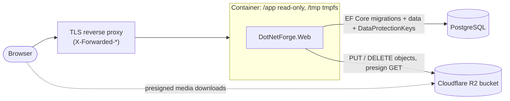

# Deployment

How to run DotNetForge CMS in production. The application is designed for a **read-only deployment directory**:
everything it writes at runtime goes to the database or to object storage, never into its own folder.

## Read-only deployment requirements

| Runtime data | Where it goes | Never |
| --- | --- | --- |
| Content, users, settings, audit log | the PostgreSQL database | `storage/` next to the app |
| Uploaded media | S3-compatible object storage via `IFileStorage` (`STORAGE_S3_*`, required) | the content root |
| Data Protection key ring (auth cookies, antiforgery tokens) | the `DataProtectionKeys` table | the default `~/.aspnet/DataProtection-Keys` folder |
| Upload buffering (multipart bodies over 64 KB) | the OS temp directory: `ASPNETCORE_TEMP`, else `/tmp` | - must be writable (tmpfs), is not storage |
| Logs | stdout/stderr (console logger) | log files |
| Extension views | compiled **in memory** from `extensions/` (read only) | - |
| Extension code | loaded at startup from each extension's built `bin/` (read into memory, files never locked) | building inside the running container |
| Enabled extensions | the `InstalledExtensions` table (enable/disable on the Plugins screen writes only the database) | files under `extensions/` |

What enforces this:

- Outside Development nothing defaults: the PostgreSQL `DATABASE_CONNECTION_STRING` and the S3 settings are
  required (a SQLite additional database needs an **absolute** `Data Source` on a volume). The process exits with
  code 1 and a clear message otherwise ([configuration](../features/configuration.md)).
- `ReadOnlyDeploymentTests` runs setup, sign-in, enabling an extension, admin screens (including an admin extension
  tab), uploads, downloads and deletes, and fails if any file under the content root changed. CI also builds and runs the image read-only with `docker/compose.app.yml` (job `read-only-container`).
- Verified manually (October 2026): the image with `--read-only --tmpfs /tmp` against PostgreSQL 17 and an
  S3-compatible server passed 19 end-to-end checks with an empty `docker diff`, and sessions survived a container
  restart.



## Environment variables

All configuration comes from environment variables (or a `.env` file next to the app, read-only). Secrets belong in
your platform's secret store, never in the image or the repository.

| Variable | Production value | Secret | Notes |
| --- | --- | :-: | --- |
| `ASPNETCORE_ENVIRONMENT` | `Production` (image default) | | Enables the production rules, HSTS, enforced CSP, Secure cookies |
| `DATABASE_CONNECTION_STRING` | `Host=…;Database=dotnetforge;Username=…;Password=…;GSS Encryption Mode=Disable` | ✔ | required; the CMS database is always PostgreSQL ([database configuration](../database/configuration.md)) |
| `DATABASES_<NAME>_PROVIDER`, `_CONNECTION_STRING` | optional | ✔ | additional databases for your own data ([more databases](../database/configuration.md#more-databases)) |
| `APP_NAME` | display name | | |
| `APP_URL` | public base URL | | the links in password-reset and confirmation emails |
| `STORAGE_S3_SERVICE_URL` | `https://<account-id>.r2.cloudflarestorage.com` | | empty = AWS S3 |
| `STORAGE_S3_BUCKET` | bucket name | | |
| `STORAGE_S3_ACCESS_KEY_ID` | bucket-scoped key id | ✔ | |
| `STORAGE_S3_SECRET_ACCESS_KEY` | bucket-scoped secret | ✔ | |
| `STORAGE_S3_REGION` | `auto` (R2) / AWS region | | required for AWS S3 |
| `STORAGE_S3_FORCE_PATH_STYLE` | `false` (R2, AWS); `true` (MinIO, Supabase) | | |
| `ASPNETCORE_FORWARDEDHEADERS_ENABLED` | `true` behind a proxy | | see [Behind a reverse proxy](#behind-a-reverse-proxy) |
| `ASPNETCORE_HTTP_PORTS` | `8080` (image default) | | |
| `ASPNETCORE_TEMP` | optional | | upload buffer directory (default `/tmp`) |

Provider-specific storage values: [media storage → Provider setup](../features/media-storage.md#provider-setup).
Full key reference with validation messages: [configuration](../features/configuration.md).

## Docker

`docker/Dockerfile` builds a framework-dependent image (`mcr.microsoft.com/dotnet/aspnet:10.0`, non-root
`$APP_UID`, port 8080, `ASPNETCORE_ENVIRONMENT=Production`). Before `dotnet publish` it builds every
`extensions/**/*.csproj` in Release (each into its own `bin/`); `dotnet publish` then includes `wwwroot/` and
`extensions/` (without `obj/`), so the image carries the extensions' views and compiled code. Build from the
repository root (the build context):

```bash
docker build -f docker/Dockerfile -t dotnetforge .

docker run -d --name dotnetforge \
  --read-only --tmpfs /tmp \
  -p 8080:8080 \
  -e "DATABASE_CONNECTION_STRING=Host=db;Database=dotnetforge;Username=dotnetforge;Password=<secret>;GSS Encryption Mode=Disable" \
  -e STORAGE_S3_SERVICE_URL=https://<account-id>.r2.cloudflarestorage.com \
  -e STORAGE_S3_BUCKET=dotnetforge-media \
  -e STORAGE_S3_ACCESS_KEY_ID=<key-id> \
  -e STORAGE_S3_SECRET_ACCESS_KEY=<secret> \
  -e ASPNETCORE_FORWARDEDHEADERS_ENABLED=true \
  dotnetforge
```

To try the image locally with PostgreSQL, S3 and SMTP: `docker compose -f docker/compose.app.yml up -d --build`
([development → the app in Docker](development.md#the-app-in-docker)).

On first start the app applies the database migrations and seeds baseline data, then redirects every request to
`/setup` until the first Super Admin is created. `GET /health` returns `{ "status": "ok", "app": "<APP_NAME>" }` and
is not affected by the install gate - use it for liveness probes.

Without Docker: build the extensions with code first (`dotnet build -c Release` builds the solution, samples
included), then `dotnet publish src/DotNetForge.Web/DotNetForge.Web.csproj -c Release -o out`, deploy `out/`
read-only, set the same environment variables, run `dotnet DotNetForge.Web.dll`.

### Extensions in production

- Every extension starts **disabled**; a Super Admin enables it on **Plugins** after deployment. The choice is stored
  in the database, so it survives redeploys and applies to every instance (others follow within 30 s).
- Adding, removing or changing an extension in a read-only deployment means a new publish or image; a changed DLL
  needs a restart, which a new deployment does anyway.
- Extension secrets (e.g. `DISCORD_CLIENT_ID`, `S3_CONNECTOR_SECRET_ACCESS_KEY`) are environment variables like the
  core ones ([configuration → extension settings](../features/configuration.md#extension-settings)).
- Check the startup log for `Extension {id} is enabled but not running: ...` (warning; information while disabled); such an extension cannot be enabled.
- Extensions run with full host privileges - deploy only trusted ones ([extensions → Security
  model](../features/extensions.md#security-model)). An extension can also be built against a published CMS (no
  `src/`): `extensions/Directory.Build.props` then references the SDK DLLs next to the app
  ([extensions → Deployment](../features/extensions.md#deployment)).

## Behind a reverse proxy

Terminate TLS at the proxy (nginx, Caddy, Traefik, a cloud load balancer) and forward to port 8080.

- Set `ASPNETCORE_FORWARDEDHEADERS_ENABLED=true` so ASP.NET Core takes the scheme and client IP from
  `X-Forwarded-Proto`/`X-Forwarded-For`. Without it the app sees `http` and the proxy's IP: the `Secure` auth cookie is
  still issued, but rate limits and audit entries would key on the proxy's address. This setting trusts the headers
  from any sender, so the app must only be reachable through the proxy.
- The app does not redirect HTTP to HTTPS itself (`UseHttpsRedirection` is not used); configure that on the proxy.
  HSTS is sent on HTTPS responses outside Development.
- Allow request bodies up to 251 MB on `/admin/media/upload` (10 × 25 MB + overhead), or lower both limits together.

## Database

- **PostgreSQL** (the CMS database - the only one supported): the app applies `Database/Providers/PostgreSql/Migrations/`
  on start. Use a dedicated database and user. Add `GSS Encryption Mode=Disable` to the connection string; otherwise
  Npgsql probes for Kerberos (`libgssapi_krb5.so.2`), which the slim image doesn't include, and logs an error line on
  start.
- **Additional databases** (SQLite, PostgreSQL, SQL Server, MySQL 8, MongoDB) for extensions, custom API endpoints and
  exports: `DATABASES_<NAME>_PROVIDER` / `_CONNECTION_STRING` ([more databases](../database/configuration.md#more-databases)).
  They hold no CMS tables and get no migrations. SQLite only on a persistent volume with an absolute path; MySQL is
  never auto-detected, so set the provider; MongoDB transactions need a replica set or Atlas. Enable TLS in the
  connection string when the server is not on a private network
  ([database security](../database/security.md#connections-and-secrets)).
- **Moving from a SQLite, SQL Server, MySQL or MongoDB CMS database** (earlier builds): those no longer start. An export
  made there imports into PostgreSQL on [Data Management](../pages/data-management.md) in Development when its data
  version matches ([database → provider](../architecture/database.md#provider)).
- **Upgrading from a database created before PostgreSQL migrations existed** (created by `EnsureCreated`): it has no
  `__EFMigrationsHistory`, so migrating fails on existing tables. Recreate it, or create the `DataProtectionKeys`
  table by hand and insert the `20261005180055_InitialCreate` row into `__EFMigrationsHistory` before starting the new
  version ([database](../architecture/database.md)).
- Expected log lines on a fresh PostgreSQL database: one `fail: Microsoft.EntityFrameworkCore.Database.Command[20102]`
  for the not-yet-existing migrations history table (EF Core then creates it), and the Data Protection warning
  "No XML encryptor configured" (keys are stored unencrypted in the database - protect database access accordingly).

## Object storage

1. Create a private bucket (R2: *R2 → Create bucket*; leave public access off - the app hands out presigned URLs).
2. Create an API token scoped to that bucket with object read/write (R2: *Manage R2 API tokens*).
3. Set the `STORAGE_S3_*` variables. Nothing needs CORS: browsers follow a redirect to the presigned URL, they don't
   call the bucket from scripts.
4. Upload a file in **Media**, open its link, confirm the redirect to the bucket works.

Why R2 and how the alternatives compare: [media storage → Provider choice](../features/media-storage.md#provider-choice).

## Scaling to several instances

What already works across instances: Data Protection keys are shared through the database; media lives in object
storage; the scheduled-publishing job is idempotent (running on every instance is harmless).

What is per instance: rate limits (in memory, so N instances allow N× the limit), the API-token verification cache
and the session-validation cache (both short-lived and self-correcting), the extension discovery cache, the
enabled-extensions cache (30 s, so an enable/disable reaches other instances within 30 s) and the queue that feeds
extension audit handlers (events are handled on the instance that wrote them).

## Backups

Back up the database and the media bucket together; rows reference object keys.

- PostgreSQL: managed backups / point-in-time recovery, or scheduled `pg_dump`.
- Media: enable bucket versioning or replicate to a second bucket (`rclone sync`, `aws s3 sync`) on a schedule.
- The app's own backups ([Data Management](../pages/data-management.md): manual or scheduled, off by default) are
  exports of the CMS data stored in the media storage under `backups/` - no media files, and restoring them works
  only in Development. They complement the database's own backups; they don't replace them.

## Verification

After deploying:

```bash
curl -fsS https://cms.example.com/health          # {"status":"ok",...}
curl -sI https://cms.example.com/login | grep -i content-security-policy
```

Then sign in, upload a file in **Media**, open it, and delete it. In Docker, `docker diff <container>` must show no
changes. Security behaviour you can expect: [security](../features/security.md).
