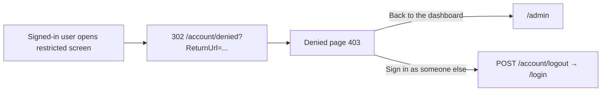

# Access denied

## Purpose

Shown when a signed-in user opens a screen their role does not allow (the cookie scheme's `AccessDeniedPath`).
Tells them so and offers a way back or to sign in as someone else.

## Route / Navigation

| Item | Value |
| --- | --- |
| Route | `GET /account/denied` (status code set to **403**) |
| Query parameter | `ReturnUrl` is appended by the cookie middleware but ignored |
| Reached from | a direct URL or bookmark to an admin screen whose role check fails (e.g. an Editor opening `/admin/users`, `/admin/plugins` or `/admin/settings` - the sidebar no longer shows those links), and any `Forbid()` from a resource-level check (e.g. an Author editing, deleting or reordering a page they did not create on [Pages](pages.md), or an entry in the [Content Manager](content-manager.md)) |

## Relevant source files

```text
src/DotNetForge.Web/Controllers/AccountController.cs     Denied(): ViewData["AppName"], status 403
src/DotNetForge.Web/Views/Account/Denied.cshtml          lock icon, message, dashboard link, sign-out form (Layout = "_AuthLayout")
src/DotNetForge.Web/Views/Shared/_AuthLayout.cshtml      brand panel + form column, theme menu, _Feedback; loads dnf-theme.js, dnf.css, auth.css, dnf.js
src/DotNetForge.Web/wwwroot/css/auth.css                 .dnf-auth__heading--state (centred)
src/DotNetForge.Web/Areas/Admin/Navigation/AdminNavigation.cs   AdminNavigationService: hides sidebar links the user cannot open
```

## Page layout

```text
Access denied (_AuthLayout, title "Access denied · <APP_NAME>")
├── aside.dnf-auth__panel (brand panel - white in light, charcoal in dark; hidden below 56rem)
└── main.dnf-auth__main
    ├── .dnf-auth__top: <APP_NAME> mark (→ /, only below 56rem) · theme menu (JS only)
    ├── .dnf-auth__card
    │   ├── .dnf-auth__heading.dnf-auth__heading--state (centred)
    │   │   ├── lock icon (span.dnf-dialog__icon.dnf-dialog__icon--danger, aria-hidden)
    │   │   ├── h1 **Access denied**
    │   │   └── "Your account doesn't have permission to open this page. Ask an administrator if you need access."
    │   └── .dnf-stack.dnf-stack--sm
    │       ├── [**Back to the dashboard**] (a.dnf-button.dnf-button--primary → /admin)
    │       └── form (POST /account/logout, antiforgery) → [**Sign in as someone else**] (button.dnf-button.dnf-button--secondary)
    └── footer line "<APP_NAME> · Powered by DotNetForge"
```

Layout mechanics: [design system → auth layout](../architecture/design-system.md#auth-layout).

## Components and functionality

| Element | Behaviour |
| --- | --- |
| **Back to the dashboard** | link to `/admin` (Dashboard). For a user without an admin-capable role (e.g. `Authenticated`) this leads straight back here. |
| **Sign in as someone else** | a real submit button in a POST form to `/account/logout` with an antiforgery token (audit `user.logout`, then `302 /login`). Works without JavaScript; no inline handler (CSP `script-src 'self'`). |
| Theme menu | Light / Dark / System ([themes](../architecture/design-system.md#themes)); JS only. |

## Data, state, validation, loading, empty states

Only `AppEnvironment.AppName`. No state (apart from the theme choice in `localStorage`), no validation, no async work,
no empty state.

## Permissions

Anonymous route; normally reached by signed-in users.

## Error handling

None.

## User interactions

One link and one button; "Skip to content" and the theme menu from the layout. No keyboard shortcuts.

## Dependencies

`AccountController` → `AppEnvironment`.

## Page flow



## Related pages

[Sign in](login.md), [Dashboard](dashboard.md). Which screens trigger it: [authorization](../features/authorization.md#screen-access).

## Important implementation details / known limitations

- The sidebar hides links whose screen controller's `[Authorize]` rules the user fails (`AdminNavigationService`,
  [pages → navigation](../architecture/pages.md#navigation)), so role-restricted screens are reached here only by
  typed URLs, bookmarks or old links. Hiding is not the gate: the controller attributes still redirect here
  (verified by `AdminUiTests.The_sidebar_shows_only_screens_the_role_may_open`).
- Resource-level refusals (`Can`/`CanModify` → `Forbid()`, e.g. an Author and another author's page) are not
  predicted by the sidebar and still end up here.
- A `fetch` that is forbidden (the reorder on Pages) also follows the redirect here and receives this 403
  page; `pages.js` then shows the toast "Could not save the new order." and reloads.
- The page carries no inline script or style (CSP, see [security](../features/security.md)). It is not among the
  pages `AdminUiTests.Every_screen_renders_without_inline_script_or_style` checks (that test covers
  `/login`, `/` and `/about` outside the admin).

## Extension points

- Navigation visibility follows `AdminNavigation.Tree` and each screen controller's `[Authorize]` data - add a new
  screen there with its `Controller` type and the link hides itself for users who cannot open it. Keep the controller
  attributes as the real gate.
- Wording and actions: `src/DotNetForge.Web/Views/Account/Denied.cshtml`.
