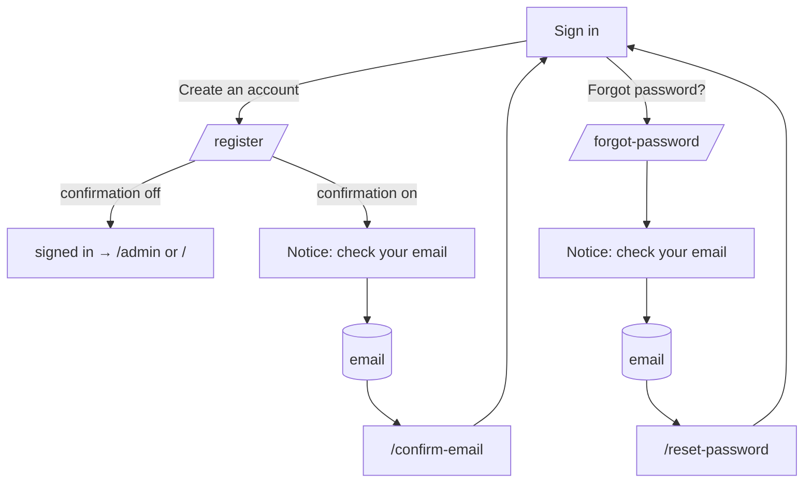

# Register, forgot and reset password, email confirmation

## Purpose

The self-service account screens: visitors create an account (only while **Enable sign-ups** is on), users who forgot
their password get a reset link by email, and new accounts confirm their email address (only while **Enable email
confirmation** is on). All of them use `_AuthLayout`, like [Sign in](login.md). Rules and settings:
[authentication → self-service accounts](../features/authentication.md#self-service-accounts) and
[Advanced Settings](advanced-settings.md).

## Route / Navigation

| Screen | Route | Available when | Reached from |
| --- | --- | --- | --- |
| Create an account | `GET/POST /register` | sign-ups on, else `404` | **Create an account** on [Sign in](login.md) |
| Forgot password | `GET/POST /forgot-password` | SMTP configured (`SMTP_*` in `.env`, [Email Configuration](email-configuration.md)), else `404` | **Forgot password?** on Sign in |
| Choose a new password | `GET/POST /reset-password?token=...` | the token is valid | the reset email (or a front end's own page, see below) |
| Confirm email | `GET /confirm-email?token=...` | - | the confirmation email |
| Resend confirmation | `POST /confirm-email/resend` | email confirmation on (otherwise a no-op) | **Send the confirmation link again** on Sign in |
| Notice | (rendered by the actions above) | - | "Check your email" and "This link doesn't work" messages |

Every `POST` is rate limited with the `credentials` policy (10 per minute per client IP → `429`). Every `POST` checks
the antiforgery token except `POST /reset-password`: there the single-use reset token is the proof, so a front end's
own reset page can post its form there.

## Relevant source files

```text
src/DotNetForge.Web/Controllers/AccountController.cs       Register, ForgotPassword, ResetPassword, ConfirmEmail, ResendConfirmation, Notice, InvalidLink
src/DotNetForge.Web/Services/AccountService.cs             RegisterAsync, RequestPasswordResetAsync, FindResetUserAsync, ResetPasswordAsync, ConfirmEmailAsync, ResendConfirmationAsync; tokens, links, emails
src/DotNetForge.Web/Services/UserAccountSettings.cs        UserAccountSettingsService (sign-ups, default role, confirmation, URLs)
src/DotNetForge.Infrastructure/Messaging/SmtpEmailSender.cs IEmailSender over SMTP
src/DotNetForge.Web/Views/Account/Register.cshtml          the form around Shared/_AccountFields: name (optional), email, password + confirm
src/DotNetForge.Web/Views/Account/ForgotPassword.cshtml    email
src/DotNetForge.Web/Views/Account/ResetPassword.cshtml     hidden token, new password + confirm
src/DotNetForge.Web/Views/Account/Notice.cshtml            icon (mail, or circle-alert for a broken link), title, text, "Back to sign in"
src/DotNetForge.Web/wwwroot/css/auth.css                   .dnf-auth__switch ("Already have an account? Sign in")
```

## Page layout

```text
Create an account (_AuthLayout)
├── h1 **Create an account** + "Sign up with your email address and a password."
├── form.dnf-form (POST /register, antiforgery)
│   ├── <dnf-validation-summary />
│   ├── .dnf-form-grid: **First name** (optional) · **Last name** (optional)
│   ├── **Email** *, **Password** * (+ eye button, hint "At least 8 characters, including a letter and a number."), **Confirm password** *
│   └── [**Create account**]
└── .dnf-auth__switch "Already have an account? **Sign in**"

Forgot password: h1 **Forgot your password?** · **Email** · [**Send reset link**] · "Back to sign in"
Choose a new password: h1 · <dnf-validation-summary /> · hidden token · **New password** (+ eye) · **Confirm new password** · [**Change password**]
Notice: icon · h1 (title) · text · [**Back to sign in**]
```

## Functionality

### Register

1. `POST /register` → `AccountService.RegisterAsync`: sign-ups on; valid email (`EmailValidator`, max length as on
   the Users screen); `PasswordPolicy`; passwords match; names ≤ the Users screen limit; no account with that email
   (case-insensitive); the default role exists.
2. Creates the user (`Enabled`, the [default role](advanced-settings.md)) and audits `user.registered`
   (details `Role: <name>`).
3. **Email confirmation off:** the account is confirmed and signed in right away → `/admin` when its role can enter
   the admin (with a "Welcome!" toast), otherwise `/` (the public site shows no toasts).
4. **Email confirmation on:** the account is unconfirmed, a confirmation email is sent and the notice "Check your
   email" is shown.
5. **Errors:** the form re-renders with the message in `<dnf-validation-summary />` and empty password fields. With sign-ups
   off the `POST` answers `404` too.

### Forgot password

`POST /forgot-password` → `RequestPasswordResetAsync`. For an **enabled** account with that email (case-insensitive)
it emails a link (`user.password.reset.requested`, `success: true`); for an unknown email nothing is sent
(the same audit action with `success: false`). The answer is always the same notice ("If an account uses … we sent it
a link …"), so the form never reveals whether an account exists. A failed send is logged with its error type only.

### Choose a new password

`GET /reset-password?token=…` shows the form only for a valid, unexpired, unused token ("This link doesn't work"
otherwise). `POST` checks the token again, `PasswordPolicy` and the confirmation, then sets the password, clears the
lockout, marks the email confirmed and audits `user.password.reset` → `302 /login` with "Your password is changed"
toast. The link then stops working (it is bound to the old password).

### Confirm email

`GET /confirm-email?token=…` marks the account confirmed (`user.email.confirmed`, once) and redirects to the
**Redirection after email confirmation** URL, or to `/login` with "Your email is confirmed" toast. An invalid or
expired link (or one for an address the account no longer uses) shows "This link doesn't work".

### Resend confirmation

From the sign-in error "Confirm your email first": `POST /confirm-email/resend` sends a new link when an enabled,
unconfirmed account uses that email; the notice is neutral either way.

## Data used by the page

`Users`, `UserRoles`, `Roles`, `Settings` (`users.*` keys), `AuditLogs`; the Data Protection key ring (tokens).

## State

Tokens are ASP.NET Data Protection time-limited payloads (purpose `DotNetForge.Account.Links.v1`), so no table holds
them: reset `reset|<userId>|<password-hash fingerprint>`, 1 hour; confirmation `confirm|<userId>|<email>`, 2 days.
Links are built from `APP_URL` (or the configured reset page URL), never from the request's `Host` header.

## Permissions

Anonymous. A signed-in user can open them too.

## Validation

As in [Functionality](#functionality); browser `required`/`type=email` in addition. Password rules:
`PasswordPolicy` (at least 8 characters, a letter and a number).

## Error handling

| Case | Shows |
| --- | --- |
| Sign-ups off (`/register`) or SMTP not configured (`/forgot-password`) | `404` |
| Invalid / expired / used link | Notice "This link doesn't work" (circle-alert icon) |
| Email already used | "An account with this email already exists. Sign in, or reset your password." |
| Default role deleted | "Registration is not available right now." (warning logged) |
| SMTP unreachable | the same neutral notice; error type logged |
| Rate limit | `429` |

## Loading behaviour

Synchronous POSTs; sending email happens inside the request (SMTP latency adds to it).

## Empty states

Not applicable.

## User interactions

Enter submits; eye buttons reveal passwords (JS only); `autocomplete` `username` / `new-password`.

## Dependencies

```text
AccountController → AuthService, AccountService, UserAccountSettingsService, IAuditService, AppEnvironment, LoginProviders
AccountService → DotNetForgeDbContext, IPasswordHasher, IEmailSender (SmtpEmailSender), UserAccountSettingsService, IAuditService, IDataProtectionProvider
```

## Page flow



## Related pages

[Sign in](login.md), [Advanced Settings](advanced-settings.md), [Users](users.md) (accounts created there are
confirmed already).

## Important implementation details

- No inline script or style (CSP); the same `_AuthLayout` as Sign in.
- Email bodies are built in `AccountService` (not editable; [email templates](../features/email.md) are planned).
- These paths (`/login`, `/register`, `/forgot-password`, `/reset-password`, `/confirm-email`) are attribute routes, so
  they take precedence over a content page with the same slug.

## Known limitations

- Registration only by email and password; sign-up through an OAuth provider is not built.
- Emails are HTML only (no plain-text part); their text comes from [Email Templates](email-templates.md).

## Planned (not implemented)

- Editable email templates and a test email ([email](../features/email.md#planned-not-implemented)).
- Sign-up through social/OAuth providers ([authentication](../features/authentication.md#planned-not-implemented)).
