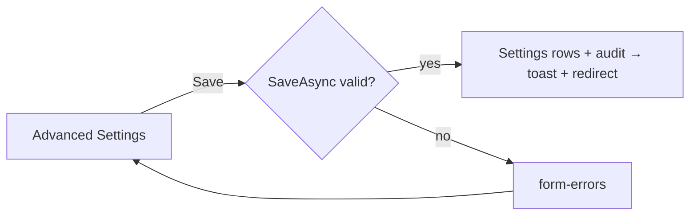

# Advanced Settings

## Purpose

The **Advanced User Settings**: how people get an account on the site - whether visitors may sign up at `/register`,
the role new accounts get, whether they must confirm their email first, and where the email links point for a front
end with its own pages. Mechanism: [authentication → advanced user settings](../features/authentication.md#advanced-user-settings);
the visitor screens: [self-service account screens](account-self-service.md).

## Route / Navigation

| Item | Value |
| --- | --- |
| Route | `GET /admin/advanced-settings`, `POST /admin/advanced-settings` |
| Navigation entry | sidebar **Settings → Users & Permissions Plugin → Advanced Settings** (icon `sliders`) |
| Parent / children | none |

## Relevant source files

```text
src/DotNetForge.Web/Areas/Admin/Controllers/AdvancedSettingsController.cs  Index (GET), Save (POST); role list, CanEdit
src/DotNetForge.Web/Areas/Admin/Views/AdvancedSettings/Index.cshtml         two cards (Sign-ups, Email) in one form
src/DotNetForge.Web/Areas/Admin/Models/AdminViewModels.cs                   AdvancedSettingsViewModel
src/DotNetForge.Web/Services/UserAccountSettings.cs                         UserAccountSettings, UserAccountSettingsService (GetAsync, DefaultRoleAsync, SaveAsync)
src/DotNetForge.Web/Areas/Admin/Navigation/AdminNavigation.cs               sidebar link
```

## Page layout

```text
Advanced Settings (admin layout, medium width)
└── form (POST /admin/advanced-settings, antiforgery) - fieldset disabled without Settings update
    ├── <form-errors />
    ├── card **Sign-ups**
    │   ├── switch **Enable sign-ups** (off by default) - "/register answers 404" when off
    │   ├── select **Default role for new accounts** (every role except Super Admin and Public; "(opens the admin)" marks admin-capable ones; Authenticated preselected)
    │   └── info line: one account per email address - always on
    ├── card **Confirmation and password reset**
    │   ├── alert (warning) "Email is not configured" - set `SMTP_*` in `.env` (links Email → Configuration) - only without SMTP
    │   ├── switch **Enable email confirmation** (disabled without SMTP)
    │   ├── **Reset password page** (optional URL)
    │   ├── **Redirection after email confirmation** (optional URL)
    │   └── card-footer: [**Save settings**] (only with Settings update; saves both cards - one form)
```

## Functionality

**Save settings** → `UserAccountSettingsService.SaveAsync`. On success: upserts the five `Settings` rows, audits
`settings.changed` (entity display "Advanced User Settings", details "Sign-ups on/off, email confirmation on/off"),
toast "Advanced user settings saved." and redirect. On errors the screen re-renders with the posted values and the
messages.

## Data used by the page

`Settings` rows `users.signUps`, `users.defaultRole`, `users.emailConfirmation`, `users.resetPasswordUrl`,
`users.confirmationRedirectUrl` (listed on [Settings](settings.md), but only editable here); `Roles`; whether SMTP is
configured (`IEmailSettingsSource` - [Email Configuration](email-configuration.md)).

## State

All server side (the `Settings` table). Email confirmation counts as on only while SMTP is configured, whatever is
stored.

## Permissions

`[RequirePermission(Settings, Read)]` to open (by default Super Admin and Admin); `Save` needs `Settings / Update`.
Only a **Super Admin** may choose a default role that opens the admin (any role except `Authenticated`); others may
keep the one a Super Admin chose - otherwise anyone with the Settings permission could sign themselves up with more
rights than they have.

## Validation

| Rule | Message |
| --- | --- |
| Default role must exist | "Choose a default role that exists." |
| Not Super Admin or Public | "New accounts can't get the <role> role." |
| Admin-capable role, saved by someone who isn't a Super Admin (and not already stored) | "Only a Super Admin can give new accounts a role that opens the admin (<role>)." |
| Email confirmation without SMTP | "Email confirmation needs email: set SMTP_HOST and SMTP_FROM in .env first." |
| URLs | absolute `http`/`https`, or empty: "… must be an absolute http(s) address, or empty for the built-in page." |

## Error handling

Validation errors in `<form-errors />`; nothing is saved when there is one.

## Loading behaviour

Server-rendered; one synchronous POST.

## Empty states

Not applicable (built-in roles always exist).

## User interactions

Switches and the select are plain form controls; the form works without JavaScript.

## Dependencies

```text
AdvancedSettingsController → UserAccountSettingsService (→ DotNetForgeDbContext, IAuditService, AppEnvironment), DotNetForgeDbContext, AppEnvironment
```

## Page flow



## Related pages

[Sign in](login.md), [self-service account screens](account-self-service.md), [Settings](settings.md),
[Roles](roles.md), [Users](users.md).

## Important implementation details

- **Reset password page:** reset emails link there with `?token=…`; that page posts a form with `token`, `password`
  and `confirmPassword` to `<APP_URL>/reset-password` (no antiforgery token needed). Empty: the built-in page.
- **Redirection after email confirmation:** where `/confirm-email` sends a confirmed user. Empty: `/login`. (The
  original specification made it required while confirmation is on; the built-in sign-in page is the default instead.)
- Turning email confirmation on never locks out existing accounts: they were marked confirmed by the data upgrade
  (`DataSeeder` seed version 2), and accounts created on the Users screen or by setup are confirmed.

## Known limitations

- Applies to email/password sign-up only; provider (OAuth) sign-up is not built.

## Planned (not implemented)

- Provider-specific rules (sign-up through OAuth, one-account-per-email across providers) - see
  [authentication](../features/authentication.md#planned-not-implemented).
