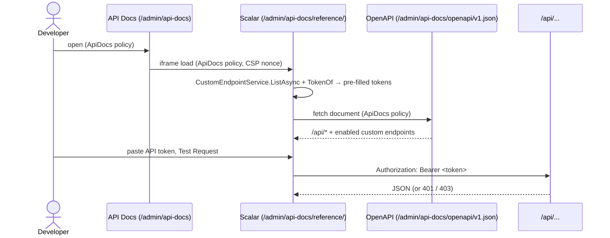
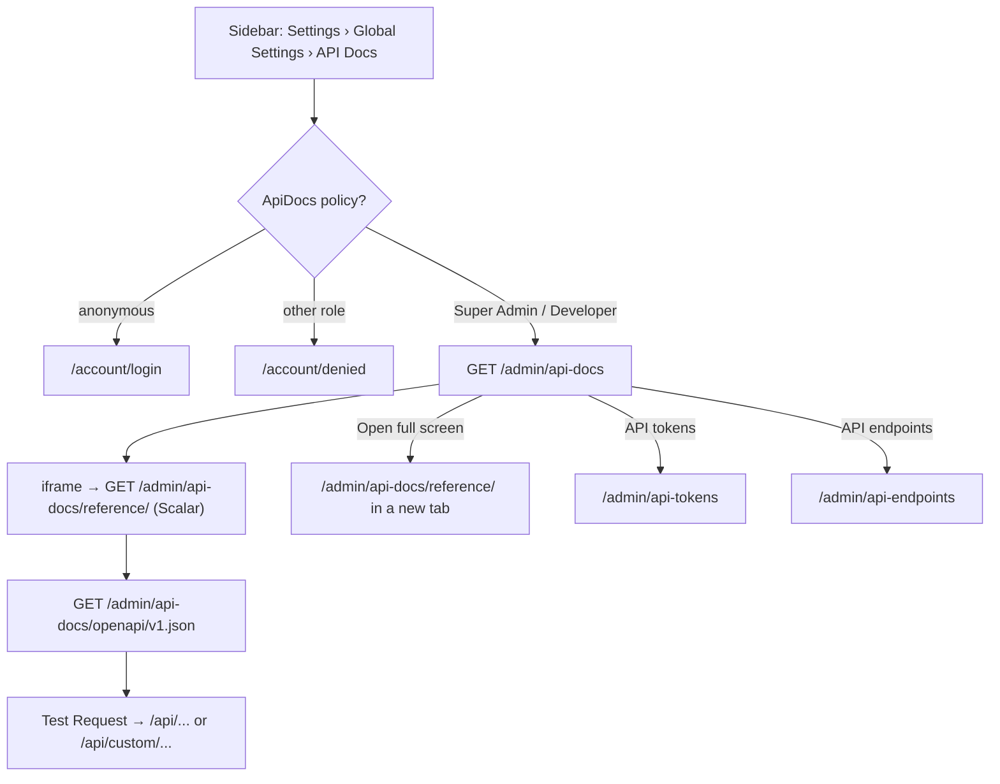

# API Docs

## Purpose

Lets Super Admins and Developers read and try the site's API inside the admin: the [headless API](../features/headless-api.md)
(with an API token they paste in) and every enabled [custom endpoint](../features/custom-endpoints.md) (with its own
token, already filled in). The screen frames the interactive reference that [Scalar](../features/api-docs.md) renders
from the site's OpenAPI document. What the document contains, how Scalar is configured and its security rules are in
[API docs](../features/api-docs.md); this document describes the screen.

## Route / Navigation

| Screen | Route | View | Title (h1, last breadcrumb) |
| --- | --- | --- | --- |
| API Docs | `GET /admin/api-docs` | `ApiDocs/Index.cshtml` | "API Docs" |
| Reference (in the frame, or full screen) | `GET /admin/api-docs/reference/` | Scalar's own HTML page (no admin shell), mapped by `MapApiDocs` | "<AppName> API" (Scalar) |
| OpenAPI document (read by Scalar) | `GET /admin/api-docs/openapi/v1.json` | JSON, mapped by `MapApiDocs` | - |

| Item | Value |
| --- | --- |
| Sidebar entry | **Settings → Global Settings → API Docs** (icon `book`), right after API Endpoints (`AdminNavigation.Tree`); shown only to Super Admins and Developers |
| Breadcrumbs | Settings › Global Settings › **API Docs** |
| Child screens | none; **Open full screen** opens the reference in a new tab |
| Linked from | the sidebar; **Try it in the API docs** on the [API Endpoints](api-endpoints.md) editor's **Call it** card |

All three routes are listed in the [route map](../architecture/pages.md#route-map) and in
[API docs → Routes](../features/api-docs.md#routes).

## Relevant source files

```text
src/DotNetForge.Web/Areas/Admin/Controllers/ApiDocsController.cs     Index ([Authorize(Policy = AuthorizationPolicies.ApiDocs)])
src/DotNetForge.Web/Areas/Admin/Views/ApiDocs/Index.cshtml           header actions + .ext-frame card (skeleton, iframe[data-frame])
src/DotNetForge.Web/ApiDocs/ApiDocsEndpoints.cs                      MapApiDocs: MapOpenApi + MapScalarApiReference (options, pre-filled endpoint tokens)
src/DotNetForge.Web/ApiDocs/ApiDocsTransformers.cs                   ApiDocsDocument, ApiDocsDocumentTransformer, ApiDocsOperationTransformer
src/DotNetForge.Web/Startup/DependencyRegistration.cs                AddOpenApi("v1", ...), the ApiDocs policy
src/DotNetForge.Web/Program.cs                                       app.MapApiDocs(env)
src/DotNetForge.Web/Middleware/SecurityHeadersMiddleware.cs          ApiReferencePolicy: the Scalar page's nonce'd CSP
src/DotNetForge.Web/Areas/Admin/Navigation/AdminNavigation.cs        sidebar entry
src/DotNetForge.Web/wwwroot/js/forge/ui.js                           iframe[data-frame]: hides the skeleton once the frame has loaded
src/DotNetForge.Web/wwwroot/css/forge/admin.css                      .ext-frame-card, .ext-frame, .ext-frame-loading (shared with admin extension tabs)
src/DotNetForge.Shared/Constants/AuthorizationPolicies.cs            AuthorizationPolicies.ApiDocs
src/DotNetForge.Content/Endpoints/CustomEndpointService.cs           ListAsync, OperationsAsync, TokenOf (the endpoints, their operations and tokens)
```

## Page layout

```text
API Docs (h1) - "Try the API: the headless API with an API token, and your custom endpoints with their own tokens (filled in)."
   [API tokens] → /admin/api-tokens   [API endpoints] → /admin/api-endpoints   [Open full screen] → /admin/api-docs/reference/ (new tab)
└── div.card.ext-frame-card
    ├── .ext-frame-loading skeleton (title + 3 lines; JS only, hidden once the frame has loaded)
    └── iframe.ext-frame src=/admin/api-docs/reference/  title="API reference"  data-frame   (viewport height minus header, min 28rem)
        └── Scalar ("<AppName> API", document description, then the operations grouped by tag - the API's
            controllers, and one tag per enabled custom endpoint named like it; authentication with
            ApiToken and one "Endpoint xxxxxxxx" scheme per token endpoint)
```

## Components

| Component | Inputs | Behaviour |
| --- | --- | --- |
| Header actions | none | three links (`btn-secondary`): **API tokens** (icon `key`), **API endpoints** (icon `code`), **Open full screen** (icon `external-link`, `target="_blank" rel="noopener"`) |
| Frame card | none | the same markup as an [admin extension tab](extension-host.md): `.ext-frame-card` with a skeleton and `iframe.ext-frame[data-frame]`; `ui.js` adds `is-loaded` on the frame's `load` event, which hides the skeleton |
| Scalar reference | `GET /admin/api-docs/openapi/v1.json`, the pre-filled endpoint tokens | Scalar's own UI (operations, schemas, "Test Request"); configured in `MapApiDocs` without the font CDN, telemetry, the "Ask AI" agent, MCP and developer tools ([API docs → Tokens in Scalar](../features/api-docs.md#tokens-in-scalar)) |

The controller passes no model: everything inside the frame comes from the two mapped routes.

## Functionality

### Open the screen

`GET /admin/api-docs` → `ApiDocsController.Index` → `View()`. The browser then loads the frame:
`GET /admin/api-docs/reference/` (Scalar's page; `MapScalarApiReference` reads `CustomEndpointService.ListAsync` and
adds an HTTP bearer authentication with the token for every endpoint that is enabled, has **Token** access and a
readable token) → Scalar fetches `GET /admin/api-docs/openapi/v1.json`. Both routes require the `ApiDocs` policy.

### Read the document

The OpenAPI document ([API docs → The OpenAPI document](../features/api-docs.md#the-openapi-document)) lists:

- every `/api/*` action except the custom-endpoint catch-all `/api/custom/{**path}` (`ApiDocsDocument.Includes`);
  each operation with `[RequireApiPermission]` needs the `ApiToken` bearer scheme and says "Needs an API token with
  `<key>`." (`ApiDocsOperationTransformer`);
- every **enabled** custom endpoint as a tag named like the endpoint (with "(/path)" added when two share a name;
  its description, or "Custom endpoint /api/custom/<path>."), holding each of its operations at
  `/api/custom/<endpoint path>/<sub-path>` with the operation's method, summary (its name, else method and sub-path),
  parameters (route, query, JSON body; typed) and responses (200 by result shape, 400, 500; 401 for token endpoints;
  404 for "First row"). A token endpoint has one scheme `Endpoint <first 8 hex of its id>` for all its operations, a
  public one none (`ApiDocsDocumentTransformer`).

The document is built per request, so an endpoint saved, disabled or deleted on [API Endpoints](api-endpoints.md)
shows (or disappears) on the next load of the frame.

### Try a request ([API docs → Using it](../features/api-docs.md#using-it))

- **Headless API:** create a token on [API Tokens](api-tokens.md) (the secret is shown once), paste it into the
  `ApiToken` authentication in Scalar, then send the request ("Test Request"). The token must hold the key the
  operation names, else the API answers 403; without one, 401.
- **Custom endpoints:** open the endpoint's group and pick an operation; the endpoint's token (one for all its
  operations) is already filled in, so "Test Request" works at once. Public endpoints need none.

Requests go from the browser straight to `/api/...` on this origin (`connect-src 'self'`), with the API's own
authentication and rate limit; the admin cookie plays no part in them. Calls that change data are real (custom
endpoints audit non-GET calls as `endpoint.executed`) - unlike the editor's test run, nothing is rolled back.



### Open full screen

**Open full screen** opens `/admin/api-docs/reference/` in a new tab - the same Scalar page without the admin shell.

## Data used by the page

`CustomEndpoint` rows (`ListAsync`: name, base path, description, access, enabled; the token through `TokenOf`,
decrypted with Data Protection) and their `CustomEndpointOperation` rows (`OperationsAsync`: method, sub-path, name,
`ParametersJson`, result); the API controllers' `ApiDescription`s and their
`RequireApiPermissionAttribute`; `AppEnvironment.AppName` (titles). No view model, no `ViewData` beyond title and
description.

## State

None on the server for this screen. The frame's state (open operations, the pasted API token, request values) lives
in Scalar inside the browser and is lost on reload unless Scalar keeps it itself. The endpoint tokens are re-read on
every load of the reference.

## Permissions

`[Authorize(Policy = AuthorizationPolicies.ApiDocs)]` on `ApiDocsController` (plus `AdminArea` from
`AdminControllerBase`), and `RequireAuthorization(AuthorizationPolicies.ApiDocs)` on the reference and the OpenAPI
document: signed in **and** in the role `Super Admin` or `Developer` (`RequireRole`). Anonymous requests to any of the
three routes are redirected to sign-in; other roles get [Access denied](access-denied.md) and no sidebar link. The
check is by role name, not by permission grants - a custom role cannot be given access. There is no finer-grained
check: whoever opens the screen sees every enabled endpoint's token. Covered by
`ApiDocsTests.Only_super_admins_and_developers_open_the_docs`.

## Validation

Not applicable - the screen has no form. Requests sent from Scalar are validated by the API itself.

## Error handling

| Failure | Detection | User sees | Recovery |
| --- | --- | --- | --- |
| Not signed in | `ApiDocs` policy | redirect to `/account/login` (also when the frame or the JSON is opened directly) | sign in |
| Wrong role | `ApiDocs` policy | [Access denied](access-denied.md) | ask a Super Admin for the `Developer` role |
| Endpoint token unreadable (Data Protection key gone) | `TokenOf` returns null | the endpoint is listed with its scheme but no token filled in | **Generate token** on [API Endpoints](api-endpoints.md) |
| API request refused | the API | Scalar shows the response: 401 (no or wrong token), 403 (token lacks the key), 429 (rate limit) | paste a token with the right key |
| Custom endpoints on MongoDB | `CustomEndpointsApiController` | the endpoints are listed; calls answer 501 | - |
| Frame fails to load | none | the skeleton stays | **Open full screen** or reload |

## Loading behaviour

The admin page is server-rendered; the reference loads asynchronously in the frame. A skeleton (title + three lines,
JS only) covers the card until the frame's `load` event; without JavaScript the frame shows directly. Scalar then
fetches the OpenAPI document and renders it.

## Empty states

None of the screen's own. Without enabled custom endpoints the document lists only the headless API, which is always
there.

## User interactions

**API tokens**, **API endpoints**, **Open full screen** (new tab); everything inside the frame is Scalar's (expand
operations, enter authentication and values, "Test Request").

## Dependencies

```text
ApiDocsController (AdminControllerBase) → View()
MapApiDocs (Program.cs)
├── MapOpenApi("/admin/api-docs/openapi/{documentName}.json") → AddOpenApi("v1")
│   ├── ApiDocsDocumentTransformer → CustomEndpointService (ListAsync, OperationsAsync), AppEnvironment
│   └── ApiDocsOperationTransformer → RequireApiPermissionAttribute metadata
└── MapScalarApiReference("/admin/api-docs/reference") → CustomEndpointService (ListAsync, TokenOf), AppEnvironment
SecurityHeadersMiddleware → ApiReferencePolicy(nonce) for the Scalar page only
View → ui.js (iframe[data-frame]), admin.css (.ext-frame-*), <icon>
```

## Page flow



## Related pages

[API Tokens](api-tokens.md) (tokens for the headless API) · [API Endpoints](api-endpoints.md) (custom endpoints and
their tokens; links here with **Try it in the API docs**) · [Admin extension tab](extension-host.md) (the same framed
layout) · feature docs: [API docs](../features/api-docs.md), [headless API](../features/headless-api.md),
[custom endpoints](../features/custom-endpoints.md).

## Important implementation details

- Scalar renders a complete HTML page with its own scripts, so it is not a Razor view: the screen frames it, like an
  admin extension tab, and **Open full screen** shows it alone.
- Only the Scalar page gets a relaxed Content-Security-Policy: `script-src 'self' 'nonce-…'` (a fresh nonce per
  response, on Scalar's one inline script) and `style-src 'self' 'unsafe-inline'` (it injects styles at runtime).
  `SecurityHeadersMiddleware` switches when Scalar has put its nonce in `HttpContext.Items`. The API Docs screen keeps
  the strict policy ([API docs → Content-Security-Policy](../features/api-docs.md#content-security-policy)).
- Scalar's scripts are served by `Scalar.AspNetCore` from under `/admin/api-docs/reference/`, so the docs need no CDN.
- The pre-filled endpoint tokens are in the Scalar page's HTML; the page is only served to the same roles that can
  read them on [API Endpoints](api-endpoints.md).
- The document comes from the endpoints' metadata at request time, not from a file: nothing is written to disk.
- `ApiDocsTests.The_document_lists_the_api_and_the_custom_endpoints_with_their_tokens` checks the paths (no `/admin`,
  no `{**path}`), the `ApiToken` scheme and `entries.read` on `/api/entries/{type}`, a token endpoint's own scheme -
  the same on its `GET` and its `DELETE /{id}` operation, which sits under the tag "Items" - and a public one's none,
  the token in Scalar's HTML, and the nonce in the CSP.

## Known limitations

- API tokens are not filled in: their secret is shown only once, so it must be pasted.
- Access is by role name (`Super Admin`, `Developer`); it cannot be granted to an `Admin` or a custom role.
- Requests sent from the reference are real - writes are not rolled back.
- The skeleton stays if the frame never fires `load` (e.g. a network error inside the frame).

## Extension points

- What the document contains: `ApiDocsDocument.Includes`, `ApiDocsDocumentTransformer`, `ApiDocsOperationTransformer`
  (`src/DotNetForge.Web/ApiDocs/ApiDocsTransformers.cs`). A new API action appears automatically under `/api/`; give it
  `[RequireApiPermission]` so the document names its key.
- Scalar's options (title, disabled features, pre-filled authentication): `MapApiDocs` in `ApiDocsEndpoints.cs`. Keep
  the CDN, telemetry and AI features off - the CSP and the privacy of the document depend on it.
- Who may open the docs: the `ApiDocs` policy in `DependencyRegistration` (the controller and both routes use it).
