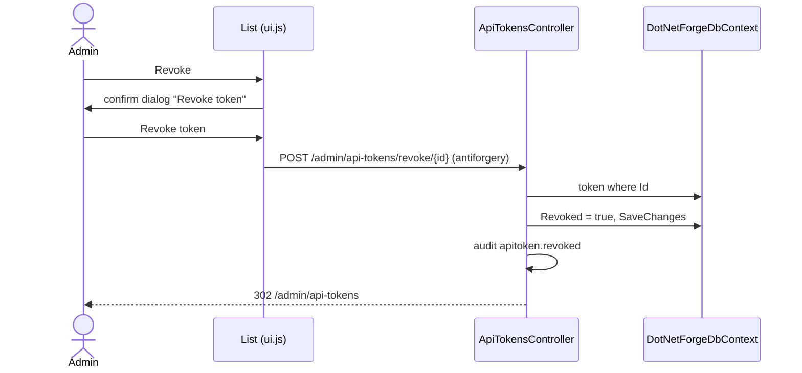
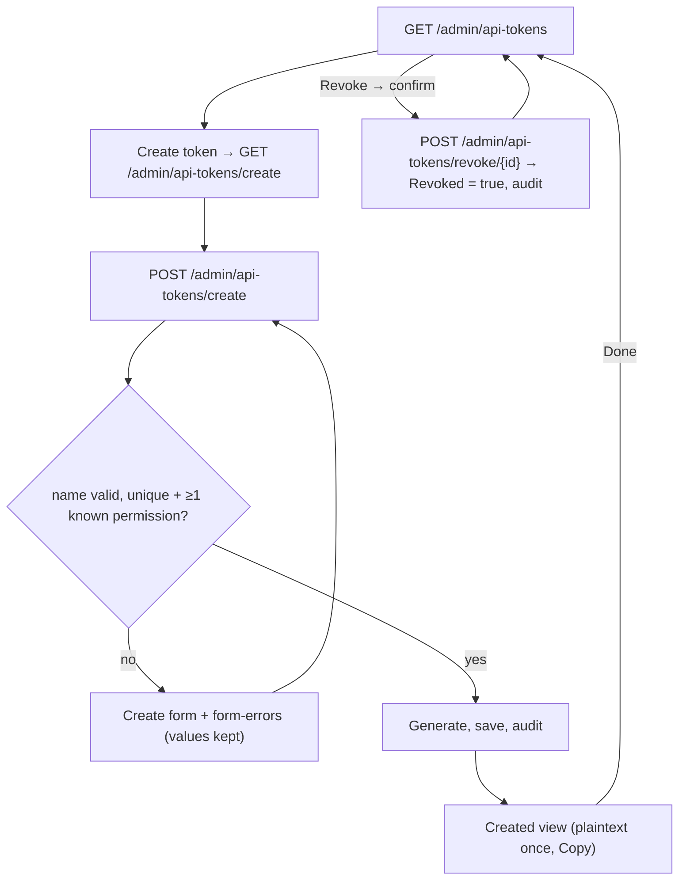

# API Tokens

## Purpose

Lets a Super Admin, Admin or Developer issue and revoke bearer tokens for the
[headless API](../features/headless-api.md). Each token is limited to a chosen set of permission keys. The secret is
shown once on creation and only a hash is kept. API tokens do not open [custom endpoints](api-endpoints.md) - each of
those has its own token. To try a token, paste it into the `ApiToken` authentication of the [API Docs](api-docs.md).

## Route / Navigation

| Screen | Route | View | Title (h1, last breadcrumb) |
| --- | --- | --- | --- |
| Token list | `GET /admin/api-tokens` | `ApiTokens/Index.cshtml` | "API Tokens" |
| Create form | `GET /admin/api-tokens/create` | `ApiTokens/Create.cshtml` | "Create API token" |
| Create submit | `POST /admin/api-tokens/create` | `Create.cshtml` (errors) or `Created.cshtml` (success, not a redirect) | "Create API token" / "Token created" |
| Revoke | `POST /admin/api-tokens/revoke/{id:guid}` | redirects to the list | - |

| Item | Value |
| --- | --- |
| Sidebar entry | **Settings → Global Settings → API Tokens** (`AdminNavigation.Tree`); stays active on the child routes (longest matching href) |
| Breadcrumbs | list: Settings › Global Settings › **API Tokens**; create: Settings › Global Settings › API Tokens › **Create API token**; after creating: … › API Tokens › **Token created** |
| Child flow | list → **Create token** → create form → created view → **Done** → list |
| Linked from | the sidebar; **New API token** quick action on the [Dashboard](dashboard.md) (→ `/admin/api-tokens/create`, shown only to users who may open this screen); **API tokens** button on the [API Docs](api-docs.md) screen |

## Relevant source files

```text
src/DotNetForge.Web/Areas/Admin/Controllers/ApiTokensController.cs    Index, Create (GET/POST), Revoke, duration helpers
src/DotNetForge.Web/Areas/Admin/Views/ApiTokens/Index.cshtml          list card: filter, table, revoke with confirm, empty state
src/DotNetForge.Web/Areas/Admin/Views/ApiTokens/Create.cshtml         Details card (name, description, expiry radio cards) + Permissions card
src/DotNetForge.Web/Areas/Admin/Views/ApiTokens/Created.cshtml        one-time secret + usage example, copy buttons
src/DotNetForge.Web/Areas/Admin/Models/AdminViewModels.cs             CreatedTokenViewModel
src/DotNetForge.Web/Areas/Admin/Navigation/AdminNavigation.cs         sidebar entry, active link, breadcrumbs
src/DotNetForge.Web/Ui/UiTagHelpers.cs                                <timestamp>, <badge>, <alert>, <empty-state>, <form-errors>, <icon>
src/DotNetForge.Web/wwwroot/js/forge/ui.js                            data-collection, data-confirm dialog, data-check-group, data-copy-target
src/DotNetForge.Web/wwwroot/css/forge/admin.css                       .permission-groups / .permission-group
src/DotNetForge.Web/Views/Shared/_Feedback.cshtml                     confirm dialog, toasts
src/DotNetForge.Shared/Entities/ApiToken.cs                           entity (Permissions parsed from PermissionsCsv)
src/DotNetForge.Shared/Constants/Permissions.cs                       PermissionKeys.All, IsKnown
src/DotNetForge.Infrastructure/Security/ApiTokenFactory.cs            Generate (plaintext, hash, prefix)
```

## Page layout

```text
API Tokens (h1) - "Scoped tokens for the headless API. A token's secret is shown once, when it is created."   [+ Create token]
└── section.card[data-collection][data-page-size=25]
    ├── card-header: **Tokens** · "N total" · .segmented (JS only, when tokens exist): **All** | **Active** | **Expired** | **Revoked**
    ├── <empty-state> when there are no tokens (see Empty states)
    ├── table.table.table-stack: **Name** ⇅ · **Token** · **Scopes** ⇅ · **Last used** ⇅ · **Expires** ⇅ · **Status** · actions
    │   └── row: name / "Created <timestamp>" · <code>prefix…</code> · key count · <timestamp> ("Never") ·
    │            <timestamp> ("Never") · Active | Expired | Revoked badge · [Revoke] (only for active tokens)
    └── .pagination (JS, only when more than 25 rows match)

Create API token (h1) - "Give the token a name you'll recognise, choose how long it lives and what it may do."
└── form.form (POST) - centred narrow page (`ViewData["PageWidth"] = "narrow"`)
    ├── <form-errors />
    ├── card **Details**: Name* (placeholder "Marketing website") · Description (optional, "What uses this token?")
    │   └── fieldset **Expires after**: .choice-cards  7 days · 30 days (default) · 90 days · No expiry
    └── card **Permissions*** - "Grant only what the app needs. Requests outside these scopes are refused."
        ├── .permission-groups: one fieldset per key prefix, in `PermissionKeys.All` order (Core, Pages, Content types,
        │   Content Manager, Media, Users, Roles, Settings, Extensions, Webhooks): "All of <group>" (JS only) + one
        │   checkbox per key (<code>key</code>)
        └── card-footer: [Cancel] [Generate token]

Token created (h1) - "'<name>' is ready to use."
├── <alert tone="Warning" title="Copy the token now"> only shown once, only a hash is stored
├── card.card-accent **Your token**: pre.code-block with the plaintext + [Copy] (JS only)
└── card **How to use it** - "Send it in an Authorization: Bearer header."
    ├── .dl: API URL <origin>/api (link, new tab)
    ├── **Example request**: curl -H "Authorization: Bearer <token>" <origin>/api/content/pages + [Copy] (JS only)
    └── card-footer: [Done] → list
```

## Components

| Component | Inputs | Behaviour |
| --- | --- | --- |
| Token table | `List<ApiToken>` (all tokens), newest first | Status badge: **Revoked** (`Danger`) when `Revoked`; else **Expired** (`Warning`) when `ExpirationDate` < now; else **Active** (`Success`). **Scopes** = `ApiToken.Permissions.Count`. **Token** = `TokenPrefix` + "…". **Created** is shown under the name, not as a column |
| State filter | rows' `data-state` | **Active** = neither revoked nor expired; **Expired** = past `ExpirationDate`, not revoked; **Revoked** = revoked. Client-side, [design system → behaviours](../architecture/design-system.md#behaviours) |
| Revoke form | token id | inline POST with antiforgery and `data-confirm`; shown for active tokens only (an expired token is already refused by the API) |
| Create form | `ViewBag.Permissions` = `PermissionKeys.All`; after a failed POST the posted `name`, `description`, `duration`, `permissions` (read from `Request.Form`) | posts `name`, `description`, `duration` (`7` / `30` / `90` / `unlimited`), `permissions[]`; keys are grouped by the part before the first `.`, each group named by `PermissionKeys.GroupLabel` (`content.*` → "Pages", `entries.*` → "Content Manager", `schema.*` → "Content types"; the stored keys keep their names). 31 keys (`PermissionKeys.All`); there is no key for custom endpoints |
| Select-all per group | `data-check-group` / `data-check-member` | ticks or clears the group's keys; shows checked / indeterminate from its members |
| Created view | `CreatedTokenViewModel { Name, Plaintext, Prefix }`; request scheme/host | shows the secret once; builds the API URL and example from the current request origin; **Copy** buttons copy `#token-text` / `#curl-text` (hidden spans) and confirm with a toast |

## Functionality

### Create a token

1. **Trigger:** **Generate token**.
2. **Validation (in this order, first failure wins):** name not blank (`Name is required.`); trimmed name ≤ 200 and
   trimmed description ≤ 1000 characters (`Name is limited to 200 characters and description to 1000.`); name not
   already used by another token, revoked tokens included (`A token named '<name>' already exists. Choose another
   name.`); at least one *known* permission key (`Select at least one permission.`) - unknown keys are silently
   dropped, duplicates removed.
3. **Service:** `IApiTokenFactory.Generate()`.
4. **Data:** `ApiToken { Name (trimmed), Description (trimmed, blank → null), Duration, ExpirationDate,
   PermissionsCsv, CreatedById, CreatedDate, TokenHash, TokenPrefix }`. Duration mapping: `"7"` → 7 days, `"30"` → 30,
   `"90"` → 90, `"unlimited"` → no expiry, anything else → 30 days.
5. **Backend:** save, audit `apitoken.created`.
6. **UI:** renders `Created` directly (no redirect) with the plaintext. Refreshing re-posts the form and creates
   another token (browser warns).
7. **Errors:** validation → the form is re-rendered with the error in `<form-errors />` and the posted name,
   description, expiry and ticked permissions kept. Covered by
   `SecurityTests.Duplicate_api_token_name_is_a_validation_error_not_a_crash`.

### Revoke a token

1. **Trigger:** **Revoke** → the shared confirm dialog ([design system → feedback](../architecture/design-system.md#feedback)):
   title "Revoke token", text "Revoke '<name>'? Apps using it lose access immediately. This can't be undone.",
   button **Revoke token**. Without the dialog API it falls back to `window.confirm`; without JS the form submits
   directly.
2. **Backend:** token found and not already revoked → `Revoked = true`, save, audit `apitoken.revoked`.
   Otherwise nothing happens (no error).
3. **UI:** redirect to the list with the toast "Revoked '<name>'."; the row now shows **Revoked** without a Revoke button. Effect is immediate
   for the API: `ApiTokenAuthenticationHandler` caches only the successful hash verification (10 min) and re-reads
   the token row, including `Revoked` and expiry, on every request.



### Copy the secret

**Copy** (JS only) writes the token or the curl command to the clipboard (`navigator.clipboard`) and shows the toast
"Copied to clipboard." - or "Copying is not available in this browser." / "Could not copy. Select the text and copy
it manually." on failure.

## Data used by the page

All `ApiTokens`; `PermissionKeys.All`; `IDateTimeProvider.UtcNow` (creation and expiry);
`DateTime.UtcNow` in the list view (Expired badge); current user id (`CreatedById`, `Guid.Empty` if missing); request
origin for the example.

## State

Plaintext exists only in the `Created` response (and its hidden copy spans). `ModelState` and the posted form values on
failures. Persisted token rows. DOM only: the list's filter, sort and page.

## Permissions

`AdminArea` (on `AdminControllerBase`) + `[RequirePermission(API, read)]`; creating needs `API` / `create`, revoking
`API` / `delete` ([authorization → screen access](../features/authorization.md#screen-access)). The default grants give
the `API` area to `Super Admin`, `Admin` and `Developer`; Editors/Authors get [Access denied](access-denied.md); the
sidebar link and the dashboard quick action are hidden from them
(`AdminNavigationService`; hiding is not the gate). A creator can grant **any** permission key, regardless of their
own role.

## Validation

| Rule | Where |
| --- | --- |
| Name required | browser (`required`) + server |
| Name length | browser `maxlength="200"`; server ≤ 200 after trimming |
| Description ≤ 1000 characters (after trimming) | server only |
| Unique name (revoked tokens included) | server message + DB unique index |
| ≥ 1 known permission | server only (no browser rule on the checkboxes) |

## Error handling

| Failure | Detection | User sees | Recovery |
| --- | --- | --- | --- |
| Validation error | `ApiTokensController.Create` | danger alert from `<form-errors />`, form with posted values | fix and resubmit |
| Two simultaneous creates with the same name | DB unique index | global [error page](error.md) | retry with another name |
| Revoke of an unknown / revoked id | lookup returns nothing to change | redirect to the list, no message | none needed |
| Copy fails | `ui.js` | danger toast | select the text manually |
| Other DB errors | global handling | [error page](error.md) | retry |

## Loading behaviour

Server-rendered; no indicators. Generation includes a PBKDF2 hash (60 000 iterations) - fast enough to be
unnoticeable.

## Empty states

| Case | Text |
| --- | --- |
| No tokens yet | `<empty-state icon="key">` "No API tokens yet" - "Create a token to let an app or website read your content through the API." + **Create token** (the filter is not shown) |
| Filter matches nothing (JS) | "No token matches the filter." (`[data-collection-empty]`) |

## User interactions

**Create token** (header and empty state), **All / Active / Expired / Revoked** filter, sortable headers, pagination,
**Revoke** with confirm dialog, expiry radio cards, "All of <group>" checkboxes, **Generate token**, **Cancel**,
**Copy** (token, curl example), **Done**.

## Dependencies

```text
ApiTokensController
├── DotNetForgeDbContext
├── IApiTokenFactory → ApiTokenFactory
├── IDateTimeProvider → SystemClock
└── IAuditService → AuditService
Views → <timestamp>, <badge>, <alert>, <empty-state>, <form-errors>, <icon>; ui.js; _Feedback.cshtml (confirm dialog, toasts)
```

## Page flow



## Related pages

[Dashboard](dashboard.md) (**New API token** quick action; "Active API tokens" under "At a glance"),
[Audit Logs](audit-logs.md) (create/revoke entries), [API Docs](api-docs.md) (try the API with a token; it names the
key each operation needs), [API Endpoints](api-endpoints.md) (custom endpoints, with their own tokens); consumers use
the [headless API](../features/headless-api.md).

## Important implementation details

- The list derives **Expired** in the view (`ExpirationDate < DateTime.UtcNow`); the database row is unchanged and
  the API rejects the token on expiry. The dashboard's "Active API tokens" counts tokens that are neither revoked nor
  expired.
- `TokenDuration.Custom` exists in the enum but is not offered.
- The **Scopes** column shows a count, not the keys.
- **Expires** sorts tokens without expiry last (sort value `9999`); **Last used** sorts "Never" as oldest.
- **Last used** is written by `ApiTokenAuthenticationHandler` at most once every 5 minutes per token, so it can lag
  by up to 5 minutes; a failed write is logged and never fails the API request.
- The name check and the insert are not atomic: two simultaneous creates with the same name can still hit the
  unique index (global [error page](error.md)).

## Known limitations

- No rotation, regeneration, editing, deletion, details view or usage statistics.
- A revoked token's name stays taken (the unique index covers revoked rows).
- Expired tokens are grouped under the **Revoked** filter and still offer **Revoke**.
- The Name field stops at 100 characters in the browser although the server accepts 200.
- No success toast after revoking.
- **Copy** needs the Clipboard API, which browsers offer only on secure origins (HTTPS or `localhost`).

## Planned (not implemented)

Target behaviour from the original product specification. Nothing in this section exists in the code unless marked ✔.
Token fields, permission model, role table and the full acceptance list:
[headless API → Planned](../features/headless-api.md#planned-not-implemented).

### Requirements

- **Access:** any user holding the `API` permission area, not a fixed role list; Editors/Authors (when granted) act
  only on their own tokens, Super Admins and Admins on all tokens.
- **List:** Name ✔, prefix ✔, permissions summary ✔, Created ✔, Last used ✔, expiration ✔ and a status that
  distinguishes **Active**, **Revoked** and **Expired** ✔ (the list filter still groups Expired under Revoked).
- **Review flags:** mark **orphaned** tokens (creator disabled or deleted) and tokens whose keys exceed their
  creator's current permissions.
- **Details view** per token: Created by, Description, full permission set.
- **Created view:** plaintext once ✔ with a **copy** action ✔ and the cannot-be-retrieved-again warning ✔.

### User flows

| Flow | Steps |
| --- | --- |
| Create (delta) | Form adds `Custom` to **Duration** with an **Expiration date** input (required for `Custom`); the permission picker offers only keys the creator holds, plus custom keys of installed extensions (a duplicate name is already a validation message ✔). |
| Inspect usage | List → select token → details; use **Last used** and [Audit Logs](audit-logs.md) to judge whether it is stale, then revoke or rotate. |
| Rotate | Select token → **Rotate** → new secret for an equivalent token (same name, description, permissions, duration) shown **once** → old token revoked immediately → both events audited. |

### Rules and validation

- Validation as listed in [headless API → Rules and validation](../features/headless-api.md#rules-and-validation).
- Rotation vs the `Name` unique index: the index also covers revoked rows, so rotation must either
  re-key the existing row or the index must exclude revoked tokens.

### Acceptance criteria

- [ ] A user with the `API` permission can create a token with Name, Description, Token duration, Expiration date
  and Permissions.
- [x] The plaintext token is displayed exactly once at creation (`Created.cshtml`) and never again.
- [ ] Creating a token whose permissions are not a subset of the creator's permissions is rejected.
- [x] A missing or non-unique Name is rejected with a validation message
  (`ApiTokensController.Create`: `Name is required.`, `A token named '<name>' already exists. ...`).
- [ ] `Custom` duration without a future Expiration date is rejected.
- [ ] The permission picker lists built-in keys plus custom keys declared by installed extension manifests.
- [x] Revoking is immediate and irreversible (`ApiTokensController.Revoke`), after a confirmation (`data-confirm`).
- [ ] Rotating issues a new secret (shown once) and immediately revokes the old one.
- [ ] Creation, revocation and rotation are audited (create/revoke ✔).
- [ ] Tokens whose creator account is disabled or deleted are flagged and can be revoked/rotated by a Super Admin.

## Extension points

- New permission key: add it to `PermissionKeys` and `PermissionKeys.All`; it appears in the Permissions card
  automatically, in the group named by its prefix (a new prefix makes a new group).
- Token format or hashing: `ApiTokenFactory` (keep `ExtractPrefix` compatible with stored prefixes).
- Restrict grantable keys by role: filter `ViewBag.Permissions` and `selected` in `ApiTokensController.Create`.
- A success toast after revoke: set `TempData["Success"]` in `ApiTokensController.Revoke` before the redirect
  ([design system → feedback](../architecture/design-system.md#feedback)).
