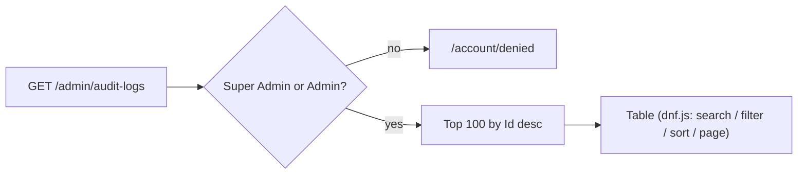

# Audit Logs

## Purpose

Shows the 100 most recent audit entries so Super Admins and Admins can see who did what, when and from where.
Read-only. What gets logged and how: [audit logging](../features/audit-logging.md).

## Route / Navigation

| Item | Value |
| --- | --- |
| Route | `GET /admin/audit-logs` |
| Sidebar entry | **Settings → Administration Panel → Audit Logs** (`AdminNavigation.Tree`) |
| Breadcrumbs | Settings › Administration Panel › **Audit Logs** |
| Parameters | none - search, filters, sort and paging are client-side over the 100 loaded entries, not URL parameters |
| Linked from | the sidebar; **View all** on the dashboard's "Recent activity" card ([Dashboard](dashboard.md), shown only to users who may open this screen) |

## Relevant source files

```text
src/DotNetForge.Web/Areas/Admin/Controllers/AuditLogsController.cs     AuditLogsController
src/DotNetForge.Web/Areas/Admin/Views/AuditLogs/Index.cshtml          card with toolbar + table
src/DotNetForge.Web/Ui/AuditPresentation.cs                           friendly action labels (Label) and icons (Icon)
src/DotNetForge.UI/Components/BasicTagHelpers.cs                      <dnf-timestamp>, <dnf-badge>, <dnf-icon>
src/DotNetForge.UI/wwwroot/dnf.js                                     data-collection search / filter / sort / paging
src/DotNetForge.Web/Areas/Admin/Navigation/AdminNavigation.cs         sidebar entry, breadcrumbs
src/DotNetForge.Shared/Entities/AuditLogEntry.cs                      entity
src/DotNetForge.Web/Services/AuditService.cs                          writer (IAuditService, src/DotNetForge.Shared/Auditing/IAuditService.cs)
```

## Page layout

```text
_AdminLayout - top bar: Settings › Administration Panel › Audit Logs
Audit Logs (h1) - "The 100 most recent actions. Entries are append-only: they can't be edited or deleted."
└── section.dnf-card[data-collection][data-page-size=25]
    ├── dnf-card__header: **Activity** · "N total" (data-collection-count)
    ├── .dnf-toolbar (JS only): search "Search user, action, entity or IP" · **All areas** ▾ · **Any result** ▾ (Succeeded, Failed)
    ├── div.dnf-table.dnf-table--stack > table: **When** ⇅ · **Action** ⇅ · **User** ⇅ · **Entity** · **Result** · **IP address**
    └── .pagination (JS, only when more than 10 entries match: **Rows per page** 10/25/50/100, default 25, remembered)
```

## Components

| Column | Source / rendering |
| --- | --- |
| **When** | `<dnf-timestamp value="Timestamp">` - relative time ("just now", "3 h ago", "3 Oct 2026"), exact UTC time in the tooltip; sorts by the ISO value |
| **Action** | `AuditPresentation.Label(Action)` as `.dnf-table__primary` (e.g. "Updated a page") with the raw key in `<code class="dnf-table__secondary">` (`content.updated`); unknown keys (extension-defined, e.g. `contactform.submitted`) show the raw key in both places |
| **User** | `UserDisplaySnapshot`, or "System" when it is null (anonymous requests) |
| **Entity** | `-` when `EntityType` is null, else `EntityType` (muted) + `EntityDisplaySnapshot` |
| **Result** | `<dnf-badge dot="true">` **Succeeded** (`Success` tone) or **Failed** (`Danger` tone) from `Success` |
| **IP address** | `IpAddress` (monospace, muted) |

`UserAgent`, `EntityId` and `Details` are not shown.

Toolbar ([design system → behaviours](../architecture/design-system.md#behaviours)), revealed only when scripts run:

| Control | Matches |
| --- | --- |
| Search | the row's whole text (relative time, label, raw key, user, entity, result, IP), case-insensitive substring |
| Area filter (**All areas** + the distinct first segment of the loaded actions, alphabetical: e.g. `apitoken`, `content`, `user`) | the row's `data-area` |
| Result filter (**Any result** / **Succeeded** / **Failed**) | the row's `data-result` (`ok` / `fail`) |
| Sort | **When** by date, **Action** by the label text, **User** by text |

## Functionality

Display only. Search, filters, sort and pagination are progressive enhancements in `dnf.js` over the 100
server-rendered rows: without JavaScript the toolbar stays hidden and all 100 rows show newest first on one page.
They never query the server, so they only ever see these 100 entries.

## Data used by the page

All `AuditLogs`, ordered by `Id` descending, `Take(100)`, as full entities - including the entries written by an
anonymous request: failed sign-ins (`user.login.failed`), where no account was resolved, and anonymous extension
actions such as the Contact Form's `contactform.submitted`.

## State

No server state. DOM only: search text, filters, sort and current page - lost on reload. The rows per page are kept
in `localStorage` (`dnf-page-size:/admin/audit-logs:0`).

## Permissions

`AdminArea` (on `AdminControllerBase`) + `[RequirePermission(Audit logs, read)]` (default: Super Admin, Admin); others
→ [Access denied](access-denied.md). The sidebar link and the dashboard's **View all** are hidden from users who fail that check
(`AdminNavigationService`; hiding is not the gate). No finer-grained check.

## Validation / error handling / loading

Not applicable / global only / one server-rendered response, no indicators.

## Empty states

| Case | Text |
| --- | --- |
| No entries (in practice the first sign-in already writes `user.login`) | "No audit entries yet." |
| Search/filters match nothing (JS) | "No entry matches the search or filters." (`[data-collection-empty]`) |

## User interactions

Typing in the search box, choosing an area or result, clicking a sortable column header (toggles ascending /
descending, `aria-sort`), the pagination buttons. All client-side; nothing is posted.

## Dependencies

```text
AuditLogsController
└── DotNetForgeDbContext
View → AuditPresentation; <dnf-timestamp>, <dnf-badge>, <dnf-icon> tag helpers; dnf.js (data-collection)
```

## Page flow



## Related pages

[Dashboard](dashboard.md) ("Recent activity" shows the latest 8 entries with the same
`AuditPresentation` labels; "Audit entries" count under "At a glance"); the sample **Audit Dashboard** admin extension
([extension host](extension-host.md)) shows the latest 50 plus a failed-login count - it queries `AuditLogs` itself.

## Important implementation details

- Actors: a signed-in user's entries carry `UserId` and the email in `UserDisplaySnapshot` - including `user.login`
  (the sign-in request sets `HttpContext.User` before auditing) and `cms.installed`. Actions done with an API token
  have `UserId = null` and **User** `API token <id>`. Anonymous entries (failed sign-ins, Contact Form submissions)
  show **User** "System"; for a failed sign-in the typed email is in the **Entity** column (`User <email>`).
- Actions written today: `user.login`, `user.login.failed`, `user.logout`, `content.created`, `content.updated`,
  `content.deleted`, `content.reordered`, `media.uploaded`, `media.deleted`, `settings.changed`, `apitoken.created`,
  `apitoken.revoked`, `plugin.enabled`, `plugin.disabled`, `cms.installed` (`AuditActions`), plus extension-defined
  keys. `AuditPresentation` has labels for every `AuditActions` constant.
- The **Area** options are built from the 100 loaded entries, so an area appears only when one of them has it.
- `AuditService` truncates snapshots to the column lengths (user 256, entity id 100, entity display 400, user agent
  512), so an oversized input never fails the audited request.
- Ordering by `Id` gives stable insertion order even with identical timestamps.

## Known limitations

- Only the latest 100 entries are reachable; search, filters and pagination work within them, not over the whole log.
- No server-side filtering, detail view or export (`audit.exported` is unused) - see [Planned](#planned-not-implemented).
- "System" is shown for every anonymous actor, so a failed sign-in reads as a system action in the **User** column.

## Planned (not implemented)

Target behaviour from the original product specification. Nothing in this section exists in the code unless marked ✔.
What is recorded, redaction, retention and permissions: [audit logging](../features/audit-logging.md#planned-not-implemented).

### Requirements

- Spec navigation: **Administration Panel → Audit Logs** (✔ sidebar **Settings → Administration Panel → Audit Logs**).
- Paginated, sortable list over the whole log; default order Timestamp descending, ties broken by `Id` (✔ ordered by
  `Id`; ✔ client-side pagination and sorting, but only over a fixed top 100).
- Columns: User, Action, Entity type, Entity ID, IP address, Timestamp and a Details summary (today Entity ID and
  Details are not shown).
- Detail view per entry with the full, redacted Details payload.
- Timestamps rendered in the viewer's configured timezone (today relative time, exact UTC in the tooltip).
- Filters: **user**, **action**, **entity type** and/or **entity ID**, **date range** (from/to) - server-side (today
  only client-side **area** and **result** filters over the loaded 100).
- Search across user, action, entity type/ID, IP address and non-sensitive Details - server-side (today a client-side
  text search over the loaded 100).
- **Export** of the current filtered/searched result set as CSV or JSON.
- Never any edit or delete control.

### User flows

| Flow | Steps |
| --- | --- |
| View | Open the screen → permission check (Super Admin, Admin; else [Access denied](access-denied.md)) ✔ → load entries, newest first → paginated list → select an entry for its full details. |
| Filter | Open the filter controls → choose any of user / action / entity type / entity ID / date range → validate → apply combined with AND → list and pagination update; active filters stay visible and removable. |
| Search | Enter a term → match across the indexed fields → paginated, newest first; combinable with filters. |
| Export | Apply filters/search → **Export** → pick CSV or JSON → permission check → generate from the current result set, redacted → streamed download; may write `audit.exported`. |

### Rules and validation

- Date range: "from" must not be after "to"; invalid filter input gives a clear error and never returns unfiltered
  data.
- Every view, filter, search and export request passes a permission check.

### Acceptance criteria

- [ ] The screen lists entries paginated and ordered by timestamp descending by default (newest first ✔ by `Id`; pagination ✔ client-side, but only over the latest 100).
- [ ] Logs can be filtered by user, action, entity type/entity ID and date range, and the filters combine correctly.
- [ ] A date-range filter rejects invalid ranges (from after to) with a clear error.
- [ ] Logs can be searched across indexed fields, and search combines with filters.
- [ ] Filtered/searched logs can be exported (CSV or JSON) with sensitive fields redacted.

## Extension points

Add server-side filters and paging as query parameters on `AuditLogsController.Index`; keep the table
read-only - never add edit/delete actions. A label for a new `AuditActions` constant
goes into `AuditPresentation.Labels` (and its icon prefix into `AuditPresentation.Icon`, using an icon the sprite has).
