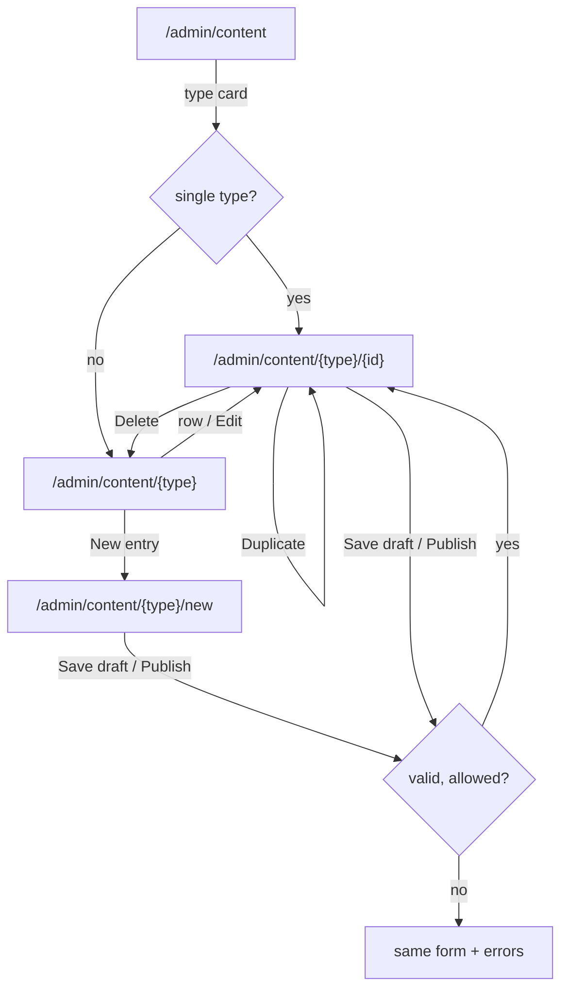

# Content Manager

## Purpose

The Content Manager is where editors manage **structured content**: the entries of the content types (blog
posts, products, events, a site-settings single type...). Each type gets an entry list and an entry form generated
from its fields, so nothing about a type is hard-coded. Content is kept apart from presentation: entries are shown on
pages by **content lists** in the [page builder](page-builder.md), and pages themselves are managed on
[Pages](pages.md). Types and their fields are defined on [Content types](content-types.md).

Every role with `Entries` / `read` can open it (by default every admin-capable role except `Developer`); who may
create, edit, publish and delete entries is decided by the `Entries` grants (see [Permissions](#permissions)). The rules - field types, validation, drafts and publishing, querying - are
documented once in [structured content](../features/structured-content.md); this document describes the screens.

## Route / Navigation

| Item | Value |
| --- | --- |
| Overview | `GET /admin/content` - the content types as cards |
| Entry list | `GET /admin/content/{type}` (`type` = the type's API id), query `q`, `status` (`draft` / `published` / `changed`), `sort` (`title`, `createdAt`, `updatedAt`, `publishedAt` or a field key), `desc` (`true`), `page` |
| Entry form | `GET /admin/content/{type}/new`, `GET /admin/content/{type}/{id:guid}` |
| Mutations | `POST /admin/content/{type}/new` and `POST /admin/content/{type}/{id}` (save, `intent` = `save` or `publish`), `POST .../{id}/publish`, `.../{id}/unpublish`, `.../{id}/duplicate`, `.../{id}/delete`, `POST /admin/content/{type}/delete-selected` (`ids`), `POST /admin/content/{type}/reorder` (JSON `{ ids }`) |
| JSON for the form | `GET /admin/content/api/entries?type={typeId}&q=`, `GET /admin/content/api/media?kind=image|file&q=`, `POST /admin/content/api/media/upload` (multipart `file`) |
| Old addresses | `GET /admin/content?selected={pageId}` and `GET /admin/content/{pageId}/builder` answer **301** to [Pages](pages.md) and its builder (the page tree lived here before) |
| Navigation entry | Sidebar → **Main** → **Content Manager** (`AdminNavigation.Tree`, icon `database`; active for any `/admin/content...` path) |
| Breadcrumbs | **Main** › **Content Manager** › *the screen title* |
| Linked from | [Content types](content-types.md) (**Entries**, header **Content Manager**); an entry list's **Fields** goes the other way; the page builder's Data tab (**Manage …**) |

## Relevant source files

```text
src/DotNetForge.Web/Areas/Admin/Controllers/ContentController.cs     overview, list, form, actions, permission checks, JSON for the pickers
src/DotNetForge.Web/Areas/Admin/Models/AdminViewModels.cs            ContentManagerViewModel, EntryListViewModel (+ Url()), EntryRow, EntryEditViewModel, EntryFieldView
src/DotNetForge.Web/Areas/Admin/Views/Content/Index.cshtml           overview: type cards, empty state, "How it fits together"
src/DotNetForge.Web/Areas/Admin/Views/Content/List.cshtml            entry list: status filter, search, table, bulk bar, pagination
src/DotNetForge.Web/Areas/Admin/Views/Content/Edit.cshtml            entry form: fields card, Status / More / Use it cards, hidden action forms
src/DotNetForge.Web/Areas/Admin/Views/Content/_Field.cshtml          one field's control (recursive for groups and repeaters)
src/DotNetForge.Web/Services/EntryForm.cs                            the posted form → entry values (f.path names, __rows markers)
src/DotNetForge.Content/ContentEntryService.cs                       save, publish, unpublish, duplicate, delete, reorder (rules + audit)
src/DotNetForge.Content/ContentQueryService.cs                       search, status, filters, sort, paging
src/DotNetForge.Web/Services/ContentRenderService.cs                 ItemsAsync: list column text (same formatting as the site)
src/DotNetForge.Web/wwwroot/js/forge/entries.js                      rich text editor, media and relationship pickers, repeaters, slugs, row drag, unsaved-changes guard
src/DotNetForge.Web/wwwroot/css/forge/admin.css                      .type-grid, .type-card, .entry-*, .repeater*, .rte*, .media-picker*, .media-dialog*, .relation-*
```

## Page layout

```text
Overview - Content Manager (h1), "Your structured content - blog posts, products, events - kept apart from the pages that show it."
├── header: [Content types] (with Content types / create)
├── no types:  card <empty-state "Start with a content type"> [New content type]  +  card "How it fits together"
│              (1. Content type · 2. Entries · 3. Page builder · 4. Map fields · 5. Publish)
└── types:     .type-grid of cards: icon, name (link), "<n> entries · <m> published" (or "Single entry"),
               description, [Open] / [Edit] (single), [New entry] (collection, with create)

Entry list - <type name> (h1), the type's description
├── header: [Fields] (with Content types / read) [New entry] (with create)
└── card "Entries" "<n> entries"   segmented: All | Published | Changed | Draft
    ├── toolbar (GET form): [select all] Search <type> [Search] [Clear]   "Drag rows to set the order…" (when reorderable)
    ├── bulk bar (overlays the toolbar when rows are checked): "<n> selected" [Clear] [Delete selected]
    ├── table: [✓] Title ↕ | <show-in-list fields> ↕ | Status | Updated ↕ | ⋯
    │          row ⋯: Edit/View, Duplicate, Publish / Publish changes, Unpublish, Delete
    └── pagination: "Page x of y" [Previous] 1 2 3 [Next]

Entry form - "New entry" / the entry's title / the type name (single) (h1)
├── header: [All <type>] (collection) [New entry] (existing entry, with create)
└── .editor
    ├── main: <form-errors/>, card with the generated fields (.form-grid; half-width fields side by side)
    └── aside: card "Status" (badge Draft | Changes not published | Published; Published / Updated by / Created;
               [Publish] or [Publish changes] + [Save draft] - or [Save] for a type without drafts)
               card "More" ([Unpublish] [Duplicate] [Delete])
               card "Use it" (content list hint, GET /api/entries/<type>/<id>)
```

## Components

### Type cards (`Index.cshtml`)

- **Inputs:** `ContentManagerViewModel.Types` (`ContentTypesController.CardsAsync`: types ordered by `SortOrder`,
  `Name`; entry and published counts from one query of `(ContentTypeId, Published)`), `CanManageTypes`
  (`Content types` / `create`), `CanCreateEntries` (`Entries` / `create`).
- A single type's card says "Single entry" and opens its entry.

### Entry list (`List.cshtml`)

- **Query:** `ContentQueryService.QueryAsync` with the working copies (`Published = false`), 25 rows per page. Search
  matches `ContentEntry.SearchText` (lower-cased title and short text values). Status: `draft` = never published,
  `published` = no pending changes, `changed` = published with a newer working copy. Sort keys other than the built-in
  columns must be a field of the type (else manual order).
- **Columns:** the title, then up to four fields marked **Show in entry list** (the title field excluded); the cell text
  is the same formatted text content lists show (numbers with their decimals, dates as `Oct 26, 2026`, option labels,
  linked entries' titles - [item data](../features/structured-content.md#data-binding)).
- **Sorting:** column headers are links (`th-sort`, `aria-sort`); clicking the sorted column again reverses it.
- **Selection / bulk delete:** `data-collection` + `data-select-*` (`ui.js`); checkboxes only on rows the user may
  delete; the bulk form posts `ids` to `delete-selected` with a confirm dialog.
- **Reorder:** offered (`CanReorder`) only with `Entries` / `update`, the manual order, no search and no status filter.
  Rows drag by the grip (`entries.js`), and the new order of the page's rows is posted as JSON; the moved rows keep the
  positions they had, so other pages of the list are untouched. Toast "Order saved." or the error.

### Entry form (`Edit.cshtml` + `_Field.cshtml`)

Every input is named `f.` + its field path (`f.title`, `f.specs.width`, `f.variants.3.name`); `EntryForm.Read` turns
the post back into values, guided by the type's fields. Controls per [field type](../features/structured-content.md#field-types):

| Field type | Control |
| --- | --- |
| Text, Email, URL, Slug | `input` (`maxlength` from the field); a slug with **Generate from** fills itself from that field while it is empty or still generated (`data-slug-from`) |
| Long text | `textarea` |
| Rich text | toolbar (Paragraph, Heading, Subheading, Bold, Italic, Underline, Link, lists, Quote, Clear formatting) over an editable area; the hidden textarea posts the blocks as JSON. Pasting inserts plain text. Without JavaScript: a plain textarea (blank lines separate paragraphs) |
| Number | `input type=number` (`step` 1 for whole numbers, `min`/`max`) |
| Yes / no | switch (checkbox before its hidden `false`) |
| Date | `input type=date`, or `datetime-local` (UTC) with a time |
| Select | `select` with **Choose…**; with **Allow several**: checkboxes |
| Image, File | a native `select` of the newest 100 files (+ the chosen ones), turned into thumbnails with **Choose an image / Choose a file / Add images / Replace**: a dialog with search, **Upload** (with `Media` / `create`) and a grid (several: toggle and **Use selected**) |
| Relationship | a native `select` of the first 100 entries of the linked type by title (+ the chosen ones; drafts marked "(draft)"), turned into chips and a search box (`api/entries`, 200 ms debounce, Enter picks the first) |
| Array | `textarea`, one value per line |
| Group | a `fieldset` with the nested fields |
| Repeater | numbered rows with move up / down / remove, **Add <label> row** (from a `<template>` whose paths say `__index__`); `f.<path>.__rows` is always posted so removing every row clears the field |

Errors are shown at the top (`<form-errors />`) and under each field whose path matches (`.has-error`). The form is
`novalidate`; leaving it with changes asks first (`beforeunload`).

## Functionality

### Save (and publish)

```mermaid
sequenceDiagram
    actor U as Editor
    participant F as Entry form
    participant C as ContentController.Save
    participant S as ContentEntryService.SaveAsync
    participant DB as Database
    U->>F: Save draft / Publish / Save
    F->>C: POST /admin/content/{type}/{id|new} (f.*, intent, baseVersion)
    C->>C: may create / update (own) / publish?
    C->>S: EntryForm.Read → SaveAsync(type, entry, input, publish, baseVersion)
    S->>DB: media + linked entries lookup, unique values in ContentEntryValues
    alt stale version
        S-->>C: Conflict
        C-->>U: form with the posted values + "Someone else saved this entry…" (next save overwrites)
    else invalid
        S-->>C: errors by path
        C-->>U: form with errors
    else ok
        S->>DB: DataJson (+ PublishedDataJson), title, search text, index rows; audit entry.created/updated (+ entry.published)
        C-->>U: 302 /admin/content/{type}/{id}, toast "Published '…'." / "Saved a draft of '…'."
    end
```

1. **Trigger:** **Save draft** (`intent=save`), **Publish** / **Publish changes** (`intent=publish`), or **Save** for a
   type without drafts (always publishes).
2. **Permission:** new entry `create`; existing `update`, or `update.own` on an entry the user created; publishing
   `publish` - without it a draft type shows "You don't have permission to publish entries. Save a draft instead."
   and a no-drafts type answers 403.
3. **Validation:** [entry validation](../features/structured-content.md#validation) - formats and limits always,
   required fields, minimum lengths and row counts only when publishing; unique fields against every other entry.
4. **Conflict:** the form posts the `baseVersion` it loaded; a newer save in between re-renders the posted values with
   the message and a hidden `force=true`, so saving again overwrites.

### Publish / Unpublish (row menu, **More** card)

`POST …/{id}/publish` validates the saved values as a publish (`TempData["Error"]` "Can't publish yet: …" lists up to
three problems); `…/unpublish` (confirm, accent) clears the published values - the entry leaves the site and the API,
its working copy stays. Both need `publish`; `returnTo=list` returns to the list. Audit `entry.published` /
`entry.unpublished`.

### Duplicate

Needs `create` (not for single types). An unpublished copy right below the original: title + " (copy)", slugs get
`-copy` (`-copy-2`...), other unique values are emptied. Audit `entry.created` "Duplicate of '…'". Opens the copy.

### Delete / Delete selected

`delete`, or `delete.own` on own entries; single-type entries can't be deleted. Confirm dialog, then the entry and its
index rows are removed; audit `entry.deleted`. Bulk: every selected entry must be deletable by the user, otherwise 403
and nothing is deleted. Pages that showed the entries simply stop showing them.

### Single types

`GET /admin/content/{type}` of a single type redirects to its one entry, or to `/new` when it has none yet (the first
save creates it; a GET never writes). A second "new" form of a single type edits the existing entry instead.

## Data used by the page

| Data | Origin |
| --- | --- |
| Content types | all `ContentTypes` |
| Entries | `ContentEntries` (working copy `DataJson`), filtered and ordered via `ContentEntryValues` |
| Picker options | first 100 entries per linked type, newest 100 media files (private ones included - admins may use them) |
| Updated by | `Users.Email` of `UpdatedById` |

## State

| State | Kind | Changes when |
| --- | --- | --- |
| Search, status, sort, page | URL query | toolbar, segmented filter, column headers, pagination |
| Unsaved form input | DOM; posted values on a failed save | typing |
| Rich text | DOM + hidden JSON textarea | editing |
| Selection / bulk bar | DOM (`ui.js`) | checking rows |
| Entries | database | save, publish, unpublish, duplicate, delete, reorder |

## Permissions

The screens need the `AdminArea` policy (`AdminControllerBase`) and `[RequirePermission(Entries, read)]` on
`ContentController` - every route, the overview and the old `/admin/content?selected=` / `/admin/content/{id}/builder`
redirects included. Without it (the built-in `Developer`, or a custom role without `Entries` / `read`) a user gets
[Access denied](access-denied.md) and no **Content Manager** link in the sidebar. Then the area **`Entries`**
("Content Manager" on the Roles screen; [authorization](../features/authorization.md)):

| Action | Needs | Admin, Editor | Author |
| --- | --- | :-: | :-: |
| Overview | `read` | ✔ | ✔ |
| List, open an entry | `read` | ✔ | ✔ |
| New entry, duplicate | `create` | ✔ | ✔ |
| Save | `update`, or `update.own` on own entries | ✔ | own |
| Publish, unpublish, save a no-drafts type | `publish` | ✔ | ✘ |
| Delete | `delete`, or `delete.own` on own entries | ✔ | own |
| Reorder | `update` | ✔ | ✘ |
| Upload from a picker | `Media` / `create` | ✔ | ✔ |

A user who may read but not save sees the form read-only ("View only"). Refusals are `Forbid()` → `/account/denied`.

## Validation

All on the server (`EntryData`, `ContentEntryService`); messages name the field ("Price: must be at least 0.",
"Title is required.", "SKU: another entry already uses this value; it must be unique."). The browser only shapes inputs
(`type`, `maxlength`, `step`).

## Error handling

| Failure | What the user sees | Recovery |
| --- | --- | --- |
| Invalid values | form with `<form-errors />` and errors under the fields, input kept | fix, save again |
| Saved by someone else meanwhile | "Someone else saved this entry while you were editing it…" | save again to overwrite, or reload |
| Publish refused (row menu) | danger toast "Can't publish yet: …" | open the entry, fill in what is missing |
| No permission | `/account/denied` (403) | - |
| Unknown type or entry | 404 | - |
| Upload or lookup failure | danger toast with the server's message | - |

## Loading behaviour

Server-rendered; the pickers and the media dialog load JSON on demand ("Loading…"); the reorder posts in the background.

## Empty states

- No types: "Start with a content type" - "Describe what you publish - a product has a name, a price and pictures - and
  the Content Manager builds the forms. Then show it on any page with a content list." (without the right: "Ask an
  administrator to create a content type.")
- No entries: "No entries yet. Create the first one"; no match: "No entry matches. Show all entries".
- A type without fields: "This content type has no fields yet. Add fields first."
- Relationship picker: "Nothing linked yet."; media dialog: "No files match. Upload one, or add files on the Media
  screen."

## User interactions

Links and form posts; drag rows (list) and repeater rows' move buttons; confirm dialogs for delete and unpublish;
keyboard: Enter in the relationship search picks the first match, Esc closes it and the media dialog.

## Dependencies

```text
ContentController
├── ContentTypeService, ContentEntryService, ContentQueryService   (DotNetForge.Content)
├── ContentRenderService.ItemsAsync                                 (list column text)
├── MediaService                                                    (upload)
├── EntryForm                                                       (form → values)
└── AdminControllerBase (CurrentUserId, Can / CanModify)
entries.js (api/entries, api/media, api/media/upload, {type}/reorder; window.Forge.toast / confirm from ui.js)
```

## Page flow



## Related pages

[Content types](content-types.md) (fields), [Pages](pages.md) and the [page builder](page-builder.md) (where entries
are shown), [Media](media.md) (files the pickers offer), [API Tokens](api-tokens.md) (reading entries over the
[headless API](../features/headless-api.md)), [Audit Logs](audit-logs.md) (`entry.*`).

## Important implementation details

- An entry has a working copy (`DataJson`) and published values (`PublishedDataJson`); the list and the form show the
  working copy, the site and the API the published values.
- New entries are created on their first save, not when **New entry** opens (no empty drafts).
- Changing a type's fields rewrites every entry (renamed keys keep their values) - see
  [Content types](content-types.md).
- The bool `desc` binds only `true`/`false`, so links carry `desc=true`.

## Known limitations

- No version history, review workflow, scheduling or tags for entries ([structured content → Planned](../features/structured-content.md#planned-not-implemented)).
- Pickers list at most the first 100 entries / newest 100 files server-side; more are reached through the search (JS).
- Adding repeater rows needs JavaScript.

## Extension points

- A new field type: [structured content → Where to change things](../features/structured-content.md); its control goes
  into `_Field.cshtml` (and `EntryForm.Read` when it posts something other than one string).
- A new action: a POST in `ContentController` with `Can` / `CanModify` on `PermissionAreas.Entries`, the rule in
  `ContentEntryService`, an `AuditActions` constant.
