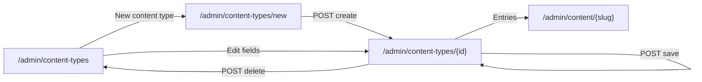

# Content types

## Purpose

Where administrators define the **shape** of structured content: a content type (Blog posts, Products, Events, Site
settings...) and its fields. The [Content Manager](content-manager.md) generates the entry list and form from these
definitions, the [page builder](page-builder.md)'s content lists bind to the fields, and the headless API serves them.
Rules (field types, options, limits, what a schema change does to entries): [structured content](../features/structured-content.md#field-types).

## Route / Navigation

| Item | Value |
| --- | --- |
| List | `GET /admin/content-types` |
| New | `GET /admin/content-types/new` → `POST /admin/content-types/create` (`name`, `template`) |
| Builder | `GET /admin/content-types/{id:guid}` → `POST /admin/content-types/{id:guid}` (`ContentTypeInput`) |
| Delete | `POST /admin/content-types/{id:guid}/delete` (`withEntries`) |
| Navigation entry | Sidebar → **Main** → **Content types** (icon `layers`; shown only to roles with `Content types` / `read`) |
| Breadcrumbs | **Main** › **Content types** › *type name* / **New content type** |
| Linked from | the [Content Manager](content-manager.md) (**Content types**, **New content type**), an entry list's **Fields** |

## Relevant source files

```text
src/DotNetForge.Web/Areas/Admin/Controllers/ContentTypesController.cs   list, new, create, builder, save, delete; CardsAsync (shared with the Content Manager)
src/DotNetForge.Web/Areas/Admin/Views/ContentTypes/Index.cshtml        type cards
src/DotNetForge.Web/Areas/Admin/Views/ContentTypes/New.cshtml          template gallery + name
src/DotNetForge.Web/Areas/Admin/Views/ContentTypes/Edit.cshtml         builder: fields card (+ JSON), Settings and Delete cards
src/DotNetForge.Web/wwwroot/js/forge/content-types.js                  the visual field builder (keeps FieldsJson in sync)
src/DotNetForge.Content/ContentTypeService.cs                          create (templates), update (+ entry migration), delete, Icons
src/DotNetForge.Core/Content/ContentSchema.cs                          field definitions: parse and validate
src/DotNetForge.Core/Content/ContentTypeTemplates.cs                   the starter templates
```

## Page layout

```text
Content types (h1)  "Define the shape of your content: a type has fields, the Content Manager generates its forms, and pages show it with content lists."
├── header: [Content Manager] [New content type] (with the right to create)
├── no types: card <empty-state "No content types yet"> (no button - New content type is in the header)
└── .type-grid of cards: icon, name, API id, Collection | Single, description, Fields / Entries / Published, [Edit fields] [Entries →]

New content type (h1)
├── card "Start from": Blank + one card per template (Blog posts, Categories, Authors, Products, Events, Projects,
│                      Testimonials, FAQ, Site settings [Single])
└── card "Name": Name (optional with a template)  [Cancel] [Create content type]

<type name> (h1)  "<n> fields · <m> entries · API /api/entries/<slug>"
├── header: [All types] [Entries] [Save content type]
└── form#typeForm.editor
    ├── main: <form-errors/>, "This type has entries" note, card "Fields"
    │         field list: ⠿ type icon · Label · key · type · badges (Required, Unique, Many, In list) · ↑ ↓ ⧉ 🗑
    │         open field: its settings (+ nested field list for a group / repeater)
    │         [Add field] → palette of the 16 field types
    │         ▸ Fields as JSON (the posted textarea)
    └── aside: card "Settings" (Name*, API id*, Description, Icon, Holds: Many entries | One entry, Title field, Drafts) [Save content type]
               card "Delete content type" [Delete content type]
```

## Components

### Field builder (`content-types.js`)

The `FieldsJson` textarea is the only thing posted. The script renders it as a list of field cards and writes it back
after every change; without JavaScript the JSON is edited directly (a `<noscript>` note says so).

- **Add field:** the palette lists Text, Long text, Rich text, Number, Yes / no, Date, Select, Email, Link, Slug,
  Image, File, Relationship, Array, Group, Repeater (groups and repeaters only
  while nesting allows - three levels). A new field is called "New <type> field", opens, and its **API name** follows
  the **Label** (camelCase, unique among its siblings) until the API name is edited.
- **Settings per field:** Label, API name, Help text; Placeholder (text-like and number); Min / Max length (text-like,
  rich text); Pattern (text, long text); Generate from (slug); Minimum, Maximum, Decimals shown, Whole numbers only
  (number; min/max also for number arrays); With a time of day (date); Options with label and value (select; values
  follow the labels until edited); Links to (relationship); Each item is Text / Number (array); Allow several (select,
  image, file, relationship); Min / Max rows or items (array, repeater, several); Default value (text-like, number,
  date, select) or On by default (yes / no); flags Required (to publish), Unique (top-level text, email, link, slug,
  number), Show in entry list (top level), Half width in the form.
- **Order:** drag by the grip (siblings only) or ↑ / ↓; ⧉ duplicates (new id, "… copy", not unique); 🗑 asks first.
- **Hints:** an invalid or duplicate API name marks the card red with the reason; the server decides.
- The **Title field** select lists the top-level Text, Slug and Email fields and follows the builder.
- Editing the JSON and leaving the textarea replaces the builder's state (invalid JSON is outlined).

## Functionality

### Create a type

1. **New content type** → choose **Blank** or a template, optionally a name → **Create content type**
   (`Content types` / `create`).
2. `ContentTypeService.CreateAsync`: a template also creates the types its relationships link to when no
   type with that API id exists yet (Blog posts → Categories, Authors); API ids are made free (`products-2`...); a single type
   gets its empty entry. Audit `contenttype.created` per type.
3. Redirect to the builder with "Created '<name>'. Add its fields, then save." (or "…and the types it links to…").
   A blank type without a name: "Give the content type a name." on the same screen.

### Save a type

1. **Save content type** posts Name, Slug (API id), Description, Icon, Kind, Drafts, TitleField, FieldsJson
   (`Content types` / `update`).
2. `ContentTypeService.UpdateAsync` checks the name (required, ≤ 100), the API id (`^[a-z][a-z0-9-]{0,63}$`, not
   `api` / `types` / `new` / `media`, unique), the description (≤ 500), switching to one entry (refused
   with more than one), and the fields ([`ContentSchema.Validate`](../features/structured-content.md#field-types));
   at least one field.
3. When fields or the title field changed, every entry of the type is rewritten in the same save: values move with
   renamed fields (fields keep their id), removed fields lose their values, titles, search text and the value index
   are rebuilt. Audit `contenttype.updated` ("<n> field(s)").
4. Success: toast "Saved '<name>'."; problems: listed in `<form-errors />` with the posted state kept.

### Delete a type

**Delete content type** (`Content types` / `delete`, confirm dialog naming the entry count) deletes the type and all
its entries. Refused (toast) while another type has a relationship field linking to it. Audit `contenttype.deleted`.

## Data used by the page

All `ContentTypes`; entry counts from `ContentEntries`; the relationship targets are every type (the type itself
included, for "related posts").

## State

| State | Kind | Changes when |
| --- | --- | --- |
| Field list | `FieldsJson` textarea (DOM), posted on save | any builder edit |
| Open field cards | JS memory | clicking a field |
| Type | database | save, delete |

## Permissions

`[RequirePermission(Content types, read)]` on the controller; create, update and delete need their own grants. By
default only Super Admin and Admin have the area ([authorization](../features/authorization.md)); others don't see the
sidebar link and get `/account/denied`. Read-only users see "View only" and disabled controls.

## Validation

Server-side only (`ContentTypeService`, `ContentSchema`); the builder's red cards are hints. Messages, e.g. "Two fields
are named \"price\"; API names must be unique.", "Category: choose the content type this field links to.",
"Variants: add at least one field inside the repeater.".

## Error handling

| Failure | What the user sees | Recovery |
| --- | --- | --- |
| Invalid settings or fields | `<form-errors />`, builder shows the posted fields | fix, save |
| Delete refused | danger toast with the reason | remove the linking field first |
| Unreadable JSON typed into the textarea | textarea outlined red; the builder keeps its state | fix the JSON |
| No permission | `/account/denied` | - |

## Loading behaviour

Server-rendered; the builder renders on load from the textarea.

## Empty states

"No content types yet" - "A content type is a reusable shape for content - blog posts, products, events. Start from a
template or build your own." - without a button of its own: **New content type** is in the header (the
[Content Manager](content-manager.md)'s empty state keeps one, since its header has none). In the builder: "No fields yet. Add the first one below."

## User interactions

Drag and drop of fields (and ↑ / ↓ for keyboards), palette (Esc closes it), confirm dialogs for removing a field and
deleting the type.

## Dependencies

```text
ContentTypesController
├── ContentTypeService (DotNetForge.Content) → ContentEntryService (migration, single entries), IAuditService
└── DotNetForgeDbContext (counts)
content-types.js (no server calls; ui.js Forge.confirm)
```

## Page flow



## Related pages

[Content Manager](content-manager.md), [page builder](page-builder.md) (content lists), [Roles](roles.md) (the
`Content types` area), [headless API](../features/headless-api.md) (`/api/content-types`).

## Important implementation details

- A field's `id` never changes once created; it is what keeps values attached across API-name changes.
- `isNew` / `keyEdited` are builder-only flags, stripped before submit.
- Types are listed in creation order (`ContentType.SortOrder`); there is no control to reorder them yet.

## Known limitations

- Changing a field's type keeps the stored values; values the new type can't read are dropped the next time each
  entry is saved.
- No undo in the builder (reload discards unsaved changes).

## Extension points

New field type or option: [structured content → Where to change things](../features/structured-content.md); the
builder's palette and settings are in `content-types.js` (`TYPES`, `settings()`).
