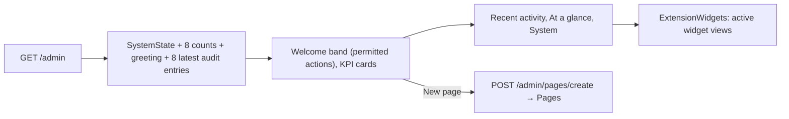

# Dashboard

## Purpose

The admin landing screen: a welcome band with the quick actions the user may perform, key counts, the latest audit
activity, basic system facts and the panels of enabled widget extensions. Every admin-capable user lands here after
sign-in or setup. Read-only apart from the **New page** quick action (a POST to Pages).

## Route / Navigation

| Item | Value |
| --- | --- |
| Route | `GET /admin` |
| Navigation entry | Sidebar → **Main** → **Dashboard** (also the sidebar logo); default after login/setup; **Back to the dashboard** on the denied screen; **Back to dashboard** on the [module placeholders](module-placeholders.md) |
| Parameters | none |
| Breadcrumbs | none - the top bar shows no breadcrumb trail on the dashboard (`_AdminLayout`, `isDashboard`) |
| Links out | quick actions, KPI cards and **View all** (see [Components](#components)) |

## Relevant source files

```text
src/DotNetForge.Web/Areas/Admin/Controllers/DashboardController.cs   counts, system state, greeting, quick-action flags, recent activity (RecentActivityCount = 8)
src/DotNetForge.Web/Areas/Admin/Models/AdminViewModels.cs            DashboardViewModel
src/DotNetForge.Web/Areas/Admin/Views/Dashboard/Index.cshtml         welcome band, KPI cards, Recent activity, At a glance, System, widget slot
src/DotNetForge.Web/Areas/Admin/Navigation/AdminNavigation.cs        AdminNavigationService / AdminNavModel.Allows (which links and actions the user may reach)
src/DotNetForge.Web/Areas/Admin/Components/ExtensionWidgetsViewComponent.cs                  widget slot
src/DotNetForge.Web/Areas/Admin/Views/Shared/Components/ExtensionWidgets/Default.cshtml      .widget-grid of widget cards
src/DotNetForge.Web/Services/ExtensionViewRenderer.cs                renders each Widget.cshtml as a partial
src/DotNetForge.Web/Ui/UiTagHelpers.cs                               <stat-card>, <empty-state>, <badge>, <timestamp>, <icon>
src/DotNetForge.Web/Ui/AuditPresentation.cs                          friendly audit action labels + icons
src/DotNetForge.Web/wwwroot/css/forge/admin.css                      .dashboard-hero, .dashboard-columns, .activity-icon, .widget-grid
```

Shared look and behaviour: [design system](../architecture/design-system.md) (admin shell, components).

## Page layout

```text
Dashboard (_AdminLayout, h1 "Dashboard", no description, no breadcrumbs)
├── section.dashboard-hero
│   ├── h2 "Welcome back, <first name>"  +  "Manage your pages, media and extensions from here."
│   └── quick actions (each only when permitted): [New page] (primary) · [Upload media] · [New API token]
├── .grid.grid-4 KPI cards (<stat-card>): Pages · Media files · Users · Enabled extensions
├── .dashboard-columns (2 : 1, one column below 64rem)
│   ├── card "Recent activity" - "The latest actions."  [View all →]
│   │   └── ul.list: icon · <action label> · <entity> / <user or "System"> · [Failed] · <relative time>
│   └── stack
│       ├── card "At a glance": Roles · Active API tokens · Webhooks · Audit entries
│       └── card "System": CMS version (badge "v<version>") · Installed (date or "-") · Modes "Traditional · Headless · Hybrid"
└── Widgets (only when a widget is active): sr-only h2 "Widgets", .widget-grid of section.card.widget - h3 <extension name> + its view
```

## Components

### Welcome band (`section.dashboard-hero`)

Greeting from `DashboardViewModel.Greeting`: the signed-in user's `FirstName`, else `User.Identity.Name`, else
`there`. Quick actions:

| Button | Shown when | Target |
| --- | --- | --- |
| **New page** | `CanCreatePages` = `Can("Collection types", "create")` | POST form (antiforgery) to `/admin/pages/create` - creates an `Untitled page` and opens it ([Pages → Create a page](pages.md#create-a-page)) |
| **Upload media** | `CanUpload` = `Can("Media", "create")` | link `/admin/media#upload` |
| **New API token** | `AdminNavModel.Allows("/admin/api-tokens")` (the user's sidebar contains API Tokens: `Super Admin`, `Admin`, `Developer`) | link `/admin/api-tokens/create` |

By default `Admin`, `Editor` and `Author` have `create` in both content and media and `Developer` in neither, so a
Developer sees only **New API token**, Editors and Authors everything but it. The checks only decide visibility; each
target enforces its own permission.

### KPI cards (`<stat-card>`)

| Card | Query | Link |
| --- | --- | --- |
| Pages | `Pages.Count()` (all, not just live) | `/admin/pages` when `Allows("/admin/pages")` (`Collection types` / `read`), else a plain card |
| Media files | `MediaFiles.Count()` | `/admin/media` when `Allows("/admin/media")` (`Media` / `read`), else a plain card |
| Users | `Users.Count()` | `/admin/users` when `Allows("/admin/users")`, else a plain card |
| Enabled extensions | `InstalledExtensions.Count(Status == Enabled)` | `/admin/plugins` when `Allows("/admin/plugins")` (`Super Admin`), else a plain card |

A card with `href` renders as an `<a>`, without as a `<div>` (`StatCardTagHelper`).

### Recent activity

The last `DashboardController.RecentActivityCount` (8) `AuditLogs` rows (including failed sign-ins), newest first
(`OrderByDescending(Id)`). Each row: an icon from
`AuditPresentation.Icon(action)` (danger style when the entry failed), the friendly label
`AuditPresentation.Label(action)` (the raw key when unmapped), `· EntityDisplaySnapshot` when present,
`UserDisplaySnapshot` or `System`, a **Failed** badge for unsuccessful entries and a `<timestamp>` (relative, exact
UTC in the tooltip). **View all** links to [Audit Logs](audit-logs.md) only when `Allows("/admin/audit-logs")`
(`Super Admin`, `Admin`); the list itself is shown to every admin-capable role.

### At a glance / System

| Item | Source |
| --- | --- |
| Roles | `Roles.Count()` |
| Active API tokens | `ApiTokens.Count(!Revoked && (ExpirationDate == null || ExpirationDate > now))` |
| Webhooks | `Webhooks.Count()` (enabled and disabled) |
| Audit entries | `AuditLogs.Count()` |
| CMS version | `SystemState.CmsVersion` (default `1.0.0`), as an accent badge `v1.0.0` |
| Installed | `SystemState.InstalledAtUtc` as `<timestamp absolute="true">` (`d MMM yyyy, HH:mm UTC`) or `-` |
| Modes | static text `Traditional · Headless · Hybrid` |

## Functionality

Display only, except **New page** (handled by `ContentController.Create`, see
[Pages](pages.md#create-a-page)).

### Widgets

`@await Component.InvokeAsync("ExtensionWidgets")` renders, below the two columns, one card per **active**
extension of type `widget` (valid, enabled on [Plugins](plugins.md), code loaded) that has a `Views/Widget.cshtml`, in
name order. The card title is the manifest `name`; the body is the view rendered by `ExtensionViewRenderer` as a
partial with a fresh ViewData (`Extension`, `Settings`, `ResourceBase = /admin/ext/{id}/resources` -
[extension view data](../features/extensions.md#slots)) and no model. A widget view that throws is logged and
replaced by "<name> could not be displayed." (`.ext-error`); the rest of the Dashboard renders normally. A widget can
link its own CSS/JS from `/admin/ext/{id}/resources/...` (CSP: no inline script or style). Sample:
`extensions/widgets/weather-widget` (**Weather**, code + `Views/Widget.cshtml`).

## Data used by the page

`DashboardViewModel` (`Users`, `Roles`, `Pages`, `Media`, `ApiTokens`, `Webhooks`, `Extensions`, `AuditEntries`,
`InstalledAtUtc`, `CmsVersion`, `Greeting`, `CanCreatePages`, `CanUpload`, `RecentActivity`, plus `AppName`, which
the view no longer renders) built from one `SystemState` read, 8 `CountAsync` queries, one user lookup for the
greeting and one recent-activity query, all sequential. `AdminNavigationService` (role-aware sidebar) for the
`Allows` checks; the active widget extensions from `ExtensionCatalog` and whatever each widget's view or services
load.

## State

None. Toasts from `TempData` are rendered by the layout ([feedback](../architecture/design-system.md#feedback)), but
the dashboard sets none.

## Permissions

`AdminArea` policy: any admin-capable role. What differs by role is only what is linked or offered: quick actions
(`Can` checks and `Allows`), the Pages / Media files / Users / Enabled extensions card links and **View all**
(`Allows`, i.e. the target controller's `[Authorize]` data). Every role sees every count and the Recent activity list -
also a `Developer`, whose only links are the API screens.

## Validation

Not applicable.

## Error handling

DB failures → global error handling. A failing widget → contained notice (see [Widgets](#widgets)).

## Loading behaviour

Server-rendered; 11 queries run one after another on each visit; no caching, no skeletons. Widgets render
synchronously in the same request (a slow widget slows the page); a widget's first render compiles its view.

## Empty states

- Recent activity: empty state **No activity yet** - "Sign-ins, content changes and uploads appear here." (rare: the
  admin's own sign-in is already an entry).
- Counts show `0`; **Installed** shows `-` if the date is missing.
- No active widget → no widget section.

## User interactions

Quick-action buttons, linked KPI cards and **View all**; nothing else besides the shell.

## Dependencies

```text
DashboardController → DotNetForgeDbContext, AppEnvironment, AdminControllerBase (CurrentUserId, Can → IPermissionService)
Index.cshtml → AdminNavigationService (scoped; IAuthorizationService, IAuthorizationPolicyProvider, ExtensionCatalog)
ExtensionWidgetsViewComponent → ExtensionCatalog, ExtensionViewRenderer
```

## Page flow



## Related pages

Receives navigation from [Sign in](login.md), [Setup](setup.md), [Access denied](access-denied.md),
[module placeholders](module-placeholders.md). Links to [Pages](pages.md), [Media](media.md),
[Users](users.md), [Plugins](plugins.md) (also enables widgets), [Audit Logs](audit-logs.md),
[API Tokens](api-tokens.md). Counts also cover [Roles](roles.md) and [Webhooks](webhooks.md).

## Important implementation details

- `CmsVersion` comes from the database row (seeded default `1.0.0`), not from the assembly version.
- `AdminNavModel.Allows(href)` is true when the user's role-filtered sidebar contains that exact href; the view calls
  `AdminNavigationService.BuildAsync`, which is built once per request and shared with the layout.
- The greeting lookup reads the user by id only (the signed-in user).
- Extension widgets exist ([Widgets](#widgets)); the spec's built-in widgets, layout personalisation, health and
  update checks ([planned](#planned-not-implemented)) are not implemented.

## Known limitations

- Recent activity (including user names and failed sign-ins) is shown to every admin-capable role, also to Editors
  and Authors, who cannot open Audit Logs; all counts are shown to every role.
- Cards link to the owning screen without any pre-filter; Roles, API tokens, Webhooks and Audit entries are plain
  text.
- Widgets are shown to every admin-capable role (the `AdminArea` policy only) and cannot be added, removed or
  rearranged per user; they render in the page request, not asynchronously.

## Planned (not implemented)

Target behaviour from the original product specification. Nothing in this section exists in the code unless marked ✔.

### Requirements

The Dashboard becomes a configurable grid of independent widget cards, extensible by
extensions. It is read-only and part of the admin area (never themed, never reachable by `Public`).

**Built-in widgets**

| Widget | Summarizes | Drill-down target | Today |
| --- | --- | --- | --- |
| Project statistics | totals: pages, content entries, published vs. draft, media items, users, extensions | [Content Manager](content-manager.md), [Settings overview](settings.md#planned-not-implemented) | partly: Pages, Media files, Users, Enabled extensions cards (no published/draft split) |
| Content statistics | pages/entries by status (published, draft, scheduled, disabled), recently edited, awaiting review | Content Manager, pre-filtered | ✘ |
| User statistics | total, active vs. disabled, new registrations over a period, users per role | [Users](users.md), [Roles](roles.md) | Users and Roles counts only |
| Media statistics | total items, storage used, public vs. private, breakdown by file type | [Media](media.md) | Media files count only |
| Recent activity | latest audit entries (sign-ins, content created/updated/deleted, media uploaded, extension installed, role changed) | [Audit Logs](audit-logs.md) | ✔ the 8 latest entries with **View all**; not filtered by role |
| Installed extensions | count + list with enabled/disabled status and available updates | [Plugins](plugins.md) | Enabled extensions count only |
| System health | database connectivity and provider, environment, storage availability, background job/queue status, error indicators | [Settings overview](settings.md#planned-not-implemented) | ✘ |
| Update status | current CMS version, available CMS update, extensions with pending updates | [Settings overview](settings.md#planned-not-implemented), [transfer and updates](../features/transfer-and-updates.md) | CMS version only (System card) |

**Custom widgets** ([extensions](../features/extensions.md#slots))

- Contributed by extensions of type `widget` ✔ ([Widgets](#widgets)); `admin` extensions contribute tabs, not widgets.
- The manifest `permissions` declare what the widget may read; enforced before the widget is offered or rendered
  (✘ not enforced).
- Available only while the parent extension is valid, enabled and running ✔.
- Behave exactly like built-in widgets for add/remove/rearrange, permission filtering and loading/empty/error states
  (✘; today a failing widget shows a notice in its card ✔).

**Layout and personalisation**

- Layout stored per user: chosen widgets, order, grid position and size. No layout store exists.
- Add from an "Add widget" picker, remove from the card menu, drag to rearrange, drag a handle to resize.
- Changes persist immediately and are restored on the next visit.
- **Reset to default** restores the default layout of the user's most-privileged role.

**Default widgets per role** (re-evaluated against granted permissions, see [authorization](../features/authorization.md))

| Role | Sees Dashboard | Default widgets |
| --- | --- | --- |
| `Super Admin` | yes ✔ | all, including System health and Update status |
| `Admin` | yes ✔ | all |
| `Editor` | yes ✔ | Content, Media, Recent activity, Project statistics; no User statistics, System health, Update status unless granted |
| `Author` | yes ✔ (limited) | Content statistics scoped to own content, Recent activity scoped to own actions |
| `Authenticated` | no ✔ | none, unless explicitly granted admin permissions |
| `Public` | never ✔ | none |

Widgets render asynchronously - this would be the first client-side data fetching for a screen's own data in the
admin area (today every screen is server-rendered, see
[page architecture](../architecture/pages.md#how-screens-load-data)).

### User flows

| Flow | Steps |
| --- | --- |
| View | resolve roles → load saved layout (none → role default) → drop widgets the user may not see (silently) → each widget fetches its data independently with its own loading state → render data, empty state, or error state with **Retry** |
| Add widget | open picker (built-ins + widgets of installed, enabled extensions the user is permitted to see) → select → added at default position/size, layout persisted, widget enters loading state |
| Remove widget | card menu → **Remove** → layout persisted, grid reflows; affects only this user, never disables/uninstalls the extension |
| Rearrange / resize | drag card or resize handle → order and grid coordinates persisted → restored on later visits |
| Drill into a stat | click a stat/count/list item (e.g. "12 drafts") → owning screen pre-filtered (e.g. Content Manager filtered to drafts); target re-checks access and shows access denied if needed (✔ unfiltered links on the Pages, Media files, Users and Enabled extensions cards) |
| Retry | **Retry** on a failed widget → loading state → re-request → data, empty or error |

### Rules and validation

- **Widget identity:** stable, unique id per widget; no two widgets with the same id; custom widget ids derive from
  the extension `id`.
- **Permissions:** checked before a widget is offered in the picker or rendered; unauthorized widgets are omitted,
  not shown disabled. Add/remove/rearrange touch only the acting user's layout. (Today only links and quick actions
  are role-aware ✔; every card and the activity list are shown to every role.)
- **System health** and **Update status** are shown to `Super Admin` and `Admin` only by default (they reveal
  environment and version details). Today the System card (CMS version) is shown to every admin-capable role.
- **Drill-down** never bypasses module permissions ✔ (every target screen has its own controller-level check).
- **Layout persistence:** references to missing or unavailable widgets are ignored at render and may be pruned on
  save. Positions/sizes stay within grid bounds; overlaps and out-of-bounds coordinates are normalized before saving.
- **Custom widget loading:** only from installed, enabled, manifest-valid extensions ✔; never from invalid ✔, unsafe
  or incompatible ones.
- **Read-only:** widgets perform no writes; any action navigates to the owning screen.
- **Freshness:** widgets show when their data was last loaded where relevant; a slow widget never blocks the page.

### Edge cases

| Case | Target behaviour |
| --- | --- |
| Fresh install / no data | Non-error empty state with a call to action (e.g. "No content yet" → "Create your first page"), never a blank card (✔ for Recent activity: "No activity yet"). Recent activity and Installed extensions may be empty right after setup. |
| Widget of a disabled extension | Data not rendered; widget hidden or a non-blocking placeholder with a link to [Plugins](plugins.md) for users who may manage it; reference stays harmless and works again on re-enable. |
| Widget of an uninstalled extension | Disappears from picker and all layouts; dangling references ignored at render, pruned on next save; no error shown. |
| Slow widget | Own loading state, never blocks the Dashboard or admin shell; a timeout moves it to the failed state. |
| Failed widget | Contained error state with **Retry**; sibling widgets unaffected. |
| Misbehaving custom widget (throws, exceeds time budget, reads beyond declared `permissions`) | Isolated to its card and logged ([audit logging](../features/audit-logging.md)); cannot read outside its permitted scope. |
| Permission revoked while viewing | Widget omitted on next load; layout reference kept inert in case access returns. |
| Health / update check unreachable | Degraded/unknown state with retry - never implies healthy. |
| Same user edits layout in two sessions | Last persisted write wins; saves are atomic (never partially saved). |

### Acceptance criteria

- [ ] A signed-in admin user without a saved layout sees the default layout of their most-privileged role.
- [x] The `Public` role can never reach the Dashboard or the admin area - `AdminArea` policy on
  `AdminControllerBase`; anonymous requests redirect to sign-in.
- [x] An `Authenticated`-only user does not see the Dashboard by default - `AdminArea` policy → `/account/denied`.
- [ ] `Author` users see only content/activity widgets scoped to their own content; no User statistics, System
  health or Update status by default.
- [ ] System health and Update status are visible only to roles with the matching permissions (`Super Admin`/`Admin`
  by default).
- [ ] All eight built-in widgets render (Recent activity ✔ as a fixed card).
- [ ] A user can add a widget from the picker, and the picker lists only permitted widgets.
- [ ] A user can remove a widget; it affects only their layout and does not disable or uninstall an extension.
- [ ] A user can drag to rearrange and resize widgets, and the arrangement persists across sessions.
- [ ] Clicking a stat drills into the owning screen with filtering, and the target enforces its own permissions -
  four cards link to their screen today (no filtering; a link is offered only when the target is reachable ✔).
- [ ] On a fresh install every widget shows a clear empty state (Recent activity ✔).
- [x] A widget of a disabled extension does not render its data (hidden); re-enabling restores it
  (`ExtensionWidgetsViewComponent` → `ExtensionCatalog`).
- [ ] Uninstalling an extension removes its widgets from the picker and all layouts without errors.
- [ ] Widgets load asynchronously; a slow widget shows a loading state and never blocks the rest.
- [ ] A failed or timed-out widget shows a contained error state with a working **Retry**; siblings unaffected
  (a throwing widget shows a contained notice and siblings are unaffected ✔; no Retry, no timeout).
- [ ] A custom widget loads only from an installed, enabled, manifest-valid extension (✔) and cannot read beyond its
  declared permissions (✘).
- [ ] A widget never shows data the user may not view; unauthorized widgets are omitted - today every count and the
  Recent activity list are shown to every admin-capable role (e.g. Authors see the Users count and the audit
  entries); only links and quick actions follow the role (✔ `AdminUiTests.The_dashboard_shows_recent_activity_and_offers_only_permitted_actions`).

## Extension points

Add a count: property on `DashboardViewModel`, query in `DashboardController.Index`, a
`<stat-card>` or an `.dl` row in the view; link it only when `nav.Allows(href)` is true. Add a quick action: a flag
from `Can(...)` on the view model (or `nav.Allows`) and a button in the welcome band - the target keeps its own check.
Add a widget without touching the core: a `widget` extension with `Views/Widget.cshtml`
([extension development guide](../guides/extension-development.md)); built-in widgets belong in their own view
component rather than in the controller.
