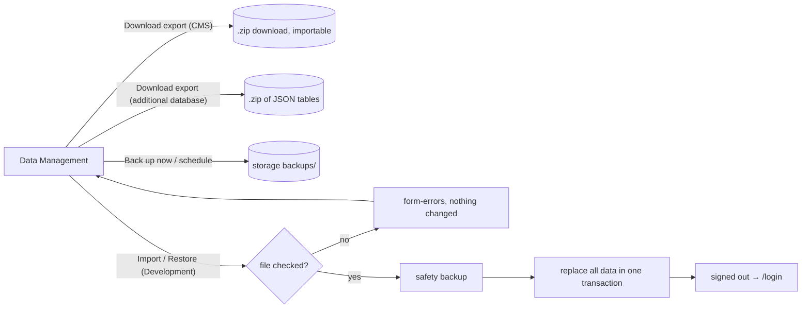

# Data Management

## Purpose

Export the CMS data, keep backups (manual or on a schedule) and - only in Development - import an export or restore a
backup, which replaces all data. Additional databases (`DATABASES_<NAME>_*`) can be exported too, as a JSON copy for
your own use. File format, rules and what is not built (core updates):
[transfer and updates](../features/transfer-and-updates.md).

| Operation | Risk | Where it runs |
| --- | --- | --- |
| Export of the CMS database (download) | low | everywhere |
| Export of an additional database (download, not importable) | low | everywhere |
| Backups of the CMS database (manual, automatic) | low | everywhere |
| Import, restore a backup | critical: replaces all data | **Development only** (`IHostEnvironment.IsDevelopment()`) |

## Route / Navigation

| Item | Value |
| --- | --- |
| Routes | `GET /admin/data`; `POST /admin/data/export` (form field `database`), `/backups`, `/backups/schedule`, `/backups/{id}/download`, `/backups/{id}/delete`, `/backups/{id}/restore`, `/import` |
| Title (h1, last breadcrumb) | "Data Management" (description "Export the CMS data, keep backups, and - in Development - import an export into this site.") |
| Navigation entry | sidebar **Settings → Global Settings → Data Management** (icon `database`), after Plugins and before Webhooks; shown only to Super Admins |
| Children | none |

## Relevant source files

```text
src/DotNetForge.Web/Areas/Admin/Controllers/DataManagementController.cs   the screen (+ DataManagementViewModel); Super Admin only; import/restore 404 outside Development
src/DotNetForge.Web/Areas/Admin/Views/DataManagement/Index.cshtml
src/DotNetForge.Web/Services/DatabaseTransferService.cs              export (CMS or additional database), backups (IFileStorage), schedule, import/restore, records, audit, one run at a time
src/DotNetForge.Web/Services/TransferFile.cs                         the .zip formats: CMS export (write, read + check, replace in one transaction; model-driven) and additional-database export (WriteDatabaseAsync)
src/DotNetForge.Web/Services/AutomaticBackupService.cs               background job: an automatic backup when the schedule is due
src/DotNetForge.Core/Transfer/{TransferManifest,TransferRules}.cs    manifest, compatibility rules and file names (pure, unit-tested)
src/DotNetForge.Shared/Entities/TransferRecord.cs                    the result log (table TransferRecords)
```

## Page layout

```text
Data Management (description "Export the CMS data, keep backups, and - in Development - import …")
├── <form-errors />
├── card **Export** ("Download a database as one .zip file - …") - form
│   ├── **Database** select (only with additional databases): "CMS database (PostgreSQL)" (default), then
│   │   "<name> (<provider>)" per additional database; hint: only CMS exports can be imported
│   ├── dl: CMS database (provider + what it includes) · Not included (uploaded files, this site's encryption keys)
│   ├── note "The file contains password hashes and personal data …"
│   └── card-footer: [**Download export**]
├── card **Automatic backups** (badge On / Off) - form
│   ├── switch "Back up automatically", **Every** (6 hours / 12 hours / day / week), **Keep** (1-100)
│   └── card-footer: [**Save schedule**]
├── card **Backups** ("n stored"; header form [Back up now])
│   └── table: Backup (time + file name) · Kind (Automatic / Manual / Safety copy + note) · Records · Size · ⋯ menu
│       (Download · Restore (Development) · Delete)   - or <empty-state> "No backups yet"
├── card **Import** (badge "Development only")
│   ├── Development: multipart form - **Export file** (.zip), checkbox "Replace all current data",
│   │   card-footer [**Import and replace data**] (danger, data-confirm)
│   └── otherwise: alert "Not available in production"
└── card **History** - the latest 25 runs: When (+ file) · Operation (+ source → target) · Result (+ error) · Records · By
```

## Functionality

- **Export** → `DatabaseTransferService.ExportAsync(userId, database, ct)`:
  - **CMS database** (`database` empty, the default): the importable export, written to a temporary file (outside the
    read-only deployment directory, deleted when the download ends) and streamed as
    `dotnetforge-export-postgresql-<yyyyMMdd-HHmmss>.zip`.
  - **Additional database** (`database` = its name, offered by `ExportDatabases`): `WriteDatabaseExportAsync` → every
    table or collection (`IDatabaseService.ListCollectionsAsync`, then all rows through `StreamAsync` with a 10-minute
    timeout) as `tables/<name>.json` plus a manifest ([format](../features/transfer-and-updates.md#export-of-an-additional-database));
    file `dotnetforge-export-<name>-<provider>-<yyyyMMdd-HHmmss>.zip`. Not importable. An unknown name → error toast
    "There is no database '<x>'."
  - Both: a `TransferRecord` (operation `Export`; for an additional database `Provider` = its provider and `Note` =
    "Database <name>") and audit `transfer.exported`. A failure → error toast "The export failed (<type>); see the log."
- **Back up now** → `CreateBackupAsync`: a CMS export, stored with `IFileStorage` (the media storage: the local folder
  in Development, S3 or a storage extension otherwise) under `backups/<record id>.zip`, named
  `dotnetforge-backup-postgresql-<yyyyMMdd-HHmmss>.zip`. Backups are never served by the media route (it only serves
  `MediaFiles` rows). Record + audit `transfer.backup.created`. Toast "Backup stored: <file> (n records)."
- **Save schedule** → `SaveScheduleAsync`: `Settings` rows `transfer.backup.enabled`, `transfer.backup.interval-hours`,
  `transfer.backup.keep` (the Settings screen refuses `transfer.` keys); audit `settings.changed` "Backup schedule".
  Off by default (every day, keep 7).
- **Automatic backups** → `AutomaticBackupService` checks every 5 minutes (first after 1 minute): on, installed, and the
  interval since the last successful backup (manual ones count) has passed → a backup marked `Automatic`; then
  automatic backups beyond **Keep** are deleted (audit `transfer.backup.deleted`). Manual and safety backups are never
  pruned.
- **Download** (POST, so it is antiforgery-protected and audited `transfer.backup.downloaded`): a signed storage URL
  when the storage can issue one, else streamed.
- **Delete** → removes the stored file; the history entry stays without it. Audit `transfer.backup.deleted`.
- **Import** (Development) → `ImportAsync`, see [the import flow](#import-flow). Max upload 512 MB
  (`DataManagementController.MaxImportBytes`).
- **Restore** (Development) → `RestoreAsync`: the import flow with the stored backup.
- After a successful import or restore the Super Admin is **signed out** and sent to `/login` with a toast: the
  accounts are now those of the file.

Backups, import and restore are CMS-only; an additional database is only exported.

### Import flow

1. One run at a time (a process-wide gate): busy → "Another export, backup or import is running …".
2. The upload is copied to a temporary file; size and SHA-256 recorded.
3. `TransferFile.ReadAsync` checks **everything before any change**: a .zip with `manifest.json`;
   `TransferRules.Check` (format, data version, tables, columns, types); every table's SHA-256 and row count; every
   value; an enabled Super Admin in the file. Any problem → the errors (first five) in `<form-errors />`, a failed
   record, audit `transfer.imported` with `success = false`, **nothing changed, no backup made**.
4. A **safety backup** of the current data ("Before import of <file>"); if it fails, nothing is imported.
5. `TransferFile.ReplaceAsync`: in **one transaction**, every transferred table is emptied and refilled from the file
   (principals before dependents, 500 rows per batch). A failure rolls back: "The import failed and was rolled back
   - the data is unchanged".
6. In-memory caches are cleared (e.g. verified API tokens), the record and audit entry are written
   (details "<file's provider> → PostgreSQL").

## Data used by the page

`TransferRecords` (backups and history), `Settings` (`transfer.backup.*`), `Users` (who started a run), every
transferred table for export/import, `IFileStorage` (`backups/`), the configured additional databases
(`DatabaseCatalog`, read through `IDatabaseService`).

## State

Server side. Exports and uploads live in temporary files only while a request runs.

## Permissions

`[Authorize(Roles = Roles.SuperAdmin)]` on the controller (every other role → `/account/denied`); the sidebar link is
hidden for them. Import and restore additionally need the Development environment (otherwise 404, and the service
refuses as well). `PermissionAreas.Updates` stays unused ([authorization](../features/authorization.md)).

## Validation

| Rule | Message |
| --- | --- |
| A known database (Export) | "There is no database '<x>'." (toast) |
| A file chosen | "Choose an export file (.zip)." |
| Replace confirmed | "Confirm that all current data is replaced." |
| A DotNetForge .zip | "The file is not a .zip export, or it is damaged or incomplete." / "The file has no manifest.json …" |
| Compatible ([rules](../features/transfer-and-updates.md#rules)) | e.g. "The export's data version (1) differs from this site's (2) …", "Unknown table X …" |
| Intact | "The data of Setting doesn't match its checksum - the file is damaged." / "… doesn't have the n rows its manifest lists." |
| Usable | "The export has no enabled Super Admin - nobody could sign in after the import." |
| Schedule | "Choose how often to back up." / "Keep between 1 and 100 automatic backups." |

## Error handling

Validation and refused imports re-render the screen with `<form-errors />`; busy, failed exports/backups, unknown
export databases and missing backups are error toasts. Failures are logged with the exception; records and toasts
carry only its type.

## Loading behaviour

Server-rendered; export, backup and import run within the request (no progress bar - the browser shows the upload and
download).

## Empty states

"No backups yet" (Back up now, or turn on automatic backups); History "Nothing yet". Without additional databases the
Export card has no Database select.

## User interactions

Restore, delete and import ask for confirmation (`data-confirm` / `menu-post confirm`); the row menu is
`<action-menu>`.

## Dependencies

```text
DataManagementController → DatabaseTransferService → TransferFile (DotNetForgeDbContext model; IDatabaseService for additional databases), TransferRules, DatabaseCatalog, IFileStorage, IAuditService, IMemoryCache
AutomaticBackupService → DatabaseTransferService (own scope)
```

## Page flow



## Related pages

[Settings](settings.md), [Audit Logs](audit-logs.md), [Media](media.md) (shares the storage),
[API Endpoints](api-endpoints.md) (also uses additional databases).

## Important implementation details

- Format and rules: [export file](../features/transfer-and-updates.md#export-file). The file holds password hashes,
  API token hashes and personal data - not this site's Data Protection keys, so values encrypted with them must be
  renewed after moving to another site: custom API endpoint tokens. A restore into the same site keeps them.
- `SystemState` (installed flag, data version) and the transfer history are this site's own and never replaced.
- Audit log entries are imported with new ids (in their original order); every other key keeps its value.
- The CMS database is always PostgreSQL; an export made on another database by an earlier build imports when its
  data version and schema match.

## Known limitations

- Media **files** are not part of an export (only their details); both sites must use the same media storage, or the
  files must be copied separately.
- No progress display; the import holds the whole file in memory while checking it.
- An additional database's export skips tables or collections whose names aren't plain identifiers (listed as
  `skipped` in its manifest); values are written as the database returns them.
- Automatic backups on several instances may each make one when due.
- A backup stored with a storage extension is unreadable once that extension is disabled.

## Planned (not implemented)

- Core updates, application rollback and update status - [transfer and updates](../features/transfer-and-updates.md#planned-not-implemented).
