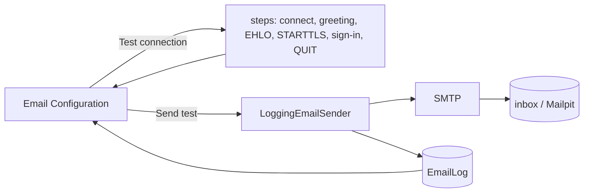

# Email Configuration

## Purpose

The SMTP server the CMS sends email with - password reset, email confirmation, welcome, account-locked and two-factor sign-in code emails
([email](../features/email.md)) - shown **read-only**: SMTP is configured only with `SMTP_*` in `.env`
([configuration → email](../features/configuration.md#email-smtp)). The screen adds tools to check it: a connection
test, test sends (a plain message or an email template with sample data), the email log and, in Development, a link
to the local Mailpit inbox.

## Route / Navigation

| Item | Value |
| --- | --- |
| Routes | `GET /admin/email/configuration`; `POST /admin/email/configuration/connection` (connection test), `POST /admin/email/configuration/test` (test send) |
| Navigation entry | sidebar **Settings → Email → Configuration** (icon `mail`) |
| Children | none |

## Relevant source files

```text
src/DotNetForge.Web/Areas/Admin/Controllers/EmailConfigurationController.cs   Index, TestConnection, Test
src/DotNetForge.Web/Areas/Admin/Views/EmailConfiguration/Index.cshtml
src/DotNetForge.Web/Services/EmailConfigurationService.cs                     settings from .env (IEmailSettingsSource), MailpitInboxUrl, DescribeFailure
src/DotNetForge.Infrastructure/Messaging/SmtpProbe.cs                         the connection test (no email sent)
src/DotNetForge.Web/Services/LoggingEmailSender.cs                            the IEmailSender of the app: every send → EmailLog
src/DotNetForge.Shared/Entities/EmailLogEntry.cs                              table EmailLog
```

## Page layout

```text
Email Configuration (header action in Development with a local Mailpit: [Open Mailpit inbox])
├── alert "Email is off" (no SMTP_HOST / SMTP_FROM)
├── card **SMTP server** (badge Configured / Not configured) - "From .env - read-only here"
│   └── dl: Host (host:port) · Encryption (STARTTLS / none) · Sign-in (username, password set/not set) · Sender - each with its SMTP_* key
├── card **Test connection** (header button [Test connection])
│   └── after a run: alert works / failed, the steps (✓/✗, name, detail, ms) and the server's extensions
├── card **Send a test** - form: **Email** (Test message | each template) · **Send to**; card-footer [Send test]
└── card **Email log** - table: When · To · Email (template name or "Test message" + subject) · Result (Sent / Failed + reason) - or <dnf-empty-state>
```

## Functionality

- **Settings** come only from `.env` (`AppEnvironment.Email`); the password is never shown, only whether it is set.
  Changing them means editing `.env` and restarting.
- **Test connection** - see [below](#test-connection).
- **Send a test** → a plain message ("Test email from <APP_NAME>") or the chosen template as it is sent (customized
  or default) rendered with its sample data, subject prefixed `[Test] `. Toast on success; on failure
  `DescribeFailure` (timeout, connection, sign-in, refused). Audited `settings.changed` "<what> sent/failed".
- **Email log** - see [below](#email-log).
- **Open Mailpit inbox** - only in Development when SMTP points at `localhost`/`127.0.0.1` port 1025 or 1026 (Mailpit's
  default, `docker/mail/mailpit.yml`): `http://localhost:<port + 7000>`.

### Test connection

`SmtpProbe.RunAsync` (15 s): Connect → Greeting (220) → EHLO (250, extensions) → STARTTLS
(when `SMTP_TLS` is on; the certificate must be valid for the host) → Sign-in (when `SMTP_USERNAME` is set; AUTH PLAIN
or LOGIN, 235) → QUIT. It stops at the first failed step and says why in its own words (reply codes, never the
server's text or the password). Nothing is sent. Audited `settings.changed` "Connection test passed/failed".

### Email log

The latest 50 `EmailLog` entries. `LoggingEmailSender` writes one per attempt of **every** email the
CMS sends (account emails and tests): time, recipient, subject, template key, sent/failed with `DescribeFailure`'s
reason. Written in its own DI scope (a caller's pending changes are never saved with it); entries older than 30 days
are deleted on the next write. No bodies are stored.

## Data used by the page

`AppEnvironment.Email`, `EmailLog`, `EmailTemplateCatalog` (the template choices), `EmailTemplates` (customized texts).

## State

Server side; the probe result only lives in the response that shows it.

## Permissions

`[RequirePermission(Settings, Read)]` to view (settings, log); the connection test and test sends need
`Settings / Update` (buttons disabled without it, or when email is off).

## Validation

| Rule | Message |
| --- | --- |
| A valid recipient | "Enter a valid email address to send the test to." (toast) |
| SMTP configured | "Email is not configured: set SMTP_HOST and SMTP_FROM in .env." |
| A known template | unknown key → 404 |

## Error handling

Send failures: toast with `EmailConfigurationService.DescribeFailure`, the application log gets the exception type only
(SMTP errors can echo addresses), the email log gets the description. A failure to write the email log is logged as a
warning and never hides the send's own result.

## Loading behaviour

Server-rendered; the connection test answers within 15 s.

## Empty states

Email log: "No emails yet".

## User interactions

Test connection, Send test, Open Mailpit inbox (new tab).

## Dependencies

```text
EmailConfigurationController → EmailConfigurationService (AppEnvironment), SmtpProbe, EmailTemplateService, IEmailSender, IAuditService, DotNetForgeDbContext (EmailLog)
IEmailSender = LoggingEmailSender → keyed transport SmtpEmailSender (LoggingEmailSender.TransportKey)
```

## Page flow



## Related pages

[Email Templates](email-templates.md), [Advanced Settings](advanced-settings.md) (email confirmation needs SMTP),
[self-service account screens](account-self-service.md).

## Important implementation details

- Implicit TLS on port 465 is not supported (STARTTLS on 587); the probe reports an unexpected greeting there.
- The integration tests replace only the transport (keyed `LoggingEmailSender.TransportKey`), so the email log runs as
  in production.
- `EmailLog` is part of Data Management exports (it is CMS data, like the audit log).

## Known limitations

- The probe checks AUTH PLAIN and LOGIN only (the mechanisms `SmtpClient` uses for these servers).
- With Mailpit, TLS stays off (`SMTP_TLS=false`): its certificate would be self-signed, which the app rejects.

## Planned (not implemented)

- Delivery status from the provider (bounces) - the log records what the SMTP server accepted.
