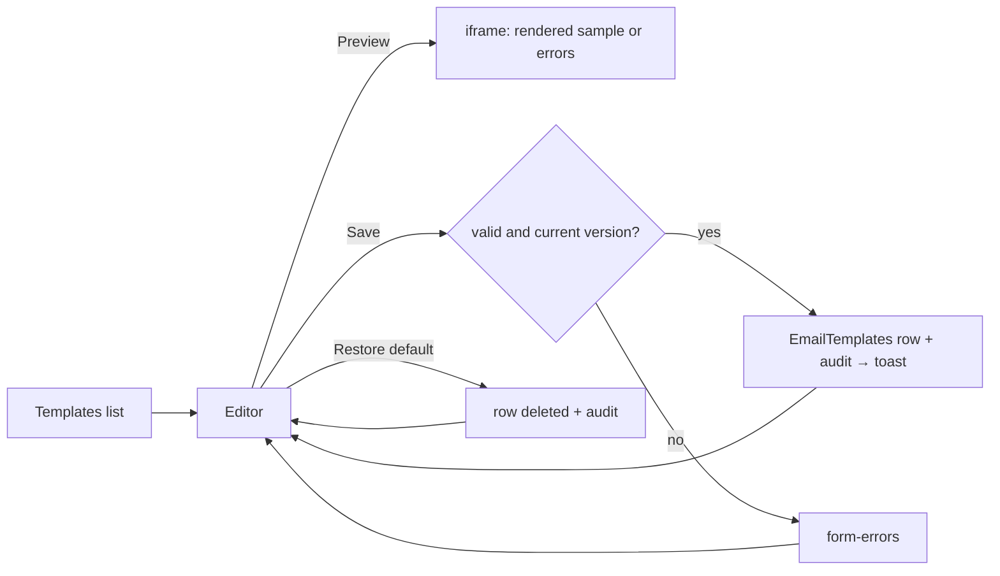

# Email Templates

## Purpose

The emails the CMS sends, each with a subject and HTML body administrators can change, a preview with sample data
and **Restore default**. Mechanism and the template catalog: [email → templates](../features/email.md#templates).

## Route / Navigation

| Item | Value |
| --- | --- |
| Routes | `GET /admin/email/templates` (list), `GET/POST /admin/email/templates/{key}` (editor, save), `POST /admin/email/templates/{key}/restore`, `GET/POST /admin/email/templates/{key}/preview` (the preview document) |
| Navigation entry | sidebar **Settings → Email → Templates** (icon `file-code`) |
| Children | one editor per template key: `email-confirmation`, `password-reset`, `welcome-email`, `account-locked`, `sign-in-code` (others → 404) |

## Relevant source files

```text
src/DotNetForge.Core/Email/EmailTemplateCatalog.cs                     the five templates: key, name, trigger, variables, required, defaults, sample values
src/DotNetForge.Core/Email/EmailTemplateRenderer.cs                    Validate, Variables, RenderSubject, RenderBody (pure, unit-tested)
src/DotNetForge.Core/Email/EmailLayout.cs                              the frame around every email (Forge colours, inline styles) + default-body helpers
src/DotNetForge.Web/wwwroot/js/forge/email-templates.js                the Monaco body editor (variable IntelliSense, hovers, validation, highlighting) + live preview
src/DotNetForge.Web/wwwroot/lib/monaco/                                Monaco 0.52.2, self-hosted (MIT; HTML/CSS language services only)
src/DotNetForge.Web/Services/EmailTemplateService.cs                   ListAsync, GetAsync, SaveAsync (concurrency, audit), RestoreAsync, RenderAsync
src/DotNetForge.Web/Areas/Admin/Controllers/EmailTemplatesController.cs  Index, Edit, Save, Restore, Preview (GET saved / POST unsaved)
src/DotNetForge.Web/Areas/Admin/Views/EmailTemplates/{Index,Edit}.cshtml
src/DotNetForge.Web/Middleware/SecurityHeadersMiddleware.cs            EmailPreviewPolicy, PolicyOverrideItemKey
src/DotNetForge.Shared/Entities/EmailTemplate.cs                       a customized template (table EmailTemplates)
```

## Page layout

```text
Email Templates (list)
└── card **Templates**
    └── table: **Template** (name link + key) · **Sent when** · **Status** (Default / Customized + when) · [Edit]

<Template name> (editor; header action "All templates"; description "Sent when: …")
├── editor-main
│   ├── form (POST /admin/email/templates/{key}, antiforgery, hidden version)
│   │   └── card **Message** - badge Default / Customized (saved …)
│   │       ├── <form-errors />, **Subject** *, **Body (HTML)** * - a Monaco code editor with a status bar (the textarea without JavaScript)
│   │       └── card-footer (Settings update only): [Restore default] (customized only, data-confirm) · [**Save template**]
│   ├── hidden #previewForm (POST …/preview, target = the frame)
│   └── card **Preview** - header action [Refresh] (JS only); iframe (sandbox): the email as sent (layout + body) with sample data, refreshed while you type
└── editor-aside: card **Variables** - per variable: {{name}} with its copy button on the right; below, a Required badge (if required) and the sample value
```

## Functionality

- **Save** → `EmailTemplateService.SaveAsync`: validates (`EmailTemplateRenderer.Validate`), checks the posted
  `version` against the stored row (a stale save is refused: "Someone else changed this template since you opened it…"),
  stores the row (`UpdatedDate`, `UpdatedById`) and audits `settings.changed` (entity `EmailTemplate`, display
  "Email template: <name>"). Text equal to the default deletes the row (the template counts as default again).
- **Restore default** → deletes the row, audits `settings.changed` "Default restored"; a template that already uses
  the default is left alone (no audit entry).
- **Preview** → updates by itself: `email-templates.js` copies the subject and body into `#previewForm` 400 ms after
  the last keystroke and posts it into the frame (without JavaScript the frame shows the saved template). It renders
  the email exactly as sent - inside `EmailLayout` - with the subject above and the template's sample values (e.g. "Alex Example",
  `https://cms.example.com/...`); with errors it lists them instead of rendering. Nothing is sent or stored, so the
  POST is not audited. **Refresh** (card header) posts the current text at once - to come back after clicking a link
  in the email (the sandboxed frame follows it to the sample URL) or whenever the preview looks out of date.
- **Sending**: `AccountService` renders through `EmailTemplateService.RenderAsync` - the customized text, else the
  default. A stored template that no longer validates (only if the catalog's variables changed) is replaced by the
  default and a warning is logged.

### Code editor

The body is edited in **Monaco** (self-hosted, `wwwroot/lib/monaco`), HTML mode, following the admin's light/dark
theme. The hidden textarea stays the form field (kept in sync), so saving and the no-JavaScript fallback are unchanged.

| Feature | Behaviour |
| --- | --- |
| Colorization | HTML (with embedded CSS/JavaScript); valid `{{variables}}` highlighted in the accent colour (`.code-var`) |
| IntelliSense | typing `{` suggests the template's variables (detail "Variable"/"Required variable", the sample value); it replaces what was typed and any auto-closed `}}`. Monaco's HTML tags and attributes (HTML worker) |
| Hover | a `{{variable}}` shows whether it is required and its sample value; an unknown one says so |
| Validation | markers for the server's rules, 250 ms after a change: unknown variable (error, lists the available ones), incomplete `{{`/`}}`, a missing required variable, an empty body; `<script>` gets a warning (email clients don't run scripts) |
| Status bar | below the editor: errors and warnings (click → next problem, like F8), `Ln, Col` and the selected character count, the body length against the 20 000 limit (red when over; an error marker too), `Spaces: 2`, `HTML`, and the **Wrap** toggle |
| Word wrap | on by default; **Wrap** in the status bar or Alt+Z toggles it, remembered per browser (`localStorage` `forge.codeEditor.wordWrap`) |
| Gutter | compact: line numbers at the left edge (no glyph margin), folding next to them |
| Keys | Ctrl/Cmd+S saves the form; Alt+Z toggles word wrap |

The page's policy allows inline styles for Monaco (`CodeEditorPolicy`); the server still validates every save.

## Data used by the page

`EmailTemplates` rows (only customized templates), `EmailTemplateCatalog` (defaults, variables, samples).

## State

Server side. The editor carries the row's `UpdatedDate` ticks (`version`, 0 = default) for the concurrency check.

## Permissions

`[RequirePermission(Settings, Read)]` for the list, editor and preview; save and restore need `Settings / Update`
(the form is disabled and the buttons hidden without it).

## Validation

| Rule | Message |
| --- | --- |
| Subject required, one line, ≤ 500 | "Enter a subject." / "The subject must be one line." / "The subject is limited to 500 characters." |
| Body required, ≤ 20 000 | "Enter a body." / "The body is limited to 20000 characters." |
| Only the template's variables | "Unknown variable {{x}} in the subject/body. Available: …" |
| Required variables in the body (`confirmationUrl`, `resetUrl`) | "The body must contain {{resetUrl}} - without it the email is useless." |
| Complete placeholders | "The body has an incomplete placeholder: write variables as {{name}}." |
| Concurrency | "Someone else changed this template since you opened it. Reload to see their version, then make your change again." |

## Error handling

Validation errors in `<form-errors />` with the posted text kept. Unknown key → 404.

## Loading behaviour

Server-rendered; the preview frame loads `GET …/preview` with the page.

## Empty states

Not applicable (the catalog always has five templates).

## User interactions

The preview follows typing (JavaScript; without it, the saved template) and **Refresh** renders it again; copy buttons on variables
(`data-copy-text`, JS only); Restore asks for confirmation (`data-confirm`).

## Dependencies

```text
EmailTemplatesController → EmailTemplateService (DotNetForgeDbContext, IAuditService) → EmailTemplateCatalog, EmailTemplateRenderer
AccountService (and AuthService for "Account locked", MfaService for "Sign-in code") → EmailTemplateService.RenderAsync → IEmailSender
```

## Page flow



## Related pages

[Email Configuration](email-configuration.md) (without SMTP nothing is sent), [self-service account screens](account-self-service.md).

## Important implementation details

- The preview shows administrator-written HTML, so it never runs inside the admin page: it is a separate document in
  an `<iframe sandbox>` (no scripts, forms or same-origin access), served with
  `SecurityHeadersMiddleware.EmailPreviewPolicy` (`default-src 'none'`, inline styles and images only, `sandbox`) as an
  enforced policy even in Development.
- Variable values are HTML-encoded in the body (a user's name can't inject markup) and plain in the subject.
- Only customized templates are stored, so a later change of a shipped default reaches every site that didn't
  customize it.

## Known limitations

- No plain-text part; the body is sent as HTML only.
- No per-language templates ([internationalization](../features/internationalization.md) is planned).
- Monaco's HTML mode doesn't check markup (e.g. unclosed tags); only the template rules are validated.
- Monaco loads about 5 MB the first time the editor opens (cached afterwards).

## Planned (not implemented)

- User invitation and admin notification templates - no flow sends them yet
  ([email](../features/email.md#planned-not-implemented)).
