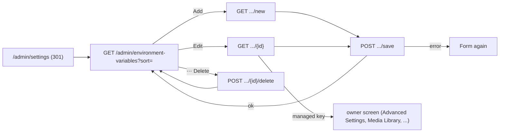

# Environment Variables

## Purpose

The site's key/value settings as **environment variables**, in the style of a hosting dashboard: API keys, tokens
and configuration the site and its extensions read. Each variable is a **secret** (encrypted, never shown again after
saving) or **config** (readable by users with access), holds a value for **all environments** or for one
(Development, Staging, Production), and can carry a note. Super Admins and Admins (the `Settings` grants) add, change
and delete them. Extensions read them through `IEnvironmentVariables` ([extensions](../features/extensions.md)), API
clients through `GET /api/settings` ([headless API](../features/headless-api.md)). Keys that other screens own
(sign-up rules, backups, media limits, two-factor settings, the admin language) are listed here but changed only on
their screen.

## Route / Navigation

| Item | Value |
| --- | --- |
| Routes | `GET /admin/environment-variables` (list; `?sort=updated` - default, newest first - or `?sort=name`) · `GET /admin/environment-variables/new` · `GET /admin/environment-variables/{id}` (edit; 404 for an unknown id, a managed key redirects to its owner screen) · `POST /admin/environment-variables/save` · `POST /admin/environment-variables/{id}/delete` |
| Old addresses | `GET /admin/settings` and `/admin/settings/edit` answer **301** to the list, `/admin/settings/new` to `.../new` (`EnvironmentVariablesController.Moved`) - the screen was called Settings |
| Navigation entry | Sidebar → **Settings** → **Global Settings** → **Environment Variables** (icon `braces`, first in the group; `AdminNavigation.Tree`); breadcrumbs **Settings / Global Settings / Environment Variables** (+ the form's title) |
| Parameters | `sort` (list), `{id}` (the row's `Guid`) |
| Access | `Super Admin`, `Admin` by default; the sidebar hides the link from other roles, and opening the URL directly lands on [access denied](access-denied.md) |

## Relevant source files

```text
src/DotNetForge.Web/Areas/Admin/Controllers/EnvironmentVariablesController.cs   Index, New, Edit, Save, Delete, Moved; EnvironmentVariablesViewModel, EnvironmentVariableFormModel
src/DotNetForge.Web/Services/EnvironmentVariableService.cs        rules: list, find, save, delete, GetAsync / EffectiveAsync; ManagedScreens; IEnvironmentVariables
src/DotNetForge.Web/Areas/Admin/Views/EnvironmentVariables/Index.cshtml   list: toolbar (search, type, environment, sort), table, row menu
src/DotNetForge.Web/Areas/Admin/Views/EnvironmentVariables/Form.cshtml    add / edit form
src/DotNetForge.Web/wwwroot/js/admin/env-vars.js                   submits the sort select on change
src/DotNetForge.Web/wwwroot/css/admin/tools.css                    .dnf-env-vars__* (toolbar, sort, key, icon, value: eye + fixed dots / shown value, editor avatar)
src/DotNetForge.UI/wwwroot/dnf.js                                  data-collection (search, filters, paging), data-copy-text, dropdowns, confirm
src/DotNetForge.Sdk/HostContracts.cs                               IEnvironmentVariables (for extensions)
src/DotNetForge.Shared/Entities/SystemState.cs                     Setting entity, SettingEnvironment.Current
src/DotNetForge.Data/DotNetForgeDbContext.cs                       Setting mapping: unique (Key, Environment), environment query filter
src/DotNetForge.Api/Controllers/ResourceApiControllers.cs          SettingsApiController (GET /api/settings)
```

## Page layout

```text
Environment Variables (h1) - "Store API keys, tokens and configuration for <APP_NAME>. Secrets can't be read after
│                             saving. This site runs in <environment>."
├── header: [+ Add Environment Variable] (primary; with Settings / update) → /admin/environment-variables/new
└── card "Project variables" [data-collection, 25 per page]   "N total" / "x of N"
    ├── toolbar: search "Search variables…" (JS) · All Types | Secret | Config (JS) · All Environments | Development |
    │            Staging | Production (JS) · sort: Last Updated | Name (A-Z) (GET form; button without JS)
    ├── table: Key · Value · Environment · Updated · ⋯
    │   row: lock (secret) / code (config) icon · key (<code>) + note + "Managed on <screen>"
    │        · value: 👁 + ••••••••••••••••• (config; the eye shows the value) | the same dots without an eye (secret) | "(empty)" - always 16 dots, whatever the length
    │        · "All Environments" or the environment + "This site" badge (the running environment)
    │        · <dnf-timestamp> + avatar of who changed it last (tooltip)
    │        · ⋯ menu: Edit (or "Change on <screen>" for a managed key) · Copy (`KEY=VALUE`; disabled for a secret) · Delete (confirm)
    ├── row "No variable matches the search or filters."   [data-collection-empty]
    ├── pagination (JS)
    └── (none yet → empty state "No environment variables yet" - "Add an API key, a token or a value your site and
        extensions read.")

Add Environment Variable / Edit <key> (h1; narrow page)
└── form card (POST /admin/environment-variables/save, antiforgery; hidden Id when editing)
    ├── <dnf-validation-summary />
    ├── Type: choice cards **Secret** ("You can't reveal this value after saving. Use for passwords, API keys and
    │   tokens.") | **Config** ("Readable after saving for users with access. …"); new variables start as Secret
    ├── Key * (placeholder CLIENT_KEY, monospace; readonly when editing: "A key can't be renamed: add a new
    │   variable and delete this one.")
    ├── Value (password input with 👁 reveal; for a saved secret empty, placeholder "Leave empty to keep the current
    │   secret", hint "The saved secret can't be shown. Enter a new value to replace it.")
    ├── Note (optional, "Where to rotate it, or who to contact")
    ├── Environment: All Environments | Development | Staging | Production ("A value for one environment wins over
    │   the one for all environments there. This site runs in <environment>.")
    └── footer: [Cancel] · [✓ Save]
```

## Components

| Component | Inputs | Behaviour |
| --- | --- | --- |
| **Add Environment Variable** | `EnvironmentVariablesViewModel.CanEdit` | link to the add form; only with `Settings` / `update` |
| Type / environment filters | `data-collection-filter="type"` / `"environments"` on the rows' `data-type`, `data-environments` | client-side; an all-environments row matches every environment filter |
| Search | `data-search` = key and note | client-side |
| Sort | `GET ?sort=updated|name` | server order; `env-vars.js` submits on change, a `<noscript>` button otherwise |
| Value | 16 dots (`Masked`) for every value, so they don't tell its length; a config value also in a hidden `<code data-env-plain>` | **Show value** / **Hide value** (`data-env-reveal`, `env-vars.js`) swaps the dots for the value; a secret has no eye and its value is never in the page |
| Secret value | none - `EnvironmentVariableRow.Value` is null for secrets | a fixed mask; the value never reaches the browser |
| Row menu | `ManagedBy`, `CanEdit` | **Edit** (with update) or **Change on <screen>** (managed keys), **Copy** (`data-copy-text` = `KEY=VALUE`, ready for a `.env` file; disabled with the tooltip "A secret can't be copied." for a secret), **Delete** (with update, not for managed keys; confirm "Delete <key> (<environment>)? Whatever reads it gets no value any more.") |
| Form | `EnvironmentVariableFormModel(Input, IsNew, WasSecret)` | see the layout; a secret's value is never put back into the form, not even after a failed save |

## Functionality

### Add or change a variable

1. **Trigger:** **Add Environment Variable** or **Edit**, then **Save** → `POST /admin/environment-variables/save`.
2. **Service:** `EnvironmentVariableService.SaveAsync(input, userId)`:
   - environment one of "" (all), `Development`, `Staging`, `Production` ("Choose one of the environments.");
   - value ≤ 4000, note ≤ 500 characters ("Values are limited to 4000 characters and notes to 500.");
   - key required, ≤ 200 characters, no spaces ("Key is required." / "A key has at most 200 characters and no
     spaces."); when editing, the stored key is kept whatever is posted;
   - not a managed key ("'users.signUps' is managed on Advanced Settings; change it there.");
   - one value per key and environment ("'api.url' already has a value for Production." / "... for all
     environments."; a concurrent insert caught by the unique index: "... was just added for this environment by
     someone else.");
   - a secret edited with an empty value keeps its stored value; turning a secret into config needs a value ("A
     secret's value can't be shown, so enter the value again to make it a config variable.").
3. **Data:** a secret's value is encrypted with Data Protection (purpose `DotNetForge.EnvironmentVariables`);
   `IsSecret`, `Environment`, `Note`, `UpdatedDate`, `UpdatedById` are set.
4. **Audit:** `settings.changed`, details `Added - secret, All environments` / `Updated - config, Production` - never
   the value.
5. **Result:** redirect to the list with the toast "Saved '<key>'."; an error re-renders the form with the message and
   the input (without a secret's value).

### Delete a variable

⋯ → **Delete** → confirm → `POST /admin/environment-variables/{id}/delete` → `DeleteAsync` (refused for a managed
key) → `settings.deleted` (details the environment) → toast "Environment variable deleted."

### Read a variable (code)

`IEnvironmentVariables.GetAsync(key)` (`EnvironmentVariableService`): the running environment's own value, else the
all-environments one, decrypted; null when unset - or when a secret can't be decrypted (encrypted by another site,
e.g. after an import). `GET /api/settings` returns the same effective set as `{ key, value, secret }`, with `value`
null for secrets.

## Data used by the page

`Settings` rows of every environment (`IgnoreQueryFilters`), their editors' names from `Users`, the managed prefixes
(`EnvironmentVariableService.ManagedScreens`), `AppEnvironment.AppName` and `SettingEnvironment.Current` (the running
environment, from `IHostEnvironment.EnvironmentName`, set in `Program.cs`).

## State

| State | Where | Changes when |
| --- | --- | --- |
| Variables | `Settings` rows (`Key`, `Value`, `IsSecret`, `Environment`, `Note`, dates, `UpdatedById`) | save, delete |
| Sort | URL `?sort=` | the sort select |
| Search, filters, page | DOM (`dnf.js`) | lost on reload |
| Rows per page | `localStorage` `dnf-page-size:/admin/environment-variables:0` | the **Rows per page** select |
| Result message | `TempData` → toast | after a save or delete |

## Permissions

`[RequirePermission(Settings, read)]` on `EnvironmentVariablesController`; `New`, `Edit`, `Save` and `Delete` also
need `Settings` / `update` (default: Super Admin and Admin). With `read` only, the list shows without **Add**, **Edit**
and **Delete** (config values stay revealable). Editors and Authors are redirected to `/account/denied`
(`SecurityTests.Editors_can_no_longer_change_settings`); the sidebar hides the link from them. No finer check exists:
whoever has `read` can reveal every config value.

## Validation

Server only, in `EnvironmentVariableService.SaveAsync` (messages above). The browser marks the key `required` and
limits key, value and note lengths. The managed prefixes are `users.` ([Advanced Settings](advanced-settings.md)),
`transfer.` ([Data Management](data-management.md)), `media.` ([Media Library](media-settings.md)), `mfa.`
([Two-factor authentication](mfa.md)) and `i18n.` ([Internationalization](internationalization.md)): such rows show
"Managed on <screen>" and a **Change on <screen>** link; adding, editing (`GET {id}` redirects there) or deleting
them here is refused.

## Error handling

| Failure | User sees |
| --- | --- |
| Invalid input, duplicate key per environment, managed key | the form again with the message in `<dnf-validation-summary />` |
| Edit of an unknown id | `404` |
| Delete of a managed or vanished variable | error toast on the list |
| No `Settings` grant | `/account/denied` |
| A secret encrypted by another site (imported backup) | `GetAsync` returns null; enter the value again |

## Loading behaviour

Server-rendered; two queries for the list (variables, editors). No asynchronous parts.

## Empty states

| When | Text |
| --- | --- |
| No variables | **No environment variables yet** - "Add an API key, a token or a value your site and extensions read." |
| Search or filters match nothing | "No variable matches the search or filters." |

## User interactions

Search, type and environment filters, sort, pagination, show a config value (eye), **Copy** (`KEY=VALUE`, not for secrets), **Add**, **Edit**,
**Delete** (confirm dialog), choosing the type cards and the environment on the form, reveal the typed value.

## Dependencies

```text
EnvironmentVariablesController
├── EnvironmentVariableService
│   ├── DotNetForgeDbContext   (Settings, Users)
│   ├── IDataProtectionProvider  protector "DotNetForge.EnvironmentVariables"
│   └── IAuditService          settings.changed / settings.deleted
└── AppEnvironment             AppName
```

## Page flow



## Related pages

[Internationalization](internationalization.md), [Media Library](media-settings.md), [Advanced Settings](advanced-settings.md),
[Two-factor authentication](mfa.md), [Data Management](data-management.md) (own keys here; exports the rows),
[Audit Logs](audit-logs.md), [headless API](../features/headless-api.md), [extensions](../features/extensions.md).

## Important implementation details

- **Environment filter.** `DotNetForgeDbContext` has a query filter on `Settings`: every query sees the rows for all
  environments and for `SettingEnvironment` (the context property, initialised from `SettingEnvironment.Current`). So
  the screens that own keys (`MediaSettingsService`, `AdminLanguageService`, ...) read the running environment's
  rows without knowing about environments; this screen and the service use `IgnoreQueryFilters` to see them all.
- **Effective value**: per key, the running environment's row wins over the all-environments row
  (`EnvironmentVariableService.Effective`).
- **One row per key and environment**: unique index (`Key`, `Environment`); `Environment` is `""` for all
  environments.
- **Secrets** are stored encrypted (`Value` up to 8000 characters, as ciphertext is longer than the 4000 allowed in
  the form) and never sent to the browser. Data Management exports them still encrypted, so they are unreadable on
  another site (like OAuth client secrets): enter them again after moving a site.
- Config values are HTML-encoded and present (masked) in the list's HTML.

## Known limitations

- No rename (add a new key and delete the old one), no bulk import (pasting a `.env`), no history of values.
- Every user with `Settings` / `read` can reveal every config value; there is no per-variable access.
- Config values are not encrypted at rest; use **Secret** for anything sensitive.
- The environments are fixed (Development, Staging, Production); a site running in another environment name only
  sees the all-environments values.

## Planned (not implemented)

Target behaviour from the original product specification. Nothing in this section exists in the code unless marked ✔.

### Requirements

**Global Settings → Overview** is the landing screen of the Global Settings group (today the group starts with
**Environment Variables**, this screen, and there is no Overview - see the
[sidebar differences](../architecture/pages.md#canonical-sidebar-tree-vs-the-sidebar)). It is planned here because
this screen took the spec's Overview slot. The Overview shows read-only
diagnostics, two logo uploads, a **Check for updates** action, a system health indicator and the settings hub table.

**Overview diagnostics (read-only)**

| Field | Type | Spec source | Available in code today |
| --- | --- | --- | --- |
| CMS version | semver string | application assembly | `SystemState.CmsVersion` (DB row, default `1.0.0`) - shown on the [Dashboard](dashboard.md), not from the assembly |
| Available CMS updates | version or "Up to date" | update check service, links to [transfer and updates](../features/transfer-and-updates.md) | ✘ |
| C# language version | string | build/runtime | ✘ |
| ASP.NET Core version | string | runtime | ✘ |
| Database provider | `postgresql` (the CMS database is always PostgreSQL; no setting) | - | ✔ `DatabaseCatalog.Main` (not displayed; Data Management shows it on its Export card) |
| Environment | e.g. `Development`, `Production` | hosting environment | ✔ `IWebHostEnvironment.EnvironmentName` (not displayed) |
| Installed extensions | count (optional list) | extension registry ([extensions](../features/extensions.md)) | `InstalledExtensions` holds the enabled state (written on enable/disable); on-disk discovery is `IExtensionLoader.Discover`, "is it active" is `ExtensionCatalog` |
| System health | `Healthy` \| `Degraded` \| `Unhealthy` + per-check detail | health check service | ✘ (`GET /health` returns a static `ok`) |

**Branding logos (the only editable inputs)**

| Field | Required | Shown on | Cleared → |
| --- | --- | --- | --- |
| Admin menu logo | no | admin sidebar/header (today `wwwroot/img/logo.svg` in the light and `logo-dark.svg` in the dark `_AdminLayout` sidebar) | built-in default |
| Authentication/login logo | no | sign-in and setup screens (`_AuthLayout`, today `wwwroot/img/logo-dark.svg` in the brand panel, `logo-mark.svg` + app name in the narrow-screen header) | built-in default |

Stored through the media subsystem (✔ uploads exist - `MediaService` + `IFileStorage`,
[upload flow](../features/media-storage.md#upload-flow); logo storage itself is not built), URL generated there,
reference saved in the settings store (`Setting`). The admin logo is the admin-area branding
override; public [themes](../features/themes.md) never affect it.

**Settings hub table** - one row per settings screen, linking to it:

| Screen | Group | Documented in |
| --- | --- | --- |
| Overview | Global Settings | this document |
| Content History | Global Settings | [Content Manager](content-manager.md) (placeholder today) |
| Internationalization | Global Settings | [Internationalization](internationalization.md) ([feature](../features/internationalization.md)) |
| File Manager (sidebar: **Media Library**) | Global Settings | [Media Library settings](media-settings.md) |
| Plugins | Global Settings | [Plugins](plugins.md) |
| API Tokens, API Endpoints, API Docs | API & Webhooks | [API Tokens](api-tokens.md), [API Endpoints](api-endpoints.md), [API Docs](api-docs.md) |
| Webhooks | API & Webhooks | [Webhooks](webhooks.md) |
| Roles, Users, Audit Logs | Administration Panel | [Roles](roles.md), [Users](users.md), [Audit Logs](audit-logs.md) |
| Transfer (sidebar: **Data Management**) | Administration Panel | [Data Management](data-management.md) |
| Configuration, Templates | Email | [email](../features/email.md) |
| Providers, Two-factor (MFA), Advanced Settings | Authentication | [Providers](providers.md), [Two-factor authentication](mfa.md), [Advanced Settings](advanced-settings.md) |

Marketplace is not part of the hub; it lives in the sidebar's **Main** group ✔
([extensions](../features/extensions.md)). A hub link is shown only to users holding the target screen's permission
area (e.g. `Webhooks`, `API`, `Media`, `Extensions`, `Users`, `Roles`).

**Permissions** (`Settings` permission area; see [authorization](../features/authorization.md))

| Action | `Super Admin` | `Admin` | `Editor`, `Author`, `Authenticated`, `Public` |
| --- | :-: | :-: | :-: |
| View Overview / Global Settings | ✔ | if granted `Settings` read | ✘ unless granted |
| Upload / change / reset either logo | ✔ | if granted `Settings` write | ✘ unless granted |
| Check for updates | ✔ | if granted `Settings` read | ✘ |
| Apply update / rollback | ✔ | only if explicitly granted | ✘ |
| Open a settings sub-screen | per that screen's permission area | same | same (`Authenticated`/`Public`: never) |

`Super Admin` has full access. With the default grants only `Super Admin` and `Admin` can open Environment Variables
and change variables ✔.

### User flows

| Flow | Steps |
| --- | --- |
| View overview | open **Settings → Global Settings → Overview** → check `Settings` read → load diagnostics → render read-only fields, current logos (or defaults), hub table, **Check for updates** |
| Upload admin menu logo | pick file → client checks type/size → server re-validates (type, size, safe-upload) → store via media subsystem, generate URL → save reference, audit → sidebar/header shows it immediately; public site unaffected |
| Upload login logo | same validation and storage → audit → sign-in and setup screens show it on next render |
| Remove / reset logo | clear the field and save → reference removed, surface reverts to the default → audit |
| Check for updates | **Check for updates** (or the **Available CMS updates** link) → query update service, compare with installed version → show newer version + link to the update workflow, which backs up first and supports rollback ([transfer and updates](../features/transfer-and-updates.md)) |
| Review degraded health | health shows `Degraded`/`Unhealthy` → expand → list of failing subsystems (database, storage, a failing extension) |

### Rules and validation

- Diagnostic fields are read-only; the two logos are the only inputs.
- Logo uploads: only image types allowed by the media configuration (e.g. PNG, JPEG, WebP - SVG is not on the
  `MediaService` allowlist), within the configured max upload size, passing safe-upload checks (type/size
  validation, scanning/blocking where possible). Validated on client and server; the server check is authoritative.
- Both logos are optional; clearing reverts to the built-in default.
- Never display secrets: show the provider, never `DATABASE_CONNECTION_STRING` ([configuration](../features/configuration.md#secrets)).
- Every successful global settings change (logo upload, logo reset, update action) is audited. Environment
  variable saves and deletes are already audited ✔ (`settings.changed`, `settings.deleted`).
- Permission checks run on every action on the server, not only in the UI.

### Edge cases

| Case | Target behaviour |
| --- | --- |
| Update available / none | Show the version with a link to the update workflow, or an explicit "Up to date" - never an empty value. |
| Update service unreachable | "Unable to check for updates" state; rest of the screen unaffected. |
| Health `Degraded`/`Unhealthy` | Show which checks failed; never silently report `Healthy`. |
| Oversized logo | Rejected with an error stating the limit; nothing partial stored. |
| Disallowed or unsafe file type | Rejected with a clear error; not stored. |
| Two admins upload a logo at once | Last successful save wins; both audited. |
| Logo reference points to a missing file | Surface falls back to the default logo, no broken image. |
| Active public theme | No effect on the admin logo or admin area. |
| `Settings` permission revoked mid-session | Subsequent saves/update actions denied server-side. |

### Acceptance criteria

- [ ] The Overview shows CMS version, available updates, C# version, ASP.NET Core version, database provider,
  environment, installed extensions and system health.
- [ ] All diagnostic fields are read-only.
- [ ] The provider shown matches the configured database, and no connection string or secret is displayed.
- [ ] A user with `Settings` write can upload an admin menu logo, and it appears in the admin sidebar/header.
- [ ] A user with `Settings` write can upload a login logo, and it appears on the sign-in and setup screens.
- [ ] Clearing either logo reverts the surface to the built-in default.
- [ ] Logo uploads with a disallowed type or over the size limit are rejected with a clear message.
- [ ] Server-side validation rejects unsafe uploads even when client validation is bypassed.
- [ ] The hub table links to every settings screen (API Tokens, Content History, Internationalization, File Manager,
  Plugins, Transfer (Data Management), Webhooks, Email, Administration Panel, Authentication).
- [x] Marketplace is reachable from the admin **Main** menu - `AdminNavigation.Tree` → `/admin/marketplace`
  (`ModulesController.Marketplace`, placeholder screen; "Soon" badge in the sidebar).
- [ ] **Check for updates** reports an available version (with link) or "Up to date", and an error state when the
  check fails.
- [ ] System health shows `Healthy`/`Degraded`/`Unhealthy` with failing-subsystem detail.
- [x] Users without the `Settings` permission cannot view or modify Global Settings (`[RequirePermission]` on
  `EnvironmentVariablesController`: `read` to view, `update` to change).
- [x] `Super Admin` has full access to Global Settings and every sub-screen - passes `AdminArea` and every
  controller check (`Super Admin` holds every grant; `PluginsController` requires the role).
- [ ] Every successful global settings change (logo upload, logo reset, update action) is audited - only environment
  variable changes exist and are audited.
- [ ] The admin menu logo and admin area are unaffected by any active public theme.

## Extension points

- **Reading a variable in code**: inject `IEnvironmentVariables` (extensions, SDK) or `EnvironmentVariableService`
  (core) and call `GetAsync(key)` - never query `Settings` directly for a free key (the environment and the
  decryption are handled there).
- **A screen that owns its keys**: give them a prefix, add a `ManagedScreen(prefix, name, href)` to
  `EnvironmentVariableService.ManagedScreens`, and write them with `Environment = ""` from the screen's own service.
- A new rule for variables goes into `EnvironmentVariableService.SaveAsync`, never the controller.
