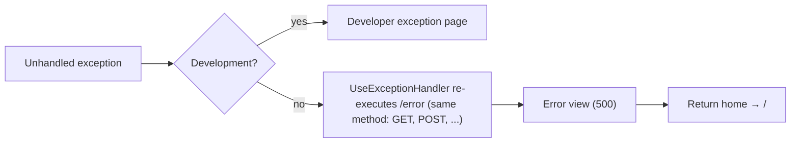

# Error

## Purpose

Generic "Something went wrong" screen for unhandled exceptions outside the Development environment. Error-handling
architecture: [logging and error handling](../features/logging-and-error-handling.md).

## Route / Navigation

| Item | Value |
| --- | --- |
| Route | `/error`, any HTTP method (`[Route("/error")]` on `HomeController.Error`) |
| Reached from | `app.UseExceptionHandler("/error")` (non-Development only) re-executing a failed request; or directly |
| Before install | a direct visit is redirected to `/setup` (the path has no extension) |

## Relevant source files

```text
Program.cs                                          UseExceptionHandler("/error") when !IsDevelopment()
src/DotNetForge.Web/Controllers/HomeController.cs   Error() - plain View(), never themed
src/DotNetForge.Web/Views/Home/Error.cshtml         card with an <empty-state> and "Return home"
src/DotNetForge.Web/Views/_ViewStart.cshtml         Layout = "_Layout"
src/DotNetForge.Web/Views/Shared/_Layout.cshtml     public fallback layout (header, main, footer); loads theme.js + public.css, no ui.js
src/DotNetForge.Web/Ui/UiTagHelpers.cs              <empty-state>, <icon>
src/DotNetForge.Web/wwwroot/css/forge/public.css    .site-header, .site-main, .site-footer
```

## Page layout

```text
Error (_Layout, title "Error · DotNetForge CMS")
├── "Skip to content" link
├── header.site-header: logo mark + "DotNetForge CMS" (→ /) · [Admin →] (/admin, only for users who may enter the admin)
│                       (brand falls back to "DotNetForge CMS" and no page menu - Error() sets neither AppName nor Menu)
├── main#main.site-main
│   └── section.card > div.empty-state
│       ├── triangle-alert icon
│       ├── h1.empty-state-title "Something went wrong"
│       ├── "An unexpected error occurred while processing your request. It has been logged; please try again in a moment."
│       └── [Return home] (a.btn.btn-primary → /)
└── footer.site-footer "Powered by DotNetForge CMS"
```

Layout: [design system → public fallback](../architecture/design-system.md#public-fallback).

## Components, functionality, data, state

Static view; no model, no actions, no data, no state. The response status is whatever the exception handler set
(500 when re-executed). The page carries no inline script or style, so it renders under the production
Content-Security-Policy (see [security](../features/security.md)). The public layout renders no toasts
(`_Feedback` is not included), no theme menu and does not load `ui.js`; `theme.js` still applies a light/dark choice
saved on the admin or sign-in screens.

## Permissions

Anonymous.

## Validation, loading, empty states, user interactions

Not applicable; two links (**Admin**, only for signed-in users who may enter the admin (`Roles.CanEnterAdmin`), and
**Return home**) and the skip link.

## Error handling

This *is* the error handler. The exception handler re-executes the failed request with its **original method**, so
the action accepts every method: an exception thrown while handling a form POST (e.g. an admin save) renders this
page with status 500, like a failed GET (regression test in `SecurityTests`).

## Dependencies

`HomeController` (constructor needs `AppEnvironment`, `DotNetForgeDbContext`, `ThemeResolver`, `IPublishedPages`,
`ExtensionViewRenderer` - none used by `Error()`).

## Page flow



## Related pages

[Public home](public-home.md) (shares `_Layout`), [public content page](public-page.md).

## Important implementation details / known limitations

- The page heading is the empty state's title (`heading-level="1"` renders it as the page's only `<h1>`); `AdminUiTests`
  checks `/error` with the other public pages.
- No request id or correlation id is shown or logged by the application.
- No custom 404 page: `NotFound()` results are empty bodies, not this screen.
- An enabled theme does not restyle this screen: `Error()` returns the built-in view directly (not `ThemedViewAsync`).

## Extension points

To show a request id, use `HttpContext.TraceIdentifier` in `Error()` and pass it to the view. Keep `[Route("/error")]`
method-agnostic; an `[HttpGet]` restriction would bring back empty 500s for failed POSTs.
