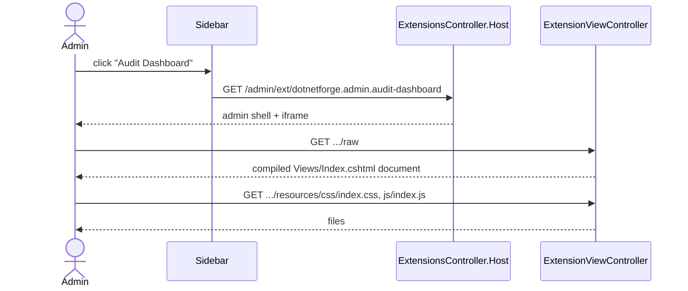

# Admin extension tab (extension host)

## Purpose

Shows an **enabled admin extension** (manifest `type: "admin"`, enabled on the [Plugins](plugins.md) screen) as a
tab inside the admin area. The admin shell (sidebar, top bar) stays the CMS's; the extension's own Razor document is
rendered in an iframe. The repository ships one: **Audit Dashboard** (`extensions/admin/audit-dashboard`). Mechanism
and security model: [extensions → Slots](../features/extensions.md#slots) and
[Security model](../features/extensions.md#security-model).

## Route / Navigation

| Route | Handler | Returns |
| --- | --- | --- |
| `GET /admin/ext/{id}` | `ExtensionsController.Host` (Admin area) | `_AdminLayout` + iframe |
| `GET /admin/ext/{id}/raw` | `ExtensionViewController.Render` (no area) | the extension's `Views/Index.cshtml` as a full document |
| `GET /admin/ext/{id}/resources/{**path}` | `ExtensionViewController.Resource` | a static file from `Views/Resources/` of **any** active extension (admin tabs, dashboard widgets) |

`{id}` is the manifest `id` (case-insensitive), e.g. `/admin/ext/dotnetforge.admin.audit-dashboard`.

| Item | Value |
| --- | --- |
| Navigation entry | Sidebar → **Extensions** → **<extension name>** - a section `AdminNavigationService` appends to `AdminNavigation.Tree` only when at least one admin extension is active (see [Components](#components)) |
| Breadcrumbs | **Extensions** › **<extension name>** |
| Linked from | the sidebar only; [Plugins](plugins.md) enables the extension |

The public counterpart for themes and modules, `GET /ext/{id}/resources/{**path}`, is described in
[extensions → Slots](../features/extensions.md#slots).

## Relevant source files

```text
src/DotNetForge.Web/Areas/Admin/Controllers/ExtensionsController.cs                         Host
src/DotNetForge.Web/Areas/Admin/Views/Extensions/Host.cshtml                                card + loading skeleton + iframe[data-frame] (.dnf-ext-frame__frame)
src/DotNetForge.Web/Areas/Admin/Navigation/AdminNavigation.cs                               AdminNavigationService: appends the Extensions section (sidebar + breadcrumbs)
src/DotNetForge.Web/Areas/Admin/Views/Shared/_Sidebar.cshtml, _NavLink.cshtml               render the sections and links
src/DotNetForge.UI/wwwroot/dnf.js                                                           iframe[data-frame]: data-loaded on [data-frame-host] once the frame has loaded
src/DotNetForge.Web/wwwroot/css/admin/shell.css                                             .dnf-ext-frame, __frame, __loading
src/DotNetForge.Web/Controllers/ExtensionViewController.cs                                  Render, Resource (+ ExtensionResources.Serve, the public ExtensionResourcesController)
src/DotNetForge.Web/Services/ExtensionViewRenderer.cs                                       AddExtensionViewData (Extension, Settings, ResourceBase), ToViewPath
src/DotNetForge.Web/Startup/DependencyRegistration.cs                                       AddRazorRuntimeCompilation + PhysicalFileProvider(ExtensionViewRoot); AddExtensionHost
src/DotNetForge.Extensions/ExtensionCatalog.cs                          FindActiveAsync / GetActiveAsync (valid + enabled + code loaded)
src/DotNetForge.Extensions/ExtensionLoader.cs                           Discover (cached), FileSystemWatcher
src/DotNetForge.Core/Extensions/IExtensionContracts.cs                  IExtensionLoader, DiscoveredExtension
src/DotNetForge.Web/Middleware/SecurityHeadersMiddleware.cs                                 CSP / X-Frame-Options for the shell and the iframe document
src/DotNetForge.Web/DotNetForge.Web.csproj                                                  <None Include="../../extensions/**" Exclude="../../extensions/**/obj/**" CopyToPublishDirectory="PreserveNewest" />
extensions/admin/audit-dashboard/**                                     the sample extension
```

## Page layout

```text
<Extension name> (_AdminLayout, h1 = manifest name, breadcrumbs Extensions › <name>)
└── div.dnf-card.dnf-ext-frame[data-frame-host]
    ├── .dnf-ext-frame__loading skeleton (title + 3 lines; JS only, hidden once the frame has loaded)
    └── iframe.dnf-ext-frame__frame src=/admin/ext/{id}/raw  title=<name>  data-frame   (viewport height minus header, min 28rem)
        └── extension document (its own _Layout)
            e.g. Audit Dashboard (dnf.css + dnf-theme.js, the DotNetForge UI tag helpers):
            ├── sr-only h1 "Audit Dashboard" + "Recent administrative activity."
            ├── <dnf-stat-card>s: Recent events · Failed sign-ins (if settings.showFailedLogins != false) · Last activity (relative)
            ├── card: div.dnf-table of the latest 50 audit entries (When, User, Action, Entity, Result, IP)
            │   or empty state "No audit activity yet"
            └── footer "Loaded at <time>" (set by Resources/js/index.js)
```

## Components

| Component | Inputs | Output / behaviour |
| --- | --- | --- |
| Extensions section (`AdminNavigationService.BuildAsync`) | `ExtensionCatalog.GetActiveAsync("admin")` (ordered by name) | one `NavLink` per extension: label = manifest `name`, href `/admin/ext/{id}`, icon `panel`, controller `ExtensionsController` (so visibility follows its `AdminArea` policy); the section is added after **Settings** only when the list is not empty; active by the same longest-matching-href rule as every link |
| `Host.cshtml` | `ViewData["Title"]`, `ViewData["ExtensionId"]` | card with skeleton + iframe (`title` = extension name) |
| `dnf.js` (`iframe[data-frame]`) | the iframe's `load` event (or an already complete document) | sets `data-loaded="true"` on the `[data-frame-host]` card, which hides the skeleton ([behaviours](../architecture/design-system.md#behaviours)) |
| `ExtensionViewController.Render` | active extension, `Views/Index.cshtml` path | `ViewData["Extension"]`, `ViewData["Settings"]`, `ViewData["ResourceBase"] = /admin/ext/{id}/resources` ([extension view data](../features/extensions.md#slots)) |
| `ExtensionViewController.Resource` | `path` | file under `Views/Resources/` of any active extension, content type by file extension |

## Functionality

### Open an extension tab

1. Click the sidebar entry (**Extensions** → <name>).
2. `Host` calls `ExtensionCatalog.FindActiveAsync(id, "admin")` (the first valid manifest with that id,
   case-insensitive, of type `admin`, enabled, and - if it has code - loaded) → renders the shell; `null` → 404.
3. The browser loads `/raw`: `Render` calls `FindActiveAsync(id, "admin")` again, requires `Views/Index.cshtml`,
   builds an app-relative path (`~/extensions/...`) and returns `View(path)` - compiled in memory on first use by
   runtime Razor compilation (nothing is written to disk).
4. The extension's layout links `@ViewData["ResourceBase"]/css/index.css` and `@ViewData["ResourceBase"]/js/index.js`; `Resource` serves
   them (`FindActiveAsync(id)`, any type).

## Data used by the page

Manifest (`id`, `name`, `settings`), files under the extension's `Views/`. Whatever the extension's views inject -
the sample injects `DotNetForgeDbContext` and reads all `AuditLogs`, like the core [Audit Logs](audit-logs.md)
screen.

## State

None in the host. Extension-defined state only.

## Permissions

All three endpoints: `AdminArea` policy (any admin-capable role). Manifest `permissions` are not enforced. Iframe
requests carry the same auth cookie (same origin).

## Validation

Only active extensions (`ExtensionCatalog`) are served; the tab and `/raw` also require type `admin`. `Resource` rejects paths outside
`Views/Resources/` (`Path.GetFullPath` + prefix check) and missing files.

## Error handling

| Case | Result |
| --- | --- |
| Unknown / invalid / disabled / not running / non-admin id | 404 (shell or iframe) |
| No `Views/Index.cshtml` | 404 in the iframe (shell still renders) |
| Razor compile or runtime error in the extension | exception → error page / developer page **inside the iframe** |
| Inline `<script>`, inline `<style>` or `style="..."` in the extension's views | blocked by the browser outside Development (CSP `script-src 'self'; style-src 'self'`); in Development only reported (report-only header) |
| Traversal attempt or missing resource | 404 |

## Loading behaviour

Shell renders immediately; the iframe loads separately. With JavaScript a skeleton (`.dnf-skeleton--title` + three
`.dnf-skeleton--line`s, `aria-hidden`) covers the frame until `dnf.js` sees the frame's `load` event; without JavaScript
the skeleton stays hidden (`data-js-only`) and the frame simply fills in. First render of an extension view triggers
Razor compilation (slower); later renders reuse it until the file changes. A 404 or error document in the frame
also counts as loaded.

## Empty states

No enabled admin extensions → no **Extensions** sidebar section. The sample shows the empty state **No audit
activity yet** when there are no entries.

## User interactions

Inside the iframe, whatever the extension provides (the sample has none).

## Dependencies

```text
ExtensionsController / ExtensionViewController / AdminNavigationService (scoped)
├── ExtensionCatalog (singleton) → IExtensionLoader (+ FileSystemWatcher), ExtensionRuntime, IExtensionState (cached 30 s)
├── ExtensionViewRenderer (ExtensionViewController only: view path, view data)
├── Runtime Razor compilation (PhysicalFileProvider over the content root)
└── SecurityHeadersMiddleware (CSP, X-Frame-Options: SAMEORIGIN)
```

## Page flow



## Related pages

[Plugins](plugins.md) (enables the extension), [Dashboard](dashboard.md#widgets) (widgets use the same resource
route), [Audit Logs](audit-logs.md) (the sample's data source).

## Important implementation details

- The URL uses the manifest `id`; the manifest's `routes` array is informational only.
- Enabling or disabling on the Plugins screen takes effect on this instance at once, on other instances within 30 s
  (`ExtensionState.Lifetime`).
- Discovery is cached in the `ExtensionLoader` singleton. A `FileSystemWatcher` on `AppEnvironment.ExtensionsPath`
  (no name filter, subdirectories included) clears the cache when any file or folder below it is created, changed,
  renamed or deleted, or when the watcher reports an error; a version counter keeps a scan that overlapped a
  change from being cached. If the watcher cannot be created (missing folder at startup, unsupported file system),
  every call rescans. Changes to view files are picked up by runtime compilation, not by this cache.
- The three endpoints and the sidebar share one lookup, `ExtensionCatalog`; none combines discovery and enabled
  state itself.
- The active-link match lowercases the request path but not the href built from the manifest `id`, so an extension
  whose `id` contains capital letters still opens, but its sidebar link is never marked active and the breadcrumb
  trail is missing (ids are conventionally lowercase, like the sample's).
- The extension document can reuse the DotNetForge UI library ([.docs/ui](../ui/README.md)): the sample links
  the library's `dnf.css` and `dnf-theme.js` (served by the `DotNetForge.UI` Razor class library), marks its `<body>` as a `.dnf-scope`
  (`data-dnf-extension="audit-dashboard"`) and registers the `DotNetForge.UI` tag helpers in its `_ViewImports.cshtml`
  ([tag helpers](../architecture/design-system.md#tag-helpers)). It does not load `dnf.js`, so there are no toasts,
  confirm dialog or data-attribute behaviours inside the frame.
- `extensions/` is copied to the publish output (`CopyToPublishDirectory="PreserveNewest"` as `None` items, so the
  Razor SDK does not precompile them). The folder is read at runtime and never written - a read-only deployment
  works ([deployment](../guides/deployment.md#read-only-deployment-requirements)).
- Security headers apply to both documents: the shell and the iframe are same-origin, so `X-Frame-Options:
  SAMEORIGIN` and CSP `frame-src 'self'; frame-ancestors 'self'` allow the embedding. The extension document gets
  the same CSP as every response: scripts and styles only from files (`script-src 'self'; style-src 'self'`), no
  inline script or style.
- The iframe document is **not** wrapped by `_AdminLayout` because `ExtensionViewController` is outside the area and
  the extension supplies its own `_ViewStart`/`_Layout`.
- Runtime compilation is enabled in every environment, so production compiles extension views on demand.

## Known limitations

- Extensions run with host privileges; no permission sandbox.
- The frame applies the saved theme when it loads (`dnf-theme.js`); switching Light/Dark in the shell's theme menu does
  not re-theme an already loaded frame until it reloads (no storage listener). "System" follows the OS in both.
- No CSP nonce support: an extension cannot opt into inline script or style.
- Supported resource types are limited to the switch in `ExtensionResources.Serve` (others served as
  `application/octet-stream`).

## Planned (not implemented)

Target behaviour from the original product specification. Nothing in this section exists in the code unless marked ✔.
The full extension model is in [extensions → Planned](../features/extensions.md#planned-not-implemented).

### Requirements

- Only **installed and enabled** admin extensions get a sidebar entry and are served by the three endpoints ✔; a
  disabled extension contributes no routes ✔.
- Extensions must pass validation, dependency, compatibility and safety checks before they are used; manifest
  validation ✔ and dependency checks on enable ✔ exist, compatibility and safety checks do not.
- The manifest `permissions` are enforced at runtime through the role/permission model (today the extension's views
  get full DI access - see [Known limitations](#known-limitations)).
- Routes an extension declares in its manifest `routes` are registered when it is enabled (today ignored; the tab URL
  is always `/admin/ext/{id}`).

### Acceptance criteria

- [ ] Invalid, unsafe or incompatible extensions are never used (invalid, disabled and failed extensions 404 ✔; no
  safety or compatibility checks exist).
- [ ] Each extension's declared permissions are enforced at runtime via the role/permission model.

## Extension points

- Create a new admin extension: [extension development guide](../guides/extension-development.md) (no inline
  script/style, no runtime file writes) and the
  [admin-extension skill](../../.claude/skills/admin-extension/SKILL.md).
- New resource content types: `ExtensionResources.Serve` (`ExtensionViewController.cs`).
- Pass more context to extension views: add `ViewData` entries in `ExtensionViewRenderer.AddExtensionViewData` (all
  extension views) and document them in [extensions → Slots](../features/extensions.md#slots).
