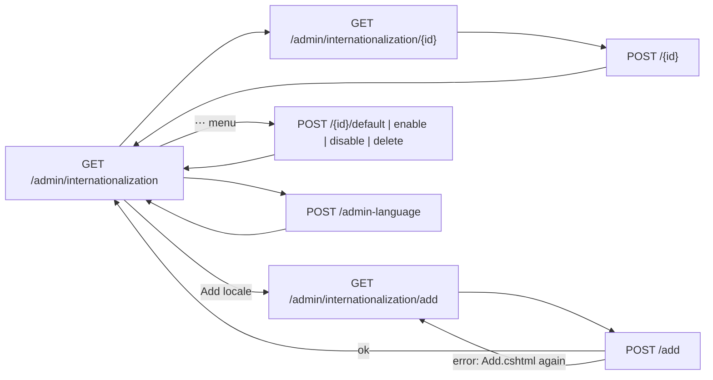

# Internationalization

## Purpose

Manages the site's **locales** - the languages content is published in - and the site's **admin language**. Super
Admins and Admins (the `Settings` grants) add locales, rename them, enable or disable them, choose the default locale
and delete locales; the admin language is what every admin user sees unless they chose their own on
[Profile](profile.md). The rules (codes, exactly one default, the content swap when the default changes) are owned by
[internationalization](../features/internationalization.md); translating content happens on [Pages](pages.md),
the [page builder](page-builder.md) and the [Content Manager](content-manager.md).

## Route / Navigation

| Item | Value |
| --- | --- |
| Routes | `GET /admin/internationalization` (list) · `GET /admin/internationalization/add` (Add locale screen) · `POST /admin/internationalization/add` · `GET /admin/internationalization/{id}` (edit) · `POST /admin/internationalization/{id}` (save) · `POST /admin/internationalization/{id}/enable` · `POST /admin/internationalization/{id}/disable` · `POST /admin/internationalization/{id}/default` · `POST /admin/internationalization/{id}/delete` · `POST /admin/internationalization/admin-language` |
| Sidebar entry | **Settings → Global Settings → Internationalization** (icon `globe`, `AdminNavigation.Tree`) |
| Breadcrumbs | Settings › Global Settings › Internationalization (› the locale's name on the edit screen) |
| Parameters | `{id}` = the locale's id (`Guid`) |
| Linked from | the sidebar (the **Localized** switch on [Content types](content-types.md) and the Admin language card on [Profile](profile.md) name it) |

## Relevant source files

```text
src/DotNetForge.Web/Areas/Admin/Controllers/InternationalizationController.cs   actions; InternationalizationViewModel, LocaleEditModel
src/DotNetForge.Web/Areas/Admin/Views/Internationalization/Index.cshtml        header button Add locale, locales table, Admin language
src/DotNetForge.Web/Areas/Admin/Views/Internationalization/Add.cshtml          the Add locale screen
src/DotNetForge.Web/Areas/Admin/Views/Internationalization/Edit.cshtml         one locale: display name, enabled
src/DotNetForge.Web/Services/Localization/LocaleService.cs                     locale rules, LocaleRow (with translation counts), audit
src/DotNetForge.Web/Services/Localization/LocaleCatalog.cs                     cached LocaleSet, IDefaultLocaleSwap
src/DotNetForge.Web/Services/Localization/AdminLanguageService.cs              site / user admin language (setting i18n.adminLanguage)
src/DotNetForge.Core/Validation/LocaleCodes.cs                                 code validation and canonical case, suggested names
src/DotNetForge.Shared/Entities/Localization.cs                                Locale, PageTranslation, ContentEntryTranslation
```

## Page layout

```text
Internationalization (h1) - description: the default locale is the main content and the fallback; others under /de/about
├── header: [+ Add locale] (primary; with Settings / update) → /admin/internationalization/add
├── card **Locales** · "N total · M enabled"
│   └── table: **Locale** (display name link, code) · **URL** (`/` or `/de/`) · **Status** (Default, Enabled/Disabled)
│       · **Translations** ("Main content" / "No translations" / "2 pages, 5 entries") · ⋯ menu
│         (Edit or View · Set as default · Disable / Enable · Delete)
└── form card **Admin language** - "for every user who has not chosen their own on Profile"
    ├── **Language** select (English first, then the twenty shipped catalogs by their own names)
    └── footer [✓ Save admin language] (with Settings / update)

Add locale (h1; narrow page)
└── form card
    ├── <dnf-validation-summary />
    ├── **Locale code** (placeholder de-DE, hint: BCP-47, becomes the URL prefix; autofocus) · **Display name** (optional)
    ├── switch **Enabled** (on)
    └── footer: [Cancel] (→ list) · [+ Add locale]

Edit - "<display name>" (h1); description: default → main content and fallback, else "Published under /de/ while enabled."
└── form card **Locale `de`**
    ├── **Display name** (hint: the code can't change - it is the URL prefix)
    ├── switch **Enabled** - default: disabled, "The default locale is always enabled."; else the translation counts
    └── [Back] · [Save] (with Settings / update)
```

## Components

| Element | Rendering |
| --- | --- |
| Locale row | `LocaleRow` from `LocaleService.ListAsync`: the default first, then `SortOrder`, then code; translation counts = `PageTranslations` and `ContentEntryTranslations` rows of the locale |
| **Status** | `Default` (`Primary` badge) on the default; `Enabled` (`Success`) / `Disabled` (`Neutral`) dot badge |
| ⋯ menu | `<dnf-dropdown>`: **Edit** (**View** without update); with update and not on the default: **Set as default** (confirm), **Disable** (confirm only when it has translations) or **Enable**, **Delete** (confirm) |
| Admin language select | `AdminLanguageService.Languages` (`AdminTranslations.Languages`); selected = `SiteLanguageAsync`; disabled without update; each option has `lang` |
| Enabled switch (add, edit) | checkbox before a hidden `false` (the bound bool takes the first posted value); on the default's edit form the switch is disabled and a hidden `true` is posted |

## Functionality

| Action | What happens |
| --- | --- |
| Add locale | header button → `GET /admin/internationalization/add` (`InternationalizationController.Add`, `Add.cshtml`) → `POST /add` → `LocaleService.AddAsync`: code validated and made canonical, unique, not a top-level page's slug, display name defaulted to the language's own name, added last, never default → `locale.created` → toast "Locale added." and the list; an error re-renders `Add.cshtml` with the input |
| Save (edit) | `UpdateAsync`: display name and enabled → `locale.updated` with the changes (none when nothing changed) → toast "Locale saved." and the list |
| Enable / Disable (⋯) | `UpdateAsync` with the row's name → toast "Deutsch enabled." / "Deutsch disabled. Its translations are kept." |
| Set as default | confirmation "Make Deutsch the default locale? Its translations become the main content (unprefixed URLs, the fallback of every missing translation), and the current main content becomes the translations of the previous default. ..." (title "Change the default locale", button **Make default**) → `SetDefaultAsync`: one transaction - demote, promote and enable, move the content ([changing the default](../features/internationalization.md#changing-the-default)) → `locale.default.changed` → toast "Default locale changed. Its translations are now the main content; the previous default's text became its translations." |
| Delete | confirmation "Delete Deutsch (de)? Its translations (2 pages, 5 entries) are deleted too; that content shows the default locale's text." (or "... It has no translations.") → `DeleteAsync` removes the locale and its translations → `locale.deleted` → toast "Locale deleted, with its translations." |
| Save admin language | `AdminLanguageService.SetSiteLanguageAsync` → setting `i18n.adminLanguage`, cache cleared → `settings.adminlanguage.changed` → toast "Admin language saved." already in the new language (for users without their own choice) |

```mermaid
sequenceDiagram
    actor A as Admin
    participant C as InternationalizationController
    participant S as LocaleService
    participant DB as PostgreSQL
    A->>C: POST /admin/internationalization/{id}/default (after the confirm dialog)
    C->>S: SetDefaultAsync(id)
    S->>DB: BEGIN; old default IsDefault = false; save
    S->>DB: new default IsDefault = true, Enabled = true; save
    S->>DB: PageTranslationService.SwapAsync, EntryLocaleSwap (pages, entries)
    S->>DB: COMMIT (a concurrent switch fails on IX_Locales_IsDefault → rollback)
    S->>S: LocaleCatalog.Invalidate(); audit locale.default.changed
    C-->>A: 302 /admin/internationalization + toast
```

## Data used by the page

`Locales` (all rows), counts from `PageTranslations` and `ContentEntryTranslations` grouped by locale, the
`i18n.adminLanguage` row of `Settings`, the shipped admin catalogs (`AdminTranslations`, in memory).

## State

Database rows only (`Locales`, the translation tables, `Settings`). `LocaleCatalog` (30 s) and the admin-language cache
(30 s) are cleared on every change in this instance. The Add locale screen keeps its input after a validation error.

## Permissions

| Route | Requires |
| --- | --- |
| list, edit (`GET`) | `AdminArea` + `Settings` / `read` (`[RequirePermission]` on the controller) |
| Add locale (`GET /add`), every `POST` | + `Settings` / `update` |

Defaults: Super Admin and Admin. Without `update` the edit link reads **View**, the edit form is read-only, the **Add
locale** button is hidden (its screen is denied), and the admin language select is disabled without a save button; a POST is denied
(`/account/denied`). Changing one's **own** admin language needs no grant ([Profile](profile.md)).

## Validation

Server only (the inputs have `required` / `maxlength` hints). Messages from `LocaleService` / `LocaleCodes`
([rules](../features/internationalization.md#rules-and-validation)): empty, malformed or unknown code, duplicate code,
a code equal to a top-level page's slug ("A top-level page uses the slug 'da', which this locale's URLs would hide.
Change that page's slug first."), display name required (edit) and at most 100 characters, the default stays enabled, the default can't be deleted.
The admin language must be an offered one ("Choose one of the offered admin languages.").

## Error handling

| Failure | Detection | User sees | Recovery |
| --- | --- | --- | --- |
| Invalid add / edit input | `LocaleService` message | the Add locale / edit form again with `<dnf-validation-summary />` and the input kept | correct and resubmit |
| Disable or delete the default, unknown admin language | service message | error toast on the list | make another locale the default first |
| Concurrent default change | `DbUpdateException` on the filtered unique index | error toast "The default locale was changed at the same time by someone else. Reload and try again." | reload |
| Locale deleted meanwhile | not found | `404` (edit, enable, disable) or "That locale no longer exists." | back to the list |

## Loading behaviour

Server-rendered; no asynchronous parts.

## Empty states

The list is never empty (the seeder keeps one default locale). A locale without translations shows "No
translations"; the default shows "Main content".

## User interactions

Open a locale, add, save, the ⋯ menu actions with confirmation dialogs (`data-confirm`), choose and save the admin
language. No drag and drop (no reordering).

## Dependencies

```text
InternationalizationController
├── LocaleService
│   ├── DotNetForgeDbContext
│   ├── LocaleCatalog (singleton, IMemoryCache)
│   ├── IEnumerable<IDefaultLocaleSwap>: PageTranslationService, EntryLocaleSwap → EntryTranslationService → ContentEntryService
│   └── IAuditService       locale.created / updated / default.changed / deleted
└── AdminLanguageService
    ├── DotNetForgeDbContext, IMemoryCache
    ├── AdminTranslations (singleton)
    └── IAuditService       settings.adminlanguage.changed
```

## Page flow



## Related pages

[Environment Variables](environment-variables.md), [Profile](profile.md) (own admin language), [Pages](pages.md) (Translations tab),
[Page builder](page-builder.md) (per-locale layouts), [Content Manager](content-manager.md) and
[Content types](content-types.md) (localized entries), [Audit Logs](audit-logs.md).

## Important implementation details

- The default locale's content is the page's and the entry's own data; there are no translation rows for it. That is
  why changing the default moves content instead of flipping a flag.
- `/admin/internationalization/{id}` and the actions use the id, not the code: the code never changes.
- The **URL** column shows the prefix a locale is published under; a disabled locale's prefix answers 404.

## Known limitations

- No reordering of locales (new ones go last; the language switcher follows that order).
- The code can't be changed - add a new locale and delete the old one (its translations go with it).
- Other instances see a change within 30 seconds (per-instance caches).
- See the feature's [known limitations](../features/internationalization.md#known-limitations).

## Extension points

Locale rules go into `LocaleService` (never the controller). Content that should move with the default implements
`IDefaultLocaleSwap` and is registered in `DependencyRegistration`; its rows must also be deleted in
`LocaleService.DeleteAsync` and counted in `ListAsync` if the table should show them.
