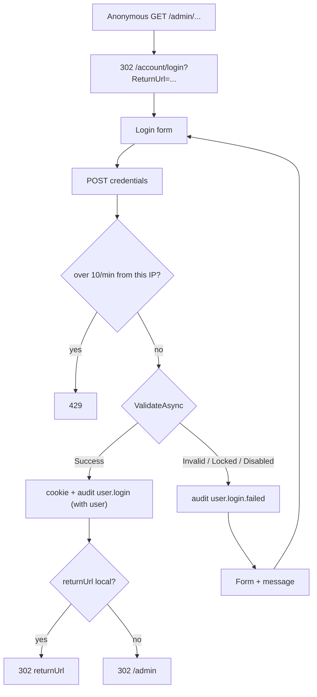

# Sign in

## Purpose

Lets an existing user sign in with email and password - or with an enabled sign-in extension ("Sign in with ...") -
to reach the admin area. It is the cookie scheme's login page, so every anonymous request to a protected admin screen
ends up here. Mechanism details: [authentication](../features/authentication.md) and
[external sign-in extensions](../features/authentication.md#external-sign-in-extensions).

## Route / Navigation

| Item | Value |
| --- | --- |
| Route | `GET /account/login`, `POST /account/login`; sign-out is `POST /account/logout`; external buttons post to `POST /account/external/{scheme}` (callback `GET /account/external/callback`, `ExternalLoginController`) |
| Query parameter | `returnUrl` (also accepted as `ReturnUrl`, which the cookie middleware sends) |
| Navigation entry | redirect from any protected admin URL; **Sign out** returns here |
| Parent / children | none |
| On success | `returnUrl` when it is a local URL (`Url.IsLocalUrl`), otherwise `/admin` |
| Rate limit | `POST /account/login`, `POST /account/external/{scheme}`, `GET /account/external/callback`: 10 requests per minute per client IP each (policy `credentials`) → `429` |

## Relevant source files

```text
src/DotNetForge.Web/Controllers/AccountController.cs        Login (GET/POST), Logout, Denied; ViewData["LoginProviders"], TempData["Error"], RememberMeLifetime
src/DotNetForge.Web/Controllers/ExternalLoginController.cs  Challenge (POST /account/external/{scheme}), Callback
src/DotNetForge.Web/Services/LoginProviders.cs              providers of active authentication extensions
src/DotNetForge.Web/Views/Account/Login.cshtml              heading, form (password reveal) + "or continue with" provider buttons (Layout = "_AuthLayout")
src/DotNetForge.Web/Views/Shared/_AuthLayout.cshtml         brand panel + form column, theme menu, _Feedback; loads theme.js, ui.js, auth.css
src/DotNetForge.Web/Views/Shared/_ThemeMenu.cshtml          Light / Dark / System menu (needs JS)
src/DotNetForge.Web/Views/Shared/_Feedback.cshtml           toast region (sign-in errors) + confirm dialog
src/DotNetForge.Web/Ui/UiTagHelpers.cs                      <form-errors /> (model-state errors), <icon>
src/DotNetForge.Web/wwwroot/css/forge/auth.css              .auth-shell, .auth-panel, .auth-card, .auth-heading, .auth-divider
src/DotNetForge.Web/wwwroot/js/forge/ui.js                  data-reveal (show/hide password), data-js-only, theme menu
src/DotNetForge.Web/Services/AuthService.cs                 ValidateAsync (credentials, lockout, principal), ValidateExternalAsync, GetDefaultTenantIdAsync, IsActiveAsync
src/DotNetForge.Web/Services/AuditService.cs                user.login / user.login.failed / user.logout (via IAuditService)
src/DotNetForge.Web/Startup/DependencyRegistration.cs       cookie options (paths, lifetime, flags), ValidateSessionAsync, AddRateLimits
src/DotNetForge.Shared/Constants/RateLimitPolicies.cs   policy names (credentials, api)
```

## Page layout

```text
Sign in (_AuthLayout, title "Sign in · <APP_NAME>")
├── aside.auth-panel (brand panel - white in light, charcoal in dark; hidden below 56rem)
│   ├── DotNetForge logo
│   ├── "Build, publish and extend - from one place."
│   └── 3 points: Pages, media and SEO… · Extensions without touching the core · Roles, audit log and scoped API tokens
└── main.auth-main
    ├── .auth-top: <APP_NAME> mark (→ /, only below 56rem) · theme menu (JS only)
    ├── .auth-card
    │   ├── h1 **Sign in** + "Welcome back. Sign in to manage your site."
    │   ├── form.form (POST /account/login?returnUrl=..., antiforgery)
    │   │   ├── <form-errors />                     (model-state errors; sign-in failures are toasts)
    │   │   ├── **Email** (type=email; autofocus, or re-filled after a failure)
    │   │   ├── **Password** + eye button (data-reveal, JS only; autofocus after a failure)
    │   │   ├── ☐ **Remember me** "Stay signed in on this device for 30 days." (.check)
    │   │   └── [**Sign in**] (.btn-primary.btn-lg.btn-block)
    │   └── only when a provider is active:
    │       ├── .auth-divider "or continue with"
    │       └── per provider: form (POST /account/external/{scheme}, antiforgery, hidden returnUrl) → [**Sign in with <DisplayName>**]
    └── footer line "<APP_NAME> · Powered by DotNetForge"
```

Layout mechanics (panel, one column below 56rem, theme menu): [design system → auth layout](../architecture/design-system.md#auth-layout).

## Components

| Component | Purpose | Inputs | Output |
| --- | --- | --- | --- |
| Login form | credentials | `email`, `password`, `rememberMe` (simple parameters, no model), `returnUrl` via `asp-route-returnUrl` | `AccountController.Login(email, password, rememberMe, returnUrl)` |
| Error toast | a sign-in failure (`.toast-danger`, `role=alert`, stays until dismissed) | `TempData["Error"]`, rendered by `_Feedback` in the same response (password) or after the redirect (external) | - |
| `<form-errors />` | model-state errors (`div.validation-summary-errors[role=alert]`); renders nothing today, since sign-in failures are toasts | `ModelState` | - |
| Password reveal | eye / eye-off button that toggles the field between `password` and `text`, `aria-pressed` and the label "Show password" / "Hide password" | `data-reveal="#password"` ([behaviours](../architecture/design-system.md#behaviours)); hidden until `ui.js` runs (`data-js-only`) | - |
| External sign-in buttons | one per provider of an active authentication extension, under "or continue with" | `ViewData["LoginProviders"]` (`LoginProviders.GetActiveAsync`, `LoginProviderContribution { ExtensionId, Scheme, DisplayName }`) | `ExternalLoginController.Challenge(scheme, returnUrl)` |
| Theme menu | Light / Dark / System ([design system → themes](../architecture/design-system.md#themes)) | `localStorage` `dnf-theme` | - |

## Functionality

### Sign in

1. **Trigger:** **Sign in**.
2. **Validation:** rate limit (`[EnableRateLimiting(RateLimitPolicies.Credentials)]`, checked before the action);
   browser `required` + `type=email`; server: antiforgery, then `AuthService.ValidateAsync`.
3. **Call:** `AccountController.Login` gets the tenant from `AuthService.GetDefaultTenantIdAsync` (the oldest
   tenant), calls `AuthService.ValidateAsync(email, password, tenantId)`.
4. **Backend:** lockout counters / `LastLoginDate` updated; on success the cookie `dnf.auth` is issued (persistent
   for 30 days with **Remember me** - see [State](#state)), the
   request's `HttpContext.User` is set to the new principal and `user.login` is audited with that user's `UserId`
   and `TenantId`; on failure `user.login.failed` (`success: false`, no user, typed email as entity display).
5. **Result:** `LocalRedirect(Url.IsLocalUrl(returnUrl) ? returnUrl : "/admin")` - an external or malformed
   `returnUrl` (e.g. `https://evil.example/`) falls back to `/admin`.
6. **Errors:** an error toast (below); the email field is re-filled (`ViewData["Email"]`) and the password field
   gets the focus, **Remember me** keeps its state.

### Sign in with an extension

**Sign in with <provider>** → `POST /account/external/{scheme}` → the extension's remote scheme (e.g. Discord OAuth)
→ provider → callback → `GET /account/external/callback` → the existing user with that exact email is signed in
(`user.login`, details `via <provider>`) and redirected to `returnUrl` or `/admin`. Any failure redirects back here
with a message. Full flow and rules: [authentication → external sign-in](../features/authentication.md#external-sign-in-extensions).

### Sign out

`POST /account/logout` from **Sign out** in the admin sidebar's account menu or **Sign in as someone else** on the
[denied screen](access-denied.md) → audit `user.logout` → sign out → `302 /account/login`.

## Data used by the page

`AppEnvironment.AppName`, `ViewData["ReturnUrl"]`, `ViewData["LoginProviders"]`, `Users`, `UserRoles` ⨝ `Roles`,
oldest `Tenant`.

## State

`returnUrl` travels in the query string of the form action. Successful sign-in creates the auth cookie `dnf.auth`
(8 h, sliding, `HttpOnly`, `SameSite=Lax`, `Secure` outside Development - `CookieSecurePolicy.Always`; in
Development `SameAsRequest`). Without **Remember me** it is a browser-session cookie (gone when the browser closes);
with it, `IsPersistent` and `ExpiresUtc` = now + `AccountController.RememberMeLifetime` (30 days, renewed while in
use), so it survives closing the browser. Session re-validation below applies either way. `User.FailedLoginCount`/`LockoutEndUtc` persist lockout state. The rate-limit
counters are in memory per instance. A failed external sign-in passes its message in `TempData["Error"]` across the redirect (an error
toast). Client side: the password field's
`type` while revealed (not persisted) and the theme choice (`localStorage` `dnf-theme`).

Session validity: on every request with the cookie, `OnValidatePrincipal` (`ValidateSessionAsync`) checks
`AuthService.IsActiveAsync(userId)` (user exists and is `Enabled`), cached 30 s per user in `IMemoryCache`
(`dnf:session:{id}`). A disabled or deleted user is signed out within 30 seconds and redirected here on the next
admin request. Roles are not re-read; they stay as issued at sign-in.

## Permissions

Anonymous. No redirect away when already signed in (a signed-in user can sign in again as someone else).

## Validation

- Email/password presence: browser only (`required`). Empty values reach `AuthService` and fail as invalid
  credentials.
- Email match is exact after trimming (case-sensitive on default collations).
- Lockout: 5 consecutive failures → 15 minutes.
- Rate limit: more than 10 `POST /account/login` per minute from one IP (fixed window, no queue) → `429 Too Many
  Requests` with an empty body, regardless of the credentials. `GET` is not limited.

## Error handling

Every message below is shown as an error toast (bottom right, stays until dismissed) when the screen re-renders.

| Status from `AuthService` | Message |
| --- | --- |
| `InvalidCredentials` (unknown email or wrong password) | `Invalid email or password.` |
| `LockedOut` | `Account is temporarily locked. Try again later.` |
| `Disabled` | `This account is disabled.` |
| (rate limit exceeded, before `AuthService`) | `429` with an empty body (browser's default error display); wait for the 1-minute window |

External sign-in failures (shown after the redirect back here):

| Case | Message |
| --- | --- |
| Provider callback failed, provider no longer active, or no email claim | `External sign-in did not complete. Try again or sign in with your password.` |
| No user with that email | `No account here uses the email of your <provider> account.` |
| Locked out / disabled | same messages as above |

A non-local `returnUrl` is ignored (redirect to `/admin`); it no longer throws.

## Loading behaviour

Synchronous POST; PBKDF2 verification (~120 000 iterations) adds a small delay. No indicator. Everything is
server-rendered; `ui.js` (deferred) only reveals the password and theme buttons.

## Empty states

Not applicable.

## User interactions

| Interaction | Behaviour |
| --- | --- |
| Enter | submits the form |
| Focus | Email has `autofocus`, `autocomplete="username"`; password `autocomplete="current-password"` |
| Eye button | shows/hides the password (`aria-pressed`, label switches to "Hide password"); without JS it is not shown |
| Theme menu (sun/moon) | Light, Dark or System; without JS it is not shown and the system preference applies |
| Skip link | "Skip to content" jumps to `main#main` |

## Dependencies

```text
AccountController
├── AuthService → DotNetForgeDbContext, IPasswordHasher, IDateTimeProvider
├── IAuditService → AuditService
├── AppEnvironment
└── LoginProviders → ExtensionCatalog (+ every LoginProviderContribution registered by extensions)
ExternalLoginController → LoginProviders, AuthService, IAuditService
Rate limiter (credentials policy) · cookie OnValidatePrincipal → AuthService.IsActiveAsync + IMemoryCache
```

## Page flow



## Related pages

- Navigates to: [Dashboard](dashboard.md) or the originally requested admin screen; an external provider's sign-in
  page.
- Providers appear when an `authentication` extension is enabled on [Plugins](plugins.md).
- Receives navigation from: any protected admin screen, **Sign out**, [Access denied](access-denied.md).
- Shares: `_AuthLayout` with [Setup](setup.md) and [Access denied](access-denied.md).

## Important implementation details

- Roles are captured in the cookie at sign-in; changes need a new sign-in. Only "exists and enabled" is re-checked
  (every 30 s at most per user).
- Behind a TLS-terminating proxy, set `ASPNETCORE_FORWARDEDHEADERS_ENABLED=true`, otherwise every client shares the
  proxy's IP for the rate limit and the `Secure` cookie needs the original scheme - see
  [deployment → behind a reverse proxy](../guides/deployment.md#behind-a-reverse-proxy).
- The tenant is always the oldest one; there is no tenant field.
- Failed-login audit entries record the typed email in `EntityDisplaySnapshot`.
- `_AuthLayout` is built in and never replaced by a public theme ([themes](../features/themes.md)). The screen has
  no inline script or style (CSP); `AdminUiTests.Every_screen_renders_without_inline_script_or_style` checks
  `/account/login` for that, exactly one `<h1>`, `lang` and the skip link.

## Known limitations

- No password reset, sign-up or email confirmation. External providers only come from extensions and
  only sign in existing users.
- Unknown emails are never locked; the per-IP rate limit is the only throttle for them.
- Rate limits are per instance (in memory): several instances multiply the limit.
- Outside Development the cookie is `Secure`-only, so signing in over plain HTTP does not keep the session.

## Planned (not implemented)

Target behaviour from the original product specification. Nothing in this section exists in the code unless marked ✔.
Mechanisms, settings and acceptance criteria: [authentication](../features/authentication.md#planned-not-implemented).

### Requirements

- One sign-in button per **Enabled** social/OAuth provider (defaults and `authentication` extensions); disabled
  providers are not shown (✔ for extensions; no built-in providers exist).
- The email/password form only while the **Email** provider is enabled (✔ form exists; it is always shown today).
- Entry points to request a password reset and - only when **Enable sign-ups** is on - to register.
- Server-side email format validation (today: browser `type=email` only) and endpoint rate limiting on
  `POST /account/login` (✔ rate limiting: 10/min per IP, `RateLimitPolicies.Credentials`).

### User flows

1. **Social sign-in:** click a provider → redirect to the provider → callback → signed in and redirected to
   `returnUrl` or `/admin` ✔, or the registration sub-flow runs for an unknown email (✘ today: refused with a
   message).
2. **Unconfirmed account:** with email confirmation on, a correct password for an unconfirmed account shows a
   "confirm your email" message with a **resend confirmation email** action.

### Edge cases

| Situation | Screen shows |
| --- | --- |
| OAuth sign-in, no matching account, sign-ups disabled | "registration is disabled"; no account is created |
| OAuth email already used by another account, one-account-per-email on | rejection; no second account |
| Provider disabled | ✔ its button disappears; existing accounts must use another provider or email/password |
| Too many attempts from one client | throttled by rate limiting, independent of account lockout (✔ `429` after 10/min per IP) |

## Extension points

- Credential rules and lockout: `AuthService` (`MaxFailedAttempts`, `LockoutWindow`).
- Cookie behaviour: `DependencyRegistration` cookie options.
- Additional sign-in methods: an `authentication` extension (`AddLoginProvider`, see
  [extension development](../guides/extension-development.md)) - no change here; buttons come from `LoginProviders`.
  The host side is `ExternalLoginController` + `AuthService.ValidateExternalAsync`.
