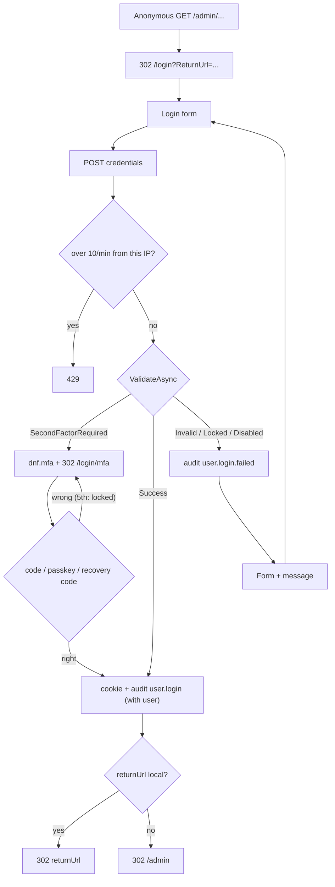

# Sign in

## Purpose

Lets a user sign in with email and password - or with an enabled sign-in provider ("Sign in with ..."), which can
also create the account while sign-ups are on - to reach the admin area (or, for a site-only account, the site).
Accounts with a second factor then confirm on the [two-factor step](#two-factor-step) (`/login/mfa`). It is the cookie scheme's login page, so every
anonymous request to a protected admin screen ends up here. It links to **Forgot password?** (when email is
configured) and **Create an account** (when sign-ups are on) - those screens:
[self-service account screens](account-self-service.md). Mechanism details:
[authentication](../features/authentication.md),
[external sign-in](../features/authentication.md#external-sign-in) and [two-factor authentication](../features/mfa.md).

## Route / Navigation

| Item | Value |
| --- | --- |
| Route | `GET /login`, `POST /login`; the old `GET /account/login` answers `301` to `/login` (query string kept); sign-out is `POST /account/logout`; external buttons post to `POST /account/external/{scheme}` (callback `GET /account/external/callback`, failure `GET /account/external/failed`, `ExternalLoginController`); the two-factor step is `GET/POST /login/mfa`, `POST /login/mfa/send`, `POST /login/mfa/passkey/options`, `POST /login/mfa/passkey`, `POST /login/mfa/cancel` (`MfaLoginController`) |
| Query parameter | `returnUrl` (also accepted as `ReturnUrl`, which the cookie middleware sends) |
| Navigation entry | redirect from any protected admin URL; **Sign out** returns here |
| Parent / children | links to [Forgot password / Register](account-self-service.md) |
| On success | `returnUrl` when it is a local URL (`Url.IsLocalUrl`), otherwise `/admin` for a user whose roles can enter the admin (`Roles.CanEnterAdmin`) and `/` for a site-only account (`Authenticated`) |
| Rate limit | `POST /login`, `POST /account/external/{scheme}`, `GET /account/external/callback` and the `POST`s of `/login/mfa`: 10 requests per minute per client IP each (policy `credentials`) → `429` |

## Relevant source files

```text
src/DotNetForge.Web/Controllers/AccountController.cs        Login (GET/POST), LegacyLogin (301), Logout, Denied; PrepareLoginAsync (providers, SignUps, CanResetPassword), TempData["Error"], RememberMeLifetime
src/DotNetForge.Web/Services/UserAccountSettings.cs         UserAccountSettingsService: is sign-up / email confirmation on
src/DotNetForge.Web/Services/AccountService.cs              EmailEnabledAsync (SMTP configured), ResendConfirmationAsync
src/DotNetForge.Web/Controllers/ExternalLoginController.cs  Challenge (POST /account/external/{scheme}, answers the "Continuing to" page), Callback, Failed
src/DotNetForge.Web/Views/ExternalLogin/Continue.cshtml     "Continuing to <provider>…" with a meta refresh to the provider (CSP form-action)
src/DotNetForge.Web/Services/LoginProviders.cs              LoginOption list: enabled built-in OAuth providers, then those of active authentication extensions
src/DotNetForge.Web/Controllers/MfaLoginController.cs       the two-factor step (/login/mfa)
src/DotNetForge.Web/Views/MfaLogin/Index.cshtml             two-factor step: one method, "Try another way", recovery code, cancel
src/DotNetForge.Web/Services/Mfa/PendingSignIn.cs           the dnf.mfa cookie between the two steps
src/DotNetForge.Web/wwwroot/js/admin/passkeys.js            "Use passkey" (WebAuthn)
src/DotNetForge.Web/Views/Account/Login.cshtml              heading, form (password reveal) + "or continue with" provider buttons (Layout = "_AuthLayout")
src/DotNetForge.Web/Views/Shared/_AuthLayout.cshtml         brand panel + form column, theme menu, _Feedback; loads dnf-theme.js, dnf.css, auth.css, dnf.js
src/DotNetForge.Web/Views/Shared/_ThemeMenu.cshtml          Light / Dark / System menu (needs JS)
src/DotNetForge.Web/Views/Shared/_Feedback.cshtml           toast region (sign-in errors) + confirm dialog
src/DotNetForge.UI/Components/BasicTagHelpers.cs            <dnf-validation-summary /> (model-state errors), <dnf-icon>
src/DotNetForge.Web/wwwroot/css/auth.css                    .dnf-auth, .dnf-auth__panel, .dnf-auth__card, .dnf-auth__heading, .dnf-auth__ways
src/DotNetForge.UI/wwwroot/dnf.js                           data-reveal (show/hide password), data-js-only, theme menu
src/DotNetForge.Web/Services/AuthService.cs                 ValidateAsync (credentials, lockout, principal), ValidateExternalAsync, CompleteSecondFactorAsync, RecordFailedSecondFactorAsync
src/DotNetForge.Web/Services/AuditService.cs                user.login / user.login.failed / user.logout (via IAuditService)
src/DotNetForge.Web/Startup/DependencyRegistration.cs       cookie options (paths, lifetime, flags), ValidateSessionAsync, AddRateLimits
src/DotNetForge.Shared/Constants/RateLimitPolicies.cs   policy names (credentials, api)
```

## Page layout

```text
Sign in (_AuthLayout, title "Sign in · <APP_NAME>")
├── aside.dnf-auth__panel (brand panel - white in light, charcoal in dark; hidden below 56rem)
│   ├── DotNetForge logo
│   ├── "Build, publish and extend - from one place."
│   └── 3 points: Pages, media and SEO… · Extensions without touching the core · Roles, audit log and scoped API tokens
└── main.dnf-auth__main
    ├── .dnf-auth__top: <APP_NAME> mark (→ /, only below 56rem) · theme menu (JS only)
    ├── .dnf-auth__card
    │   ├── h1 **Sign in** + "Welcome back. Sign in to manage your site."
    │   ├── form.dnf-form (POST /login?returnUrl=..., antiforgery)
    │   │   ├── <dnf-validation-summary />          (model-state errors; sign-in failures are toasts)
    │   │   ├── **Email** (type=email; autofocus, or re-filled after a failure)
    │   │   ├── .dnf-auth__label-row: **Password** label · **Forgot password?** (→ /forgot-password, only when SMTP is configured)
    │   │   ├── **Password** + eye button (data-reveal, JS only; autofocus after a failure)
    │   │   ├── ☐ **Remember me** "Stay signed in on this device for 30 days." (.dnf-check)
    │   │   └── [**Sign in**] (.dnf-button--primary.dnf-button--lg.dnf-button--full-width)
    │   ├── only after "confirm your email first": form (POST /confirm-email/resend, hidden email) → [**Send the confirmation link again**]
    │   ├── only when a provider is active:
    │   │   ├── .dnf-divider--label "or continue with"
    │   │   └── per provider: form (POST /account/external/{scheme}, antiforgery, hidden returnUrl) → [**Sign in with <DisplayName>**]
    │   └── only when sign-ups are on: .dnf-auth__switch "No account yet? **Create an account**" (→ /register)
    └── footer line "<APP_NAME> · Powered by DotNetForge"
```

Layout mechanics (panel, one column below 56rem, theme menu): [design system → auth layout](../architecture/design-system.md#auth-layout).

## Components

| Component | Purpose | Inputs | Output |
| --- | --- | --- | --- |
| Login form | credentials | `email`, `password`, `rememberMe` (simple parameters, no model), `returnUrl` via `asp-route-returnUrl` | `AccountController.Login(email, password, rememberMe, returnUrl)` |
| Error toast | a sign-in failure (`.dnf-toast--danger`, `role=alert`, stays until dismissed) | `TempData["Error"]`, rendered by `_Feedback` in the same response (password) or after the redirect (external) | - |
| `<dnf-validation-summary />` | model-state errors (`div.dnf-validation-summary[role=alert]`); renders nothing today, since sign-in failures are toasts | `ModelState` | - |
| Password reveal | eye / eye-off button that toggles the field between `password` and `text`, `aria-pressed` and the label "Show password" / "Hide password" | `data-reveal="#password"` ([behaviours](../architecture/design-system.md#behaviours)); hidden until `dnf.js` runs (`data-js-only`) | - |
| External sign-in buttons | one per enabled built-in provider ([Providers](providers.md), catalog order), then one per provider of an active authentication extension, under "or continue with" | `ViewData["LoginProviders"]` (`LoginProviders.GetActiveAsync`, `LoginOption { Scheme, DisplayName, ProviderKey, ExtensionId }`) | `ExternalLoginController.Challenge(scheme, returnUrl)` - **Remember me** is not posted with it |
| Theme menu | Light / Dark / System ([design system → themes](../architecture/design-system.md#themes)) | `localStorage` `dnf-theme` | - |

## Functionality

### Sign in

1. **Trigger:** **Sign in**.
2. **Validation:** rate limit (`[EnableRateLimiting(RateLimitPolicies.Credentials)]`, checked before the action);
   browser `required` + `type=email`; server: antiforgery, then `AuthService.ValidateAsync`.
3. **Call:** `AccountController.Login` calls `AuthService.ValidateAsync(email, password)`.
4. **Backend:** lockout counters / `LastLoginDate` updated; when the account has a usable second factor, no session
   yet: the `dnf.mfa` cookie and a redirect to the [two-factor step](#two-factor-step); otherwise on success the cookie `dnf.auth` is issued (persistent
   for 30 days with **Remember me** - see [State](#state)), the
   request's `HttpContext.User` is set to the new principal and `user.login` is audited with that user's `UserId`;
   on failure `user.login.failed` (`success: false`, no user, typed email as entity display).
5. **Result:** `LocalRedirect(returnUrl)` when it is local; otherwise `/admin` (or `/` for a site-only account) -
   an external or malformed `returnUrl` (e.g. `https://evil.example/`) falls back to that.
6. **Errors:** an error toast (below); the email field is re-filled (`ViewData["Email"]`) and the password field
   gets the focus, **Remember me** keeps its state.

### Sign in with a provider

**Sign in with <provider>** → `POST /account/external/{scheme}` → a short page "Continuing to <provider>…" that moves
on to the provider at once (meta refresh; a **Continue to <provider>** button if it doesn't - a redirect from the
form post would be blocked by the CSP's `form-action 'self'`) → provider → its callback (`/signin/<key>` for built-in
providers) → `GET /account/external/callback` → the user with that verified email is signed in (`user.login`, details
`via <provider>`) - or created first while **Enable sign-ups** is on - and, after the two-factor step when the account
has one, redirected to `returnUrl` or home. Any failure redirects back here with a message. Full flow and rules:
[authentication → external sign-in](../features/authentication.md#external-sign-in).

### Two-factor step

`/login/mfa` (`MfaLoginController`, `Views/MfaLogin/Index.cshtml`, `_AuthLayout`, title **Two-step verification**)
follows a correct password or provider sign-in for an account with a usable second factor
([MFA → Sign-in](../features/mfa.md#sign-in)). Without a valid `dnf.mfa` cookie (10 minutes from the first step), or
when the account was disabled, locked or lost its methods meanwhile, every route returns here with "Your sign-in
expired. Sign in again."

```text
Two-step verification (h1) · "Signing in as a••••••@example.com[ with <provider>]."
├── <dnf-validation-summary />
├── one of (the method selected with ?method={id}, else the first in the order app, passkey, SMS, email):
│   ├── authenticator app / sent email or SMS code: **Code from your authenticator app** / **Code we texted to +41 *** *** 67** / **Code we emailed you** (6 digits, one-time-code) · [Verify]
│   │   └── email/SMS: [Send a new code]
│   ├── email/SMS before a code was sent: "We'll email/text a 6-digit code to …  It works for 10 minutes." · [Send code]
│   ├── passkey: hint · [Use passkey] (JS only; without JS: "Passkeys need JavaScript. Use another way below.")
│   └── ?recovery=true: **Recovery code** (XXXXX-XXXXX) · [Verify]
├── .dnf-divider--label "Try another way": the user's other methods · **Use a recovery code**
└── [Cancel and sign in again] (POST /login/mfa/cancel)
```

| Action | Result |
| --- | --- |
| **Verify** (code) | `POST /login/mfa` with `method` and `code` (or `recovery=true`): right → session cookie, `user.login` "with …", redirect to `returnUrl` or home; with 3 or fewer recovery codes left an info toast "N recovery codes left. Make new ones on Profile → Sign-in security."; wrong → "That code is not right." / "That recovery code is not right, or it was used already." and `user.login.failed` |
| **Send code** / **Send a new code** | `POST /login/mfa/send`: a new code by email (template **Sign-in code**) or SMS; toast "We emailed you a code." / "We texted a code to …"; failure toast "The email couldn't be sent. Try another way, or try again later." (SMS alike) |
| **Use passkey** | `passkeys.js`: `POST /login/mfa/passkey/options` → the browser's passkey prompt → `POST /login/mfa/passkey` → redirect; failure in the page: "That passkey didn't work. Try again, or use another way." |
| 5th wrong code or passkey | account locked for 15 minutes → back here with "Account is temporarily locked. Try again later." |
| **Cancel and sign in again** | deletes `dnf.mfa`, back to `/login` |

### Sign out

`POST /account/logout` from **Sign out** in the admin sidebar's account menu or **Sign in as someone else** on the
[denied screen](access-denied.md) → audit `user.logout` → the session ends on the server, the cookie is cleared → `302 /login`.

## Data used by the page

`AppEnvironment.AppName`, `ViewData["ReturnUrl"]`, `ViewData["LoginProviders"]`, `Users`, `UserRoles` ⨝ `Roles`;
the two-factor step: the user's usable `UserMfaMethods` and unused `UserRecoveryCodes`.

## State

`returnUrl` travels in the query string of the form action. Successful sign-in creates the auth cookie `dnf.auth`
(8 h, sliding, `HttpOnly`, `SameSite=Lax`, `Secure` outside Development - `CookieSecurePolicy.Always`; in
Development `SameAsRequest`). Without **Remember me** it is a browser-session cookie (gone when the browser closes);
with it, `IsPersistent` and `ExpiresUtc` = now + `AccountController.RememberMeLifetime` (30 days, renewed while in
use), so it survives closing the browser. The session check below applies either way. `User.FailedLoginCount`/`LockoutEndUtc` persist lockout state. The rate-limit
counters are in memory per instance. A failed external sign-in passes its message in `TempData["Error"]` across the redirect (an error
toast). Between the two steps of a two-factor sign-in the encrypted `dnf.mfa` cookie (10 minutes, not sliding) holds
the user id, **Remember me**, the `returnUrl`, the provider and the token of a sent code or passkey request. Client side: the password field's
`type` while revealed (not persisted) and the theme choice (`localStorage` `dnf-theme`).

Session validity: on every request with the cookie, `OnValidatePrincipal` (`ValidateSessionAsync`) asks
`UserSessionService` whether the session still counts and which roles the user has, cached 30 s per user in `IMemoryCache`
(`dnf:session:{id}`) and dropped by any change ([sessions](../features/authentication.md#sessions)). A user who no longer
has a session is redirected here on the next admin request.

## Permissions

Anonymous. No redirect away when already signed in (a signed-in user can sign in again as someone else).

## Validation

- Email/password presence: browser only (`required`). Empty values reach `AuthService` and fail as invalid
  credentials.
- Email match is exact after trimming (case-sensitive on default collations).
- Lockout: 5 consecutive failures → 15 minutes; wrong two-factor codes count too.
- Rate limit: more than 10 `POST /login` per minute from one IP (fixed window, no queue) → `429 Too Many
  Requests` with an empty body, regardless of the credentials. `GET` is not limited.

## Error handling

Every message below is shown as an error toast (bottom right, stays until dismissed) when the screen re-renders.

| Status from `AuthService` | Message |
| --- | --- |
| `InvalidCredentials` (unknown email or wrong password) | `Invalid email or password.` |
| `LockedOut` | `Account is temporarily locked. Try again later.` |
| `Disabled` | `This account is disabled.` |
| `EmailNotConfirmed` (correct password, email confirmation on, account not confirmed) | `Confirm your email first: open the link we sent you.` + the **Send the confirmation link again** button |
| (rate limit exceeded, before `AuthService`) | `429` with an empty body (browser's default error display); wait for the 1-minute window |

External sign-in failures (shown after the redirect back here):

| Case | Message |
| --- | --- |
| Provider callback failed or the provider is no longer active | `Signing in with the provider did not complete. Try again or sign in with your password.` |
| A built-in provider reported a failure or the user cancelled there (`GET /account/external/failed`) | `Signing in with <provider> was cancelled or did not complete. Try again or sign in with your password.` |
| No verified email from the provider | `Your <provider> account has no verified email address, so it can't be matched to an account here.` |
| No user with that email, sign-ups off | `No account here uses the email of your <provider> account, and new accounts can't be created.` |
| No user with that email, sign-up refused | the registration message, e.g. `An account with this email already exists.` ([sign-up through a provider](../features/authentication.md#sign-up-through-a-provider)) |
| Locked out / disabled | same messages as above |

A non-local `returnUrl` is ignored (redirect to `/admin`); it no longer throws.

## Loading behaviour

Synchronous POST; PBKDF2 verification (~120 000 iterations) adds a small delay. No indicator. Everything is
server-rendered; `dnf.js` (deferred) only reveals the password button; the theme menu shows once `dnf-theme.js` has run.

## Empty states

Not applicable.

## User interactions

| Interaction | Behaviour |
| --- | --- |
| Enter | submits the form |
| Focus | Email has `autofocus`, `autocomplete="username"`; password `autocomplete="current-password"` |
| Eye button | shows/hides the password (`aria-pressed`, label switches to "Hide password"); without JS it is not shown |
| Theme menu (sun/moon) | Light, Dark or System; without JS it is not shown and the system preference applies |
| Skip link | "Skip to content" jumps to `main#main` |

## Dependencies

```text
AccountController
├── AuthService → DotNetForgeDbContext, IPasswordHasher, IDateTimeProvider
├── IAuditService → AuditService
├── AppEnvironment
└── LoginProviders → OAuthProviderRegistry, ExtensionCatalog (+ every LoginProviderContribution registered by extensions)
ExternalLoginController → LoginProviders, AuthService, AccountService (sign-up), IAuditService, AppEnvironment
MfaLoginController → AuthService, MfaService, IAuditService, AppEnvironment
Rate limiter (credentials policy) · cookie OnValidatePrincipal → UserSessionService + IMemoryCache
```

## Page flow



## Related pages

- Navigates to: [Dashboard](dashboard.md) or the originally requested admin screen; an external provider's sign-in
  page.
- Providers appear when turned on on [Providers](providers.md) or when an `authentication` extension is enabled on
  [Plugins](plugins.md); second factors are set up on [Sign-in security](sign-in-security.md).
- Receives navigation from: any protected admin screen, **Sign out**, [Access denied](access-denied.md).
- Shares: `_AuthLayout` with [Setup](setup.md) and [Access denied](access-denied.md).

## Important implementation details

- Roles are captured in the cookie at sign-in; changes need a new sign-in. Only "exists and enabled" is re-checked
  (every 30 s at most per user).
- Behind a TLS-terminating proxy, set `ASPNETCORE_FORWARDEDHEADERS_ENABLED=true`, otherwise every client shares the
  proxy's IP for the rate limit and the `Secure` cookie needs the original scheme - see
  [deployment → behind a reverse proxy](../guides/deployment.md#behind-a-reverse-proxy).
- Failed-login audit entries record the typed email in `EntityDisplaySnapshot`.
- `_AuthLayout` is built in and never replaced by a public theme ([themes](../features/themes.md)). The screen has
  no inline script or style (CSP); `AdminUiTests.Every_screen_renders_without_inline_script_or_style` checks
  `/login` for that, exactly one `<h1>`, `lang` and the skip link.

## Known limitations

- **Remember me** applies to password sign-ins only: the provider buttons don't post it, so a provider sign-in gets
  a browser-session cookie. **Forgot password?** needs SMTP; **Create an account** needs sign-ups on
  ([Advanced Settings](advanced-settings.md)).
- Unknown emails are never locked; the per-IP rate limit is the only throttle for them.
- Rate limits are per instance (in memory): several instances multiply the limit.
- Outside Development the cookie is `Secure`-only, so signing in over plain HTTP does not keep the session.

## Planned (not implemented)

Target behaviour from the original product specification. Nothing in this section exists in the code unless marked ✔.
Mechanisms, settings and acceptance criteria: [authentication](../features/authentication.md#planned-not-implemented).

### Requirements

- ✔ One sign-in button per **Enabled** social/OAuth provider (built-in and `authentication` extensions); disabled
  providers are not shown.
- The email/password form only while the **Email** provider is enabled (✔ form exists; it is always shown today).
- ✔ Entry points to request a password reset and - only when **Enable sign-ups** is on - to register.
- Server-side email format validation (today: browser `type=email` only) and endpoint rate limiting on
  `POST /login` (✔ rate limiting: 10/min per IP, `RateLimitPolicies.Credentials`).

### User flows

1. ✔ **Social sign-in:** click a provider → redirect to the provider → callback → signed in and redirected to
   `returnUrl` or `/admin`, or the registration sub-flow runs for an unknown email while sign-ups are on.
2. ✔ **Unconfirmed account:** with email confirmation on, a correct password for an unconfirmed account shows a
   "confirm your email" message with a **resend confirmation email** action.

### Edge cases

| Situation | Screen shows |
| --- | --- |
| OAuth sign-in, no matching account, sign-ups disabled | ✔ "… new accounts can't be created."; no account is created |
| OAuth email already used by another account | ✔ that account is signed in; never a second account |
| Provider disabled | ✔ its button disappears; existing accounts must use another provider or email/password |
| Too many attempts from one client | throttled by rate limiting, independent of account lockout (✔ `429` after 10/min per IP) |

## Extension points

- Credential rules and lockout: `AuthService` (`MaxFailedAttempts`, `LockoutWindow`).
- Cookie behaviour: `DependencyRegistration` cookie options.
- Additional sign-in methods: an `authentication` extension (`AddLoginProvider`, see
  [extension development](../guides/extension-development.md)) - no change here; buttons come from `LoginProviders`.
  The host side is `ExternalLoginController` + `AuthService.ValidateExternalAsync`. A further built-in provider:
  `OAuthProviderCatalog` ([authentication](../features/authentication.md#built-in-oauth-providers)).
- The two-factor step: `MfaLoginController` and `Views/MfaLogin/Index.cshtml` ([MFA](../features/mfa.md)).
