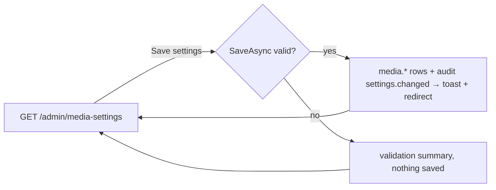

# Media Library

## Purpose

The **Media Library settings**: the largest file people may upload, per kind of file, and how uploads are made
smaller - image optimization on upload and video compression with ffmpeg in the background. The screen also shows
what the library uses in the media storage. Used by roles with `Settings` / `read` (by default Super Admin and Admin);
saving needs `Settings` / `update`. Rules: [media storage → upload limits](../features/media-storage.md#upload-limits)
and [→ optimization](../features/media-storage.md#optimization); the library itself: [Media](media.md).

## Route / Navigation

| Item | Value |
| --- | --- |
| Route | `GET /admin/media-settings`, `POST /admin/media-settings` |
| Title (h1, last breadcrumb) | "Media Library" (description "Upload limits, and how uploads are optimized to keep storage small.") |
| Navigation entry | sidebar **Settings → Global Settings → Media Library** (icon `image`), between Internationalization and Plugins |
| Parent / children | none; the Storage card links to [Media](media.md) |

## Relevant source files

```text
src/DotNetForge.Web/Areas/Admin/Controllers/MediaSettingsController.cs  Index (GET), Save (POST); MediaSettingsViewModel, StorageUse; CanEdit
src/DotNetForge.Web/Areas/Admin/Views/MediaSettings/Index.cshtml         Storage card + one form across Upload limits, Images, Videos
src/DotNetForge.Web/Services/MediaSettings.cs                            MediaSettings (defaults, KindOf, MaxBytesFor), MediaSettingsService (GetAsync, SaveAsync)
src/DotNetForge.Web/Services/VideoCompression.cs                         Ffmpeg.GetInfoAsync (the ffmpeg status shown on the Videos card)
src/DotNetForge.Web/Areas/Admin/Navigation/AdminNavigation.cs            sidebar link
tests/DotNetForge.IntegrationTests/MediaOptimizationTests.cs             saving, validation, limits, optimization, the ffmpeg status
```

## Page layout

```text
Media Library (admin layout, medium width)
├── card **Storage** ("What the media library uses in the media storage now.")
│   ├── stats: **files** · **stored** · **saved by optimization** (+ "(NN%)" when anything was saved)
│   └── note (only when there are any): "N video(s) waiting for compression." · "N video(s) could not be compressed and are kept as uploaded (see the application log)."
└── form (POST /admin/media-settings, antiforgery) - fieldset disabled without Settings update
    ├── <dnf-validation-summary />
    ├── card **Upload limits** ("The largest file people can upload, per kind - on the Media screen, in entry forms and in the page builder.")
    │   ├── **Images (MB)** · **Videos and audio (MB)** · **Other files (MB)** (1-2048)
    │   └── note: "Up to 2048 MB. Behind a reverse proxy, allow large request bodies there too (nginx: client_max_body_size)."
    ├── card **Images** ("JPEG, PNG and WebP uploads. GIF and AVIF, animations and very large images are stored as uploaded.")
    │   ├── switch **Optimize images on upload**
    │   ├── **Maximum width (px)** · **Maximum height (px)** (320-10000) · **Quality (40-100)** ("80-85 looks the same as the original for photos.")
    │   └── switch **Store as WebP**
    └── card **Videos** ("MP4 uploads, compressed with ffmpeg in the background after upload (H.264 video, AAC audio).") + badge **ffmpeg found** / **No ffmpeg**
        ├── ffmpeg found: version - path · configured but not running: alert (warning) "ffmpeg doesn't run" · not configured: alert (info) "Video compression needs ffmpeg"
        ├── switch **Compress videos** (disabled without a working ffmpeg)
        ├── **Maximum resolution** (480p, 720p, 1080p, 1440p, 4K (2160p)) · **Quality** (High quality, Balanced, Smallest files)
        └── card-footer: [**Save settings**] (only with Settings update; saves all three cards - one form)
```

## Components

| Component | Inputs | Behaviour |
| --- | --- | --- |
| Storage stats | `StorageUse` (`MediaFiles`: count, sum of `SizeBytes`, sum of `OriginalSizeBytes - SizeBytes`, count `Pending`/`Processing`, count `Failed`) | read-only; sizes through `MediaPresentation.Size` |
| Settings form | `MediaSettingsViewModel` (the eleven settings), `CanEdit` | each switch posts `true` from the checkbox before a hidden `false`, so a bound bool takes the first value |
| ffmpeg status | `FfmpegInfo` (`Configured`, `Available`, `Path`, `Version`, `Problem`) from `Ffmpeg.GetInfoAsync` | badge, version line or alert; disables **Compress videos** unless available |

## Functionality

### Save settings

1. **Trigger:** **Save settings** (any card's values; it is one form).
2. **Validation:** `MediaSettingsService.SaveAsync` checks every value (see [Validation](#validation)); with any error
   nothing is saved and the screen re-renders with the posted values and the messages.
3. **Effect:** upserts the eleven `Settings` rows `media.*` and audits `settings.changed` (entity type `Setting`,
   display "Media Library settings", details "Limits I/V/O MB, images optimized|as uploaded, videos compressed|as
   uploaded").
4. **Result:** toast "Media Library settings saved. They apply to new uploads." and redirect to `GET`.

Files already stored are not changed. Turning **Compress videos** off (or losing ffmpeg) makes the background job reset
every queued video to "as uploaded" on its next run ([videos](../features/media-storage.md#videos)).

## Data used by the page

`Settings` rows `media.maxImageMb`, `media.maxVideoMb`, `media.maxOtherMb`, `media.optimizeImages`,
`media.imageMaxWidth`, `media.imageMaxHeight`, `media.imageQuality`, `media.convertToWebP`, `media.compressVideos`,
`media.videoResolution`, `media.videoCrf` (a missing or unreadable row means the default; they are also listed on
[Settings](settings.md), which refuses to change them: "'media.…' is managed on Media Library; change it there."); `MediaFiles` for the Storage card; `FFMPEG_PATH` (`AppEnvironment.FfmpegPath`,
[configuration](../features/configuration.md#video-compression)) through `Ffmpeg`.

| Setting | Default |
| --- | --- |
| Images / Videos and audio / Other files | 25 / 100 / 25 MB |
| Optimize images on upload | on |
| Maximum width × height | 2560 × 2560 px |
| Quality (images) | 82 |
| Store as WebP | off |
| Compress videos | off |
| Maximum resolution | 1080p |
| Quality (videos) | Balanced (CRF 23) |

## State

All server side (the `Settings` table). `Ffmpeg` probes `ffmpeg -version` once per process and caches the result, so a
changed `FFMPEG_PATH` or a newly installed ffmpeg shows after a restart.

## Permissions

`[RequirePermission(Settings, Read)]` on the controller (by default Super Admin and Admin; other roles get
[Access denied](access-denied.md) and no sidebar link); `Save` has `[RequirePermission(Settings, Update)]`. Without
`update` the form is shown disabled and without the **Save settings** button.

## Validation

Browser: `min`/`max`/`required` on the number fields. Server (`MediaSettingsService.SaveAsync`):

| Rule | Message |
| --- | --- |
| Each upload limit 1-2048 MB | "Images: the upload limit must be 1 to 2048 MB." (`Videos and audio: …`, `Other files: …`) |
| Width and height 320-10000 px | "The maximum image width and height must be 320 to 10000 px." |
| Image quality 40-100 | "Image quality must be 40 to 100." |
| Resolution one of 480, 720, 1080, 1440, 2160 | "Choose one of the offered video resolutions." |
| Video quality one of CRF 20, 23, 28 | "Choose one of the offered video qualities." |

## Error handling

| Failure | User sees | Recovery |
| --- | --- | --- |
| Invalid values | messages in `<dnf-validation-summary />`, nothing saved | fix and save again |
| `FFMPEG_PATH` set but ffmpeg doesn't start or fails `-version` | Videos card: alert "ffmpeg doesn't run" with the problem; the start error is logged as a warning | fix `FFMPEG_PATH` in `.env`, restart |
| Videos failed to compress | Storage card note with the count; details in the application log | none needed - they are kept as uploaded |

## Loading behaviour

Server-rendered; one synchronous POST. The first time after a start that ffmpeg's status is needed (this screen, an
MP4 upload or the background job with compression on), `ffmpeg -version` runs once (at most 15 s) when `FFMPEG_PATH`
is set.

## Empty states

Not applicable (an empty library shows 0 files).

## User interactions

Switches, number fields and selects are plain form controls; the form works without JavaScript.

## Dependencies

```text
MediaSettingsController
├── MediaSettingsService → DotNetForgeDbContext, IAuditService
├── Ffmpeg (singleton) → AppEnvironment.FfmpegPath
├── DotNetForgeDbContext (Storage card)
└── AdminControllerBase (Can → IPermissionService)
```

## Page flow



## Related pages

[Media](media.md) (the Upload dialog shows these limits; badges show what optimization saved),
[Content Manager](content-manager.md) and [page builder](page-builder.md) (their uploads follow the same limits),
[Settings](settings.md), [Data Management](data-management.md#media-export) (downloads the files).

## Important implementation details

- The request-size limit of every media upload follows these settings (`[MediaUploadLimit]`); see
  [upload limits](../features/media-storage.md#upload-limits).
- **Compress videos** is disabled without a working ffmpeg; saving then keeps the stored choice (the disabled switch
  posts nothing), so compression is on again as soon as ffmpeg is set up.
- "Saved by optimization" sums `OriginalSizeBytes - SizeBytes` of the optimized files; the percentage is of the whole
  library as uploaded (stored + saved).

## Known limitations

- Settings apply to new uploads only; existing files are not optimized or re-checked.
- Only MP4 videos are compressed; audio is never compressed.
- Allowed file types are not configurable (`MediaService.AllowedTypes`).

## Planned (not implemented)

Optimizing existing files, more video formats, configurable allowed types: [media storage →
Planned](../features/media-storage.md#planned-not-implemented).

## Extension points

A new setting: `MediaSettings` (record, `Default`), `MediaSettingsService` (read, validate, save), the view model and
view here, this document. Where a setting is used: `MediaService.UploadAsync` (limits, images) or
`VideoOptimizationService` (videos) - [media storage → Where to change things](../features/media-storage.md#where-to-change-things).
