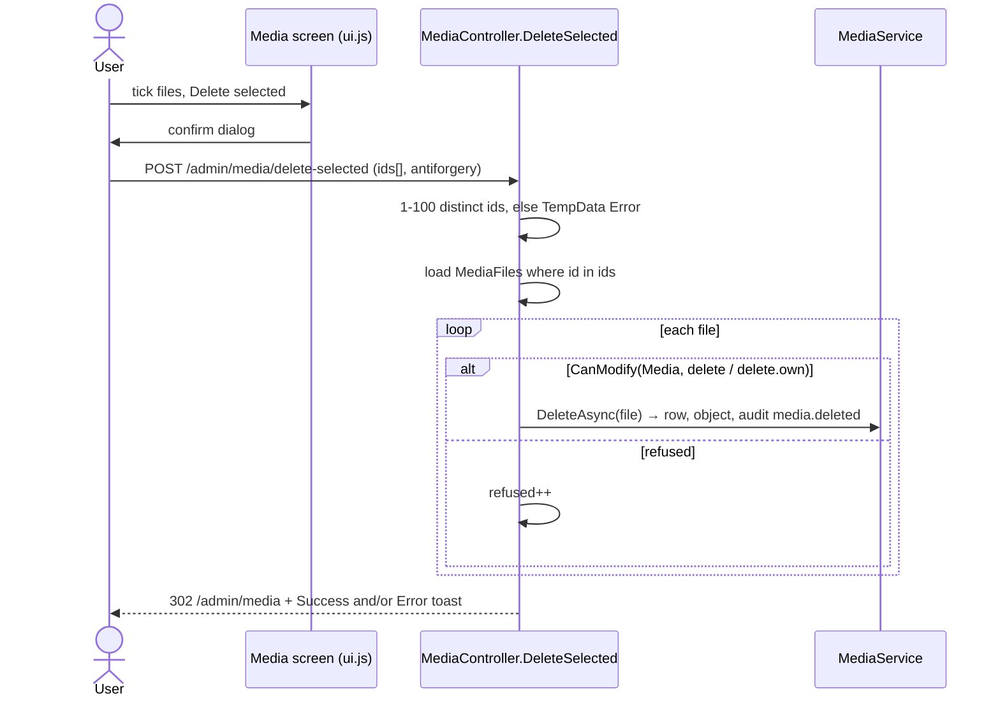
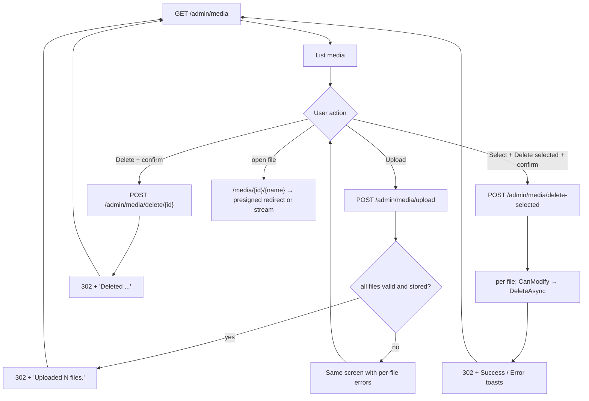

# Media

## Purpose

The media library: upload files, open or share their links, and delete them - one at a time or
several at once. Files are stored in object storage through `IFileStorage` ([media storage](../features/media-storage.md))
- never in the deployment directory. Used by every role with `Media` / `read` (by default all admin-capable roles
except `Developer`); what each role may do differs (see [Permissions](#permissions)).

## Route / Navigation

| Item | Value |
| --- | --- |
| Routes | `GET /admin/media` (`?folder={id}` shows a folder; unknown id → 404), `POST /admin/media/upload` (multipart, field `folderId`), `POST /admin/media/visibility/{id:guid}` (form field `isPublic`), `POST /admin/media/delete/{id:guid}`, `POST /admin/media/delete-selected` and `POST /admin/media/move-selected` (fields `ids` repeated, `folderId`, `returnFolder`), `POST /admin/media/folders` (`name`, `parentId`), `POST /admin/media/folders/{id:guid}/rename` (`name`), `/move` (`parentId`), `/delete` |
| Public file URLs | `GET /media/{id}/{fileName}` - served by `MediaFilesController` ([download flow](../features/media-storage.md#download-flow)) |
| Navigation entry | Sidebar → **Main** → **Media** (`AdminNavigation.Tree`); breadcrumbs **Main / Media** |
| Linked from | Dashboard: quick action **Upload media** (`/admin/media#upload`, shown when permitted) and the **Media files** KPI card (a link only for users who may open this screen) |
| Parameters / children | `folder` (query): the folder shown; every POST redirects back to the folder it came from (a failed upload re-renders the screen) |

## Relevant source files

```text
src/DotNetForge.Web/Areas/Admin/Controllers/MediaController.cs     list, upload, delete, DeleteSelected (MaxBulkDelete = 100); permission checks; request size limits
src/DotNetForge.Web/Areas/Admin/Models/AdminViewModels.cs          MediaIndexViewModel (CanUpload, folder rights, Current, Breadcrumbs, Folders, AllFolders, Files), MediaFolderLink, MediaFolderRowViewModel, MediaRowViewModel (+ Url, CanDelete)
src/DotNetForge.Web/Areas/Admin/Views/Media/Index.cshtml           Upload card (dropzone), Library card (toolbar, bulk bar, media cards, per-file menu)
src/DotNetForge.Web/Ui/MediaPresentation.cs                        Classify (filter kind + icon), Size ("3.4 KB")
src/DotNetForge.Web/Ui/UiTagHelpers.cs                             <icon>, <badge>, <timestamp>, <empty-state>, <form-errors>
src/DotNetForge.Web/Services/MediaService.cs                       upload/delete rules, allowed types, size cap, keys, audit
src/DotNetForge.Web/Services/MediaFolderService.cs                 folders: create, rename, move, delete (empty only), paths, moving files, audit
src/DotNetForge.Web/Controllers/MediaFilesController.cs            the /media/{id} links and thumbnails
src/DotNetForge.Web/wwwroot/js/forge/media.js                      drag and drop of files and folders onto folders and breadcrumbs
src/DotNetForge.Web/wwwroot/js/forge/ui.js                         collection (search/filter/paging), selection + bulk bar, view switch, dropzone, copy, confirm dialog
src/DotNetForge.Web/wwwroot/css/forge/admin.css                    .media-items / .media-card grid and list layouts
src/DotNetForge.Web/Views/Shared/_Feedback.cshtml                  toasts (TempData) + confirm dialog, rendered by _AdminLayout
```

## Page layout

```text
Media (_AdminLayout; header "Media" + description "Images, documents and other files for your pages. ...")
├── header actions [New folder] · [Upload] (CanUpload) - open the New folder dialog / the Upload dialog (media.js)
├── <dialog class="upload-dialog"> > card "Upload" (id upload)   only when CanUpload; never part of the page until opened: by [Upload], a file drag onto the page or #upload, and again after a failed upload; closed by [×] (clears the files), Esc or a click on the backdrop
│   └── form (POST /admin/media/upload, multipart, antiforgery, hidden folderId = the folder shown)
│       ├── <form-errors />                     one line per rejected file / problem
│       ├── .dropzone "Drop files here or click to choose"   allowed extensions; input type=file multiple required accept=…
│       ├── preview (JS): one tile per chosen file - image thumbnail or file icon, name, size, "Too large" / "Type not allowed", [×] remove
│       └── ☑ Public "Anyone with the link can open it. Private files need an admin sign-in."  (checked) · [Upload]
├── <dialog #new-folder-dialog> "New folder" / "In Library/…"   only when CanUpload: form#folder-create (POST /admin/media/folders, hidden parentId) Name · footer [Cancel] [Create folder]
└── card "Library" [data-collection, 48 per page]   title = breadcrumbs "Library / Photos / 2026" (links); "N total" / "x of N"
    ├── header: grid / list switch (JS only, remembered)
    ├── .collection-bar
    │   ├── toolbar (JS only): ☐ select all · search "Search files" · "All types" ▾ · "Public and private" ▾
    │   └── form#bulkForm .bulk-bar (overlays the toolbar while files are selected): ☐ · "N selected" · [Clear] ·
    │       Move to ▾ [Move] (when a file may be moved) · [Delete selected] (when a file may be deleted; confirm)
    ├── .media-items (data-view-mode grid|list): the subfolders first (folder tiles), then one article.media-card per file
    │   ├── folder tile: folder icon · name (opens it) · "n folders · n files" · ⋯ Open · Edit… (Media update; dialog) · Delete (Media delete)
    │   ├── file: ☐ select (CanDelete or CanChangeVisibility) · thumbnail or type icon → opens the file
    │   │   name (link, new tab) · size · <timestamp> · badge Public / Private (lock) · content type (list view)
    │   └── file ⋯ menu: Open · Copy link · Make private / Make public (CanChangeVisibility) · Delete (CanDelete)
    ├── empty state "No matching files"         [data-collection-empty]
    └── pagination                              JS, more than 48 matching items
    (nothing here → "No media yet" at the top level, "This folder is empty" inside a folder)
```

## Components

Component mechanics (cards, dropzone, collection, bulk bar, menu, toasts, confirm dialog) are in the
[design system](../architecture/design-system.md#components); this table lists what this screen feeds them.

| Component | Inputs | Behaviour |
| --- | --- | --- |
| Upload card | `CanUpload` (`Media/create`), `MediaService.AllowedTypes`, `MaxFilesPerUpload`, `MaxUploadBytes` | posts `files` (1-10) and `isPublic`; the file input covers the dropzone, so dropping files selects them natively (they upload on **Upload**) |
| Library toolbar | items' `data-search` (name + content type), `data-kind`, `data-access` | search; type filter `image` / `video` / `audio` / `document` / `archive` (`MediaPresentation.Classify`); access filter `public` / `private` |
| Media card | `MediaRowViewModel`, newest first | image files show the file itself as a lazy-loaded thumbnail (`/media/{id}/{name}`), others an icon by kind; size from `MediaPresentation.Size`; uploaded time relative, exact UTC in the tooltip |
| Per-file menu | `Url`, `CanChangeVisibility`, `CanDelete` | **Open** (new tab), **Copy link** (absolute URL, toast), **Make private** / **Make public** (POST form with `data-confirm`), **Delete** (POST form with `data-confirm`) |
| Selection + bulk bar | rendered only when at least one file has `CanDelete`; checkboxes only on deletable files | each checkbox posts `ids` with `form="bulkDelete"`; **Delete selected** confirms first |

## Functionality

### Folders

Folders are **virtual** (`MediaFolder`, `MediaFolderService`): a file's stored object and its `/media/{id}` link never
change when it moves. Folders nest without limit (the materialized path is at most 1000 characters).

- **Create** - **New folder** in the header opens a dialog (`#new-folder-dialog`, "In Library/…", a **Name** field
  focused; footer **Cancel** · **Create folder**, Enter creates too; Esc, Cancel or a click on the backdrop close it)
  that creates a folder inside the one shown (`Media/create`); the screen comes back at the same scroll position.
  Names: 1-100 characters, no `/` or `\`, not `.` or `..`, unique per parent ignoring case ("There is already a
  folder 'x' here."). Audit `media.folder.created`.
- **Browse** - folder tiles (with their counts) open `?folder={id}`; the card title is the breadcrumb trail back to
  **Library**. Only the files of the folder shown are listed; search and filters work on them.
- **Rename / move a folder** - **Edit…** in the folder's ⋯ menu (`Media/update`, JavaScript). The folder's `Path` and every path below it
  are rewritten; a folder can't move into itself or one of its own folders. Audit `media.folder.updated` ("Renamed
  from …" / "Moved from …").
- **Delete a folder** - only when it is empty (`Media/delete`): **Delete** in the tile's menu; a folder with
  files or folders is refused with what is in it. Audit `media.folder.deleted`.
- **Move files** - select files, choose **Move to** in the bulk bar (Top level or any folder) and **Move**. Each file
  needs `Media/update` (or `update.own` for own uploads); others are skipped and reported. Audit `media.moved` per file
  ("To /Photos").
- **Upload** goes into the folder shown.
- **Edit… in a folder's ⋯ menu** (`Media/update`, JavaScript) opens the **Edit folder** dialog: **Name** [Rename] and
  **Move into** [Move] (the folder itself and its own folders can't be chosen).
  **Delete** in the menu is offered with `Media/delete`; a folder with content is refused with what is in it.
- **Drag and drop** (`wwwroot/js/forge/media.js`, JavaScript and a mouse): drag a file - or, when it is selected, every
  selected file - or a folder onto a folder tile, or onto a breadcrumb to move it up. The target is outlined while
  dragging; dropping posts the same forms as the Move buttons (hidden `#dragMove` with the antiforgery token), so the
  same permissions, rules and audit entries apply. Files are draggable when the user may move them, folders with
  `Media/update`; a folder can't be dropped on itself (its own subfolders are refused by the server).

### Upload files

1. **Trigger:** click **Upload** in the header (or follow `#upload`), or drag files from the computer anywhere onto
   the page - the Upload popup opens (a modal `<dialog>`, focus on the file picker) and the dropped files are added. Each chosen file shows a preview (an image
   thumbnail drawn as a `data:` image - the policy allows no `blob:` URLs - or a file icon, its size, and "Too large" /
   "Type not allowed" when it will be refused) with a remove button. The same file (name, size, last change) is added
   only once however often it is dropped or picked, and **Upload** locks after the first click; optionally untick
   **Public**; **Upload**.
2. **Validation:** `Media/create` permission (else `Forbid` → [Access denied](access-denied.md)); 1-10 files; the
   request limit (25 MB × 10 + 1 MB); per file in `MediaService`: not empty, ≤ 25 MB, extension in `AllowedTypes`,
   not a duplicate - a file with the same name and size already in that folder is refused ("'x' is already in this
   folder (same name and size)."). The page builder's and the Content Manager's pickers get the existing file back
   instead (`reuseDuplicate`, when its visibility matches).
3. **Service:** `MediaService.UploadAsync` per file: generated storage key (`yyyy/MM/<random>.<ext>`),
   `IFileStorage.SaveAsync`, `MediaFile` row, audit `media.uploaded` ([upload flow](../features/media-storage.md#upload-flow)).
4. **Result:** all stored → redirect with the toast "Uploaded N files." ("Uploaded 1 file."); any rejected → the same
   screen with one message per rejected file in `<form-errors />` (accepted files are stored and listed).

### Delete a file

1. **Trigger:** ⋯ menu → **Delete** → confirm dialog "Delete '<name>'? Links to it stop working." (**Delete file**).
2. **Validation:** file exists (else 404); `Media/delete`, or `Media/delete.own` when the user uploaded
   it (else `Forbid`).
3. **Service:** `MediaService.DeleteAsync`: row removed, then the stored object; audit `media.deleted`.
4. **Result:** redirect with the toast "Deleted '<name>'."; the file's link returns 404 from then on.

### Delete selected files

1. **Trigger:** tick files (or select all - it ticks the files currently shown) → bulk bar **Delete selected** →
   confirm dialog "Delete the selected files? Links to them stop working." (**Delete files**).
2. **Validation:** distinct ids; none → error "Select at least one file."; more than `MediaController.MaxBulkDelete`
   (100) → error "Delete at most 100 files at a time." (nothing deleted). Then per file, exactly like
   [Delete a file](#delete-a-file): only existing files are loaded (unknown ids are skipped
   silently), and each needs `CanModify(Media, delete, delete.own, UploadedById)`.
3. **Service:** `MediaService.DeleteAsync` per permitted file - each deletion its own `media.deleted` audit entry.
4. **Result:** redirect; toast "Deleted N files." ("Deleted 1 file.") when any were deleted, plus an error toast
   "N files were not deleted: your role may not delete them." ("1 file was not deleted: ...") for refused
   files; "None of the selected files exist any more." when nothing was deleted and nothing refused.



### Open or share a file

The name, thumbnail and **Open** open `/media/{id}/{name}` in a new tab: public files for anyone; private files only
for signed-in admin-capable users. With S3 storage the browser is redirected to a short-lived presigned URL; with
local storage the app streams the file. **Copy link** copies the absolute URL (`scheme://host/media/...`).

### Make a file private or public

**Make private** / **Make public** in a file's ⋯ menu, after a confirmation dialog, posts
`/admin/media/visibility/{id}` → `MediaService.SetVisibilityAsync` flips `MediaFile.IsPublic` (the stored object is
not moved), writes `media.updated` (details `Made private` / `Made public`) and returns with a toast ("… is now
private: only signed-in admin users can open it."). The badge on the card changes accordingly. A private file stops
loading for visitors at once - pages that show it display a broken image - except where a browser already cached it
(public responses are cacheable for 5 minutes) or holds an S3 link issued before the change (valid up to 1 hour).

### Search, filter, switch view

Client-side over the server-rendered list ([behaviours](../architecture/design-system.md#behaviours)): search by
name or content type, filter by type and access, 48 files per page, grid or list layout (remembered per browser).
Without JavaScript the toolbar, view switch and pagination stay hidden and every file is listed in the grid; Upload
and New folder are dialogs and need JavaScript.

## Data used by the page

All `MediaFiles` (projected: id, name, type, size, public flag, upload date, uploader); the user's
role claims for `CanUpload`/`CanDelete`; `MediaService` constants for the hint and `accept` list; the request scheme
and host for **Copy link**.

## State

| State | Where | Changes when |
| --- | --- | --- |
| Result messages | `TempData["Success"]` / `["Error"]` → toasts | after a delete, bulk delete or successful upload |
| Upload errors | `ModelState` | failed upload (same request, no redirect) |
| Search, filters, page, selection | DOM only (`ui.js`) | lost on reload or after any POST |
| Grid / list view | `localStorage` `dnf-view:media` | the view switch |
| Files | `MediaFiles` rows + stored objects | upload, delete |

## Permissions

`AdminArea` policy + `[RequirePermission(Media, read)]` on `MediaController`: a role without `Media` / `read` (e.g. the
built-in `Developer`, or a custom role without it) gets [Access denied](access-denied.md) and no **Media** link in the
sidebar. Actions use the `Media` permission area ([authorization](../features/authorization.md)):

| Action | Super Admin | Admin | Editor | Author | Developer |
| --- | :-: | :-: | :-: | :-: | :-: |
| View list | ✔ | ✔ | ✔ | ✔ | - |
| Upload | ✔ | ✔ | ✔ | ✔ | - |
| Make private / public (`update`, or `update.own`) | ✔ | ✔ | ✔ | own uploads only | - |
| Delete (single or selected) | ✔ | ✔ | ✔ | own uploads only | - |
| Create folders (`create`) | ✔ | ✔ | ✔ | ✔ | - |
| Move files (`update`, or `update.own`) | ✔ | ✔ | ✔ | own uploads only | - |
| Rename / move folders (`update`) | ✔ | ✔ | ✔ | - | - |
| Delete empty folders (`delete`) | ✔ | ✔ | ✔ | - | - |

Controls a user can't use are not rendered (Upload card, visibility and Delete menu items, checkboxes, bulk bar); the server
re-checks on every POST, per file for bulk delete. Covered by
`AdminUiTests.Bulk_delete_removes_the_selected_files_the_user_may_delete` (an Author's bulk delete of an admin's
files removes nothing; the admin's removes exactly the selected files with one `media.deleted` entry each).

## Validation

| Rule | Message |
| --- | --- |
| No file chosen | "Choose at least one file to upload." (the browser's `required` normally stops this first) |
| More than 10 files | "Upload at most 10 files at a time." |
| Empty file | "'name' is empty." |
| Over 25 MB | "'name' is larger than 25 MB." |
| Extension not allowed (HTML, SVG, scripts, unknown) | "'name' has a file type that is not allowed." |
| Storage unavailable | "'name' could not be stored right now. Try again later." |
| Bulk delete with no file | "Select at least one file." (error toast) |
| Bulk delete with more than 100 files | "Delete at most 100 files at a time." (error toast) |

The content type is taken from the extension map, never from the browser. Requests over the size limit are rejected
by the server before model binding (error page).

## Error handling

| Failure | User sees | Recovery |
| --- | --- | --- |
| Upload validation | messages in `<form-errors />` in the Upload card | fix and resubmit |
| Storage outage on upload | per-file message; details in the server log | retry later |
| Missing permission (upload, single delete) | Access denied screen | - |
| Bulk delete includes files the user may not delete | those are skipped; error toast with their count; the rest are deleted | ask someone with `Media/delete` |
| Unknown id on single delete | 404 | - |
| Selected files already gone | error toast "None of the selected files exist any more." | - |

## Loading behaviour

Server-rendered; the upload is a normal form post (the browser shows its own progress). Thumbnails load lazily
(`loading="lazy"`). No skeletons and no client-side upload progress.

## Empty states

| When | Text |
| --- | --- |
| No files yet | **No media yet** - "Uploaded files appear here, ready to use on your pages." |
| An empty folder | **This folder is empty** - "Upload files into it, move files here, or create a folder inside it." |
| Search/filter matches nothing | **No matching files** - "Try another search or filter." |

## User interactions

Drop files on or click the dropzone, **Public** checkbox, **Upload**; grid/list switch; search box and two filters;
pagination; file links (new tab); ⋯ menu (Open, Copy link, Delete with confirm dialog); checkboxes, select all,
**Clear**, **Delete selected** with confirm dialog. Menus close on Escape ([accessibility](../architecture/design-system.md#accessibility-wcag-22-aa)).

## Dependencies

```text
MediaController
├── DotNetForgeDbContext
├── MediaService → IFileStorage, DotNetForgeDbContext, IAuditService, ILogger
└── AdminControllerBase (Can / CanModify → IPermissionService)
```

## Page flow



## Related pages

[Dashboard](dashboard.md) (**Media files** card, **Upload media** quick action), `GET /api/media`
([headless API](../features/headless-api.md)), the download endpoint
([media storage](../features/media-storage.md#download-flow)).

## Important implementation details

- Storage keys never contain the uploaded file name; the name is only metadata (sanitized, ≤ 200 characters).
- Public/private is chosen at upload time and can be switched per file afterwards (one file at a time; no bulk toggle).
- Large uploads are buffered in the OS temp directory during the request ([deployment](../guides/deployment.md#read-only-deployment-requirements)).
- Grid and list are the same DOM (`data-view-mode` on `.media-items`), so each file has one checkbox in both layouts.
- **Select all** ticks only the files currently shown (current page and filter); files ticked earlier stay ticked
  when a filter hides them and are posted with the rest.
- Image thumbnails request the file itself through `/media/{id}/{name}` - with S3 that is a presigned redirect per
  image (allowed by the CSP's `img-src 'self' data: https:`).
- Bulk delete deletes one file at a time; a failure part-way leaves the files deleted so far deleted (each already
  audited).

## Known limitations

- No tags, image variants, sorting, server-side search, or bulk public/private change; search and
  filters work only on the items of the folder shown, in the browser. Folders have no visibility of their own.
- The media pickers of the page builder and the Content Manager list all files, not by folder.
- Bulk delete needs JavaScript (the bulk bar is hidden without it); single delete works without.
- Allowed types and size limit are constants in `MediaService`, not settings.
- No content sniffing or malware scanning (types are decided by extension; active formats are not allowed).
- Private files are visible to every signed-in admin-capable user (no per-file grants).

## Planned (not implemented)

Target behaviour from the original product specification. Nothing in this section exists in the code unless marked ✔.
Data model, settings, roles and upload rules: [media storage → Planned](../features/media-storage.md#planned-not-implemented).

### Requirements

- Renamed **File Manager** in the sidebar (still under *Main*); a folder/document library.
- Layout (arrangement suggested here; the spec fixes the features, not the arrangement):

  ```text
  File Manager
  ├── toolbar: Upload (file picker, multiple) ✔ · New Folder ✔ · search box ✔ · filters ✔ (type, access) · sort
  ├── breadcrumb: Root / Parent / Current ✔     (every segment clickable)
  ├── drop zone (drag/drop upload into the current folder) ✔
  ├── list/grid ✔: subfolders ✔, then files (name ✔, type ✔, size ✔, tags, public/private ✔, date ✔)
  │   └── row actions: Download · Copy URL ✔ · Rename · Move ✔ (bulk, drag and drop) · Public/Private ✔ · Access · Delete ✔
  └── per-file upload results (accepted / rejected with reason ✔ / duplicate action taken)
  ```

- Image files show variant URLs (small/medium/large) when responsive upload is on.
- Settings for the library are on a separate *Settings → Global Settings → File Manager* screen.

### User flows

- **Browse**: open a folder → breadcrumb `Root / Parent / Current`; clicking a segment goes to that folder; the list
  shows the folder's subfolders and files.
- **Upload**: drag files onto the drop zone or pick files ✔ → each file is validated and processed independently ✔ →
  accepted files appear in the current folder; rejected files show their reason (type ✔, size ✔, unsafe, duplicate).
- **New folder / rename / move / delete folder**: *New Folder* asks for a name and creates it under the current
  folder; rename edits the name and refreshes breadcrumbs; move by drag or a *Move* action to a target folder;
  delete shows a warning for non-empty folders and lists in-use files first.
- **Public / private and access**: toggle *Public/Private*; when private, an *Access* dialog assigns roles and/or
  users (Super Admin/Admin only).
- **Search, filter, sort**: search term plus filters for name, type/MIME, tag, folder and date range, within the
  current folder scope and the user's access; sort by name, type, size or date, ascending/descending. Today: name /
  content-type search and type and access filters in the browser ✔; no tag, folder or date filter and no sort.
- **Delete file**: confirmation dialog ✔; if the file is referenced by pages (type `File`) or content, the dialog
  lists the references and blocks or requires explicit confirmation.
- **Download / copy URL**: download streams the file; copy URL gives the stable file (or variant) URL (file URL ✔).

### Rules and validation

- Folder name required and unique among siblings; errors shown inline in the dialog.
- The move dialog does not offer the folder itself or its descendants as targets.
- Authors only see rename/move/delete on files and folders they created (delete ✔); Editors and Authors do not see
  *Access*; Authors do not see *Public/Private* ([roles](../features/media-storage.md#roles)).
- All mutations are `POST` + antiforgery and audited ✔.

### Edge cases

- Batch upload with some rejected files: the accepted files still appear; rejected ones are listed with reasons ✔
  (`MediaController.Upload` stores the valid files and re-renders with one message per rejected file).
- Concurrent edit conflict on rename/move/delete: the user sees a conflict message and retries.
- Storage unreachable: upload fails with a clear error and the list still renders ✔ (`MediaService.UploadAsync`).

### Acceptance criteria

The screen-level criteria are part of the list in
[media storage → Acceptance criteria](../features/media-storage.md#acceptance-criteria) (upload by drag/drop and
picker, folders, clickable breadcrumbs, search/filter/sort, public/private, access grants, in-use delete warning).

## Extension points

See [media storage → Where to change things](../features/media-storage.md#where-to-change-things). A new per-file
action goes into the ⋯ menu in `Index.cshtml` (a POST form with `data-confirm` when destructive) and a
`MediaController` action that loads the file by id and checks `Can`/`CanModify`; a new bulk action
reuses `form#bulkDelete`'s pattern (checkboxes post `ids`, cap the count, check each file). When the screen becomes
the File Manager, update its label in `AdminNavigation.Tree`
(`src/DotNetForge.Web/Areas/Admin/Navigation/AdminNavigation.cs`), [pages.md](../architecture/pages.md) and this
document.
