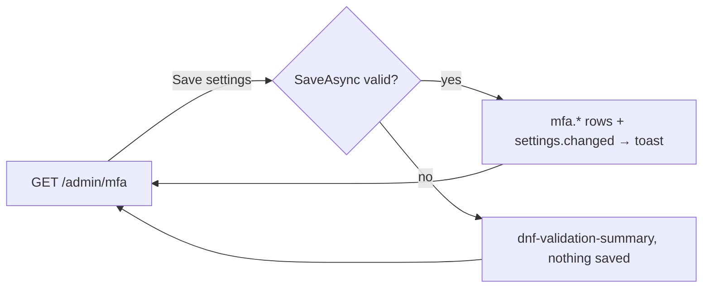

# Two-factor authentication

## Purpose

Which second sign-in steps people may set up on [Sign-in security](sign-in-security.md) - authenticator app,
passkeys and security keys, email codes, SMS codes - and whether everyone who uses the admin must have one. Shows how
many accounts use each method. Used by roles with `Settings` / `read` (by default Super Admin and Admin); saving needs
`Settings` / `update`. Rules: [two-factor authentication (MFA)](../features/mfa.md).

## Route / Navigation

| Item | Value |
| --- | --- |
| Route | `GET /admin/mfa`, `POST /admin/mfa` |
| Title (h1, last breadcrumb) | "Two-factor authentication" (description "A second step after the password: which methods people can set up on Profile → Sign-in security, and who must use one.") |
| Navigation entry | sidebar **Settings → Authentication → Two-factor (MFA)** (icon `shield`), between Providers and Advanced Settings |
| Parent / children | none |

## Relevant source files

```text
src/DotNetForge.Web/Areas/Admin/Controllers/MfaSettingsController.cs  Index (GET), Save (POST); MfaSettingsViewModel (form + counts)
src/DotNetForge.Web/Areas/Admin/Views/MfaSettings/Index.cshtml        Methods card, Who must use it card - one form
src/DotNetForge.Web/Services/Mfa/MfaSettings.cs                       MfaSettings (defaults, Allows), MfaSettingsService (GetAsync, GetStoredAsync, SaveAsync, IsRequiredAsync)
src/DotNetForge.Web/Areas/Admin/Navigation/AdminNavigation.cs         sidebar link "Two-factor (MFA)"
tests/DotNetForge.IntegrationTests/SignInSecurityTests.cs             requirement, email and SMS availability
```

## Page layout

```text
Two-factor authentication (admin layout, medium width)
└── form (POST /admin/mfa, antiforgery) - fieldset disabled without Settings update
    ├── <dnf-validation-summary />
    ├── card **Methods** ("N accounts use two-factor authentication. Turning a method off stops it at sign-in; what people set up is kept.")
    │   ├── switch **Authenticator app** [Recommended] - TOTP apps, QR code, offline · "N accounts."
    │   ├── switch **Passkeys and security keys** [Recommended] - WebAuthn, phishing-resistant, only at APP_URL · "N accounts."
    │   ├── switch **Email codes** [Needs email] - template "Sign-in code"; disabled without SMTP ("Set SMTP_* in .env (Email → Configuration) to use it.")
    │   ├── switch **SMS codes** [Needs Twilio] - "The weakest method (SIM swapping), and each message costs money."; disabled without TWILIO_* ("… in .env and restart to use it.")
    │   └── note: "Everyone who sets up a method also gets 10 one-time recovery codes. Someone who lost every method: remove their methods on Users → edit → Two-factor authentication."
    └── card **Who must use it** ("Wrong codes count toward the account lockout, like wrong passwords.") + badge **Required** / **Optional**
        ├── ( ) **Optional** - "Everyone may turn it on for their account; nobody has to."
        ├── ( ) **Required for everyone who uses the admin** - "N accounts with a role that opens the admin. Someone without a method is sent to Sign-in security after signing in and can't use the admin until they set one up."
        └── footer (only with Settings update): [**Save settings**]
```

## Components

| Component | Inputs | Behaviour |
| --- | --- | --- |
| Method switches | `MfaSettingsViewModel` from `GetStoredAsync` (the saved values, so a choice survives while SMTP/Twilio is missing) | checkbox `true` before a hidden `false`; Email/SMS disabled while `EmailAvailable` / `SmsAvailable` is false |
| Counts | `UserMfaMethods` (`UserId`, `Type`) grouped per type, distinct users; accounts with a role that opens the admin (`Roles.CanEnterAdmin`, `UserRoles`) | text only |
| Requirement | radio `Requirement` = `Optional` / `AdminUsers` | - |

## Functionality

### Save settings

1. **Trigger:** **Save settings**.
2. **Server:** Email and SMS are taken from the stored values while SMTP or Twilio is not configured (their disabled
   switches post nothing). `MfaSettingsService.SaveAsync` validates ([Validation](#validation)).
3. **Effect:** upserts the five `Settings` rows `mfa.*`, clears the "required?" cache, audits `settings.changed`
   (display "Two-factor authentication").
4. **Result:** toast "Two-factor authentication settings saved." and redirect to `GET`.

Effects: a method turned off stops counting at sign-in at once (its users' rows stay); the requirement applies within
30 s on other instances ([MFA → Requirement](../features/mfa.md#requirement)).

## Data used by the page

`Settings` rows `mfa.authenticatorApp`, `mfa.passkeys`, `mfa.email`, `mfa.sms`, `mfa.requirement` (missing or
unreadable → default: on, on, off, off, `Optional`; the [Settings](settings.md) screen refuses to change them);
`UserMfaMethods`, `Roles`, `UserRoles` for the counts; `SMTP_*` (`IEmailSettingsSource`) and `TWILIO_*`
(`AppEnvironment.Sms`) for availability.

## State

All server side (`Settings`). The "required?" value is cached 30 s per instance.

## Permissions

`[RequirePermission(Settings, Read)]` on the controller; `Save` adds `[RequirePermission(Settings, Update)]` and
`[ValidateAntiForgeryToken]`. Without `update` the form is disabled and has no **Save settings** button.

## Validation

| Rule | Message |
| --- | --- |
| Email codes turned on without SMTP | "Email codes need email: set SMTP_HOST and SMTP_FROM in .env first." |
| SMS codes turned on without Twilio | "SMS codes need Twilio: set TWILIO_ACCOUNT_SID, TWILIO_AUTH_TOKEN and TWILIO_FROM in .env first." |
| Required, but no method on | "Turn on at least one method before requiring two-factor authentication." |
| Unknown requirement value | "Choose who must use two-factor authentication." |

## Error handling

| Failure | User sees | Recovery |
| --- | --- | --- |
| A rule above | `<dnf-validation-summary />`, nothing saved | fix and save |
| SMTP or Twilio removed after the method was turned on | **Needs email** / **Needs Twilio**; the method counts as off at sign-in (users with only that method sign in with the password alone) | configure the service again and restart |

## Loading behaviour

Server-rendered; one synchronous POST.

## Empty states

Not applicable (counts show "0 accounts").

## User interactions

Switches and radio buttons; works without JavaScript.

## Dependencies

```text
MfaSettingsController
├── MfaSettingsService → DotNetForgeDbContext, IAuditService, IEmailSettingsSource, AppEnvironment, IMemoryCache
├── DotNetForgeDbContext (counts)
└── AdminControllerBase (Can → IPermissionService)
```

## Page flow



## Related pages

[Sign-in security](sign-in-security.md) (where users set up methods), [Sign in → Two-factor step](login.md#two-factor-step),
[Users](users.md) (reset a user's methods), [Email Templates](email-templates.md) (**Sign-in code**),
[Email Configuration](email-configuration.md), [Providers](providers.md).

## Important implementation details

- Requiring two-factor authentication doesn't sign anyone out: users without a method are redirected to Sign-in
  security on their next admin request.
- The requirement counts as off while every method is off or unavailable, so nobody can be locked out of the admin by
  it.

## Known limitations

- One requirement for every admin user; no per-role choice and nothing for site-only accounts.
- The note names "Users → edit → Two-factor authentication", but the card on the user's edit screen is titled
  **Two-step verification** ([Users](users.md)).

## Planned (not implemented)

None specified ([MFA → Planned](../features/mfa.md#planned-not-implemented)).

## Extension points

A new method or setting: `MfaSettings`, `MfaSettingsService` (keys, read, validate), the view model and view here,
[MFA](../features/mfa.md#where-to-change-things).
