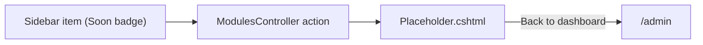

# Module placeholders

## Purpose

Sidebar items whose modules are specified but not built route to one shared placeholder screen, so the navigation
has no dead links. Each placeholder names the module, gives a one-line description and names the document that holds
its planned behaviour.

## Route / Navigation

All handled by `src/DotNetForge.Web/Areas/Admin/Controllers/ModulesController.cs`, rendered with
`src/DotNetForge.Web/Areas/Admin/Views/Modules/Placeholder.cshtml`. The sidebar links come from
`AdminNavigation.Tree` (`NavLink(..., typeof(ModulesController), Planned: true)`); `_NavLink.cshtml` gives every
planned link a **Soon** badge (tooltip "Planned - not built yet").

| Route | Action | Title (h1) | Sidebar entry (section → group → label) | Icon | Planned behaviour |
| --- | --- | --- | --- | --- | --- |
| `/admin/marketplace` | `Marketplace` | Marketplace | Main → **Marketplace** | `store` | [extensions.md](../features/extensions.md#planned-not-implemented) |
| `/admin/content-history` | `ContentHistory` | Content History | Settings → Global Settings → **Content History** | `history` | [content-pages-and-routing.md](../features/content-pages-and-routing.md#planned-not-implemented) |
| `/admin/internationalization` | `Internationalization` | Internationalization | Settings → Global Settings → **Internationalization** | `globe` | [internationalization.md](../features/internationalization.md#planned-not-implemented) |
| `/admin/transfer` | `Transfer` | Transfer | Settings → Global Settings → **Transfer** | `transfer` | [transfer-and-updates.md](../features/transfer-and-updates.md#planned-not-implemented) |
| `/admin/webhooks` | `Webhooks` | Webhooks | Settings → Global Settings → **Webhooks** | `webhook` | [webhooks.md](../features/webhooks.md#planned-not-implemented) |
| `/admin/email/configuration` | `EmailConfiguration` | Email Configuration | Settings → Email → **Configuration** | `mail` | [email.md](../features/email.md#planned-not-implemented) |
| `/admin/email/templates` | `EmailTemplates` | Email Templates | Settings → Email → **Templates** | `file-code` | [email.md](../features/email.md#planned-not-implemented) |
| `/admin/providers` | `Providers` | Authentication Providers | Settings → Users & Permissions Plugin → **Providers** | `lock` | [authentication.md](../features/authentication.md#planned-not-implemented) |
| `/admin/advanced-settings` | `AdvancedSettings` | Advanced User Settings | Settings → Users & Permissions Plugin → **Advanced Settings** | `sliders` | [authentication.md](../features/authentication.md#planned-not-implemented) |

All are `GET` only, no parameters. Breadcrumbs follow the sidebar entry; when the title differs from the sidebar
label the title is appended (e.g. **Settings** › **Email** › **Configuration** › **Email Configuration**).

## Relevant source files

```text
src/DotNetForge.Web/Areas/Admin/Controllers/ModulesController.cs        one action per placeholder + Placeholder() helper
src/DotNetForge.Web/Areas/Admin/Models/AdminViewModels.cs               ModulePlaceholderViewModel (Title, DocPath, Description)
src/DotNetForge.Web/Areas/Admin/Views/Modules/Placeholder.cshtml        card with <empty-state> + Planned footer
src/DotNetForge.Web/Areas/Admin/Navigation/AdminNavigation.cs           AdminNavigation.Tree (Planned: true links), AdminNavigationService
src/DotNetForge.Web/Areas/Admin/Views/Shared/_NavLink.cshtml            "Soon" badge on planned links
src/DotNetForge.Web/Ui/UiTagHelpers.cs                                  <empty-state>, <badge>, <icon>
```

## Page layout

```text
<Title> (_AdminLayout, h1 = Title)
└── section.card
    ├── <empty-state> icon = the sidebar link's icon (fallback "box")
    │   ├── title "<Title> is coming soon"
    │   ├── text <Description>
    │   └── [← Back to dashboard]                              link /admin
    └── .card-footer: badge "Planned" + "The planned behaviour is described in <DocPath>, section "Planned (not implemented)"."
```

## Components, functionality, data, state

Static content from `ModulePlaceholderViewModel`; the view looks up the icon in `AdminNavigation.Tree` by the
request path. No actions, no database access, no state.

## Permissions

`AdminArea` policy (any admin-capable role), so the sidebar shows every planned link to every admin-capable role.

## Validation, error handling, loading, empty states, user interactions

Not applicable; the whole screen is an empty state. The only interaction is **Back to dashboard**.

## Dependencies

`ModulesController` → `AdminControllerBase` only. `Placeholder.cshtml` → `AdminNavigation.Tree` (static).

## Page flow



## Related pages

[Implementation status](../implementation-status.md) lists what foundation exists for each module.
[Dashboard](dashboard.md) (**Back to dashboard**). [Pages](pages.md#planned-not-implemented)
(Content History).

## Important implementation details / known limitations

- `DocPath` is shown as plain text (`<code>`), not a link - the `.docs/` files are not served by the app.
- What foundation exists differs per module: webhooks and auth providers have tables (the `HmacWebhookSigner` class
  exists but is not registered in DI); email has only the `IEmailSender` contract - no implementation is registered
  (the unused `FileSystemEmailSender` was removed); marketplace, content history, i18n and transfer have nothing.
  See [implementation status](../implementation-status.md).

## Extension points

To build one of these modules: delete its action from `ModulesController`, add a real controller following the
[admin-page skill](../../.claude/skills/admin-page/SKILL.md) on the same route, change its `NavLink` in
`AdminNavigation.Tree` to the new controller and drop `Planned: true` (removes the **Soon** badge; visibility then
follows the new controller's `[Authorize]`), add `.docs/pages/<module>.md`, and update
[implementation-status.md](../implementation-status.md) and this table.
