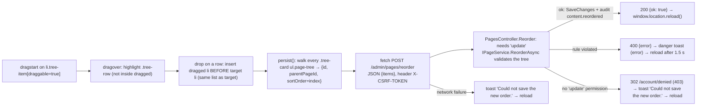
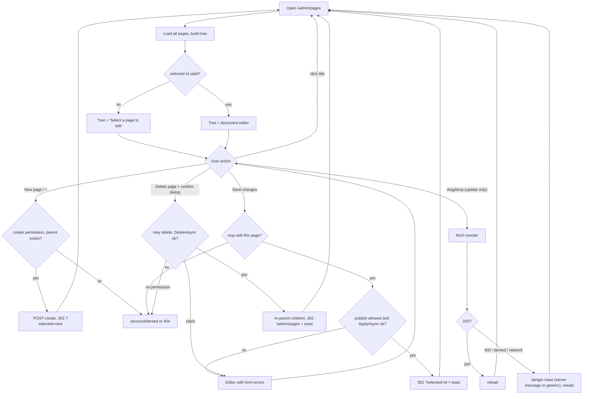
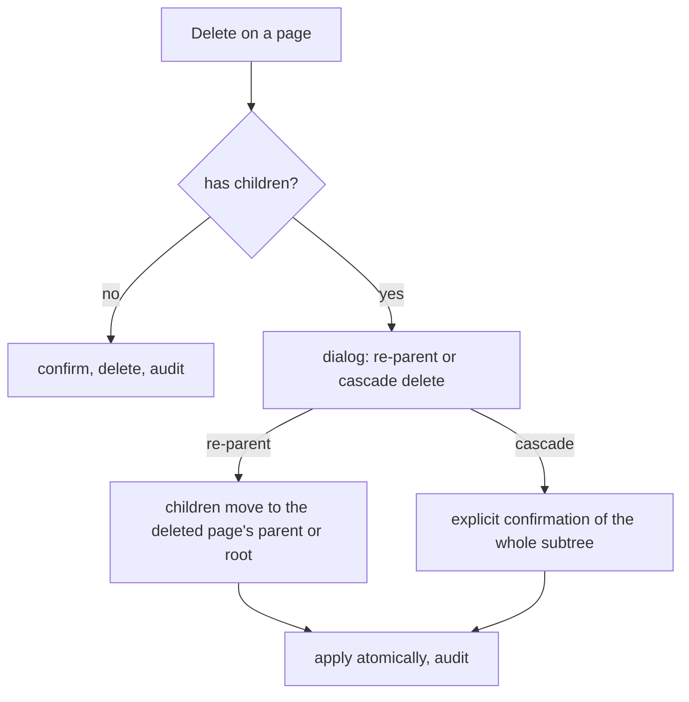

# Pages

## Purpose

**Pages** is where editors build the site's **page tree**: create content pages, arrange them in a
hierarchy, and edit each page's slug, type, SEO metadata, publishing flags, schedule and layout. Pages own URLs,
navigation, SEO and page settings; structured content (blog posts, products...) lives in the
[Content Manager](content-manager.md) and appears on a page through a content list in its
[page builder](page-builder.md) layout ([structured content](../features/structured-content.md)). Every role with
`Collection types` / `read` can open it - by default `Super Admin`, `Admin`, `Editor` and `Author`, not `Developer`;
what each role may change differs (see [Permissions](#permissions)). Rules for content pages are documented once in
[content pages and routing](../features/content-pages-and-routing.md); this document describes the screen.

## Route / Navigation

| Item | Value |
| --- | --- |
| Route | `GET /admin/pages` |
| Query parameter | `selected` (`Guid`, optional) - the content page shown in the editor |
| Mutations | `POST /admin/pages/create?parent={guid?}`, `POST /admin/pages/update/{id:guid}`, `POST /admin/pages/duplicate/{id:guid}`, `POST /admin/pages/delete/{id:guid}`, `POST /admin/pages/reorder` (JSON) |
| Navigation entry | Sidebar → **Main** → **Pages** (`AdminNavigation.Tree`; active for any `/admin/pages...` path) |
| Breadcrumbs | **Main** › **Pages** |
| Old addresses | `GET /admin/content?selected={id}` and `GET /admin/content/{id}/builder` answer **301** to `/admin/pages?selected={id}` and `/admin/pages/{id}/builder` (`ContentController.Index` / `LegacyBuilder`): `/admin/content` is now the [Content Manager](content-manager.md) of structured content |
| Parent | Admin area (no parent screen) |
| Child screens / tabs | the page editor's tabs **Page settings**, **SEO**, **Theme**, **Permissions**, **Layout** ([page editor](#page-editor)); the [page builder](page-builder.md) opens from the Layout tab |
| Deep link | `/admin/pages?selected=<pageId>`, a tab with `#page`, `#seo`, `#theme`, `#permissions` or `#layout` |
| Linked from | [Dashboard](dashboard.md) (**Pages** card - a link only for users who may open this screen -, **New page** quick action posts to `create`); the [public content page](public-page.md) alert ("Design it in Pages (Layout tab)"); the [public home](public-home.md) empty state (**Open Pages**) |

## Relevant source files

```text
src/DotNetForge.Web/Areas/Admin/Controllers/PagesController.cs     actions, permission checks, tree building, ViewData["CanReorder"]
src/DotNetForge.Web/Areas/Admin/Controllers/AdminControllerBase.cs   CurrentUserId, Can(area, action), CanModify(area, any, own, createdById)
src/DotNetForge.Web/Areas/Admin/Models/AdminViewModels.cs            ContentIndexViewModel, PageTreeNode, ReorderRequest, ReorderItem
src/DotNetForge.Shared/Content/IPageService.cs   IPageService, PagePosition, PageInput (form model, PageInput.From)
src/DotNetForge.Web/Services/PageService.cs                          ApplyAsync, ReorderAsync, DeleteAsync, Slugify, ToUtc
src/DotNetForge.Shared/Auditing/IAuditService.cs IAuditService (implemented by src/DotNetForge.Web/Services/AuditService.cs)
src/DotNetForge.Shared/Authorization/PermissionMatrix.cs   role defaults for the "Collection types" area
src/DotNetForge.Web/Areas/Admin/Views/Pages/Index.cshtml           header action form#treeActions, tree card (filter, empty state), editor column
src/DotNetForge.Web/Areas/Admin/Views/Pages/_TreeNodes.cshtml      recursive tree partial (open/close toggle, status dot, add-child and delete buttons, draggable when allowed)
src/DotNetForge.Web/Areas/Admin/Views/Pages/_PageForm.cshtml       document editor (General, SEO, Publishing, Delete page) + hidden form#deletePageForm
src/DotNetForge.Web/wwwroot/js/forge/pages.js                      conditional fields, publishing options with Published, tree filter, drag-and-drop reorder
src/DotNetForge.Web/wwwroot/js/forge/ui.js                           confirm dialog (data-confirm), toasts, data-js-only (loaded by _AdminLayout)
src/DotNetForge.Web/Views/Shared/_Feedback.cshtml                    toast region (TempData["Success"]) + confirm <dialog>
src/DotNetForge.Web/wwwroot/css/forge/admin.css                      .content-manager, .tree-card, .page-tree, .tree-row, .tree-action, .tree-toggle, .editor, .editor-aside
src/DotNetForge.Shared/Entities/Content.cs       Page entity
```

Components, toasts and the confirm dialog: [design system](../architecture/design-system.md#components),
[feedback](../architecture/design-system.md#feedback).

## Page layout

```text
Pages (_AdminLayout, h1 "Pages")
├── Description "Build the site's page tree, then edit each page's URL, SEO, publishing and layout. Structured content lives in the Content Manager."
├── Header action: [New page] (primary)                 form#treeActions (POST, antiforgery)
└── .content-manager (tree 16-20rem | editor; one column below 64rem)
    ├── aside.card.tree-card (sticky)
    │   ├── header "Pages" + [Close all / Open all] (JS only, when a page has children) + badge <page count>
    │   ├── filter "Filter pages" (search input, JS only, when pages exist)
    │   └── body: page tree (_TreeNodes, recursive)  or empty state "No pages yet" [New page]
    │       └── li.tree-item (draggable only with "update")
    │           ├── status dot (Published / Disabled) + title + /slug   link to ?selected={id}
    │           ├── [›/⌄] open/close (only with child pages, JS only; closed pages remembered in localStorage
    │           │         `dnf-tree-collapsed`; the selected page's parents always open; filtering shows every match)
    │           ├── [⋯] row actions (<action-menu>, shown on hover/focus):
    │           │     ├── View on site - the page's public URL in a new tab (`PageTreeNode.ViewUrl`, built like the
    │           │     │     site resolves URLs); a page not on the site (disabled, a disabled parent, a dynamic
    │           │     │     `[param]` URL, under the home page) shows the reason (menu note) instead
    │           │     ├── Add child page                  POST /admin/pages/create?parent={id}
    │           │     ├── Duplicate                       POST /admin/pages/duplicate/{id} (see below)
    │           │     └── Delete (danger; when the user may delete it: `Pages` / `delete`, or `delete.own` on their
    │           │           own pages) → confirmation dialog → POST /admin/pages/delete/{id}
    │           └── children (nested _TreeNodes)
    │       └── "No page matches the filter." (hidden note)
    └── section "Page editor"
        ├── (nothing selected) card with empty state "Select a page to edit"
        └── _PageForm: form#pageForm.editor (novalidate)
            ├── .editor-main
            │   ├── <form-errors />                     also shows a refused delete
            │   ├── card <Title> + status badge (Published / Disabled)
            │   │   └── Title*, Slug* (+ hint), Page type ▾, Parent page ▾,
            │   │       Target URL (URL redirect) / File reference (File), Sort order (+ hint)
            │   └── card "SEO": Meta title, Meta description, Keywords, Canonical URL (all optional)
            └── aside.editor-aside (sticky; below the main column under 80rem)
                ├── card "Publishing": switch Published (off = disabled),
                │   #publishOpts: switch Show in menu, Publish at (UTC), Unpublish at (UTC), hint
                │   └── footer [Save changes]
                └── card.card-danger "Delete page" - "Its child pages move up a level; they are not deleted."
                    └── [Delete page]                   submits form#deletePageForm, data-confirm
```

Shown to every role: **New page**, the add-child buttons, **Save changes**, the publishing switches and **Delete
page**; the server decides on submit (see [Permissions](#permissions)). Only drag-and-drop follows the role.

## Components

### Tree card (`Index.cshtml` + `_TreeNodes.cshtml`)

- **Purpose:** show the whole page tree and select a page.
- **Inputs:** `ContentIndexViewModel.Tree` (`IReadOnlyList<PageTreeNode>`), `ViewData["SelectedId"]`,
  `ViewData["CanReorder"]` (`Can("Collection types", "update")`, set in `PagesController.OnActionExecuted`).
- **Rendering:** nodes ordered by `SortOrder` then `Title` (order of the query; children keep that order). The
  header badge counts all pages. The selected row gets `.active` and its link `aria-current="page"`. The status dot is
  `dot-success` "Published" when `Published`, else `dot-danger` "Disabled" (with an `sr-only` label; a page
  still carrying the legacy `Disabled` flag counts as not published) - stored flags only, so a published page with a future schedule shows Published
  even though it isn't live. `draggable` is `true` only with `CanReorder`: then the whole row drags (grab cursor; no separate handle - the title
  link is `draggable="false"` so dragging it moves the row, not the link).
- **Events:** clicking a title navigates to `?selected={id}`; **+** submits `#treeActions` to
  `/admin/pages/create?parent={id}`; typing in the filter hides rows (JS); dragging calls the reorder flow.
- **Appears:** always. Every role sees every page.

### Tree filter (`[data-tree-filter]`, `pages.js`)

Shown only when there are pages and scripts run (`data-js-only`). Case-insensitive substring match on each item's
`data-search` (title + slug); an item stays visible when it or any descendant matches, so the tree keeps its shape.
When nothing matches, `[data-tree-empty]` shows "No page matches the filter.". Client-side only; nothing is posted.

### "New page" form (`form#treeActions`)

One shared POST form with an antiforgery token in the page header (`@section Actions`). Its button posts to
`/admin/pages/create`; the empty state's **New page** uses `form="treeActions"` and its own `formaction`. The row
menu's items are `<menu-post>` forms with their own antiforgery token, so every create, duplicate and delete stays
POST + antiforgery.

**Duplicate** (`PagesController.Duplicate`, needs `create`; a user blocked from editing the page can't copy it):
copies the page's settings, SEO, theme, page type and layout (published and draft) and its view/edit grants, titles
it "<title> (copy)" with a short free slug among the siblings (`about-copy`, `about-copy-2`, ...; the root page
copies as `home-copy`), places it right below the original (later siblings move down) and leaves it switched off.
Child pages are not copied. Audit `content.created` with details "Duplicate of '<title>'"; toast, then the copy is
selected.

### Page editor

`_PageForm.cshtml`, `form#pageForm`: one form in five tabs (`data-tabs`, `ui.js`). The tab is kept in the URL hash and
in a hidden `tab` field, so saving returns to the same tab (`/admin/pages?selected={id}#seo`). Without JavaScript the
five panels are shown one below the other.

| Tab | Fields |
| --- | --- |
| **Page settings** | Title, Slug, Page type, Parent page, Target URL / File reference (by type), Sort order |
| **SEO** | a search result preview; Meta title, Meta description, Keywords, Canonical URL, Social image (`og:image`), **Hide from search engines** (`noindex`, left out of sitemaps) |
| **Theme** | Site theme (default) or one installed theme extension for this page; not enabled themes are marked and fall back to the site theme |
| **Permissions** | a role table: **View** (no box = everyone; else only those roles - `Public` = everyone, `Authenticated` = any signed-in user) and **Edit** (extra roles that may edit this page; not for `Public` / `Authenticated`); a **Users** table: per user View and Edit = *Not set* / *Allow* / *Block* (a block wins over the user's roles), added with the last row's user picker, removed with the bin button (JS) or by setting both to *Not set*. Super Admins (the role and its users) are not listed - they always have full access. Read-only without `update` on every page. Rules: [page permissions](../features/content-pages-and-routing.md#page-permissions) |
| **Layout** | the layout's status (none / draft / published, unpublished changes), **Open page builder** ([page builder](page-builder.md)), **Preview draft** |

The publishing card (Published, Show in menu, schedule, **Save changes**) and the delete card stay beside
every tab; **Save changes** saves all tabs at once.

- **Purpose:** edit every editable field of the selected page.
- **Inputs:** `PageInput` (model), `ViewData["Extras"]` (`PageEditorExtras`: roles and grants, installed themes,
  layout status), `ViewData["SelectedId"]` (posted to `update/{id}`),
  `ViewData["ParentOptions"]` (every page except the selected one, labelled `Title (/slug)`; first option
  "None (top level)").
- **Output:** `POST /admin/pages/update/{id}` bound to `PageInput`, plus `viewRoles` / `editRoles` (role ids),
  `userPermissions[i].UserId` / `.View` / `.Edit` (`allow`, `block` or empty), `permissionsShown` (only when the
  Permissions tab is editable) and `tab` (**Save changes**).
- **Header:** the card title is the page title ("Untitled page" when empty) with a status badge (Published /
  Disabled, same rule as the tree dot).
- **Conditional UI (`pages.js`):** fields with `data-when-type` show only when **Page type** matches
  (`UrlRedirect` → Target URL, `File` → File reference); `#publishOpts` (Show in menu + schedule) shows only while
  **Published** is on. Without JavaScript every field is visible.
- **Appears:** only when `Model.Selected` is not null (a valid `selected` id, a failed save or a refused delete).

### Delete page card + `form#deletePageForm`

The **Delete page** button sits inside the editor but submits a separate, hidden POST form (`form="deletePageForm"`,
`/admin/pages/delete/{id}`, own antiforgery token), so deleting never posts the edited fields. The button carries
`data-confirm="Delete this page? Its child pages move up a level."`, `data-confirm-title="Delete page"` and
`data-confirm-action="Delete page"`: `ui.js` opens the shared confirm dialog (title **Delete page**, buttons **Cancel**
/ **Delete page**) and submits only on confirm; without the dialog API it falls back to `window.confirm`, without JS the
form submits directly ([feedback](../architecture/design-system.md#feedback)). No inline `onsubmit` (CSP).

## Functionality

### Select a page

1. Click a title in the tree (`<a href="/admin/pages?selected={id}">`).
2. `Index(selected)` → `BuildIndexAsync(selected, form: null)` loads all pages, maps the selected page with
   `PageInput.From`. An unknown id simply shows the "Select a page to edit" state (no error). Anyone who can
   open the screen can open any page's editor; the permission check happens on **Save changes** / **Delete page**.

### Create a page

1. **Trigger:** **New page** (header, empty state or the Dashboard quick action - root) or a row's **+** (child).
2. **Permission:** `create` in `Collection types` (every built-in admin-capable role except `Developer`) - else
   `Forbid()` → `/account/denied`.
3. **Validation:** antiforgery; when `parent` is given it must be an existing page, else `404`.
4. **Call:** `PagesController.Create(Guid? parent)`.
5. **Data:** new `Page { CreatedById = current user, Title = "Untitled page", Slug = "new-page" (or "new-page-2", "-3", ... - the first free one among the siblings),
   Published = false, PageType = Standard, ParentPageId = parent, SortOrder = <sibling count> }`.
   The suffix is the first 8 hex characters of a new GUID.
6. **Backend:** `SaveChangesAsync`, then audit `content.created`.
7. **Result / UI:** redirect to `?selected={newId}`; the new page is selected in the editor (no toast).
8. **Errors:** a slug collision with the random suffix is theoretically possible (unique index → global error page).

### Save page settings

```mermaid
sequenceDiagram
    actor U as Editor or Author
    participant F as _PageForm
    participant C as PagesController.Update
    participant P as IPageService.ApplyAsync
    participant DB as DotNetForgeDbContext
    participant A as IAuditService
    U->>F: Save changes
    F->>C: POST /admin/pages/update/{id} (PageInput)
    C->>DB: Page by id
    alt not found
        C-->>U: 404
    else no "update", and not own page with "update.own"
        C-->>U: 302 /account/denied
    else Published or schedule changed without "publish"
        C-->>U: Index view + "You don't have permission to publish, unpublish or schedule pages."
    else permitted
        C->>P: ApplyAsync(page, form)
        alt error message
            C-->>U: Index view re-rendered, error in <form-errors />, unsaved input kept
        else ok
            C->>DB: UpdatedDate = UtcNow, SaveChanges
            C->>A: content.updated
            C-->>U: 302 ?selected={id}, toast "Saved '<title>'."
        end
    end
```



1. **Trigger:** **Save changes**.
2. **Permission:** `update`, or `update.own` when `page.CreatedById` is the current user, else `Forbid()`. If the
   posted `Published`, `ScheduledPublishDate` or `ScheduledUnpublishDate` differs from the stored value (dates
   compared after `PageService.ToUtc`), `publish` is also required (`PagesController.ChangesPublishing`).
3. **Validation:** all rules of [`ApplyAsync`](../features/content-pages-and-routing.md#applyasync---save-and-create)
   (title, field lengths, slug, type, parent exists/no cycle, unique slug per parent, one dynamic segment per parent,
   schedule order, redirect/file requirements). The form is `novalidate`, so the browser does not block a submit.
4. **Service:** `IPageService.ApplyAsync` (implemented by `PageService`).
5. **Data:** every `PageInput` field; slug normalized by `Slugify`; schedule dates treated as UTC.
6. **Backend:** `UpdatedDate` set, one save; audit entry in a second save.
7. **Result:** redirect with `TempData["Success"]` = `Saved '<title>'.`, shown as a success toast by the layout.
8. **Errors:** validation or missing publish permission → same screen with the message in `<form-errors />` and the
   posted input; missing page → 404; no edit permission → `/account/denied`; DB exceptions → global error page.

### Delete a page

1. **Trigger:** **Delete page** → confirm dialog (`data-confirm` on the button, `ui.js`) → submits
   `form#deletePageForm`.
2. **Validation:** page must exist (else 404); `delete`, or `delete.own` on an own page (else
   `Forbid()` → `/account/denied`); `IPageService.DeleteAsync` refuses when re-parenting the children would put two
   equal slugs or two `[...]` pages under the new parent.
3. **Call:** `PagesController.Delete(id)` → `IPageService.DeleteAsync(page)`.
4. **Backend:** all direct children get `ParentPageId = <deleted page's parent>` and a new `UpdatedDate`; the page
   is removed; one save; audit `content.deleted`.
5. **Result:** redirect to `/admin/pages` (nothing selected), success toast `Deleted '<title>'.`.
6. **Errors:** a clash re-renders the screen (status 200) with the page still selected and
   `Can't delete: its child pages would move up a level and clash. <conflict>` in the editor's `<form-errors />`;
   nothing is deleted. Rules: [`DeleteAsync`](../features/content-pages-and-routing.md#deleteasync---delete).

### Reorder / re-parent by drag and drop



- Only users with `update` get draggable rows (`ViewData["CanReorder"]`); the POST checks again.
- A drop always makes the dragged page the **previous sibling** of the target; you cannot drop *into* a page that
  has no children, or after the last sibling. Use the **Parent page** dropdown / **Sort order** for those cases.
- Drops on itself or inside its own subtree are ignored client-side.
- The client posts the position of **every** page in the tree (also rows hidden by the filter). `ReorderAsync`
  checks that every id and parent exists, that no move creates a cycle, and that no parent ends up with
  duplicate slugs or a second `[...]` page ([rules](../features/content-pages-and-routing.md#reorderasync---drag-and-drop));
  only pages whose parent or sort order changed get a new `UpdatedDate`.
- Success writes one audit entry `content.reordered` (entity type `Page`, display `<n> page(s)` = number of posted
  positions) and reloads without a toast.
- On failure `pages.js` calls `window.Forge.toast(message, "danger")` with the server's `error` text (e.g.
  `That move would create a cycle in the page tree.`) or `Could not save the new order.`, then reloads after 1.5 s,
  so the tree returns to its stored order. The reload keeps the URL, so the selected page stays open.

## Data used by the page

| Data | Origin |
| --- | --- |
| All `Page` rows | `DotNetForgeDbContext.Pages` (`AsNoTracking`, ordered by `SortOrder`, `Title`) |
| `ContentIndexViewModel { Tree, Selected, SelectedId, ParentOptions }` | built by `BuildIndexAsync` |
| `PageInput` | `PageInput.From(page)` on GET and after a refused delete; the posted model after a failed save |
| `ViewData["CanReorder"]` | `Can("Collection types", "update")` in `OnActionExecuted` |
| Current user | `AdminControllerBase.CurrentUserId` (claim) |
| Permissions | `AdminControllerBase.Can` / `CanModify` → `IPermissionService.IsGranted(role claims, "Collection types", action)` (the roles' stored grants) |
| Antiforgery token | hidden fields from `@Html.AntiForgeryToken()`; `pages.js` reads the first `__RequestVerificationToken` input |

## State

| State | Kind | Changes when |
| --- | --- | --- |
| Selected page | URL `?selected=` | clicking a title, after create/update |
| Unsaved form input | DOM; posted model on validation failure | typing; failed save re-renders it |
| Conditional field visibility | DOM (`pages.js`) | changing Page type / Published |
| Tree filter | DOM (`hidden` on items), not persisted | typing in **Filter pages**; reset on reload |
| Drag state | JS variable `dragged`, CSS `.dragging`, `.drop-target` | during a drag |
| Toast | `TempData["Success"]` (layout) or `Forge.toast` (reorder failure) | after save/delete; on a failed reorder |
| Error state | `ModelState` → `<form-errors />` | failed save, refused delete |
| Persisted tree | database | create, save, delete, reorder; scheduler |

No global client state.

## Permissions

Opening the screen needs the `AdminArea` policy (inherited from `AdminControllerBase`) and
`[RequirePermission(Collection types, read)]` on `PagesController`: without that grant (the built-in `Developer`, or a
custom role without it) a user gets [Access denied](access-denied.md) and no **Pages** link in the sidebar. Each
mutation then checks the user's roles against the permission area **`Collection types`** through `IPermissionService` (the roles' stored
grants). A role with a page **edit** grant may also save that page. Full rules:
[content pages and routing → Permissions](../features/content-pages-and-routing.md#permissions).

| Action | Needs | `Super Admin`, `Admin`, `Editor` | `Author` | Refused with |
| --- | --- | :-: | :-: | --- |
| View tree and editor | `AdminArea` + `read` | ✔ | ✔ | sign-in / [denied](access-denied.md) |
| Create a page | `create` | ✔ | ✔ | `Forbid()` → `/account/denied` |
| Save a page | `update`, or `update.own` on a page with `CreatedById` = self, or a page edit grant; never when the user is blocked from editing the page | ✔ | own pages only | `Forbid()` → `/account/denied` |
| Change the page's permissions | `update` (every page) | ✔ | ✘ (tab read-only) | ignored |
| Change Published / schedule dates | additionally `publish` | ✔ | ✘ | form error `You don't have permission to publish, unpublish or schedule pages.` |
| Delete a page | `delete`, or `delete.own` on an own page | ✔ | own pages only | `Forbid()` → `/account/denied` |
| Reorder (drag-and-drop) | `update` | ✔ | ✘ (rows not draggable) | `Forbid()` → `/account/denied` (the script shows its generic toast) |

Seeded pages have no `CreatedById`, so Authors cannot edit or delete them. Authors may save their own pages but not
switch **Published**. Covered by
`SecurityTests.Authors_cannot_delete_or_publish_pages_they_did_not_create`.
See [authorization](../features/authorization.md).

## Validation

- Server: `IPageService.ApplyAsync` on **Save changes** (including length limits - Title 300, Slug 200, Meta title
  300, Meta description 1000, Keywords 500, Canonical URL / Target URL / File reference 2000 - checked before saving,
  so PostgreSQL never rejects an over-long value); `IPageService.ReorderAsync` on reorder; `IPageService.DeleteAsync`
  on delete; parent existence on create.
- Browser: `form#pageForm` is `novalidate`, so `required` (Title), `type="url"` (Target URL, Canonical URL) and
  `min="0"` (Sort order) do not block a submit; `maxlength="300"` on Title still limits typing; `type="number"` and
  `datetime-local` shape the inputs.
- Duplicate prevention: slug uniqueness per parent in `PageService` + the DB unique index.

## Error handling

| Failure | Detection | User sees | Recovery |
| --- | --- | --- | --- |
| Rule violation on save | `ApplyAsync` returns message | message in `<form-errors />` (danger alert), input preserved | fix and save again |
| Publishing change without `publish` | `ChangesPublishing` + `Can(..., "publish")` | `You don't have permission to publish, unpublish or schedule pages.` in `<form-errors />` | leave Published and the schedule unchanged, or ask an Editor |
| No permission for the action | `Can` / `CanModify` false | `302 /account/denied` ([Access denied](access-denied.md), 403) | go back |
| Delete would clash slugs | `DeleteAsync` returns message | `Can't delete: its child pages would move up a level and clash. ...` in `<form-errors />` | rename or move the children first |
| Unknown page or parent id | `FirstOrDefaultAsync` / `AnyAsync` | empty 404 | go back |
| Reorder rule violation | `ReorderAsync` returns message → `400 { error }` | danger toast with the server message, reload after 1.5 s | drop elsewhere, or use the Parent page dropdown |
| Reorder forbidden (or another non-JSON failure) | `fetch` not ok, body not JSON | danger toast `Could not save the new order.`, reload | - |
| Reorder network failure | `fetch` rejected | danger toast `Could not save the new order.`, reload | - |
| Unique-index violation (random create slug, concurrent edits) | `DbUpdateException` | [error page](error.md) (prod) / exception page (dev) | reload |

## Loading behaviour

Everything is rendered server-side in one response (tree + editor). The reorder POST runs asynchronously with no
progress indicator, then reloads the whole page. No skeletons, no disabled buttons during submit.

## Empty states

- No pages: tree card shows **No pages yet** - "Create the first page of your site." with a **New page** button (a
  fresh install has six seeded pages).
- No selection: editor column shows **Select a page to edit** - "Choose a page in the tree, or create a new one. Drag
  pages to reorder or move them."
- Filter without match: "No page matches the filter."
- No parent options (only one page): the Parent page dropdown contains only "None (top level)".

## User interactions

| Interaction | Effect |
| --- | --- |
| Click a page title | select (navigates) |
| Click **New page** / row **+** (tooltip "Add child page") | create root/child page (POST) |
| Type in **Filter pages** | hide non-matching rows (ancestors of matches stay) |
| Drag a row by any part of the item (handle is visual; only with `update`) | reorder/re-parent, then reload |
| Change **Page type** | show Target URL / File reference |
| Toggle **Published** | on: published; off: disabled. Publishing options shown only when Published |
| **Save changes** | validate + save |
| **Delete page** | confirm dialog (Escape or **Cancel** aborts), then delete; without JavaScript the form submits without confirmation |

Keyboard: native links, buttons, switches and the dialog; drag-and-drop has no keyboard equivalent (use **Parent
page** / **Sort order**). The add-child and delete buttons appear on hover or focus (always on touch devices).

## Dependencies

```text
PagesController
├── DotNetForgeDbContext
├── IPageService → PageService
│   └── DotNetForgeDbContext
├── IAuditService → AuditService
│   ├── DotNetForgeDbContext
│   └── IHttpContextAccessor
└── AdminControllerBase (CurrentUserId, AdminArea policy, Can/CanModify → IPermissionService.IsGranted → stored role grants)
pages.js (no server dependency besides /admin/pages/reorder; window.Forge.toast from ui.js)
ui.js (confirm dialog for data-confirm, toasts, data-js-only)
```

## Page flow



## Related pages

- Navigates to: itself; [Access denied](access-denied.md) when a permission check fails.
- Receives navigation from: sidebar; [Dashboard](dashboard.md); [public content page](public-page.md) alert link;
  [public home](public-home.md) empty state.
- Shares functionality with: [public home](public-home.md) and [public content page](public-page.md) (they render
  what this screen edits); `POST /api/content/pages` ([headless API](../features/headless-api.md)) also creates pages
  and applies the same `IPageService.ApplyAsync` rules; the [Dashboard](dashboard.md) counts pages and offers **New
  page**; [Audit Logs](audit-logs.md) lists the `content.*` entries.

## Important implementation details

- **Published ≠ live.** **Published** is the page's one switch (off = disabled); visibility is computed per request
  (schedule window). New pages start disabled. A page saved with the old, removed **Disabled** switch stays hidden and
  shows as disabled; saving it clears that flag (`PageService.ApplyAsync`).
- `IPageService` methods validate and mutate tracked entities but never save; `PagesController` saves, then audits
  through `IAuditService` (a second save).
- `BuildIndexAsync` loads **all** pages on every render (tree + parent options); fine for small trees.
- On a failed save, `Selected` is the posted model but the tree is reloaded from the DB. On a refused delete the
  editor shows the stored page.
- The parent dropdown excludes only the page itself; choosing a descendant is caught by the cycle check on save.
- Schedule inputs are formatted `yyyy-MM-ddTHH:mm`; seconds are dropped on the next save.
- `ScheduledPublishingService` may clear schedule dates or uncheck Published between two views of this screen. For a
  user without `publish`, the stale form then counts as a publishing change and the save is refused; reload first.
- Antiforgery for the `fetch` uses the `X-CSRF-TOKEN` header name configured in `DependencyRegistration`.
- `Create` uses `formaction` on buttons so one form (`#treeActions`, in the page header) serves every add button.
- The delete button lives inside `form#pageForm` but belongs to `form#deletePageForm` (`form` attribute) - nested
  forms are invalid HTML, and the delete must not carry the edited fields.
- `ViewData["CanReorder"]` is set in `OnActionExecuted`, so it is present for every view the controller returns
  (also the re-rendered Index after a failed save or delete).
- The screen carries no inline script or style; behaviour comes from `pages.js` (`@section Scripts`) and `ui.js`
  (CSP `script-src 'self'`, see [security](../features/security.md)). `AdminUiTests` renders the screen with and
  without `?selected=` and checks for inline script/style.

## Known limitations

- No content history, review or tags (see [Planned](#planned-not-implemented)); the page
  builder has no version history yet ([page builder → Planned](../features/page-builder.md#planned-not-implemented)).
- Drag-and-drop can only insert before an existing sibling; no "drop into" or "drop at end"; no keyboard reordering.
- Only drag-and-drop is hidden by permission: an Author still sees **Save changes**, **Delete page** and the
  **Published** switch on every page and learns about a restriction only on submit.
- Authors cannot edit seeded pages or pages created through the API (no `CreatedById`).
- A forbidden reorder (possible only if the role changed after the page loaded) shows the generic toast, not a
  permission message (the `fetch` follows the redirect to the 403 denied page).
- The filter is client-side and not kept across reloads.
- The status dot and badge reflect stored flags, not liveness.
- `PageType` values other than `Standard` are stored but have no public effect.

## Planned (not implemented)

Target behaviour from the original product specification. Nothing in this section exists in the code unless marked ✔.

The content model, rules, role defaults and the full acceptance criteria are in
[content pages and routing → Planned](../features/content-pages-and-routing.md#planned-not-implemented); this
section covers only the screen.

### Requirements

| Area | Target UI |
| --- | --- |
| Collection and single types | ✔ built as the [Content Manager](content-manager.md) and [Content types](content-types.md) screens |
| Page form | adds a target-page picker (`ExistingPage`), a File Manager asset picker for `FileReference` ([media storage](../features/media-storage.md)), tags (create-on-type, autocomplete), view roles and view users, theme, layout and layout settings ([themes](../features/themes.md#planned-not-implemented)) |
| Save actions | **Save draft**, **Publish** (when allowed), **Submit for review**, **Preview** |
| Page builder | a builder mode for Standard pages: place built-in modules, the Razor module and extension modules, configure each |
| History | per page/entry: version list with author and time, pick two to compare side by side, **Restore** |
| Review Content | reviewer queue of assigned items with draft and diff; **Approve & publish**, **Reject with comments**, **Request revision** |
| Tags | manage the vocabulary: rename, merge, delete |
| Warnings | broken file/media reference, `ExistingPage` pointing at a deleted page, page slug shadowed by or shadowing a dynamic route, dynamic route with a missing target |
| Actions per role | buttons follow the role defaults ([content role defaults](../features/content-pages-and-routing.md#role-defaults-for-content)) (✔ enforced on the server for create, save, publish, delete and reorder; ✔ drag-and-drop offered only with `update`; other buttons are not hidden) |

The sidebar already has a **Content History** placeholder at `/admin/content-history` (✔ placeholder only,
[module placeholders](module-placeholders.md)).

### User flows

**Create a page (target).** Today **New page** creates an `Untitled page` immediately; the target is a guided
create:

1. **Add page**, optionally on a parent node.
2. Choose the page type (Standard, Existing page, URL redirect, File).
3. Enter slug, title, SEO fields; slug format and uniqueness are validated.
4. Set display in menu, sort order, schedule, theme/layout and per-page permissions.
5. URL redirect → target URL; File → file reference; Existing page → target page.
6. **Save draft**.

**Build and preview.** Open a Standard page → builder mode → place and configure modules → **Preview** renders the
draft as a visitor sees it → each save records a draft version.

**History, compare, restore.** **History** → versions with who and when → select two → side-by-side diff →
**Restore** a version, which becomes a new version.

**Submit for review.** On a draft → **Submit for review** → assign reviewers (or default pool) → status
`In review`, reviewers notified, submission logged.

**Review and decide.** **Review Content** → open an assigned item with its draft and diff → **Approve & publish**
(draft goes live), **Reject with comments** (status `Rejected`) or **Request revision** (status
`Revision requested`) → decision logged with reviewer, time and comments.

**Delete a page that has children.**



Today **Delete page** always re-parents children after the confirm dialog (`data-confirm`), and refuses when they
would clash (see [Delete a page](#delete-a-page)).

### Rules and validation

- Reject and request-revision dialogs require a comment; submit is blocked without one.
- **Publish** without direct-publish permission on a site with mandatory review submits for review instead.
- A parent selection that would create a cycle is rejected and cleared (✔ rejected on save by `PageService`).
- Client-side checks are advisory; every action validates on the server (✔ create, save, reorder and delete validate
  in `PagesController` / `IPageService`).

### Edge cases

- **Version conflict:** saving over a newer version shows a conflict dialog with a diff and merge / overwrite /
  discard options.
- **Restore during an open review:** the item returns to draft and the review is closed in its history.
- **Broken reference:** a File page or entry whose asset was deleted shows a warning and cannot be published.
- **Tree drag-and-drop** must apply the same rules as **Save** (parent exists, no cycle, unique slug, one dynamic
  segment per parent) - ✔ `IPageService.ReorderAsync`, `400 { error }` shown in a danger toast
  (`SecurityTests.Reorder_rejects_a_cycle`, `PageServiceTests.Reorder_rejects_moves_that_duplicate_a_slug`).

### Acceptance criteria

Tracked once in [content pages and routing → Acceptance criteria](../features/content-pages-and-routing.md#acceptance-criteria).

## Extension points

- New field: follow the checklist in [content pages and routing → Where to change things](../features/content-pages-and-routing.md#where-to-change-things);
  put it in the matching editor card as a `.field` ([components](../architecture/design-system.md#components)).
- New rule: add it to `PageService` (`ApplyAsync`, `ReorderAsync` or `DeleteAsync`), never to the controller or the
  view.
- New tree action (e.g. duplicate page): add a POST action to `PagesController` with a `Can` / `CanModify` check
  in `PermissionAreas.CollectionTypes`, a `formaction` button using `form="treeActions"` in `_TreeNodes.cshtml`, and
  an `IAuditService.LogAsync` call with a new `AuditActions` constant.
- Hide actions the user cannot perform: compute flags with `Can` / `CanModify` (as `ViewData["CanReorder"]` does
  here, or `MediaIndexViewModel.CanUpload` / `MediaRowViewModel.CanDelete` on [Media](media.md)) and keep the server
  checks.
- Client behaviour: `src/DotNetForge.Web/wwwroot/js/forge/pages.js` (keep the screen working without JS; no inline
  script or style; report failures with `window.Forge.toast`, confirmations with `data-confirm`).
