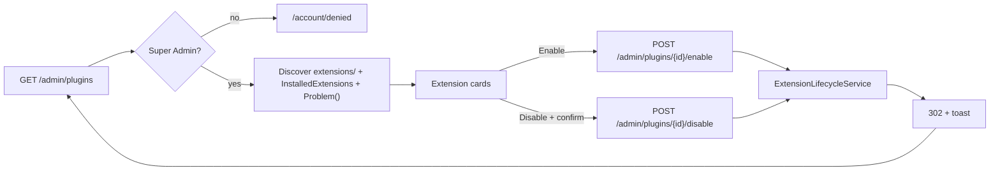

# Plugins

## Purpose

Lists every extension found under `extensions/` - its manifest, whether its code is running, its problems and its
status - and enables or disables it. Super Admin only. Nothing an extension offers is used until it is enabled here.
There is no install, configure, update or remove. Extension mechanics (catalog, slots, enable rules):
[extensions](../features/extensions.md).

## Route / Navigation

| Item | Value |
| --- | --- |
| Routes | `GET /admin/plugins`, `POST /admin/plugins/{id}/enable`, `POST /admin/plugins/{id}/disable` |
| Navigation entry | Sidebar → **Settings** → **Global Settings** → **Plugins** (`AdminNavigation.Tree`); breadcrumbs **Settings / Global Settings / Plugins**; hidden from every role but Super Admin |
| Parameters / children | `{id}` = manifest `id` (case-insensitive); both POSTs redirect back to `/admin/plugins` |

## Relevant source files

```text
src/DotNetForge.Web/Areas/Admin/Controllers/PluginsController.cs   list + Enable/Disable actions (result in TempData Success / Error)
src/DotNetForge.Web/Areas/Admin/Models/AdminViewModels.cs           PluginRowViewModel (+ IsEnabled)
src/DotNetForge.Web/Areas/Admin/Views/Plugins/Index.cshtml          status tabs, search, type filter, extension cards, Enable/Disable forms
src/DotNetForge.UI/wwwroot/dnf.js                                   data-collection (tabs, search, type filter), confirm dialog
src/DotNetForge.Web/wwwroot/css/admin/people.css                    .dnf-extension-list / .dnf-extension-card
src/DotNetForge.Web/Views/Shared/_Feedback.cshtml                   result toasts + confirm dialog (rendered by _AdminLayout)
src/DotNetForge.Web/Services/ExtensionLifecycleService.cs           enable/disable rules, InstalledExtensions row, audit
src/DotNetForge.Extensions/ExtensionCatalog.cs                      Installed() (first valid manifest per id), Problem()
src/DotNetForge.Extensions/ExtensionLoader.cs                       discovery (cached, FileSystemWatcher invalidation)
src/DotNetForge.Extensions/ManifestValidator.cs                     validity
```

## Page layout

```text
Plugins (_AdminLayout; header "Plugins" + description "Extensions found in the extensions/ folder. Nothing an
│        extension offers is used until you enable it; enabling and disabling take effect at once. Code changes need a restart.")
└── card "Extensions" [data-collection]   "N total" / "x of N"
    ├── toolbar (JS only)
    │   ├── status tabs: All N · Enabled N · Disabled N · Needs attention N (only when a problem exists)
    │   └── search "Search extensions" · "All types" ▾ (the types found)
    ├── .dnf-extension-list: one article.dnf-extension-card per manifest (data-enabled="true" when enabled)
    │   ├── type icon · **name** v<version> [problem icon] · id below (tooltip: id · extensions/<folder>) · badge Enabled / Disabled
    │   ├── description
    │   ├── badges: <type> · Code (manifest names an assembly) · one per dependency (tooltip "Needs <id>")
    │   └── footer: "by <author>" · [Disable] (confirm) or [Enable]
    └── empty state "No matching extensions"   [data-collection-empty]
    (no manifest at all → empty state "No extensions found" instead of toolbar and cards)
```

## Components

`PluginRowViewModel { Id, Name, Description, Version, Type, Status, Author, ValidManifest, HasCode, Dependencies,
Problem, Folder, InstalledDate, CanToggle, IsEnabled }` - one per manifest from `IExtensionLoader.Discover()`, ordered
by type, then name. Component mechanics: [design system](../architecture/design-system.md#components).

| Field | Value |
| --- | --- |
| `Id`, `Name`, `Description`, `Version`, `Type`, `Author` | manifest values; missing ones as `(unknown)` / `-`; `Id` falls back to the folder name; `Type` lower-cased |
| `HasCode` | the manifest names an `assembly` → **Code** badge |
| `Dependencies` | manifest `dependencies` → one badge per id |
| `Folder` | path below `extensions/` (only in the id's tooltip) |
| `Status` / `IsEnabled` | `Enabled` when the `InstalledExtensions` row with this id has `Status = Enabled`, else `Disabled` |
| `Problem` | invalid manifest: the validation errors; duplicate id: "Another extension already uses this id; only the first one found is used."; otherwise `ExtensionCatalog.Problem` (code failed to load, or "Its code was added or changed after the app started - restart the app to load it.") |
| `CanToggle` | valid manifest that is the one used for its id |

| Card part | Rule |
| --- | --- |
| Type icon | `theme` palette, `authentication` log-in, `connector` plug, `library` package, `admin` panel, `widget` gauge, `provider` bell, `module` box, other puzzle |
| Problem | only an icon button right after the name and version when `Problem` is set - triangle-alert (warning, **Not running**) or circle-x (danger, **Invalid manifest**), tooltip with that title; clicking it opens a popover (`.dnf-popover.dnf-popover--bare[popover]`, placed by `dnf.js` below the icon, left-aligned (`bottom-start`), closes on Escape / outside click) with the alert and the problem text |
| Action | **Disable** when `CanToggle` and enabled (even with a problem); **Enable** when `CanToggle`, disabled and no problem; nothing otherwise |
| Filters | items carry `data-state` (`enabled` / `disabled`, plus `problem`) for the status tabs and `data-type` for the type filter |

`InstalledDate` is in the view model but not shown.

## Functionality

### Enable

**Enable** → `POST /admin/plugins/{id}/enable` (antiforgery, no confirmation) → `ExtensionLifecycleService.EnableAsync`
→ refused when no valid manifest has the id, the extension has a problem (`<Name> can't be enabled: <problem>`) or a
dependency is not enabled (`<Name> needs <ids> - enable it first.`) → otherwise upserts the `InstalledExtensions` row
from the manifest (`InstalledDate` on first enable), `Status = Enabled`, refreshes `ExtensionState`, audit
`plugin.enabled` → redirect with the toast "Extension enabled." (refusals: error toast with the message). The
extension's slots (sidebar tab, widget, theme, module, endpoints, storage, sign-in, audit handlers) answer on the next
request. Rules: [extensions → Enable and disable](../features/extensions.md#enable-and-disable).

### Disable

**Disable** → confirm dialog "Disable '<Name>'? Everything it adds stops working until you enable it again."
(**Disable extension** / **Disable**) → `POST /admin/plugins/{id}/disable` → `ExtensionLifecycleService.DisableAsync` →
refused when not enabled ("This extension is not enabled.") or an enabled extension depends on it (`<Names> depends on
<Name> - disable it first.`) → `Status = Disabled`, refresh, audit `plugin.disabled` → toast "Extension disabled."

### Find an extension

Client-side over the server-rendered cards ([behaviours](../architecture/design-system.md#behaviours)): status tabs,
search (the card's whole text: name, id, description, badges, problem, author), type filter. No pagination.
Without JavaScript the toolbar stays hidden and every card is listed.

## Data used by the page

`InstalledExtensions` (`Id`, `Status`, `InstalledDate`) and
`IExtensionLoader.Discover()`, a singleton rooted at `AppEnvironment.ExtensionsPath` that caches the scan until a
manifest file changes. Code state comes from `ExtensionRuntime` (loaded once at startup) via `ExtensionCatalog`.
`InstalledExtensions` rows whose manifest is gone are not listed.

## State

| State | Where | Changes when |
| --- | --- | --- |
| Enabled state | `InstalledExtensions` | Enable / Disable |
| Result message | `TempData["Success"]` / `["Error"]` → toast | after each POST (PRG) |
| Tab, search, type filter | DOM only (`dnf.js`) | lost on reload |

## Permissions

`AdminArea` + `[Authorize(Roles = "Super Admin")]` on the controller (all three actions). Admins, Editors and Authors
→ [Access denied](access-denied.md); the sidebar hides the link from them
(`AdminUiTests.The_sidebar_shows_only_screens_the_role_may_open`). (The spec allows Admins on this screen; the code
doesn't - see [Planned](#planned-not-implemented).)

## Validation

Manifest validity is `ManifestValidator`; its errors are shown in the card's problem popover. Enable/Disable refusals are shown
as an error toast (messages above). Changes are serialized per instance by a semaphore.

## Error handling

| Failure | Detection | User sees | Recovery |
| --- | --- | --- | --- |
| Invalid JSON / missing fields | loader / validator | **Invalid manifest** icon; its popover lists the errors; no action | fix the manifest (picked up without restart) |
| Code missing, failing or changed after startup | `ExtensionRuntime`, `ExtensionCatalog.Problem` | **Not running** icon; its popover shows the reason; no Enable | build the extension, restart |
| Refused enable/disable | `ExtensionLifecycleService` | error toast with the message | enable dependencies first / disable dependents first |
| Other exceptions (e.g. file-system permission) | - | global error page | - |

## Loading behaviour

Server-rendered. The first visit after startup or after a manifest change scans the folder recursively; later visits
reuse the cached result. Without a file watcher (the folder did not exist at startup) every visit rescans. No
skeletons.

## Empty states

| When | Text |
| --- | --- |
| No manifest found | **No extensions found** - "Put an extension folder with a dotnetforge.extension.json manifest under extensions/ and it appears here." |
| Tab/search/filter matches nothing | **No matching extensions** - "Try another search or filter." |

The repository ships nine samples.

## User interactions

Status tabs, search box, type filter; **Enable** (one form per card, no confirmation); **Disable** (confirm dialog).

## Dependencies

```text
PluginsController
├── DotNetForgeDbContext (InstalledExtensions)
├── IExtensionLoader (singleton → ManifestValidator, FileSystemWatcher)
├── ExtensionCatalog (→ IExtensionLoader, ExtensionRuntime, IExtensionState)
├── ExtensionLifecycleService (→ DotNetForgeDbContext, ExtensionCatalog, ExtensionState, IAuditService)
└── AppEnvironment (ExtensionsPath)
```

## Page flow



## Related pages

[Extension host](extension-host.md) (enabled admin tabs), [Dashboard](dashboard.md) (widgets, "Enabled extensions"
count), [Sign in](login.md) (external providers), [Public page](public-page.md) (themes, modules), `GET /api/extensions`
([headless API](../features/headless-api.md)), Marketplace [placeholder](module-placeholders.md) (planned:
[extensions → Marketplace](../features/extensions.md#marketplace)).

## Important implementation details

- Enabling/disabling never needs a restart; a new or rebuilt DLL does (code loads only at startup).
- Two valid manifests with the same id: only the first found is used; the other card shows the duplicate-id problem.
- The listed `extensions/` folder is the one next to the running app (copied to the publish output). It is read-only
  at runtime; enabled state lives in the database, so enabling works on a read-only deployment.
- The tab counts are computed on the server; **Needs attention** counts every card with a problem, enabled or not.
- An enabled admin extension appears in the sidebar's **Extensions** section on the next request (built by
  `AdminNavigationService` from `ExtensionCatalog`).
- `ExtensionTests` tells enabled cards apart by `dnf-extension-card` with `data-enabled="true"` - keep it when
  restyling.

## Known limitations

No install, configure, update or remove; disabling an in-use theme, storage connector or sign-in provider is allowed
(the confirm dialog warns only generically); Super Admin only.

## Planned (not implemented)

Target behaviour from the original product specification. Nothing in this section exists in the code unless marked ✔.
Lifecycle rules, validation and guards: [extensions → Planned](../features/extensions.md#planned-not-implemented).

### Requirements

- Open to **Super Admin and Admin**; Editor, Author, Authenticated and Public denied.
- Lists every **installed** extension, including disabled ones. Columns:

| Column | Source | Today |
| --- | --- | --- |
| Name | manifest `name` | ✔ |
| Description | manifest `description` | ✔ (on the card) |
| Version | installed `version` | ✔ |
| Type | manifest `type` | ✔ |
| Status | `Enabled` / `Disabled` (`InstalledExtension.Status`) | ✔ |
| Author | manifest `author` | ✔ |
| Installed date | `InstalledExtension.InstalledDate` | ✘ written on first enable, not shown |
| Update availability | newer version at the marketplace/update source (`InstalledExtension.UpdateAvailable`) | ✘ |

- An install entry point for a local package (upload or select); marketplace installs start from
  [Marketplace](../features/extensions.md#marketplace).

### User flows

Per-extension actions (each a POST with antiforgery, Super Admin/Admin only, audited):

| Action | Effect | Guard / failure shown to the user |
| --- | --- | --- |
| **Enable** ✔ | activate | ✔ missing dependency is named; incompatible core reports required vs current version (✘) |
| **Disable** ✔ | deactivate | ✔ refused while enabled extensions depend on it; warn/block when in use (✘) |
| **Configure** | edit the extension's `settings` | field-level validation messages |
| **Update** | apply the available newer version after validation | shown only when an update is available; failure keeps/restores the previous version |
| **Remove** | uninstall from `extensions/` | blocked with an explanation while depended on or in use (active theme, auth provider, connector); requires confirmation |

### Rules and validation

- A rejected install/update shows the specific validation reason (✔ for discovery: errors are shown on the card).
- Two lifecycle actions on the same extension must not run concurrently (✔ per instance).

### Acceptance criteria

- [ ] Lists every installed extension with Name, Description, Version, Type, Status, Author, Installed date and
  Update availability (all but the last two ✔).
- [ ] Exposes Enable ✔, Disable ✔, Configure, Update and Remove actions per extension.
- [ ] Only Super Admin and Admin can open the screen and manage extensions; all other roles are denied (Admin is
  denied today by `PluginsController`).
- [ ] Every install, enable ✔, disable ✔, configure, update and remove action is recorded in the audit log.

## Extension points

- New lifecycle action: add the rule to `ExtensionLifecycleService` (it owns the rules and the audit entry) and a
  POST action + form here; never decide "is it active" outside `ExtensionCatalog`.
- Show the installed date: render `PluginRowViewModel.InstalledDate` in `Index.cshtml` (e.g. a `<dnf-timestamp>` in the
  card footer).
