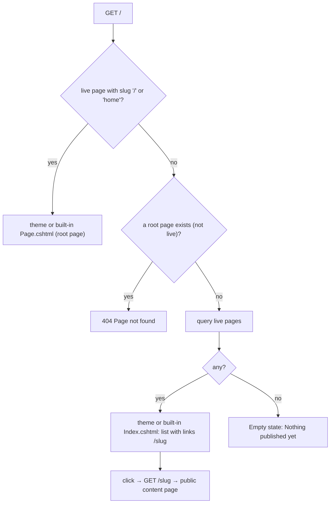

# Public home

## Purpose

The site root for anonymous visitors. If a live **root page** exists (slug `/`, or legacy slug `home`) it is
rendered like any content page. A root page that exists but is not live (switched off, or outside its schedule)
answers **404** like any other page that is not live. Only a site without a root page shows the fallback list of
every live content page (a fresh install). Both use the active
theme's views (`Page.cshtml` / `Index.cshtml`) when a theme extension is enabled ([themes](../features/themes.md)).
Routing and liveness rules: [content pages and routing](../features/content-pages-and-routing.md#public-resolution).

## Route / Navigation

| Item | Value |
| --- | --- |
| Route | `GET /` (`[HttpGet("")]` on `HomeController.Index`) |
| Navigation entry | brand link in `_Layout`; "Return home" on the error screen; the `<APP_NAME>` mark on the auth screens below 56rem |
| Parameters | none |
| Before install | redirected to `/setup` |

## Relevant source files

```text
src/DotNetForge.Web/Controllers/HomeController.cs     Index(), ThemedViewAsync()
src/DotNetForge.Shared/Content/PublishedPages.cs      PageVisibility.Live (the live rule)
src/DotNetForge.Web/Services/ThemeResolver.cs         the active theme
src/DotNetForge.Web/Views/Home/Page.cshtml            used when a root page is live (variant A, inside _Layout)
src/DotNetForge.Web/Views/Home/Index.cshtml           fallback list (variant B, inside _Layout)
src/DotNetForge.Web/Views/_ViewStart.cshtml           Layout = "_Layout" for both
src/DotNetForge.Web/Views/Shared/_Layout.cshtml       public fallback layout: skip link, header (brand, Admin), main, footer; SEO meta from ViewData; theme.js + public.css (no ui.js, no _Feedback, no theme menu)
src/DotNetForge.Web/Ui/UiTagHelpers.cs                <empty-state>, <icon>
src/DotNetForge.Web/wwwroot/css/forge/public.css      .site-header, .site-hero, .site-lead, .site-page-list, .site-footer
src/DotNetForge.Web/Middleware/SecurityHeadersMiddleware.cs   CSP and other security headers on every response
```

## Page layout

Variant A - a live root page exists: identical to the [public content page](public-page.md) (same `_Layout`; modules
whose `pages` setting lists `"/"` appear).

Variant B - fallback list (built-in view; an active theme with `Views/Index.cshtml` renders its own instead, with the
same model):

```text
<APP_NAME> (_Layout; ViewData["Title"] = null, so the <title> is just <APP_NAME>)
├── "Skip to content" link
├── header.site-header: logo mark + <APP_NAME> (→ /) · [Admin →] (/admin)
├── main#main.site-main
│   ├── section.site-hero
│   │   ├── h1 <APP_NAME>
│   │   ├── "A modular, secure, hybrid CMS built on ASP.NET Core MVC."
│   │   └── "The CMS is installed and running. This is the built-in public site - enable a theme on the Plugins screen to give it your own look."  (Plugins → /admin/plugins)
│   └── section "Published pages" (h2)
│       ├── ul.card.site-page-list: <Title> → (/<slug>) · /<slug>     ordered by SortOrder
│       └── or card > <empty-state> (see Empty states)
└── footer.site-footer "Powered by DotNetForge CMS"
```

Layout: [design system → public fallback](../architecture/design-system.md#public-fallback).

## Components

| Component | Inputs | Appears |
| --- | --- | --- |
| Header / footer (`_Layout`) | `ViewData["AppName"]` | both variants |
| Hero (`section.site-hero`, the page's only `<h1>`) | `ViewData["AppName"]` | variant B |
| Published pages list (`ul.card.site-page-list`) | model `List<(string Title, string Slug)>`, `ViewData["PublishedCount"]` | variant B, when count > 0 |
| `<empty-state icon="pages">` with **Open the Content Manager** | - | variant B, when no live pages |

## Functionality

### Render the root

1. Query live pages with slug `/` or `home`, ordering `/` first.
2. Found → `ThemedViewAsync("Page", home)`: the active theme's `Views/Page.cshtml`, else the built-in `Page.cshtml`
   inside `_Layout` (header brand from `ViewData["AppName"]`).
3. Not found → query all live pages (title, slug) by `SortOrder` → `ThemedViewAsync("Index", list)`.

No other actions.

## Data used by the page

`Page` rows (all tenants), `AppEnvironment.AppName`, `DateTime.UtcNow` for the liveness window.

## State

None beyond the request. `theme.js` applies a light/dark choice saved in `localStorage` (`dnf-theme`) on the admin
or auth screens; the public layout has no theme menu of its own.

## Permissions

Anonymous; no permission system on the public site.

## Validation

Not applicable.

## Error handling

Database errors → global error handling. No custom states.

## Loading behaviour

Server-rendered; one or two queries per request, plus the theme lookup and the menu query when a theme is active;
no caching.

## Empty states

Variant B with zero live pages shows, in a card under **Published pages**:

| Element | Text |
| --- | --- |
| Title | "Nothing published yet" |
| Text | "Create and publish a page in the Content Manager." |
| Action | **Open the Content Manager** (`/admin/content`, `.btn-primary`) |

On a fresh install the seeded `Home` page (slug `/`, published) is live, so variant A is shown.

## User interactions

Links only (brand, **Admin**, page links, **Plugins**, **Open the Content Manager**) and the "Skip to content" link.
No scripts beyond `theme.js`.

## Dependencies

```text
HomeController → DotNetForgeDbContext, AppEnvironment, ThemeResolver, IPublishedPages, ExtensionViewRenderer
SecurityHeadersMiddleware (first in the pipeline) → CSP, nosniff, X-Frame-Options, Referrer-Policy, Permissions-Policy
```

## Page flow



## Related pages

- Navigates to: [public content page](public-page.md), `/admin` ([Dashboard](dashboard.md) or [Sign in](login.md)).
- Receives navigation from: the [error screen](error.md), the brand link.
- Content is managed in the [Content Manager](content-manager.md).

## Important implementation details

- Queries ignore `TenantId` - pages of every tenant are candidates (single tenant only today).
- `Index` loads the root page in full with one query; the shape-only tree walk applies to
  [`RenderPage`](public-page.md#resolve-and-render), not to `/`.
- Every response carries the security headers of `SecurityHeadersMiddleware`; the CSP (`script-src 'self';
  style-src 'self'`, report-only in Development) means neither variant may use inline script or style - see
  [security](../features/security.md). `AdminUiTests.Every_screen_renders_without_inline_script_or_style` checks `/`
  (variant A on the seeded install) for that, exactly one `<h1>`, `lang` and the skip link.
- The built-in `_Layout` does not render `_Feedback` (no toasts, no confirm dialog) and does not load `ui.js`, so
  `data-*` behaviours from the [design system](../architecture/design-system.md#behaviours) do not work in public
  views.
- The **Admin** header link and the hero's **Plugins** / empty state's **Open the Content Manager** links are shown to
  every visitor; anonymous visitors are sent to [Sign in](login.md).
- The root lookup ignores `ParentPageId`: a nested page with slug `home` would be used as the root.
- The fallback list includes nested pages but links them as `/<slug>`, which 404s for anything below the top level
  (e.g. `Team` under `About` should be `/about/team`).

## Known limitations

- The built-in views have no menu (themes get one) and no page content.
- Fallback list links are wrong for nested pages (above).

## Planned (not implemented)

Target behaviour from the original product specification. Nothing in this section exists in the code unless marked ✔.

### Requirements

- The root page and the fallback list come from the **active tenant** only, resolved by domain, subdomain or path
  prefix ([multi-tenancy](../features/multi-tenancy.md)).
- The root page follows the same rules as any content page: published builder content, per-page view permissions,
  page type behaviour, preview ([public content page → Planned](public-page.md#planned-not-implemented)).
- Public screens render with the page's theme/layout or the tenant default theme (✔ the site-wide active theme;
  per-page themes ✘, [themes](../features/themes.md#planned-not-implemented)).
- Generated menus list `DisplayInMenu` pages (✔ in themes, top level only).
- With no matching content, the tenant's fallback/404 page is used.

Acceptance criteria: [content pages and routing](../features/content-pages-and-routing.md#acceptance-criteria),
[themes](../features/themes.md#acceptance-criteria).

## Extension points

- Root selection and the list query: `HomeController.Index`. Keep visibility rules in `PageVisibility.Live`
  (`src/DotNetForge.Shared/Content/PublishedPages.cs`).
- A different home look: a theme extension's `Views/Index.cshtml` / `Views/Page.cshtml` (no core change). A menu for
  the built-in `_Layout` would read `IPublishedPages` via a view component, not per view.
