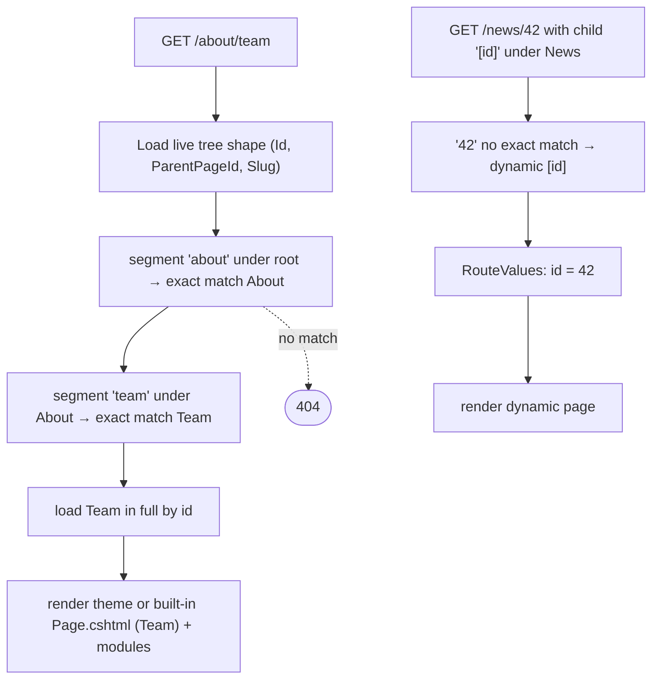

# Public content page

## Purpose

Renders a live content page for anonymous visitors at the URL formed by its slugs (e.g. `/about/team`), including
pages with a dynamic `[param]` segment, with the active theme's `Page.cshtml` when a theme extension is enabled and
the modules placed on that page. It is the frontend half of [Pages](pages.md); content lists in its layout show entries from the [Content Manager](content-manager.md).
Rules: [content pages and routing](../features/content-pages-and-routing.md); theming: [themes](../features/themes.md).

## Route / Navigation

| Item | Value |
| --- | --- |
| Route | fallback `{*path:nonfile}` → `HomeController.RenderPage` (any path without a file extension not matched by another route, including routes mapped by enabled extensions) |
| Route parameters | the URL segments; values captured by `[name]` slugs appear as `RouteValues` |
| Query parameters | none used |
| Navigation entry | links on the [public home](public-home.md) list; direct URLs |

## Relevant source files

```text
Program.cs                      app.MapFallbackToController("RenderPage", "Home")
src/DotNetForge.Web/Controllers/HomeController.cs   RenderPage(), ThemedViewAsync()
src/DotNetForge.Shared/Content/PublishedPages.cs    PageVisibility.Live (the live rule)
src/DotNetForge.Web/Services/ThemeResolver.cs       the active theme
src/DotNetForge.Web/Components/ExtensionModulesViewComponent.cs   modules placed on the page
src/DotNetForge.Web/Views/Home/Page.cshtml          built-in view: article + modules + info alert; sets Title / MetaDescription / CanonicalUrl ViewData
src/DotNetForge.Web/Views/_ViewStart.cshtml         Layout = "_Layout"
src/DotNetForge.Web/Views/Shared/_Layout.cshtml     public fallback layout: <title>, description + canonical meta, header, footer; theme.js + public.css (no ui.js, no _Feedback)
src/DotNetForge.Web/Ui/UiTagHelpers.cs              <alert>, <icon>
src/DotNetForge.Web/wwwroot/css/forge/public.css    .site-article, .site-header, .site-main, .site-footer
src/DotNetForge.Web/Middleware/SecurityHeadersMiddleware.cs   CSP and other security headers on every response
```

## Page layout

```text
_Layout
├── <title> "<MetaTitle or Title> · <APP_NAME>"
├── <meta name="description">        only when MetaDescription is set (ViewData["MetaDescription"])
├── <link rel="canonical">           only when CanonicalUrl is set (ViewData["CanonicalUrl"])
├── "Skip to content" link
├── header.site-header: logo mark + <APP_NAME> (→ /) · [Admin →] (/admin)
├── main#main.site-main
│   └── article.site-article
│       ├── header
│       │   ├── h1 Title
│       │   ├── /<slug>                                   (monospace)
│       │   └── "Dynamic route: name = value, ..."        only when a [param] segment matched
│       ├── modules (ExtensionModules view component)     only when an active module lists this path
│       └── <alert tone="Info" title="No content yet">
│           "This page is published but has no layout yet. Design it in Pages (Layout tab), or enable a theme
│            to style the site."
└── footer.site-footer "Powered by DotNetForge CMS"

With an active theme that has Views/Page.cshtml, the theme's view (and its layout) replaces all of the above.
```

Layout: [design system → public fallback](../architecture/design-system.md#public-fallback).

## Components

The built-in view renders inside the public `_Layout` (via `_ViewStart`). Inputs: model `Page`,
`ViewData["RouteValues"]` (`Dictionary<string,string>`), `ViewData["AppName"]` (header brand and `<title>` suffix).
It hands its SEO values to the layout: `ViewData["Title"]` (`MetaTitle`, else `Title`), `ViewData["MetaDescription"]`
and `ViewData["CanonicalUrl"]`. A theme view also gets `Extension`, `Settings`, `ResourceBase` (`/ext/{id}/resources`),
`AppName` and `Menu` ([themes](../features/themes.md)).

The **No content yet** `<alert>` (Info tone, `role="status"`) is always shown in the built-in view; its text links the
[Pages](pages.md) (`/admin/pages`).

`ExtensionModules` (`@await Component.InvokeAsync("ExtensionModules", new { page = Model })`, also callable from
themes): renders the `Views/Module.cshtml` of every active `module` extension whose `pages` setting lists the current
path, in name order, with the `Page` as model ([extensions → Slots](../features/extensions.md#slots)). A module that
throws is replaced by "<name> could not be displayed.".

## Functionality

### Resolve and render

1. Trim slashes; an empty path redirects to `Index` (`/`).
2. Load the **tree shape only** - `Id`, `ParentPageId`, `Slug` - of all live pages, as a projection.
3. Walk segments from the root level: exact slug (case-insensitive) first, else the `[...]` sibling; capture dynamic
   values.
4. Any segment without a match → `404` (empty body).
5. Load the matched (deepest) page in full by id (second query) and render `Page` through `ThemedViewAsync`: the
   active theme's `Views/Page.cshtml` when it has one, else the built-in view.

## Data used by the page

`Page` (title, slug, meta title/description, canonical URL), captured route values. `SeoKeywords`, `PageType`,
`TargetUrl`, `FileReference`, `DisplayInMenu` are ignored.

## State

None.

## Permissions

Anonymous. Visibility is governed solely by liveness (`Published && !Disabled` + schedule window). No per-page
permissions.

## Validation

Not applicable (read-only). Slugs were normalized when saved.

## Error handling

| Case | Result |
| --- | --- |
| Unknown path / non-live page / non-live ancestor | `404` with empty body |
| Path with a file extension (e.g. `/about.html`) | not routed to this action - static file or `404` |
| DB failure | global error handling |

## Loading behaviour

Server-rendered; two queries per request: the `(Id, ParentPageId, Slug)` projection of every live page, then the
matched row - plus, with an active theme, the live-page list for the menu. No
caching (enabled state is cached up to 30 s).

## Empty states

Not applicable (a page always has a title).

## User interactions

Links only: brand (`/`), **Admin** (`/admin`), the "Pages" link in the alert (`/admin/pages?selected={id}#layout`) and the
"Skip to content" link. No scripts beyond `theme.js` (no `ui.js`).

## Dependencies

`HomeController` → `DotNetForgeDbContext`, `AppEnvironment`, `ThemeResolver` (→ `ExtensionCatalog`),
`IPublishedPages`, `ExtensionViewRenderer`. `ExtensionModulesViewComponent` → `ExtensionCatalog`,
`ExtensionViewRenderer`. Every response passes `SecurityHeadersMiddleware` (first in the pipeline).

## Page flow



## Related pages

- Receives navigation from: [public home](public-home.md).
- Links to: [Pages](pages.md).
- Shares rendering with: [public home](public-home.md) (root page uses the same view).
- Themes and modules are enabled on [Plugins](plugins.md).

## Important implementation details

- The fallback is the lowest-priority endpoint: slugs equal to `admin`, `setup`, `account`, `api`, `error`, `health`,
  `ext` are shadowed by real routes, and so are paths an extension maps (e.g. the SEO Toolkit sample's `/sitemap.xml`
  and `/robots.txt`) - even while that extension is disabled, when the gate answers `404` instead of falling back.
- Matching is case-insensitive; slugs are stored lower-case.
- A dynamic page matches **any** value; the value is displayed, not validated or looked up.
- The built-in view uses the shared public `_Layout` (`public.css`); it has no document or stylesheet of its own. It
  carries no inline `<style>` or script; nor may theme or module views (CSP). `AdminUiTests` checks `/about` (a seeded
  live page) for no inline script/style, exactly one `<h1>`, `lang` and the skip link - a module view that adds its
  own `<h1>` would break that rule.
- The built-in `_Layout` renders no toasts or confirm dialog (`_Feedback` is not included) and does not load `ui.js`,
  so module views cannot rely on the [design system's behaviours](../architecture/design-system.md#behaviours); they
  can use its CSS classes (`components.css` is loaded).
- Security headers on every response (`SecurityHeadersMiddleware`): `Content-Security-Policy` with
  `script-src 'self'; style-src 'self'` (report-only in Development), `X-Content-Type-Options: nosniff`,
  `X-Frame-Options: SAMEORIGIN`, `Referrer-Policy: strict-origin-when-cross-origin`, `Permissions-Policy:
  camera=(), microphone=(), geolocation=()`. `img-src`/`media-src` also allow any `https:` origin (presigned media
  URLs). Full policy: [security](../features/security.md).

## Known limitations

- `UrlRedirect` and `File` page types neither redirect nor serve a file.
- No content body or layout selection; no 404 page.
- Children of the root page (`/`) are unreachable.

## Planned (not implemented)

Target behaviour from the original product specification. Nothing in this section exists in the code unless marked ✔.

Model, rules and acceptance criteria: [content pages and routing → Planned](../features/content-pages-and-routing.md#planned-not-implemented)
(including [dynamic routes](../features/content-pages-and-routing.md#dynamic-routes)); theming:
[themes](../features/themes.md#planned-not-implemented).

### Requirements

| Area | Target | Today |
| --- | --- | --- |
| Resolution order | static content page → dynamic route (priority, sort order, specificity) → extension route → fallback/404 page | tree walk with `[name]` fallback per segment, empty `404` |
| Page types | `UrlRedirect` redirects to `TargetUrl`; `File` serves or links the File Manager asset; `ExistingPage` renders the referenced page | all render `Page.cshtml` |
| Body | the published version's page-builder modules | fixed note |
| Theme | page theme/layout, else the site's default theme; admin, setup and login never themed | ✔ the page's own theme (`Page.ThemeId`) when enabled, else `ThemeResolver.DefaultThemeId` when enabled, else the first enabled theme ([themes](../features/themes.md)); ✘ per-page layout |
| Access | public pages for everyone; private pages only for the granted roles/users | liveness only |
| SEO | meta title (fallback title ✔), meta description ✔, canonical ✔, keywords; dynamic routes render title/meta/keywords/canonical templates with parameter values, entry-level values override | keywords not rendered |
| Dynamic route values | resolve the target content, module or handler from the extracted parameters | values only displayed |
| Preview | the draft of a page or route renders for authorized users; never for anonymous visitors | ✘ |
| Menu | generated from `DisplayInMenu` pages | ✔ in themes (`ViewData["Menu"]`: top-level live pages); the built-in view has none |

### Rules and validation

- A route or page that is disabled is skipped; an unpublished one resolves only in authorized preview, otherwise
  resolution continues to the next stage.
- A URL segment with an empty parameter value never matches.
- Template output is HTML-encoded (XSS-safe); a placeholder without a value renders empty/default, never an error.
- The admin area is never reachable through a public route.

### Edge cases

- Missing or disabled route target → next stage / 404, no exception; the route is flagged broken in the admin.
- Page theme uninstalled, incompatible or with missing assets → render with the site's default (or built-in default)
  theme and log it ([themes](../features/themes.md#edge-cases)).
- File page whose asset was deleted cannot be published (broken-reference warning in the admin).

### Acceptance criteria

Tracked in [content pages and routing → Acceptance criteria](../features/content-pages-and-routing.md#acceptance-criteria)
and [themes → Acceptance criteria](../features/themes.md#acceptance-criteria).

## Extension points

- Page-type behaviour (redirect, file): branch in `HomeController.RenderPage` after a match, before `View(...)`.
- Rendering: a theme extension (no core change); view selection is `HomeController.ThemedViewAsync`. Theme views must
  not use inline `<script>`/`<style>` or `style="..."` attributes (blocked by the CSP); ship them as files under the
  theme's `Views/Resources/`.
- Content on specific pages without touching the core: a `module` extension.
- The live rule is `PageVisibility.Live` (`src/DotNetForge.Shared/Content/PublishedPages.cs`); if resolution grows,
  move it into a `src/DotNetForge.Web/Services/` class shared with `Index`.
