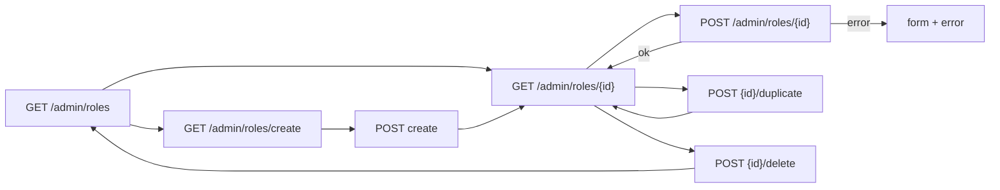

# Roles

## Purpose

Lists the roles and lets holders of the **Roles** grants create, edit, duplicate and delete
them. A role bundles `(area, action)` permissions; a user can do what any of their roles grants. Role semantics and
evaluation: [authorization](../features/authorization.md).

## Route / Navigation

| Item | Value |
| --- | --- |
| Routes | `GET /admin/roles` (list) · `GET /admin/roles/create` · `POST /admin/roles/create` · `GET /admin/roles/{id}` (editor) · `POST /admin/roles/{id}` (save) · `POST /admin/roles/{id}/duplicate` · `POST /admin/roles/{id}/delete` |
| Sidebar entry | **Settings → Administration Panel → Roles** (`AdminNavigation.Tree`). The spec tree also lists Roles under **Users & Permissions Plugin**; it is shown once ([pages → sidebar](../architecture/pages.md#canonical-sidebar-tree-vs-the-sidebar)). |
| Breadcrumbs | Settings › Administration Panel › Roles › *Create role* / *role name* |
| Linked from | the sidebar; **Manage roles** on the [Users](users.md) form; member links on the editor go to [Users](users.md) |

## Relevant source files

```text
src/DotNetForge.Web/Areas/Admin/Controllers/RolesController.cs   list, editor, POST actions; RoleListItem, RoleFormModel, RoleMember
src/DotNetForge.Web/Services/RoleManagementService.cs            rules, persistence, audit, grant cache invalidation
src/DotNetForge.Web/Areas/Admin/Views/Roles/Index.cshtml         list
src/DotNetForge.Web/Areas/Admin/Views/Roles/Edit.cshtml          create / edit form, permission grid, members, delete
src/DotNetForge.Shared/Authorization/PermissionCatalog.cs        the areas and actions the grid offers
src/DotNetForge.Data/RoleGrantStore.cs                           cached grants read by PermissionService
src/DotNetForge.Shared/Entities/Role.cs                          Role, RolePermission, UserRole
```

## Page layout

```text
List - Roles (h1) · [Create role]
└── section.card[data-collection]
    ├── card-header: **All roles** · "N total" · .segmented (JS only): All | Built-in | Custom
    └── table: **Role** ⇅ (link to the editor) · **Type** · **Users** ⇅ · **Permissions** ⇅ · row menu ⋯ (Edit, Duplicate, Delete)

Editor - <role name> or "Create role" (h1) · [Duplicate]
├── form.editor-main
│   ├── card **Details**: Name* (read-only for built-in roles) · Description
│   └── card **Permissions**: one fieldset per catalog area (label, description, "All" toggle, action checkboxes)
│       └── footer: Cancel · [Save changes] / [Create role]
└── aside.editor-aside (existing roles)
    ├── card **Users with this role**: linked names / emails
    └── card.card-danger **Delete role** (custom roles; a hint instead of the button while users hold it)
```

## Components

List rows (`RoleListItem(Id, Name, Description, IsBuiltIn, Users, Permissions)`, built-in first, then by name). The
seven built-in roles (`Roles.BuiltIn`: `Super Admin`, `Admin`, `Developer`, `Editor`, `Author`, `Authenticated`,
`Public`) are seeded by `DataSeeder` with the `PermissionMatrix` defaults - also into an existing database that lacks
one, on the next start. `Developer` holds only the `API` area (the [API Tokens](api-tokens.md) screen); the
[API Docs](api-docs.md) and [API Endpoints](api-endpoints.md) screens are opened by the role name (`Super Admin` or
`Developer`), not by grants, so ticking `API` on a custom role does not open them.

| Column | Rendering |
| --- | --- |
| **Role** | name as a link to the editor, description below ("No description" when blank) |
| **Type** | **Built-in** (accent, lock) or **Custom** badge |
| **Users** | number of `UserRole` rows |
| **Permissions** | number of catalog grants the role holds; Super Admin shows the catalog size (it has everything) |
| Row menu (⋯) | **Edit**; **Duplicate** (with the `Roles` / `create` grant); **Delete** for custom roles (with `Roles` / `delete`, confirmation dialog, back to the list) - replaced by "In use by N users - can't be deleted" while users hold the role |

Permission grid: one `fieldset.permission-group` per `PermissionCatalog.Areas` entry, checkboxes
`name="Grants" value="{area}|{action}"`, labelled by `PermissionCatalog.ActionLabel` ("Update own"). The **All**
checkbox (`data-check-group`, JS only) ticks a whole area.

## Functionality

| Action | What happens |
| --- | --- |
| Create | `RoleManagementService.CreateAsync`: a custom role with the ticked grants → toast "Created the role …" and the editor. |
| Save | `UpdateAsync`: name (custom roles only), description and grants. Only catalog grants are compared and replaced; other stored rows stay. → toast "Saved. Permission changes apply immediately." |
| Duplicate | `DuplicateAsync`: a custom copy named `<name> (copy)` (`(copy 2)`, … when taken) with every stored grant of the source (a Super Admin copy gets the whole catalog) → opens the copy. |
| Delete | `DeleteAsync` after a confirmation dialog: removes the grants, then the role → list with a toast. |

Grant changes take effect on the users' next request (`IRoleGrantStore.Invalidate`); role **assignments** are made on
the [Users](users.md) screen.

## Data used by the page

Single-table queries combined in memory: all `Roles`, `UserRoles` by
role ids (counts and members), `RolePermissions` by role ids, `Users` by member ids.

## State

Server: the `Roles` / `RolePermissions` rows. Client: the list's type filter and sort (lost on reload).

## Permissions

| Route | Requires |
| --- | --- |
| list, editor (`GET`) | `AdminArea` + `Roles` / `read` |
| create (`GET`/`POST`), duplicate | + `Roles` / `create` |
| save | + `Roles` / `update` |
| delete | + `Roles` / `delete` |

Defaults: Super Admin and Admin. Without `update` the editor is read-only (fieldset disabled, no Save button). Rules
that hold regardless of grants ([authorization → safety rules](../features/authorization.md#safety-rules-for-users-and-roles)):

- built-in roles keep their names and can't be deleted;
- `Super Admin` (always everything) and `Public` (site visitors) have fixed grants; only a Super Admin edits the
  `Super Admin` role;
- only a Super Admin changes the grants of a role they hold - an Admin sees the `Admin` grid read-only with "You hold
  this role, so you can't change its permissions. Ask a Super Admin." (the current grants are posted as hidden
  fields so saving the description leaves them unchanged).

## Validation / error handling / loading

Errors are shown in `<form-errors />` above the form with the input kept; list and delete errors are toasts.

| Rule | Message |
| --- | --- |
| Name required, at most 100 characters | "Enter a role name (at most 100 characters)." |
| Name unique (case-insensitive) | "A role named '…' already exists." |
| Description at most 500 characters | "The description is limited to 500 characters." |
| Grants must be catalog pairs | "'…' is not a known permission." |
| Changing grants of a held role (not Super Admin) | "You can't change the permissions of a role you hold. Ask a Super Admin." |
| Super Admin role by a non-Super Admin | "Only a Super Admin can change the Super Admin role." |
| Deleting a built-in role | "Built-in roles can't be deleted." |
| Deleting a role in use | "N users still have this role. Give them another role first." |
| Copy name over 100 characters | "The copy's name would be too long. Create the role instead." |

## Empty states

| Case | Text |
| --- | --- |
| No roles at all | "No roles yet." |
| Filter matches nothing (JS) | "No role matches the filter." |
| Role without members (editor) | "Nobody has this role yet. Assign it when you create or edit a user." |

## User interactions

Filter and sort the list; open a role; tick permissions (or **All** per area); save; duplicate; delete (confirmation
dialog, `data-confirm`).

## Dependencies

```text
RolesController
├── DotNetForgeDbContext (reads)
└── RoleManagementService
    ├── DotNetForgeDbContext
    ├── IAuditService      role.changed / permission.changed
    └── IRoleGrantStore    Invalidate after each change
```

## Page flow



## Related pages

[Users](users.md), [Audit Logs](audit-logs.md), [authorization](../features/authorization.md).

## Important implementation details

- Audit: create, edit of name/description, duplicate and delete write `role.changed` (details `Created`, `Updated`,
  `Duplicated from …`, `Deleted`); a changed grant set writes `permission.changed`.
- Stored keys use the catalog's exact spelling (`RoleManagementService.Normalize`), so they match the constants the
  code checks.
- Seeded rows outside the catalog (e.g. `Media` / `publish`) aren't shown or counted, but are kept on save and copied
  by Duplicate.
- Deleting removes `RolePermission` rows first.

## Known limitations

- No optimistic concurrency: two people saving the same role at once - the last save wins.
- Role assignment happens per user ([Users](users.md)); there is no bulk "assign users" on the role.
- Grants for areas without screens (Single types, Webhooks, Plugins, Extensions, Updates) are stored but not checked
  yet ([authorization → catalog](../features/authorization.md#permission-catalog)).

## Planned (not implemented)

Target behaviour from the original product specification. Nothing in this section exists in the code unless marked ✔.

### Requirements

- **Assign users** to a role from the role editor (today: from each user).
- `Public` cannot gain more than read-only public content once its grants become editable (today they are fixed ✔).

### Edge cases

- **Role still has users:** deletion is blocked ✔; the delete flow may offer bulk reassignment.
- **Concurrent edits** of the same role: optimistic concurrency, the second save gets a conflict notice and reloads.

### Acceptance criteria

- [x] Users with the Roles permission can create, edit, duplicate and delete roles and assign permissions (`RolesController`, `RoleManagementService`; assigning users is done on the Users screen).
- [x] Built-in roles cannot be deleted and their names cannot be changed.
- [x] Deleting a role that still has users is blocked until those users are reassigned.
- [x] Changes that would strip the actor's own role/user management in an unsafe way are blocked (no grant changes to a held role except by a Super Admin).
- [ ] Concurrent edits to the same role use optimistic concurrency with a conflict notice.

## Extension points

New grantable pairs go into `PermissionCatalog` (the grid picks them up). New rules belong in
`RoleManagementService`, not the controller. Destructive actions use `data-confirm` and report with
`TempData["Success"]`/`["Error"]` toasts ([design system → feedback](../architecture/design-system.md#feedback)).
