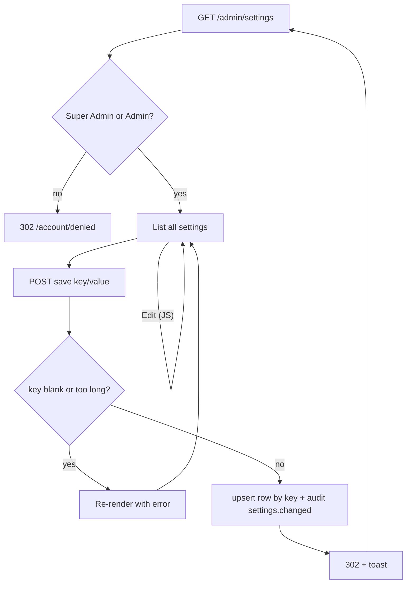

# Settings

## Purpose

A minimal key/value editor. It lists all settings (one value per key) and lets a `Super Admin` or `Admin` create a
setting or overwrite its value. No application code reads these settings yet; they are readable through
`GET /api/settings`.

## Route / Navigation

| Item | Value |
| --- | --- |
| Routes | `GET /admin/settings`, `POST /admin/settings/save` |
| Navigation entry | Sidebar → **Settings** → **Global Settings** → **Settings** (`AdminNavigation.Tree`); breadcrumbs **Settings / Global Settings / Settings** |
| Parameters | none |
| Access | `Super Admin`, `Admin` only; the sidebar hides the link from other roles, and opening the URL directly lands on [access denied](access-denied.md) |

## Relevant source files

```text
src/DotNetForge.Web/Areas/Admin/Controllers/SettingsController.cs   Index, Save, BuildAsync, MaxKeyLength / MaxValueLength
src/DotNetForge.Web/Areas/Admin/Models/AdminViewModels.cs           SettingsIndexViewModel (AppName, Settings)
src/DotNetForge.Web/Areas/Admin/Views/Settings/Index.cshtml         "All settings" table card + "Add or update" form card
src/DotNetForge.Web/wwwroot/js/forge/ui.js                          data-collection (search, sort, paging), data-fill (Edit → form)
src/DotNetForge.Web/wwwroot/css/forge/admin.css                     .settings-layout (two columns, one below 64rem)
src/DotNetForge.Web/Views/Shared/_Feedback.cshtml                   success toast after a save (rendered by _AdminLayout)
src/DotNetForge.Shared/Entities/SystemState.cs                      Setting entity (same file)
src/DotNetForge.Web/Services/AuditService.cs                        settings.changed (via IAuditService)
```

## Page layout

```text
Settings (_AdminLayout; header "Settings" + description "Key/value settings for <APP_NAME>. Saving creates a key
│         or updates its value.")
└── .settings-layout
    ├── card "All settings" [data-collection, 25 per page]   "N total" / "x of N"
    │   ├── toolbar (JS only): search "Search keys and values"
    │   ├── table.table.table-stack: Key (sortable, <code>) · Value ("(empty)" when blank) · [Edit] (JS only)
    │   │   └── row "No setting matches the search."   [data-collection-empty]
    │   └── pagination                                  JS, more than 25 matching rows
    │   (no settings → empty state "No settings yet" instead of toolbar and table)
    └── card "Add or update" - "An existing key is overwritten."
        └── form#settingForm (POST /admin/settings/save, antiforgery)
            ├── <form-errors />
            ├── Key * (placeholder "site.tagline", monospace) · Value (optional, textarea)
            └── [Clear] (reset) · [Save setting]
```

## Components

Component mechanics: [design system → components](../architecture/design-system.md#components) and
[behaviours](../architecture/design-system.md#behaviours).

| Component | Inputs | Behaviour |
| --- | --- | --- |
| Settings table | `SettingsIndexViewModel.Settings` (`(Key, Value)` list ordered by key) | read-only; client-side search over key and value, sort by **Key**, 25 rows per page |
| **Edit** button | `data-fill="#settingForm"` + `data-fill-key` / `data-fill-value` | copies the row's key and value into the form and focuses **Key**; nothing is saved until **Save setting** |
| Add or update form | `key`, `value` (simple parameters) | posts to `SettingsController.Save`; **Clear** resets the fields |

## Functionality

### Add or update a setting

1. **Trigger:** **Save setting** (optionally after **Edit** on a row).
2. **Validation:** browser `required` on Key; server: key not blank (`Key is required.`); trimmed key ≤ 200 and
   value ≤ 4000 characters (`Keys are limited to 200 characters and values to 4000.`).
3. **Call:** `SettingsController.Save(key, value)`.
4. **Backend:** trims the key; finds the `Setting` with that key; creates it if missing;
   sets `Value` (untrimmed, may be empty/null); `SaveChangesAsync`; audit `settings.changed` (entity `Setting`, id and
   display = key - the value is not recorded).
5. **Result:** redirect to `/admin/settings`, success toast `Saved '<key>'.`.
6. **Errors:** blank or too-long key/value → same screen with the message in `<form-errors />` (the form fields are
   not re-filled).

There is no delete.

### Find a setting

Client-side over the server-rendered table: search box, click **Key** to sort, pagination. Without JavaScript the
toolbar, **Edit** buttons and pagination stay hidden and every row is listed.

## Data used by the page

All `Settings` rows (`Key`, `Value`, ordered by key); `AppEnvironment.AppName` (description).

## State

| State | Where | Changes when |
| --- | --- | --- |
| Result message | `TempData["Success"]` → toast | after a save |
| Errors | `ModelState` | failed save (same request) |
| Search, sort, page, filled form | DOM only (`ui.js`) | lost on reload |
| Settings | `Setting` rows | save |

## Permissions

`[RequirePermission(Settings, read)]` on `SettingsController` and `[RequirePermission(Settings, update)]` on
`Save`, on top of the `AdminArea` policy ([authorization → screen access](../features/authorization.md#screen-access)).
With the default grants only Super Admin and Admin pass; `Editor` and `Author` are redirected to `/account/denied`
(403 [access denied](access-denied.md)) for both the GET and the POST
(`SecurityTests.Editors_can_no_longer_change_settings`). The sidebar evaluates the same attributes and hides the
**Settings** link from them (`AdminUiTests.The_sidebar_shows_only_screens_the_role_may_open`) - hiding is not the gate.

## Validation

Key required (trimmed). Key ≤ 200 characters (after trimming), value ≤ 4000 characters - the column lengths, checked
before saving so PostgreSQL never rejects the insert. No key format, no duplicate warning. Keys owned by screens with
their own rules are refused ("'<key>' is managed on <screen>; change it there."): `users.*`
([Advanced Settings](advanced-settings.md) - e.g. a Super Admin default role) and `transfer.*` (the backup schedule,
[Data Management](data-management.md)). SMTP is not a setting here: it comes from `SMTP_*` in `.env`.

## Error handling

| Failure | User sees |
| --- | --- |
| Blank key | "Key is required." in `<form-errors />` |
| Key > 200 or value > 4000 characters | "Keys are limited to 200 characters and values to 4000." in `<form-errors />` |
| Editor / Author opens or posts | redirect to `/account/denied` (403) |
| Other DB failure | global [error page](error.md) |

## Loading behaviour

Server-rendered; one query. No skeletons.

## Empty states

| When | Text |
| --- | --- |
| No settings (the normal state on a fresh install - nothing seeds settings) | **No settings yet** - "Add the first key/value pair with the form." |
| Search matches nothing | "No setting matches the search." |

## User interactions

Search box, **Key** column sort, pagination, **Edit** (fills the form), **Clear**, **Save setting**; Enter in **Key**
submits.

## Dependencies

```text
SettingsController → DotNetForgeDbContext, AppEnvironment, IAuditService (AuditService)
```

## Page flow



## Related pages

[Dashboard](dashboard.md); API `GET /api/settings` ([headless API](../features/headless-api.md)). The other
"Global Settings" sidebar items are separate screens ([API Tokens](api-tokens.md), [Plugins](plugins.md)) or
[placeholders](module-placeholders.md).

## Important implementation details

- `Settings.Key` is unique (DB index): saving an existing key overwrites its value. When the `RemoveTenants`
  migration made keys unique it deleted former global (no tenant) rows that a tenant row with the same key shadowed;
  the value the screen showed was kept.
- Values are displayed HTML-encoded; there is no secret masking - don't store secrets here.

## Known limitations

- No delete, no typed settings, no grouping, no logo upload or overview diagnostics (see
  [planned](#planned-not-implemented)).
- No consumer of `Setting` rows in the application.

## Planned (not implemented)

Target behaviour from the original product specification. Nothing in this section exists in the code unless marked ✔.

### Requirements

**Global Settings → Overview** is the landing screen of the Global Settings group (today the sidebar entry is
labelled **Settings** and opens this key/value editor - see the
[sidebar differences](../architecture/pages.md#canonical-sidebar-tree-vs-the-sidebar)). It shows read-only
diagnostics, two logo uploads, a **Check for updates** action, a system health indicator and the settings hub table.

**Overview diagnostics (read-only)**

| Field | Type | Spec source | Available in code today |
| --- | --- | --- | --- |
| CMS version | semver string | application assembly | `SystemState.CmsVersion` (DB row, default `1.0.0`) - shown on the [Dashboard](dashboard.md), not from the assembly |
| Available CMS updates | version or "Up to date" | update check service, links to [transfer and updates](../features/transfer-and-updates.md) | ✘ |
| C# language version | string | build/runtime | ✘ |
| ASP.NET Core version | string | runtime | ✘ |
| Database provider | `postgresql` (the CMS database is always PostgreSQL; no setting) | - | ✔ `DatabaseCatalog.Main` (not displayed; Data Management shows it on its Export card) |
| Environment | e.g. `Development`, `Production` | hosting environment | ✔ `IWebHostEnvironment.EnvironmentName` (not displayed) |
| Installed extensions | count (optional list) | extension registry ([extensions](../features/extensions.md)) | `InstalledExtensions` holds the enabled state (written on enable/disable); on-disk discovery is `IExtensionLoader.Discover`, "is it active" is `ExtensionCatalog` |
| System health | `Healthy` \| `Degraded` \| `Unhealthy` + per-check detail | health check service | ✘ (`GET /health` returns a static `ok`) |

**Branding logos (the only editable inputs)**

| Field | Required | Shown on | Cleared → |
| --- | --- | --- | --- |
| Admin menu logo | no | admin sidebar/header (today `wwwroot/img/logo.svg` in the light and `logo-dark.svg` in the dark `_AdminLayout` sidebar) | built-in default |
| Authentication/login logo | no | sign-in and setup screens (`_AuthLayout`, today `wwwroot/img/logo-dark.svg` in the brand panel, `logo-mark.svg` + app name in the narrow-screen header) | built-in default |

Stored through the media subsystem (✔ uploads exist - `MediaService` + `IFileStorage`,
[upload flow](../features/media-storage.md#upload-flow); logo storage itself is not built), URL generated there,
reference saved in the settings store (`Setting`). The admin logo is the admin-area branding
override; public [themes](../features/themes.md) never affect it.

**Settings hub table** - one row per settings screen, linking to it:

| Screen | Group | Documented in |
| --- | --- | --- |
| Overview | Global Settings | this document |
| API Tokens | Global Settings | [API Tokens](api-tokens.md) |
| Content History | Global Settings | [Content Manager](content-manager.md) (placeholder today) |
| Internationalization | Global Settings | [internationalization](../features/internationalization.md) |
| File Manager | Global Settings | [media storage](../features/media-storage.md) |
| Plugins | Global Settings | [Plugins](plugins.md) |
| Transfer (sidebar: **Data Management**) | Global Settings | [Data Management](data-management.md) |
| Webhooks | Global Settings | [webhooks](../features/webhooks.md) |
| Roles, Users, Audit Logs | Administration Panel | [Roles](roles.md), [Users](users.md), [Audit Logs](audit-logs.md) |
| Configuration, Templates | Email | [email](../features/email.md) |
| Roles, Providers, Advanced Settings | Users & Permissions Plugin | [Roles](roles.md), [authentication](../features/authentication.md) |

Marketplace is not part of the hub; it lives in the sidebar's **Main** group ✔
([extensions](../features/extensions.md)). A hub link is shown only to users holding the target screen's permission
area (e.g. `Webhooks`, `API`, `Media`, `Extensions`, `Users`, `Roles`).

**Permissions** (`Settings` permission area; see [authorization](../features/authorization.md))

| Action | `Super Admin` | `Admin` | `Editor`, `Author`, `Authenticated`, `Public` |
| --- | :-: | :-: | :-: |
| View Overview / Global Settings | ✔ | if granted `Settings` read | ✘ unless granted |
| Upload / change / reset either logo | ✔ | if granted `Settings` write | ✘ unless granted |
| Check for updates | ✔ | if granted `Settings` read | ✘ |
| Apply update / rollback | ✔ | only if explicitly granted | ✘ |
| Open a settings sub-screen | per that screen's permission area | same | same (`Authenticated`/`Public`: never) |

`Super Admin` has full access. With the default grants only `Super Admin` and `Admin` can open this screen and save
settings.

### User flows

| Flow | Steps |
| --- | --- |
| View overview | open **Settings → Global Settings → Overview** → check `Settings` read → load diagnostics → render read-only fields, current logos (or defaults), hub table, **Check for updates** |
| Upload admin menu logo | pick file → client checks type/size → server re-validates (type, size, safe-upload) → store via media subsystem, generate URL → save reference, audit → sidebar/header shows it immediately; public site unaffected |
| Upload login logo | same validation and storage → audit → sign-in and setup screens show it on next render |
| Remove / reset logo | clear the field and save → reference removed, surface reverts to the default → audit |
| Check for updates | **Check for updates** (or the **Available CMS updates** link) → query update service, compare with installed version → show newer version + link to the update workflow, which backs up first and supports rollback ([transfer and updates](../features/transfer-and-updates.md)) |
| Review degraded health | health shows `Degraded`/`Unhealthy` → expand → list of failing subsystems (database, storage, a failing extension) |

### Rules and validation

- Diagnostic fields are read-only; the two logos are the only inputs.
- Logo uploads: only image types allowed by the media configuration (e.g. PNG, JPEG, WebP - SVG is not on the
  `MediaService` allowlist), within the configured max upload size, passing safe-upload checks (type/size
  validation, scanning/blocking where possible). Validated on client and server; the server check is authoritative.
- Both logos are optional; clearing reverts to the built-in default.
- Never display secrets: show the provider, never `DATABASE_CONNECTION_STRING` ([configuration](../features/configuration.md#secrets)).
- Every successful global settings change (logo upload, logo reset, update action) is audited. Key/value saves are
  already audited ✔ (`settings.changed`).
- Permission checks run on every action on the server, not only in the UI.

### Edge cases

| Case | Target behaviour |
| --- | --- |
| Update available / none | Show the version with a link to the update workflow, or an explicit "Up to date" - never an empty value. |
| Update service unreachable | "Unable to check for updates" state; rest of the screen unaffected. |
| Health `Degraded`/`Unhealthy` | Show which checks failed; never silently report `Healthy`. |
| Oversized logo | Rejected with an error stating the limit; nothing partial stored. |
| Disallowed or unsafe file type | Rejected with a clear error; not stored. |
| Two admins upload a logo at once | Last successful save wins; both audited. |
| Logo reference points to a missing file | Surface falls back to the default logo, no broken image. |
| Active public theme | No effect on the admin logo or admin area. |
| `Settings` permission revoked mid-session | Subsequent saves/update actions denied server-side. |

### Acceptance criteria

- [ ] The Overview shows CMS version, available updates, C# version, ASP.NET Core version, database provider,
  environment, installed extensions and system health.
- [ ] All diagnostic fields are read-only.
- [ ] The provider shown matches the configured database, and no connection string or secret is displayed.
- [ ] A user with `Settings` write can upload an admin menu logo, and it appears in the admin sidebar/header.
- [ ] A user with `Settings` write can upload a login logo, and it appears on the sign-in and setup screens.
- [ ] Clearing either logo reverts the surface to the built-in default.
- [ ] Logo uploads with a disallowed type or over the size limit are rejected with a clear message.
- [ ] Server-side validation rejects unsafe uploads even when client validation is bypassed.
- [ ] The hub table links to every settings screen (API Tokens, Content History, Internationalization, File Manager,
  Plugins, Transfer (Data Management), Webhooks, Email, Administration Panel, Users & Permissions Plugin).
- [x] Marketplace is reachable from the admin **Main** menu - `AdminNavigation.Tree` → `/admin/marketplace`
  (`ModulesController.Marketplace`, placeholder screen; "Soon" badge in the sidebar).
- [ ] **Check for updates** reports an available version (with link) or "Up to date", and an error state when the
  check fails.
- [ ] System health shows `Healthy`/`Degraded`/`Unhealthy` with failing-subsystem detail.
- [x] Users without the `Settings` permission cannot view or modify Global Settings (`[RequirePermission]` on
  `SettingsController`: `read` to view, `update` to save).
- [x] `Super Admin` has full access to Global Settings and every sub-screen - passes `AdminArea` and every
  controller check (`Super Admin` holds every grant; `PluginsController` requires the role).
- [ ] Every successful global settings change (logo upload, logo reset, update action) is audited - only key/value
  saves exist and are audited.
- [ ] The admin menu logo and admin area are unaffected by any active public theme.

## Extension points

- A typed setting used by code: read it in a small service that queries `Settings` by key
  and register it in `DependencyRegistration`; don't query `Settings` from many controllers.
- Delete: add `POST /admin/settings/delete` with antiforgery and an audit entry.
