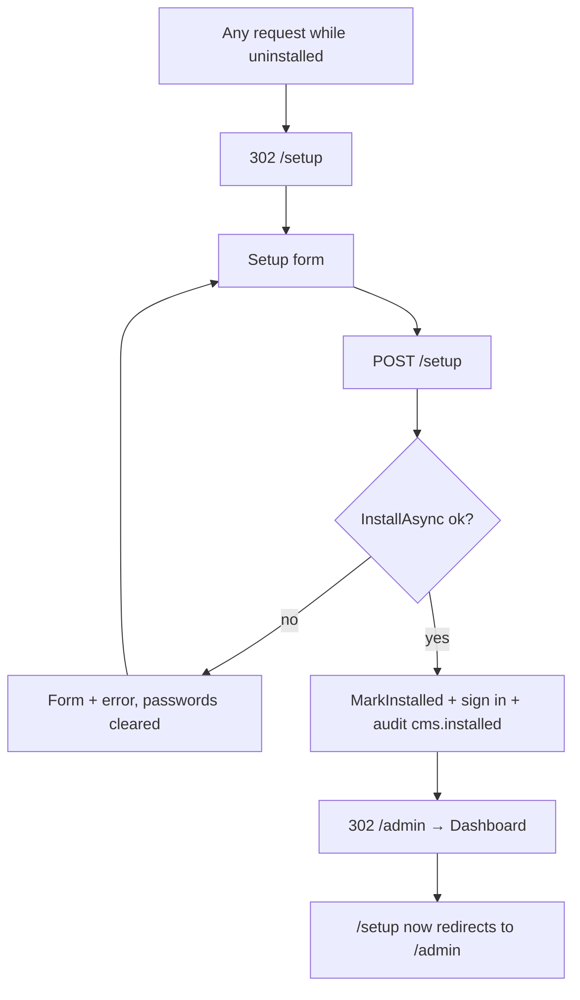

# Setup wizard

## Purpose

The first screen anyone sees on a fresh database. It creates the first administrator - assigned the `Super Admin`
role - marks the CMS **installed**, signs that user in and sends them to the admin. It exists only once: after
installation the route is permanently blocked. Used by whoever deploys the CMS. Feature-level behaviour (gate,
transaction, concurrency) is in [installation](../features/installation.md).

## Route / Navigation

| Item | Value |
| --- | --- |
| Route | `GET /setup`, `POST /setup` |
| Navigation entry | none - `InstallationMiddleware` redirects every non-static request here while uninstalled |
| After install | `/setup*` → `302 /admin` |
| On success | `302 /admin` |
| Query / route parameters | none |
| Rate limit | `POST /setup`: 10 requests per minute per client IP (policy `credentials`, shared with sign-in) → `429` |

## Relevant source files

```text
src/DotNetForge.Web/Controllers/SetupController.cs                   GET/POST actions, sign-in after install, cms.installed audit
src/DotNetForge.Web/Views/Setup/Index.cshtml                         heading + form (Layout = "_AuthLayout")
src/DotNetForge.Web/Views/Shared/_AccountFields.cshtml               the fields, shared with Register
src/DotNetForge.Web/Views/Shared/_AuthLayout.cshtml                  brand panel + form column, theme menu, _Feedback; loads dnf-theme.js, dnf.css, auth.css, dnf.js
src/DotNetForge.Web/Views/Shared/_ThemeMenu.cshtml                   Light / Dark / System menu (needs JS)
src/DotNetForge.UI/Components/BasicTagHelpers.cs                     <dnf-validation-summary /> (model-state errors), <dnf-icon>
src/DotNetForge.Web/wwwroot/css/auth.css                             auth layout styles
src/DotNetForge.UI/wwwroot/dnf.js                                    data-reveal (show/hide password), data-js-only, theme menu
src/DotNetForge.Shared/Dtos/SetupRequest.cs      form model
src/DotNetForge.Core/Installation/InstallationService.cs   validation + user creation
src/DotNetForge.Core/Validation/PasswordPolicy.cs, InputValidation.cs (EmailValidator)
src/DotNetForge.Data/InstallationStore.cs        transactional persistence
src/DotNetForge.Web/Services/InstallationStatusCache.cs              flipped to installed after success
src/DotNetForge.Web/Services/AuthService.cs                          ValidateAsync, signs the new admin in
src/DotNetForge.Web/Services/AuditService.cs                         cms.installed (via IAuditService)
src/DotNetForge.Web/Middleware/InstallationMiddleware.cs             the gate that routes users here
src/DotNetForge.Web/Startup/DependencyRegistration.cs                credentials rate-limit policy
```

## Page layout

```text
Setup (_AuthLayout, title "Setup · <APP_NAME>")
├── aside.dnf-auth__panel (brand panel - white in light, charcoal in dark; hidden below 56rem)
└── main.dnf-auth__main
    ├── .dnf-auth__top: <APP_NAME> mark (→ /, only below 56rem) · theme menu (JS only)
    ├── .dnf-auth__card
    │   ├── h1 **Welcome to DotNetForge** + "Create the first administrator. This account becomes the **Super Admin**, with full access to every setting."
    │   └── form.dnf-form (POST /setup, antiforgery)
    │       ├── <dnf-validation-summary />              only after a failure
    │       ├── .dnf-form-grid: **First name** · **Last name**   each labelled "optional"
    │       ├── **Email** *                             type=email
    │       ├── **Password** * + eye button (data-reveal="#Password", JS only)
    │       │   └── hint "At least 8 characters, including a letter and a number." (aria-describedby)
    │       ├── **Confirm password** *
    │       └── [**Create admin and install**] (.dnf-button--primary.dnf-button--lg.dnf-button--full-width)
    └── footer line "<APP_NAME> · Powered by DotNetForge"
```

The brand panel is the same as on [Sign in](login.md#page-layout); mechanics:
[design system → auth layout](../architecture/design-system.md#auth-layout).

## Components

| Component | Purpose | Inputs / outputs | Behaviour |
| --- | --- | --- | --- |
| Setup form | collect the first admin | binds `SetupRequest` (`FirstName`, `LastName`, `Email`, `Password`, `ConfirmPassword`) | posts to `SetupController.Index(SetupRequest)` |
| `<dnf-validation-summary />` | show the single failure message (`div.dnf-validation-summary[role=alert]`) | `ModelState` | renders nothing until a failed POST |
| Password reveal | show/hide the **Password** field (not **Confirm password**) | `data-reveal="#Password"` ([behaviours](../architecture/design-system.md#behaviours)) | hidden until `dnf.js` runs |
| Required / optional markers | `span.dnf-field__required` "*" (`aria-hidden`) on Email, Password, Confirm password; `span.dnf-field__optional` "optional" on the names | - | static |
| Theme menu | Light / Dark / System ([themes](../architecture/design-system.md#themes)) | `localStorage` `dnf-theme` | JS only |

## Functionality

### Create the first admin and install

1. **Trigger:** **Create admin and install**.
2. **Validation:** rate limit (10/min per IP, before the action); browser `required`/`type=email`; server
   `InstallationService.InstallAsync` (already installed, email format and ≤ 256 characters, first/last name ≤ 100
   characters each, password policy, confirmation match) - see
   [validation table](../features/installation.md#validation-in-order).
3. **Service:** `IInstallationService.InstallAsync` → `IInstallationStore.InstallFirstAdminAsync`.
4. **Data:** a `User` (trimmed email/names, PBKDF2 hash, `Enabled`, `EmailConfirmed = true`) + `UserRole`
   (`Super Admin`), `SystemState.Installed = true`, `InstalledAtUtc = now` - one transaction.
5. **Then:** `InstallationStatusCache.MarkInstalled()`; `AuthService.ValidateAsync` with the submitted credentials;
   cookie sign-in (and `HttpContext.User` set) when it succeeds; audit `cms.installed` (entity `User`, id = new
   user's id, display = trimmed email), so the entry carries the new Super Admin.
6. **UI:** `302 /admin` → [Dashboard](dashboard.md).
7. **Errors:** any failure re-renders the form with the message in `<dnf-validation-summary />`; **both password fields are
   cleared**, other fields kept.

## Data used by the page

`AppEnvironment.AppName` (`ViewData["AppName"]`), `SetupRequest`, the seeded `Super Admin`
role, `SystemState`.

## State

Form values (posted model) and `ModelState` for one request. Persisted: the new user and the installed flag.
In memory: `InstallationStatusCache` becomes `true` for the rest of the process lifetime. Client side: the
revealed/hidden password (not persisted) and the theme choice (`localStorage` `dnf-theme`).

## Permissions

Anonymous. Reachable only while uninstalled; afterwards everyone is redirected to `/admin` (where they must sign
in). No other permission logic.

## Validation

See [installation → Validation](../features/installation.md#validation-in-order). Length limits match the `User`
columns and are checked before saving: email ≤ 256 (`A valid email address is required.`), first and last name
≤ 100 each after trimming (`First and last name must be at most 100 characters.`). Names are optional.

## Error handling

| Failure | User sees | Recovery |
| --- | --- | --- |
| Validation | message in `<dnf-validation-summary />` above the fields, passwords cleared | correct and resubmit |
| More than 10 POSTs per minute from one IP | `429` with an empty body | wait a minute |
| Another setup committed first | "The CMS is already installed." | next request is redirected to `/admin`; sign in |
| Seed missing (no `Super Admin` role) | "The Super Admin role has not been seeded." | restart (seeding runs at startup) |
| Sign-in after install fails (should not happen) | redirected to `/admin` → login screen | sign in manually |

## Loading behaviour

Single synchronous POST; PBKDF2 hashing (120 000 iterations) runs twice (hash + verify during sign-in) so the
submit takes noticeably longer than other forms. No indicator. Server-rendered; `dnf.js` (deferred) only reveals the
password and theme buttons.

## Empty states

Not applicable.

## User interactions

Enter submits the form. The eye button shows/hides the password (`aria-pressed`, label "Show password" / "Hide
password"); the theme menu switches Light / Dark / System. Both appear only when JavaScript runs. "Skip to content"
jumps to the form column.

## Dependencies

```text
SetupController
├── IInstallationService → InstallationService
│   ├── IInstallationStore → InstallationStore → DotNetForgeDbContext
│   └── IPasswordHasher → Pbkdf2PasswordHasher
├── InstallationStatusCache
├── AuthService (sign-in)
├── IAuditService → AuditService
└── AppEnvironment
```

## Page flow



## Related pages

- Navigates to: [Dashboard](dashboard.md).
- Receives navigation from: every URL while uninstalled (middleware).
- Shares functionality with: [Sign in](login.md) (`AuthService`, `_AuthLayout`).

## Important implementation details

- Installation is audited as `cms.installed` (shown on [Audit Logs](audit-logs.md)).
- `.env` is not edited here; configuration must already be valid for the process to start. Outside Development
  that means an explicit `DATABASE_CONNECTION_STRING` (PostgreSQL) and S3 storage
  (`STORAGE_S3_*`) - nothing may default to a path inside the read-only deployment directory, otherwise the process
  exits with a `ConfigurationException` before this screen is reachable. See
  [deployment → read-only deployment requirements](../guides/deployment.md#read-only-deployment-requirements) and
  [environment variables](../guides/deployment.md#environment-variables).
- Setup itself writes nothing to the deployment directory (verified by
  `ReadOnlyDeploymentTests.A_full_session_writes_nothing_into_the_content_root`, which POSTs `/setup`).
- Two simultaneous setups with different emails can both commit on PostgreSQL (read-committed transaction, no
  concurrency token on `SystemState`), creating two Super Admins.
- The confirmation comparison is ordinal (case-sensitive); the email is trimmed but not lower-cased - the admin must
  later sign in with the same casing.
- The screen title is "Setup" (`<title>`), but the visible `<h1>` reads "Welcome to DotNetForge" - it is fixed text,
  not `APP_NAME`.
- No inline script or style (CSP). Unlike `/login`, `/setup` is not among the screens
  `AdminUiTests.Every_screen_renders_without_inline_script_or_style` checks (the test installs first, after which
  `/setup` redirects).

## Known limitations

- Single step; no database check, site name or locale fields from the spec
  ([installation → Planned](../features/installation.md#planned-not-implemented)).
- Rate limits are per instance (in memory).

## Extension points

- New setup fields: add to `SetupRequest`, validate in `InstallationService`, persist in
  `InstallationStore.InstallFirstAdminAsync` (inside the transaction), render in `src/DotNetForge.Web/Views/Setup/Index.cshtml`.
