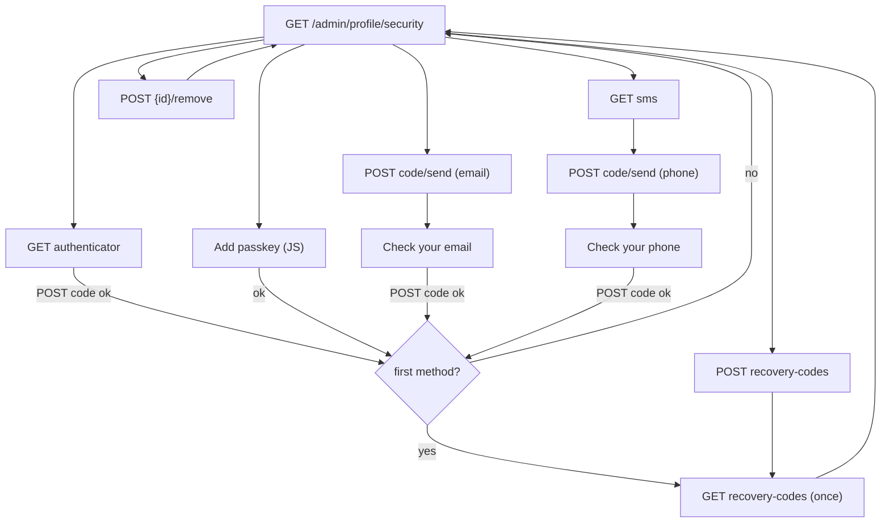

# Sign-in security

## Purpose

Where every admin user turns on two-step verification for their own account: sets up an authenticator app, passkeys
or security keys, email codes or SMS codes (as far as [Two-factor authentication](mfa.md) allows them), removes them,
and makes new recovery codes. While two-factor authentication is required, users without a method land here and can
use nothing else in the admin until they add one. Rules: [two-factor authentication (MFA)](../features/mfa.md).

## Route / Navigation

| Item | Value |
| --- | --- |
| Routes | `GET /admin/profile/security` · `GET/POST /admin/profile/security/authenticator` · `GET /admin/profile/security/sms` · `POST /admin/profile/security/code/send` · `POST /admin/profile/security/code` · `POST /admin/profile/security/passkey/options` · `POST /admin/profile/security/passkey` (JSON, `passkeys.js`) · `POST /admin/profile/security/recovery-codes` · `GET /admin/profile/security/recovery-codes` (shown once) · `POST /admin/profile/security/{id}/remove` |
| Title (h1) | "Sign-in security" (description "Two-step verification for your account: after your password, a second step only you can do."); sub-screens "Set up an authenticator app", "Add a phone for SMS codes", "Check your email" / "Check your phone", "Your recovery codes" |
| Navigation entry | no sidebar entry: the **Two-step verification** card on [Profile](profile.md) → **Sign-in security**; the redirect of every admin screen while two-factor authentication is required and the user has no method; the "Make new ones on Profile → Sign-in security" hints |
| Parent | [Profile](profile.md) |

## Relevant source files

```text
src/DotNetForge.Web/Areas/Admin/Controllers/SecurityController.cs   every route above; SecurityViewModel, CodeSetupViewModel, PasskeyInput
src/DotNetForge.Web/Areas/Admin/Views/Security/Index.cshtml         methods list, Add a method, Recovery codes
src/DotNetForge.Web/Areas/Admin/Views/Security/Authenticator.cshtml QR code, key as text, code field
src/DotNetForge.Web/Areas/Admin/Views/Security/Sms.cshtml           phone number form
src/DotNetForge.Web/Areas/Admin/Views/Security/Code.cshtml          enter the emailed / texted setup code
src/DotNetForge.Web/Areas/Admin/Views/Security/RecoveryCodes.cshtml the ten codes, once
src/DotNetForge.Web/Services/Mfa/MfaService.cs                      setup, check, remove, recovery codes, audit
src/DotNetForge.Web/wwwroot/js/admin/passkeys.js                    "Add passkey" (navigator.credentials.create)
src/DotNetForge.Web/wwwroot/css/admin/people.css                    .dnf-mfa__qr, .dnf-mfa__codes, .dnf-mfa__passkey-add; rows: .dnf-list + .dnf-list__icon
```

## Page layout

```text
Sign-in security (admin layout, medium width)
├── alert (warning, only while required and the user has no method) **Two-step verification is required**
├── card **Two-step verification** + badge **On** / **Off** ("When you sign in, you confirm with one of these." / "Off: your password alone signs you in.")
│   └── list (when On): icon · **<name>** · "<type> · added <date> · last used <date|never>[ · turned off by your administrator]" · [Remove]
├── card **Add a method** ("Add more than one, so you can still sign in when a phone or key is not at hand.")
│   ├── no method on: "Your administrator hasn't turned on any two-step method yet."
│   ├── **Authenticator app** · [Set up] / badge **Added**
│   ├── **Passkey or security key** · name field + [Add passkey] (JS only; without JS "Adding a passkey needs JavaScript.")
│   ├── **Email codes** "A code sent to <email> when you sign in. Only as safe as your mailbox." · [Turn on] / badge **Added**
│   └── **SMS codes** · [Add phone]
└── card **Recovery codes** (while the user has any method) + badge "N of 10 left" (warning at 3 or fewer) · [Make new codes]

Set up an authenticator app: card **1. Scan this QR code** (QR image, the key as text + [Copy]) · card **2. Enter the code from the app** (**6-digit code**) · Cancel · [Turn on]
Add a phone for SMS codes: **Mobile number*** (with the country code) · Cancel · [Send code]
Check your email / Check your phone: **Enter the code** ("It works for 10 minutes.") · **6-digit code** · Cancel · [Turn on]
Your recovery codes: alert **Save them now** · ordered list of 10 codes · [Copy] (JS) · [I saved them]
```

## Components

| Component | Inputs | Behaviour |
| --- | --- | --- |
| Methods list | `MfaService.MethodsAsync` (all of the user's methods, oldest first), `MfaSettings` in effect | one row per method; icon `smartphone` (app), `key` (passkey), `message` (SMS), `mail` (email); **Remove** with a confirm dialog |
| Add a method | `MfaSettingsService.GetAsync` (email/SMS only while their service is configured) | only the methods that are on; one authenticator app and one email method per account, any number of passkeys and phone numbers |
| QR code | `AuthenticatorSetup` (`Secret`, `QrCodeDataUri`, `Token`) | PNG data URI (allowed by the CSP's `img-src data:`); the signed token is a hidden field |
| Passkey row | `[data-passkey-register]`, antiforgery token | `passkeys.js` posts for options, runs `navigator.credentials.create`, posts the credential with the name, follows the returned `redirect` or shows the `error` in `[data-passkey-error]` |
| Recovery codes | `TempData["dnf.recovery-codes"]` | shown once; reloading the page goes back to Sign-in security |

## Functionality

### Set up an authenticator app

**Set up** → `GET …/authenticator` (`MfaService.BeginAuthenticator`: new secret, QR code, setup token valid 15
minutes) → scan → enter the code → `POST …/authenticator` → `CompleteAuthenticatorAsync` checks the code and stores
the method (secret protected) → audit `user.mfa.added`. Wrong code: "That code is not right. Check the time on your
phone and enter the current code." with the **same** secret; expired token: "The setup expired. Start again."

### Add a passkey

Name (optional, default "Passkey", max 100) → **Add passkey** → `POST …/passkey/options` (`{ options, token }`) → the
browser's passkey dialog → `POST …/passkey` (`{ token, name, credential }`) → `CompletePasskeyRegistrationAsync`
verifies it for `APP_URL` and stores it → `{ redirect }`. Errors come back as `{ error }`: "Passkeys are turned off.",
"The passkey request expired. Try again.", "The passkey couldn't be verified. Try again; the site must be opened at
<APP_URL origin>." A cancelled browser dialog shows the browser's message.

### Turn on email codes / add a phone

**Turn on** (email) or **Add phone** → **Send code** → `POST …/code/send` (`type`, `phone`) → `SendSetupCodeAsync`
sends a 6-digit code (email: template **Sign-in code**; SMS: Twilio) and renders **Check your email/phone** with the
signed token → `POST …/code` → `CompleteSetupCodeAsync` → method **Email codes** or the masked number. Messages:
"Enter the phone number with its country code, e.g. +41 79 123 45 67." (on the phone form), "The text message couldn't
be sent. Check the number, or try again later.", "The email couldn't be sent. Try again later." (toast), "That code is
not right.", "The code expired. Send a new one." Adding an email method or number that exists already succeeds
without a second row.

### First method → recovery codes

After the first method (when the account has no recovery codes yet) `GenerateRecoveryCodesAsync` makes ten codes
(audit `user.mfa.recovery.generated`), the toast says "… Save your recovery codes now." and **Your recovery codes**
shows them once. Later additions only toast ("Your authenticator app is set up.", "Your passkey is added.", "Email
codes are on.", "SMS codes are on.").

### Make new codes

Confirm dialog "Make new recovery codes? Your current ones stop working." → `POST …/recovery-codes` → the old codes are
deleted, ten new ones shown once. Only with at least one method.

### Remove a method

Confirm dialog ("Remove '<name>'? It is your only method: two-step verification turns off and your recovery codes stop
working." / "… You can still confirm with your other methods.") → `POST …/{id}/remove` → `MfaService.RemoveAsync`
(only the user's own methods; the last one also deletes the recovery codes; audit `user.mfa.removed`) → toast
"Removed." or "Removed. Two-step verification is off for your account."

## Data used by the page

The signed-in user (`Users`), their `UserMfaMethods` and unused `UserRecoveryCodes` count, the [Two-factor
authentication](mfa.md) settings in effect; `APP_URL`/`APP_NAME` for passkeys and the QR code.

## State

Database rows as above. Pending setups are **not** stored: the authenticator secret, a sent code's hash and the
passkey options travel in Data Protection tokens (15, 10 and 5 minutes) in hidden fields or the JSON. The recovery
codes pass once through `TempData`.

## Permissions

`AdminArea` only (every admin-capable role) - each user manages only their own account (`CurrentUserId`); removing a
method id that isn't the user's changes nothing (the error toast then still reads "Removed."). Every POST has `[ValidateAntiForgeryToken]` (the JSON posts send the token as
`X-CSRF-TOKEN`). `SecurityController` is the one admin controller the [requirement](../features/mfa.md#requirement)
doesn't redirect. Setup routes of a method that is turned off answer `404` (passkey routes: `{ error }`).

## Validation

Code fields: browser `pattern="[0-9 ]{6,7}"`, `inputmode="numeric"`, `autocomplete="one-time-code"`; server: 6 digits
after removing spaces. Phone: international format, 7-15 digits. Passkey name: max 100.

## Error handling

| Failure | Detection | User sees | Recovery |
| --- | --- | --- | --- |
| Wrong or expired code | `MfaService` | `<dnf-validation-summary />` on the same step | enter the current code / send a new one |
| Email/SMS send failed | `SendSetupCodeAsync` false | toast (email) or form error (SMS); details in the log | try again; check SMTP/Twilio |
| Passkey not verifiable (wrong address, forged response) | Fido2 exception | the message under the passkey row; warning in the log | open the site at `APP_URL` over https |
| Browser without WebAuthn | `passkeys.js` | "This browser can't use passkeys. Use another browser or another way." | another browser or method |

## Loading behaviour

Server-rendered; the passkey steps are two `fetch` calls with the browser's own dialog in between. No indicator.

## Empty states

"Off: your password alone signs you in." (no methods); "Your administrator hasn't turned on any two-step method yet."

## User interactions

Links, forms, confirm dialogs (`data-confirm`), **Copy** buttons (`data-copy-target`, JS only), the passkey button.

## Dependencies

```text
SecurityController
├── MfaService → DotNetForgeDbContext, MfaSettingsService, IDataProtectionProvider, AccountService (email), ISmsSender, AppEnvironment, IAuditService, IMemoryCache
├── MfaSettingsService
└── DotNetForgeDbContext (the user, "has codes?", "has methods?")
```

## Page flow



## Related pages

[Profile](profile.md), [Two-factor authentication](mfa.md), [Sign in → Two-factor step](login.md#two-factor-step),
[Users](users.md) (an administrator resets lost methods).

## Important implementation details

- The `On`/`Off` badge counts only methods of types that are on - the ones sign-in asks for; methods of a type the
  administrator turned off stay in the list (marked) with Remove, and the Recovery codes card shows while any method exists.
- Adding or removing a method clears the 30-second "has a method?" cache for the user, so the requirement redirect
  stops (or starts) at once on this instance.
- Recovery codes are made only when the account has none at all; once some exist (even all used), adding another
  method doesn't make new ones - use **Make new codes**.

## Known limitations

- No renaming of methods; remove and add again.
- Only one authenticator app per account through this screen.
- No re-authentication (password prompt) before removing a method or making new codes - an open session is enough.

## Planned (not implemented)

None specified ([MFA → Planned](../features/mfa.md#planned-not-implemented)).

## Extension points

New method types and their setup: `MfaService` and a route + view here ([MFA → Where to change
things](../features/mfa.md#where-to-change-things)).
