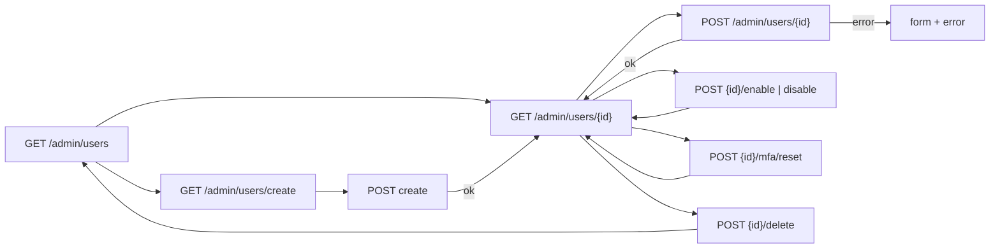

# Users

## Purpose

Lists the admin users and lets holders of the **Users** grants create, edit, enable/disable and
delete them and assign their roles. The edit screen shows each user's effective permissions - what their roles allow
together. After a fresh install the list contains only the Super Admin created by [Setup](setup.md).

## Route / Navigation

| Item | Value |
| --- | --- |
| Routes | `GET /admin/users` (list) · `GET /admin/users/create` · `POST /admin/users/create` · `GET /admin/users/{id}` (edit) · `POST /admin/users/{id}` (save) · `POST /admin/users/{id}/enable` · `POST /admin/users/{id}/disable` · `POST /admin/users/{id}/mfa/reset` · `POST /admin/users/{id}/delete` |
| Sidebar entry | **Settings → Administration Panel → Users** (`AdminNavigation.Tree`) |
| Breadcrumbs | Settings › Administration Panel › Users › *Create user* / *Edit user* |
| Parameters | none on the list (search, filters, sort and paging are client-side) |
| Linked from | the sidebar; the **Users** KPI card on the [Dashboard](dashboard.md); member links on the [Roles](roles.md) editor |

## Relevant source files

```text
src/DotNetForge.Web/Areas/Admin/Controllers/UsersController.cs   list, form, POST actions; UserListItem, UserFormModel, RoleOption
src/DotNetForge.Web/Services/UserManagementService.cs            rules, persistence, audit (UserInput, ManagementActor)
src/DotNetForge.Web/Areas/Admin/Views/Users/Index.cshtml         list with toolbar, Initials() helper
src/DotNetForge.Web/Areas/Admin/Views/Users/Edit.cshtml          create / edit form, account, effective permissions, status, delete
src/DotNetForge.Core/Validation/PasswordPolicy.cs, InputValidation.cs (EmailValidator)
src/DotNetForge.Shared/Entities/User.cs                          entity
```

## Page layout

```text
List - Users (h1) · [Create user]
└── section.card[data-collection][data-page-size=25]
    ├── card-header: **All users** · "N total"
    ├── .toolbar (JS only): search · All roles ▾ · Any status ▾
    ├── table: **User** ⇅ (avatar, name link, "You" badge, email) · **Roles** · **Status** ⇅ · **Last sign-in** ⇅ · row menu ⋯ (Edit/View, Enable/Disable, Delete)
    └── .pagination (JS, more than 10 matching rows: Rows per page 10/25/50/100, default 25, remembered)

Form - "Create user" / "Edit user" (h1, the email as description)
├── form.editor-main
│   ├── card **Details**: First name · Last name · Email* · Password* (create) / New password (edit, optional)
│   └── card **Roles***: one checkbox row per role (built-in badge, description) · [Manage roles]
│       · footer: Cancel · [Create user] / [Save changes] (the form has no status: see Disable access)
└── aside.editor-aside (edit only)
    ├── card **Account**: status badge · Created · Last sign-in
    ├── card **Effective permissions**: per catalog area - "Full access", action badges or "No access"
    ├── card **Two-step verification**: On/Off badge · one badge per method · [Reset two-step verification] (with `update`, not on your own account)
    ├── card **Disable access** / **Enable access** (not on your own account)
    └── card.card-danger **Delete user** (not on your own account)
```

## Components

| Element | Rendering |
| --- | --- |
| **User** | `.avatar` with up to two initials; name (first + last) as a link to the form with the email below, or only the email; **You** on your own row |
| **Roles** | one badge per role (`Accent` when the name contains "Admin"), "No role" when none |
| **Status** | `Enabled` → `Success`, `Disabled` → `Danger` dot badge |
| **Last sign-in** | `<timestamp>`, "Never" before the first sign-in |
| Row menu (⋯) | **Edit** (or **View** without `Users` / `update`); **Enable**/**Disable** (with `update`) and **Delete** (with `delete`, confirmation dialog) - not on your own row; these post `returnTo=list`, so the result toast shows on the list |
| Role checkbox | every role in the database, built-in first (`IsBuiltIn`), then by name - the seven built-in roles (`Admin`, `Author`, `Authenticated`, `Developer`, `Editor`, `Public`, `Super Admin`) and the custom ones; `Developer` (API docs, API tokens and API endpoints only) is assignable like any other role. `name="RoleIds" value="{roleId}"`; `Super Admin` is disabled with "Only a Super Admin can give this role." for non-Super Admins (a held one is posted as a hidden field) |
| Effective permissions | `PermissionCatalog.Areas` × the saved roles' grants from `IRoleGrantStore` (Super Admin: everything) |
| Two-step verification | the user's `UserMfaMethods` (`MfaService.MethodsAsync`, in `ViewData["MfaMethods"]`): **On** with one badge per method ("Authenticator app", "Passkey", "Email code", "SMS code") or **Off** with "The user hasn't set up a second step." ("Set it up on Profile → Sign-in security." on your own account) |

## Functionality

| Action | What happens |
| --- | --- |
| Create | `UserManagementService.CreateAsync`: validates, hashes the password (`IPasswordHasher`), creates the user **enabled** (the form has no status field) and email-confirmed, adds the role links → toast "Created … They can sign in now." and the edit form. |
| Save | `UpdateAsync`: details and role links (never the status - **Disable user** / **Enable user** change it); the password only when a new one is entered → toast "Saved. Role changes apply the next time the user signs in." |
| Enable / Disable | `SetStatusAsync` → toast; a disabled user can't sign in and an open session ends within 30 seconds. |
| Delete | `DeleteAsync` after a confirmation dialog: role links, then the user → list with a toast. Audit entries keep the user's name snapshot. |
| Reset two-step verification | for someone who lost their phone or key ([MFA → Lost access](../features/mfa.md#lost-access)): confirmation dialog "Remove every two-step method and recovery code of … ? Until they set up a new one, their password alone signs them in." → `UsersController.ResetMfa` → `MfaService.ResetAsync` deletes all their methods and recovery codes (audit `user.mfa.reset`, "N method(s) removed") → toast "Two-step verification is off for … They sign in with their password and can set it up again." ("… has no two-step methods." when there were none). On your own account: "Change your own methods on Profile → Sign-in security." |

Role changes reach a signed-in user at their next sign-in (roles are claims); [grant](roles.md) changes apply at once.

## Data used by the page

Single-table queries combined in memory: all `Users`, `UserRoles` of those
users, all `Roles`. Links to a role that no longer exists are dropped.

## State

Server: the `Users` / `UserRoles` rows. Client: the list's search, filters, sort and page (lost on reload); the rows per page in `localStorage`
(`dnf-page-size:/admin/users:0`).

## Permissions

| Route | Requires |
| --- | --- |
| list, form (`GET`) | `AdminArea` + `Users` / `read` |
| create (`GET`/`POST`) | + `Users` / `create` |
| save, enable, disable, reset two-step verification | + `Users` / `update` |
| delete | + `Users` / `delete` |

Defaults: Super Admin and Admin. Without `update` the form is read-only ("View only"). Rules that hold regardless of
grants ([authorization → safety rules](../features/authorization.md#safety-rules-for-users-and-roles)): only a Super
Admin assigns `Super Admin` or changes/disables/deletes a Super Admin; the last enabled Super Admin stays; nobody
disables or deletes their own account.

## Validation / error handling / loading

Errors are shown in `<form-errors />` with the input kept (the password is cleared); enable/disable/delete errors are
toasts.

| Rule | Message |
| --- | --- |
| Email valid, at most 256 characters | "Enter a valid email address (at most 256 characters)." |
| Email unique (case-insensitive) | "Another user already uses …" |
| Names at most 100 characters each | "First and last name are limited to 100 characters each." |
| Password (required on create) | `PasswordPolicy`: 8+ characters, a letter, a number, not a common password |
| At least one existing role | "Choose at least one role." / "One of the chosen roles no longer exists. Reload the page and try again." |
| `Super Admin` role by a non-Super Admin | "Only a Super Admin can give the Super Admin role." |
| Changing a Super Admin by a non-Super Admin | "Only a Super Admin can change or delete a Super Admin." |
| Last enabled Super Admin | "This is the last enabled Super Admin. Give another user the Super Admin role first." |
| Own account | "You can't disable your own account." / "You can't delete your own account." |

## Empty states

| Case | Text |
| --- | --- |
| No users at all | "No users yet." |
| Search/filters match nothing (JS) | "No user matches the search or filters." |
| User without roles (effective permissions) | "No roles, so no permissions." |

## User interactions

Search, filter, sort and page the list; open a user; edit and save; enable/disable; delete (confirmation dialog,
`data-confirm`).

## Dependencies

```text
UsersController
├── DotNetForgeDbContext (reads)
├── IRoleGrantStore        effective permissions
├── MfaService             the Two-step verification card, reset (user.mfa.reset)
└── UserManagementService
    ├── DotNetForgeDbContext
    ├── IPasswordHasher
    └── IAuditService      user.created / user.updated / user.deleted / role.changed
```

## Page flow



## Related pages

[Roles](roles.md), [Dashboard](dashboard.md), [Audit Logs](audit-logs.md), [Sign-in security](sign-in-security.md) (where users set up their own methods), [Two-factor authentication](mfa.md), `GET /api/users`
([headless API](../features/headless-api.md)).

## Important implementation details

- Audit: `user.created`, `user.updated` (details `Enabled`/`Disabled` for the status actions), `user.deleted`, and
  `role.changed` ("Role assignment changed") when a save changes the roles.
- Emails are stored trimmed as entered; sign-in compares them exactly (`AuthService`), uniqueness is checked
  case-insensitively.
- `LastLoginDate` is updated by `AuthService` on each successful sign-in; lockout state is not shown.
- The whole user list is rendered in one response; pagination only hides rows.

## Known limitations

- No invitations: share the initial password yourself. Users created here are email-confirmed; with SMTP configured
  they can reset a forgotten password themselves ([self-service accounts](account-self-service.md)).
- No optimistic concurrency: two people saving the same user at once - the last save wins.
- No server-side paging or search.

## Planned (not implemented)

Target behaviour from the original product specification. Nothing in this section exists in the code unless marked ✔.

### Requirements

- Invite users by email instead of setting their password (`IEmailSender` ✔ exists; needs an invitation flow and
  [email templates](../features/email.md)).
- Flag semantically conflicting role combinations (effective permissions are the union ✔ and are shown ✔).

### Edge cases

- **Concurrent edits** of the same user: optimistic concurrency with a conflict notice
  ([authorization](../features/authorization.md#edge-cases)).
- **Role change of a signed-in user** applies on the next request (today: next sign-in).

### Acceptance criteria

- [x] The Users screen lists users and supports create, edit, disable, delete, assign roles, view last login and view account status (`UsersController`, `UserManagementService`).
- [x] A user cannot disable or delete their own account.
- [x] Multi-role assignments resolve to the union of permissions and the screen shows the resulting effective permissions (conflicts are not flagged).

## Extension points

New user rules belong in `UserManagementService`. Actions in a view go in `@section Actions` (header) or a
`.col-actions` cell; destructive ones use `data-confirm` and report with `TempData["Success"]`/`["Error"]` toasts
([design system → feedback](../architecture/design-system.md#feedback)).
