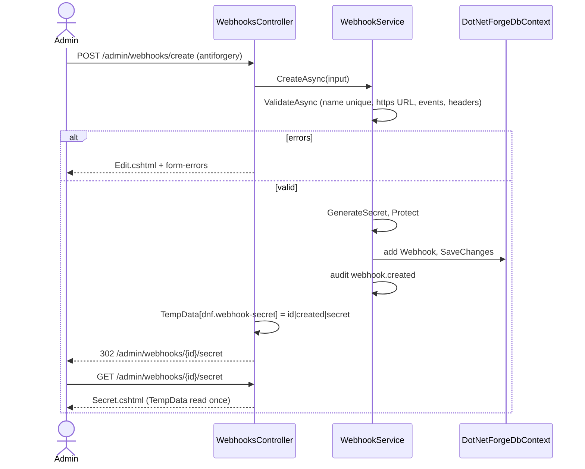
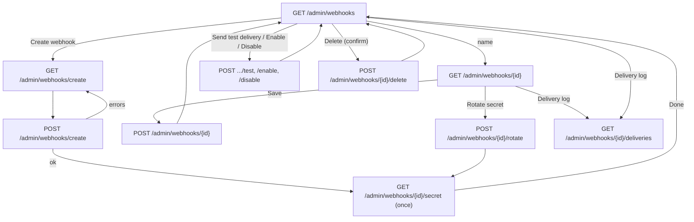

# Webhooks

## Purpose

Lets Super Admins and Admins (and any role granted the **Webhooks** permission area) send entry and media changes to
other systems: create a webhook (receiver URL, events, custom headers), copy its signing secret once, turn it on or
off, rotate the secret, send a test delivery and read every delivery attempt. Events, payload, signing, retries and
the loop guard are owned by [webhooks](../features/webhooks.md).

## Route / Navigation

| Screen | Route | View | Title (h1, last breadcrumb) |
| --- | --- | --- | --- |
| List | `GET /admin/webhooks` | `Webhooks/Index.cshtml` | "Webhooks" |
| Create form | `GET /admin/webhooks/create` | `Webhooks/Edit.cshtml` | "Create webhook" |
| Create submit | `POST /admin/webhooks/create` | `Edit.cshtml` (errors) or 302 → secret screen | - |
| Editor | `GET /admin/webhooks/{id:guid}` | `Webhooks/Edit.cshtml` | the webhook's name |
| Save | `POST /admin/webhooks/{id:guid}` | `Edit.cshtml` (errors) or 302 → list | - |
| Enable / Disable | `POST /admin/webhooks/{id:guid}/enable`, `/disable` (form field `returnTo`) | 302 → list, editor (`returnTo=edit`) or delivery log (`returnTo=deliveries`) | - |
| Send test delivery | `POST /admin/webhooks/{id:guid}/test` (form field `returnTo`) | 302 as above | - |
| Rotate secret | `POST /admin/webhooks/{id:guid}/rotate` | 302 → secret screen | - |
| Secret (once) | `GET /admin/webhooks/{id:guid}/secret` | `Webhooks/Secret.cshtml`; without the one-time value 302 → editor | "Webhook created" / "New signing secret" |
| Delete | `POST /admin/webhooks/{id:guid}/delete` | 302 → list | - |
| Delivery log | `GET /admin/webhooks/{id:guid}/deliveries?page=` (50 per page) | `Webhooks/Deliveries.cshtml` | "Delivery log" |

| Item | Value |
| --- | --- |
| Sidebar entry | **Settings → API & Webhooks → Webhooks** (icon `webhook`, the last link of the group; `AdminNavigation.Tree`), shown only to users with Webhooks `read`; stays active on the child routes (longest matching href) |
| Breadcrumbs | Settings › API & Webhooks › **Webhooks**; child screens append their title (› *Create webhook*, › *name*, › *Delivery log*, › *Webhook created*) |
| Child flow | list → **Create webhook** → form → secret screen → **Done** → list; list → name → editor → **Delivery log** |
| Linked from | the sidebar; the [Dashboard](dashboard.md) counts webhooks under "At a glance" (no link) |

## Relevant source files

```text
src/DotNetForge.Web/Areas/Admin/Controllers/WebhooksController.cs   all routes; WebhookRow and the view models (nested records)
src/DotNetForge.Web/Areas/Admin/Views/Webhooks/Index.cshtml         list card, action menus, empty state
src/DotNetForge.Web/Areas/Admin/Views/Webhooks/Edit.cshtml          Receiver / Events / Headers cards; Webhook, Signing secret, Delete webhook side cards
src/DotNetForge.Web/Areas/Admin/Views/Webhooks/Secret.cshtml        the one-time secret, copy button, how to check a signature
src/DotNetForge.Web/Areas/Admin/Views/Webhooks/Deliveries.cshtml    attempts as <details>, paging
src/DotNetForge.Web/wwwroot/js/forge/webhooks.js                     header rows: add, remove, renumber
src/DotNetForge.Web/wwwroot/css/forge/admin.css                      .webhook-url, .webhook-header-row, .delivery-* (end of the file)
src/DotNetForge.Web/Services/Webhooks/WebhookService.cs             validation, create/update/enable/disable/delete, rotate, test, audit
src/DotNetForge.Web/Services/Webhooks/WebhookSender.cs              the test delivery's request
src/DotNetForge.Web/Services/Webhooks/WebhookDispatcher.cs          MaxAttempts (shown on the form); the real deliveries
src/DotNetForge.Shared/Entities/Webhook.cs                          Webhook, WebhookDelivery
tests/DotNetForge.IntegrationTests/WebhookTests.cs                  validation, one-time secret, test delivery, events, retries, disable, permissions
```

## Page layout

```text
Webhooks (h1) - "Notify other systems - a search index, a cache, a build - with a signed POST when entries or media change."   [+ Create webhook] (create)
└── section.card **Webhooks** - "N total · M enabled"
    ├── <empty-state> when there are none (see Empty states)
    └── table.table.table-stack: **Name** · **Events** · **Status** · **Last delivery** · actions
        └── row: name (link to the editor) / URL (truncated) · one badge per event key · Enabled | Disabled ·
                 status-code badge (or "failed") + <timestamp> + "N failed attempt(s) in 24 h" - or "Never" ·
                 action menu: Edit (View without update) · Delivery log · Send test delivery · Disable|Enable (update) ·
                 ── · Delete (delete, confirm)

Create webhook / <name> (h1, medium width)   header: [Delivery log] [Send test delivery] (editor only; test with update)
├── .editor-main: form (POST /admin/webhooks/create or /admin/webhooks/{id}, antiforgery)
│   ├── <form-errors />
│   └── fieldset (disabled without update)
│       ├── card **Receiver**: Name* (placeholder "Search index") · URL* (type url, placeholder "https://example.com/hooks/cms",
│       │   hint "An https address. Each event is a POST with a JSON body, signed in the X-DotNetForge-Signature header.") ·
│       │   switch **Enabled** - "Off: it doesn't fire, and pending retries are cancelled. The settings are kept."
│       ├── card **Events*** - "At least one. Each change sends one POST; a failed one is retried 4 times with growing pauses."
│       │   └── 8 checkboxes: Entry created · Entry updated · Entry published · Entry unpublished · Entry deleted ·
│       │       Media uploaded · Media updated · Media deleted (each with its <code>key</code> and a hint)
│       └── card **Headers** - "Sent with every request, e.g. an Authorization token the receiver expects. The value may be empty."
│           ├── rows: Name ("Name, e.g. Authorization") · Value · [×] (JS only)
│           ├── [+ Add header] (JS only, disabled at 20 rows)
│           └── card-footer (update): [Cancel] [Create webhook | Save]
└── .editor-aside (editor only)
    ├── card **Webhook**: Created <timestamp> · Last delivery <timestamp> ("Never")
    ├── card **Signing secret** (update): "Shown once, after it was made. …" · [Rotate secret] (confirm)
    └── card.card-danger **Delete webhook** (delete): "Removes the webhook and its delivery log." · [Delete webhook] (confirm)

Webhook created | New signing secret (h1, medium width) - "'<name>' signs every delivery with this secret."
├── <alert tone="Warning" title="Copy the secret now"> (after a rotation also "The old secret stopped working: …")
└── card.card-accent **Signing secret**
    ├── pre.code-block: the 64-character secret + [Copy] (JS only)
    ├── **Check a delivery on the receiver**: how the signature and X-DotNetForge-Delivery work + a Node.js example
    └── card-footer: [Edit webhook] [Done] → list

Delivery log (h1) - "Every attempt of '<name>' in the last 30 days, newest first."   [Edit webhook] [Send test delivery] (update)
└── section.card **Attempts** - "N total · to <url>" · Enabled|Disabled badge
    ├── <empty-state> when there are none
    ├── ul.list: one <details> per attempt
    │   ├── summary: status badge (code, "OK", "Failed" or "Waiting") · event key · "attempt n" · "<ms> ms" · absolute <timestamp>
    │   └── body: detail (red for a failure) · Event id · Target · **Request body** (indented JSON) · **Response (start)**
    └── card-footer (more than one page): "Page x of y" · [Newer] [Older]
```

## Components

| Component | Inputs | Behaviour |
| --- | --- | --- |
| Webhook table | `WebhooksViewModel.Rows` (`WebhookRow(Webhook, Last, Failures24h)`), ordered by name | **Last delivery** = the newest finished (not `Pending`) attempt of any age: `Success` badge with its status code, else a `Danger` badge with the code or "failed"; **N failed attempt(s) in 24 h** counts `Failure` rows of the last day (test deliveries, cancelled and skipped attempts included) |
| Action menu | `CanUpdate`, `CanDelete` | `<action-menu>` with `<menu-link>` and `<menu-post>` items (each post is a form with the antiforgery token); Delete carries the confirm dialog |
| Editor form | `WebhookEditViewModel(Id, Input, Created, LastDelivery, CanSave, CanDelete)` | binds `WebhookInput` (`Name`, `Url`, `Enabled`, `Events[]`, `Headers[i].Key/Value`); `Enabled` is a checkbox followed by a hidden `false` (the first posted value wins). Shows the saved headers plus one empty row, at most 20 |
| Header rows | `webhooks.js` + `<template id="webhook-header-template">` | **Add header** appends a row, × removes one (the last row is only emptied), then the inputs are renumbered `Headers[0..n]` so they bind in order. Without JS the empty row is the way to add one header per save |
| Signing secret card | editor, `update` | **Rotate secret** posts with `data-confirm` ("Make a new secret? Deliveries are signed with it from now on; the receiver must use it to check them.") |
| Secret screen | `SecretViewModel(Id, Name, Secret, Created)` from TempData | **Copy** copies the hidden `#secret-text` (`data-copy-target`, `ui.js`) |
| Delivery list | `DeliveriesViewModel(Webhook, Deliveries, Total, CanUpdate)`, `ViewData["Page"]`/`["Pages"]` | 50 rows per page, ordered by `RequestTimestamp` then `AttemptNumber`, newest first - a scheduled retry ("Waiting") has a future time and so comes first. Bodies are pretty-printed for reading; what was sent and signed is the compact original |

## Functionality

### Create a webhook

1. **Trigger:** **Create webhook** in the header → form → **Create webhook**.
2. **Validation:** `WebhookService.ValidateAsync` - name, URL, events and header rules, all errors at once
   ([feature → a webhook](../features/webhooks.md#a-webhook)).
3. **Service:** `WebhookService.CreateAsync`: `IWebhookSigner.GenerateSecret()`, secret stored protected, row saved,
   audit `webhook.created` (details `<url>; events: <keys>`).
4. **UI:** the secret goes into `TempData["dnf.webhook-secret"]` (`<id>|created|<secret>`) and the browser is redirected
   to `/admin/webhooks/{id}/secret`, which shows it once; reloading that page redirects to the editor.
5. **Errors:** the form is shown again with `<form-errors />` and the posted values.



### Edit a webhook

**Save** → `WebhookService.UpdateAsync` (same validation; a duplicate name ignores the webhook itself) → audit
`webhook.updated`, plus `webhook.enabled` / `webhook.disabled` when the switch changed (turning it off cancels its
pending attempts) → toast "Saved '<name>'." → list. The secret is not touched. A changed URL or header set applies to
every later attempt, retries of earlier events included. A missing webhook → `404`.

### Enable / Disable

Action menu **Enable** / **Disable** → `WebhookService.SetEnabledAsync` → when the state changes: save, cancel the
pending attempts on disable ("Cancelled: the webhook was disabled."), audit `webhook.enabled` / `webhook.disabled`
→ toast "Enabled: it fires again for its events." / "Disabled: it no longer fires, and pending retries are
cancelled." → back to `returnTo`. An unknown id → `404`.

### Send a test delivery

**Send test delivery** (action menu, editor header, delivery log header) → `WebhookService.SendTestAsync` sends a
signed `webhook.test` event **in the request** (up to 10 s), logs it, sets `LastDelivery`, audits `webhook.tested` →
toast "Test delivered: <status> in <ms> ms." or "Test failed: <detail>" → back to `returnTo`. Works for a disabled
webhook too; never retried ([feature → test delivery](../features/webhooks.md#test-delivery)).

### Rotate the secret

**Rotate secret** → confirm → `WebhookService.RotateSecretAsync` (new secret, stored protected, audit
`webhook.secret.rotated`) → secret screen "New signing secret". The old secret stops working at once.

### Delete

**Delete** (action menu: "Delete '<name>' and its delivery log? Its receiver gets nothing more."; editor: "Delete
'<name>' and its delivery log?") → `WebhookService.DeleteAsync` (the delivery log goes with it, pending attempts
included; audit `webhook.deleted`) → toast "Deleted '<name>' and its delivery log." or, when it no longer exists,
the error toast "The webhook no longer exists." → list.

### Read the delivery log

**Delivery log** → `GET /admin/webhooks/{id}/deliveries` → open an attempt to see its detail, event id, target, the
exact request body and the start of the response. **Newer** / **Older** page through 50 at a time.

## Data used by the page

`Webhooks` and `WebhookDeliveries` (`DotNetForgeDbContext`, read directly by the controller with `AsNoTracking`; all
writes go through `WebhookService`); `WebhookEvents` (the eight checkboxes), `WebhookService.MaxNameLength` /
`MaxUrlLength` / `MaxHeaders`, `WebhookDispatcher.MaxAttempts`; the user's permissions (`Can`).

## State

| State | Where | Changes |
| --- | --- | --- |
| The one-time secret | `TempData["dnf.webhook-secret"]` (ASP.NET Core's cookie TempData, protected with Data Protection) | set by create/rotate, removed when the secret screen reads it |
| Toasts | `TempData["Success"]` / `["Error"]` | after save, enable/disable, test, delete |
| Form values, errors | `ModelState`, the posted `WebhookInput` | on a failed save |
| Header rows | DOM (`webhooks.js`) | until saved |
| Webhooks, attempts | database | every action; attempts also by the background delivery |
| Log page | `?page=` | **Newer** / **Older** |

## Permissions

`AdminArea` (on `AdminControllerBase`) + `[RequirePermission(Webhooks, read)]` on the controller; create needs
`Webhooks` / `create`; save, enable/disable, rotate and test `update`; delete `delete`
([feature → permissions](../features/webhooks.md#permissions)). Buttons a user can't use are not shown; a user with
`read` only sees the editor read-only (disabled fieldset, no rotate). The default grants give the area to Super Admin
and Admin; Developers, Editors and Authors get [Access denied](access-denied.md) and don't see the sidebar link
(`WebhookTests` checks Editors).

## Validation

| Rule | Browser | Server |
| --- | --- | --- |
| Name required, ≤ 200 | `required`, `maxlength` | ✔, unique case-insensitively |
| URL required, absolute, `https://` (http only for localhost in Development), ≤ 2000 | `type="url"`, `required`, `maxlength` | ✔ |
| At least one event | - | ✔ |
| Header name required when a value is set; letters, digits, `-`; not reserved; once each | `maxlength="100"` | ✔ |
| Header value: may be empty, no line breaks | `maxlength="1000"` | line breaks only |
| At most 20 header rows | **Add header** disabled at 20 | ✔ |

Messages: [feature → a webhook](../features/webhooks.md#a-webhook).

## Error handling

| Failure | Detection | User sees | Recovery |
| --- | --- | --- | --- |
| Validation error | `WebhookService.ValidateAsync` | `<form-errors />`, form with the posted values | fix and save again |
| Unknown or deleted webhook | lookup | `404` (editor, save, enable/disable, test, rotate, log); delete: error toast | back to the list |
| Secret screen reloaded or opened directly | no matching TempData value | redirect to the editor | rotate the secret for a new one |
| Test delivery fails | `WebhookSender` | error toast "Test failed: <detail>"; the attempt in the log | fix the receiver, test again |
| Receiver down for real events | background retries | failed attempts in the log, "N failed attempts in 24 h" on the list | fix the receiver; later events are sent normally |
| Header values together longer than the column | none (see Known limitations) | the [error page](error.md) | shorter header values |

## Loading behaviour

Server-rendered; no indicators. **Send test delivery** waits for the receiver (at most 10 s) before the page reloads.

## Empty states

| Case | Text |
| --- | --- |
| No webhooks | `<empty-state icon="webhook">` "No webhooks yet" - "Create one to send entry and media changes to another system as they happen." (no button of its own - **Create webhook** is in the header, with `create`) |
| No attempts | `<empty-state icon="send">` "Nothing sent yet" - "Attempts appear here when a subscribed event happens, or after a test delivery." |
| Never delivered | "Never" (list, editor) |

## User interactions

**Create webhook**, the action menu (Edit/View, Delivery log, Send test delivery, Enable/Disable, Delete with
confirm), the editor form (switch, event checkboxes, **Add header**, ×, **Save**, **Cancel**), **Rotate secret**
(confirm), **Delete webhook** (confirm), **Copy** on the secret screen, expanding an attempt, **Newer** / **Older**.

## Dependencies

```text
WebhooksController
├── WebhookService → DotNetForgeDbContext, IWebhookSigner (HmacWebhookSigner), IDataProtectionProvider,
│                    IAuditService, WebhookSender (→ IHttpClientFactory "webhooks", IWebhookSigner), IHostEnvironment
└── DotNetForgeDbContext (reads)
Views → <action-menu>, <menu-link>, <menu-post>, <badge>, <timestamp>, <empty-state>, <alert>, <form-errors>, <icon>;
        ui.js (data-confirm, data-copy-target, data-js-only), webhooks.js
```

## Page flow



## Related pages

[Audit Logs](audit-logs.md) (`webhook.*` entries), [Content Manager](content-manager.md) and [Media](media.md) (the
changes that fire events), [Roles](roles.md) (the Webhooks permission area), [Dashboard](dashboard.md) (webhook
count), [API Tokens](api-tokens.md) / [API Endpoints](api-endpoints.md) / [API Docs](api-docs.md) (the same sidebar
group).

## Important implementation details

- The secret reaches the browser only through the one redirect: `TempData` is kept in a cookie protected with Data
  Protection and removed once the secret screen reads it.
- Real deliveries happen in the background (`WebhookDispatcher`); the screen only sends test deliveries itself.
- **Last delivery** on the list is computed from the log (the newest finished attempt); on the editor it is the
  stored `Webhook.LastDelivery` (the latest attempt sent, failed ones included). They can differ: cancelled and
  skipped attempts count as finished on the list (a cancelled attempt gets the time it was cancelled).
- Saving does not cancel pending attempts of events the webhook no longer subscribes to; only disabling does.
- The delivery log keeps 30 days; deleting a webhook deletes its log.

## Known limitations

- Header values are stored and shown in clear (also to users with `read` only); there is no masking.
- No search, filter or paging on the list; the delivery log can't be filtered by event or outcome, and there is no
  **Redeliver** for a failed attempt.
- No API for webhooks ([Planned](../features/webhooks.md#planned-not-implemented)).
- **Copy** needs the Clipboard API (HTTPS or `localhost`).

## Extension points

- Rules, messages and the secret: `WebhookService`; a new event: `WebhookEvents` + `WebhookPayload.EventFor` + the
  `events` array in `Edit.cshtml`.
- Delivery behaviour: `WebhookDispatcher` / `WebhookSender` ([feature → where to change things](../features/webhooks.md#where-to-change-things)).
- A new action: a route on `WebhooksController` with `[ValidateAntiForgeryToken]`, the right `[RequirePermission]` and
  a `webhook.*` audit action written by `WebhookService` ([admin-page skill](../../.claude/skills/admin-page/SKILL.md)).
